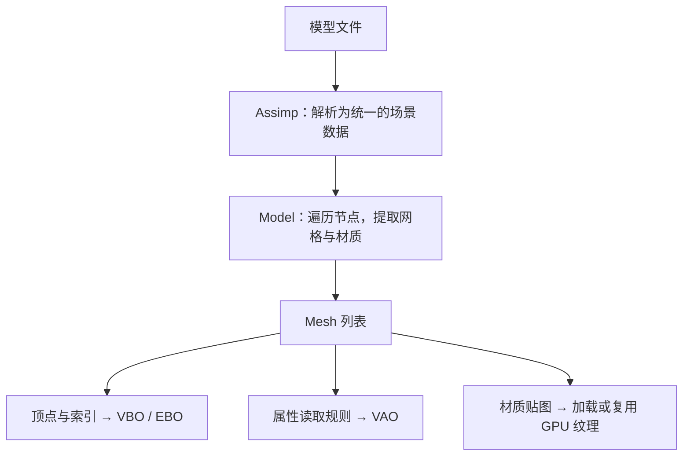

# Model 与 Mesh 类知识点详解

## 1 两个类为什么分开

> [!info] 核心概念
> **Model 负责把模型文件整理成可绘制的 Mesh；Mesh 负责保存一份网格的几何和贴图信息，并提交绘制。**
> Shader 提供计算规则，Model 和 Mesh 为它准备输入数据。

一辆汽车可以拆成车身、车窗、轮胎等网格。这样每部分能有自己的几何和材质，也能复用相同贴图。实际如何拆分，取决于模型文件和导入结果。

| 部分 | 主要保存什么 | 主要工作 |
|---|---|---|
| `Model` | Mesh 列表、已加载纹理的缓存 | 导入模型，整理网格，绘制时遍历 Mesh |
| `Mesh` | 顶点、索引、纹理引用，以及 VAO/VBO/EBO | 上传几何数据，绑定资源，提交一次网格绘制 |
| `Shader` | 着色器 program 的编号 | 选用程序，设置参数；GLSL 决定怎样计算画面 |

这里没有“Model 内置一个固定 Shader”的关系。绘制时由调用者传入 Shader，因此同一模型可以用于不同渲染效果，只要数据接口兼容。

---

## 2 初始化：模型文件怎样变成 GPU 可用的资源



*图 1 · 初始化准备好资源，后续 Draw 复用它们，不再每帧读取模型和图片。*

这条链里各个函数的作用是：

| 函数 | 在流程中的位置 |
|---|---|
| `loadModel()` | 调用 Assimp 读文件，得到节点、网格和材质数据 |
| `processNode()` | 沿节点树找到它们引用的网格 |
| `processMesh()` | 转成自己的顶点、索引、纹理记录，并创建 Mesh |
| `loadMaterialTextures()` | 查找材质贴图，已加载过的路径尽量复用 |
| `Mesh::setupMesh()` | 上传几何数据，配置 GPU 如何读取顶点 |

Assimp 解决“不同模型格式怎样解析”；Model 解决“从导入结果中提取渲染需要的数据”；Mesh 解决“这些数据怎样交给 OpenGL 绘制”。

> [!note] 这里有两次数据转换
> **文件 → CPU 数据 → GPU 资源。**
> Assimp 的临时导入结果用完后可以释放，因为需要的数据已复制到自己的容器并上传。当前 Mesh 也保留了 CPU 数组，但修改数组不会自动更新 GPU 缓冲。

由于构造 Model 时就会创建 GPU 资源，所以要先完成 OpenGL 上下文和 GLAD 初始化。

---

## 3 一个 Mesh 中的东西怎样配合

| 数据或对象 | 回答的问题 |
|---|---|
| 顶点 `Vertex` | 每个点在哪里，有什么法线、UV 等属性？ |
| 索引 `indices` | 哪些顶点连接成三角形？ |
| 纹理记录 `textures` | 这个网格绘制时使用哪些贴图？ |
| VBO / EBO | GPU 从哪里读取顶点和索引？ |
| VAO | 按什么布局读取顶点属性，关联哪个索引缓冲？ |

可以把 **VBO 看成数据表，EBO 看成选取记录的顺序，VAO 看成读取说明**。VAO 不包含 Shader，也不会自动恢复贴图绑定。

例如一个四边形可以用四条顶点记录和两组三角形索引表示。索引选中的是完整顶点记录：位置、法线、UV 一起被读取，然后送入顶点着色器。

纹理是另一条输入路径：图片上传后成为独立的 OpenGL 纹理对象，Mesh 保存它的编号和用途。多个 Mesh 可以引用同一个纹理对象，避免重复上传。

> [!tip] 共享贴图不等于合并网格
> Model 的纹理缓存减少重复加载；每个 Mesh 仍然保留自己的几何和绘制调用。这个缓存属于当前 Model，不是整个程序共用的全局缓存。

---

## 4 绘制时，这几个类怎样接起来

调用者先决定程序和变换，再让 Model 绘制。以下是省略初始化的调用示意：

```cpp
shader.use();
shader.setMat4("model", transform);
shader.setMat4("view", view);
shader.setMat4("projection", projection);
model.Draw(shader);
```

`model.Draw(shader)` 内部的工作可以展开为：

```text
Model::Draw(shader)
  → 遍历 Mesh 列表
      → Mesh::Draw(shader)
          1. 把该网格的贴图绑定到纹理单元
          2. 设置 Shader 的 sampler，让它指向对应单元
          3. 绑定 VAO，选中该网格的几何和读取规则
          4. glDrawElements，按索引提交三角形
```

贴图与 Shader 之间靠这个关系连接：

```text
GLSL 中的 texture_diffuse1
  → sampler 指定的纹理单元
  → 该单元上绑定的纹理对象
```

因此需要同时有“Shader 中声明并使用 sampler”和“Mesh 绑定正确纹理”这两部分。名字必须对应；加载了一张图片，并不代表 GLSL 已经用到了它。

> [!important] Draw 提交的是一套已经组装好的状态
> program 和矩阵由调用者选好；每个 Mesh 补上自己的纹理、VAO，再提交绘制。GPU 随后按照 [[学习笔记/cg/LearnOpengl/基础类/Shader 类知识点详解.md|Shader 类知识点详解]] 中的数据流处理这些输入。
> 当前 Model/Mesh 的 Draw 不会自动激活 Shader。Model 有 N 个 Mesh，就会提交 N 次网格绘制。

---

## 5 这套组合方式意味着什么

| 场景 | 应怎样理解 |
|---|---|
| 把同一个背包画在两个位置 | 复用 Model 和 GPU 资源，分别设置不同 `model` 矩阵，再 Draw 两次 |
| 给背包换一种着色效果 | 选择另一个接口兼容的 Shader，再用同一组 Mesh 绘制 |
| 加载了法线贴图却没有凹凸效果 | 数据已经准备好，但还需要 GLSL 使用它完成法线映射 |

这里的 C++ `Model` 对象与 GLSL 的 `model` 矩阵要分开：前者保存模型资源，后者决定这次绘制如何放置模型。当前类不保存自己的位置、旋转和缩放。

> [!note] 当前 Model 是教学用的模型加载封装
> 它遍历 Assimp 的节点树，最终保存扁平的 Mesh 列表，但没有应用节点自身的变换。因此它还不是完整的场景对象系统，不能假定会自动处理部件层级、动画或所有材质效果。

> [!summary] 记住这条主线
> **Model 从文件中组织资源 → Mesh 把几何和贴图接到 OpenGL → 调用者选择 Shader 并设置参数 → 每个 Mesh 提交绘制 → GPU 计算画面。**

---

对应源码：model.h、mesh.h。整体调用示例：model_loading.cpp。

#learnopengl #opengl #graphics #model-loading #mesh #assimp
