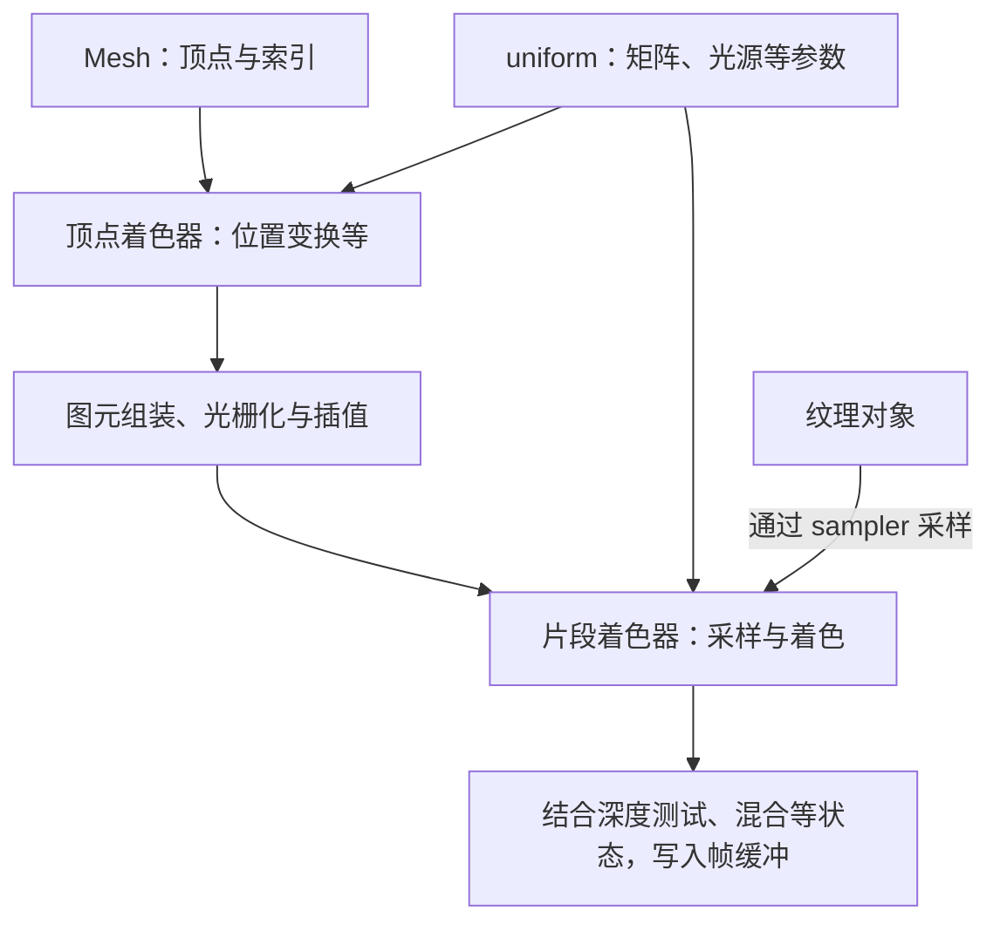

# Shader 类知识点详解

## 1 Shader 在整个架构里的位置

> [!info] 核心概念
> **Mesh 提供几何数据，Shader 提供计算规则，调用者把它们和纹理、参数组合成一次绘制。**
> C++ 的 `Shader` 类运行在 CPU 端，负责准备和选用程序；GLSL 中的顶点、片段着色器才是 GPU 执行的计算。

| 部分 | 负责什么 |
|---|---|
| C++ `Shader` 类 | 把 GLSL 文件变成可用的 program，提供 `use()` 和参数设置接口 |
| GLSL 顶点着色器 | 处理顶点，例如把模型位置变换到裁剪空间，输出 UV、法线等数据 |
| GLSL 片段着色器 | 根据输入数据、纹理和光照规则，计算片段输出 |
| 调用者（demo 的主循环） | 决定画什么、用哪个 program、传什么参数，以及何时绘制 |

这里的 **program** 是多个着色阶段链接后的程序。C++ 对象中的 `ID` 只是它的 OpenGL 编号；它不包含模型顶点，也不包办全部渲染状态。

---

## 2 分开看：初始化时准备什么，绘制时做什么

初始化时：

```text
.vs / .fs 文件
  → Shader 类读取源码
  → 驱动分别编译，再链接成 program
  → 保存 program 的 ID，供后续反复使用
```

绘制时，只需要理解三个动作：

| 动作 | 实际含义 |
|---|---|
| `shader.use()` | 选择接下来要使用的 program |
| `shader.setXxx(...)` | 更新这个 program 的参数，例如矩阵、光源位置 |
| `Draw(...)` | 结合当前程序、几何、纹理等状态提交绘制 |

> [!important] 准备程序、选择程序、执行绘制是三个阶段
> 构造 Shader 通常只做一次；`use()` 不会重新编译，也不会立即画出东西。实际绘制由后面的 Draw 调用提交。

uniform 参数属于各自的 program，设置后会保留。因此相机变化时更新相机矩阵，画另一个物体时更新物体矩阵，不需要每帧重建 Shader。

---

## 3 GPU 到底拿到了哪些数据

基础图形管线可以这样看：



*图 1 · 这是绘制时的数据流。顶点、片段阶段由 GLSL 描述，光栅化等工作由 OpenGL 管线完成。*

需要区分三类输入：

| 输入 | 例子 | 怎样接入 |
|---|---|---|
| 顶点属性 | 每个顶点的位置、法线、UV | 从 Mesh 的顶点缓冲读取；VAO 规定读取方式 |
| uniform | `model`、`view`、`projection`、光源位置 | C++ 通过 `setXxx()` 设置，供一次绘制中的着色器调用读取 |
| 纹理 | 颜色贴图、法线贴图 | 先绑定纹理，GLSL 再通过 sampler 和 UV 等坐标采样 |

顶点阶段的输出可以传给片段阶段。例如顶点带有 UV，经过光栅化插值后，每个片段得到自己的 UV，再去贴图中找颜色。

**参数决定这次怎么算，顶点决定处理哪些几何，纹理提供可采样的数据。**

---

## 4 这些部分怎样组装成一次绘制

以下只展示接口关系，省略窗口、相机和资源路径准备；初始化前需已有有效的 OpenGL 上下文和 GLAD。

```cpp
// 初始化：分别准备“计算规则”和“模型数据”
Shader shader("1.model_loading.vs", "1.model_loading.fs");
Model backpack(modelPath);

// 绘制：选择程序 → 设置参数 → 让模型提交网格
shader.use();
shader.setMat4("model", transform);       // 物体放在哪里
shader.setMat4("view", view);             // 从哪里观察
shader.setMat4("projection", projection); // 怎样投影
backpack.Draw(shader);                    // 内部绑定纹理、VAO，并提交绘制
```

关键在于 **OpenGL 的“当前状态”**：`use()` 选中程序，参数设置和资源绑定补齐这次绘制所需的状态，Draw 再按这些状态提交工作。

`Model::Draw(shader)` 接收 Shader，但当前实现不会替你调用 `use()`。这些对象通过调用顺序协作，不会仅因为互相传了引用，就自动完成所有配置。

它们之间还有两项需要对齐的约定：

- **几何接口**：Mesh 提供的顶点属性位置、类型，要与顶点着色器的输入对应。
- **材质接口**：Mesh 设置的 sampler 名称，要与 GLSL 声明对应，例如 `texture_diffuse1`。

---

## 5 用这套关系理解后面的效果

| 改变什么 | 结果 |
|---|---|
| 同一个 Mesh，换一个兼容的 Shader | 几何不变，可以改成光照、深度输出等不同计算 |
| 同一个 program，换 uniform | 算法不变，改变物体位置、光源或其他参数 |
| 同一个 program，换纹理 | 计算规则不变，改变被采样的数据 |

> [!note] 数据准备好，不代表效果自动出现
> 上传矩阵后，要由 GLSL 使用它变换顶点；加载法线贴图后，也要由 GLSL 采样并参与法线计算。
> 本地第三章的片段着色器只采样 diffuse 贴图，因此它展示的是模型贴图，没有自动实现完整光照。

> [!summary] 记住这条主线
> **初始化：GLSL → program。绘制：选择 program + 设置参数 + 绑定几何与纹理 → Draw → GPU 执行 → 帧缓冲。**

---

对应源码：shader_s.h、shader_m.h。模型怎样准备数据，接着看 [[学习笔记/cg/LearnOpengl/基础类/Model 与 Mesh 类知识点详解.md|Model 与 Mesh 类知识点详解]]。

#learnopengl #opengl #graphics #shader #glsl
