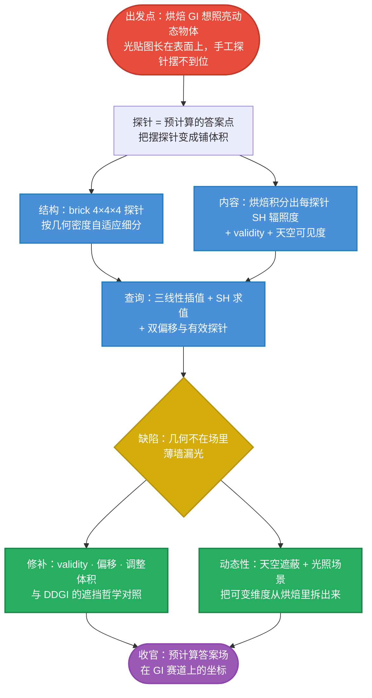

# APV 原理主线：把"摆探针"变成"铺体积"

> 本篇在思维链上的位置：**总入口**。本专题讲 Unity 6 的 Adaptive Probe Volumes（APV）——烘焙 GI 的探针路线在 2020 年代的工业完成形态。它全部的智慧可以压缩成两个动作：**把手工摆放的稀疏探针，升级成按几何密度自适应铺满的探针场；把"静态"的烘焙答案里可变的维度（天空、灯的开关），拆出来现场重算**。

## APV 一句话

> **光探针 = 空间中一个"采样好的间接光答案点"。APV 让引擎按几何密度自动铺出整个场景的三维探针场：离线把每颗探针的 SH 辐照度烘好，运行时三线性插值 + SH 求值照亮一切（包括动态物体），再用"天空遮蔽 + 光照场景"两个拆分补上动态性。**

$$
\boxed{
\text{APV}
=
\underbrace{\text{自适应探针场（brick）}}_{\text{结构}}
+
\underbrace{\text{SH 辐照度}}_{\text{内容}}
+
\underbrace{\text{插值 + 求值}}_{\text{查询}}
+
\underbrace{\text{天空遮蔽 / 光照场景}}_{\text{动态性}}
}
$$

## 身份定位：继承谁、替代谁

| APV 的三顶帽子 | 说明 |
|---|---|
| **Light Probe 的继任者** | 不再手工摆点（Light Probe Group），体积一拉、自动生成、自适应密度 |
| **Lightmap 的（间接光）替代者** | 只烘间接漫反射；直接光与阴影仍走实时；内存更省、动态物体也能受光 |
| **大世界的流式方案** | 数据按 cell 从磁盘流向 GPU，按视锥按需加载；配合 trimming 控内存 |

产品假设一句话：**静态几何 + 动态天光/灯光状态的开放世界**（URP/HDRP 皆可，SM4.5 起，手机可跑）。

## 全专题思维链路

## 各篇在主线中的位置

| 篇 | 解决的问题 |
|---|---|
| [[学习笔记/cg/games202/专题/apv/02-从光探针到APV.md|02 从光探针到 APV：一段"采样点的进化史"]] | 为什么必须有探针；手工时代（LPG/LPPV）卡在哪；APV 的三连升级 |
| [[学习笔记/cg/games202/专题/apv/03-砖块与自适应细分.md|03 砖块与自适应细分：结构层的智慧]] | brick/cell 结构：自适应密度、流式与内存控制 |
| [[学习笔记/cg/games202/专题/apv/04-烘焙-探针里存什么.md|04 烘焙：探针里存什么]] | 每颗探针存什么：SH 辐照度、validity、虚拟偏移、天空可见度 |
| [[学习笔记/cg/games202/专题/apv/05-运行时查询-插值与SH求值.md|05 运行时查询：插值与 SH 求值]] | 双插值查询：空间三线性 × 方向 SH；逐像素/逐顶点两档 |
| [[学习笔记/cg/games202/专题/apv/06-漏光与修补.md|06 漏光与修补：几何不进场的代价]] | 探针方法的原理性缺陷与 APV 的全套修补工具 |
| [[学习笔记/cg/games202/专题/apv/07-天空遮蔽与光照场景.md|07 天空遮蔽与光照场景：把可变的拆出来]] | "烘焙≠静态"：两个可变维度被拆出来现场重算 |
| [[学习笔记/cg/games202/专题/apv/08-实现管线与GI赛道对照.md|08 实现管线与 GI 赛道对照]] | 全流程账本；与 Lightmap/LPV/VXGI/DDGI/Lumen/TuanjieGI 终局对照 |

## 与已有专题的三条快线

- **LPV 是理解 APV 的最短路径**：两者都是"3D 格子 + SH 场 + 插值查询"（[[学习笔记/cg/games202/专题/lpv/01-LPV原理主线.md|LPV 原理主线：让光在格子里流动起来]]、[[学习笔记/cg/games202/专题/lpv/05-渲染查询-从场中读光.md|05 渲染查询：着色点从场里读出自己的入射光]]），差别只在**场从哪来**——LPV 每帧"推"出来（动态、无遮挡、漏光），APV 离线"烘"出来（静态、正确、需工具修漏光）。一路对照着读，两边都通透；
- **天空遮蔽是 PRT 思想的探针版**：预计算传输 × 运行时光照 = 点乘（[[学习笔记/cg/games202/专题/prt/05-漫反射PRT-从积分到点乘.md|05 漫反射 PRT：把整个渲染方程压成一次点乘]]）——[[学习笔记/cg/games202/专题/apv/07-天空遮蔽与光照场景.md|07 天空遮蔽与光照场景：把可变的拆出来]] 的核心公式会再次看到它；
- **与 TuanjieGI 是两种产品哲学**：[[学习笔记/cg/tuanjie引擎/GI原理/00-全景/01-TuanjieGI是什么.md|TuanjieGI 是什么]] 走"每帧实算"路线（屏幕层 + 世界层），APV 走"预计算 + 拆可变维"路线——[[学习笔记/cg/games202/专题/apv/08-实现管线与GI赛道对照.md|08 实现管线与 GI 赛道对照]] 会把两条路线摆上同一张审判台。

## 记忆压缩

> **探针是采样好的答案点，APV 把"摆探针"变成"铺体积"**：brick 自适应结构装 SH 辐照度，插值求值便宜到能进移动端；几何不进场所以便宜也所以漏光，工具箱全在修"谁参与插值"；真正的大招是拆分——天空和灯的状态不烘死，拆出来现场重积分。下一站从探针的前世讲起：[[学习笔记/cg/games202/专题/apv/02-从光探针到APV.md|02 从光探针到 APV：一段"采样点的进化史"]]。
