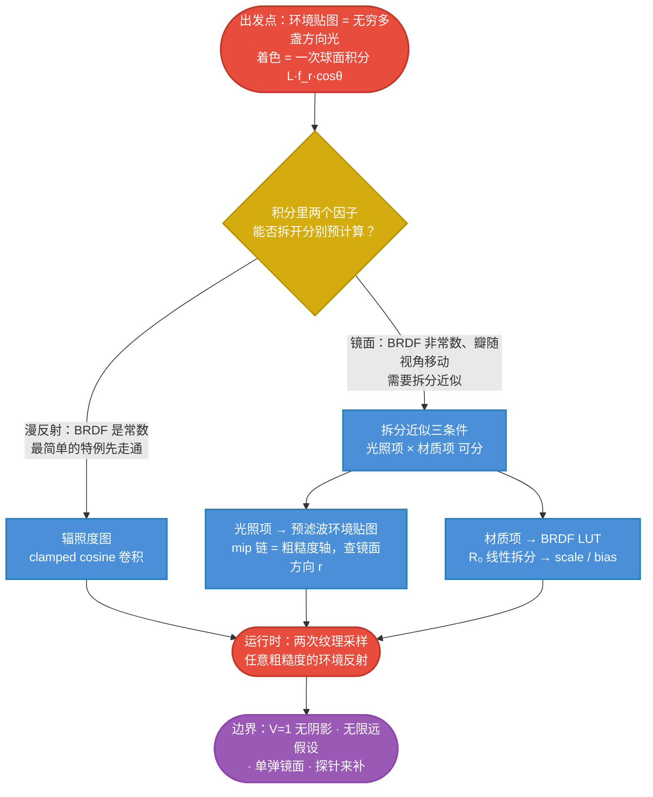

# IBL 原理主线：从环境贴图光源到两次纹理查询

## IBL 一句话

> 用一张图（HDR 环境）当光源，着色就是一个球面积分（光照 × BRDF × cosθ）。IBL 的做法是：利用"光照全场景共享、材质只由少数参数决定"的结构，把积分**拆成两个可以分别预计算的因子**——[预滤波环境贴图] × [BRDF 查找表]，运行时只剩**两次纹理采样**。

$$
\boxed{
L_o
\approx
\underbrace{\text{PrefilteredEnv}(r,\ \text{roughness})}_{\text{光照项：按粗糙度模糊的环境图}}
\times
\underbrace{\text{BRDFLUT}(\cos\theta_v,\ \text{roughness})}_{\text{材质项：}R_0\cdot\text{scale}+\text{bias}}
}
$$

PRT 专题回答的是"如何把**阴影**塞进预计算"；IBL 专题回答的是"如何把**任意粗糙度的镜面反射**塞进预计算"。两者处理的是**同一个渲染方程**，只是拆分的位置不同——这个对偶性在 [[学习笔记/cg/games202/专题/ibl/08-局限与PRT对照.md|08 IBL 的局限、探针修补与 PRT 对照]] 收尾。

## 全专题的思维链路

## 各篇在主线中的位置

| 篇 | 解决的问题 | 在主线中的角色 |
|---|---|---|
| [[学习笔记/cg/games202/专题/ibl/02-环境贴图作为光源.md|02 环境贴图作为光源：两个根基假设]] | 环境贴图到底是什么、为什么全场景共享 | 确立"图 = 球面函数 + 无限远"两个根基 |
| [[学习笔记/cg/games202/专题/ibl/03-漫反射-辐照度图.md|03 漫反射 IBL：辐照度图]] | 最简单的情形：BRDF 为常数时光照如何预计算 | 建立卷积/预滤波直觉，打通 PRT 特例 |
| [[学习笔记/cg/games202/专题/ibl/04-拆分近似与三个条件.md|04 拆分近似与三个条件：整个 IBL 的理论地基]] | 一般 BRDF 下积分什么时候可以拆成两半 | **全专题的理论地基**，误差来源首次显形 |
| [[学习笔记/cg/games202/专题/ibl/05-预滤波环境贴图.md|05 预滤波环境贴图：把"光照均值"烧进 mip 链]] | 光照项怎么预计算、怎么查 | mip 链 = 粗糙度轴；镜面方向查一次 |
| [[学习笔记/cg/games202/专题/ibl/06-BRDF查找表.md|06 BRDF 查找表：把材质积分压成一张 2D 纹理]] | 材质项怎么压成一张 2D 纹理 | $R_0$ 线性拆分是点睛之笔 |
| [[学习笔记/cg/games202/专题/ibl/07-实现管线.md|07 实现管线：预滤波、LUT 与运行时]] | 预滤波和 LUT 怎么生成、运行时怎么写 | 两阶段落地 + 代码示意 |
| [[学习笔记/cg/games202/专题/ibl/08-局限与PRT对照.md|08 IBL 的局限、探针修补与 PRT 对照]] | IBL 丢掉了什么、与 PRT 如何对偶 | 边界、补丁、探针与现代演进 |

## 与 PRT 专题的关系（先看一眼，08 收尾）

PRT 与 IBL 面对的是同一个积分 $\int L(\omega_i)\,f_r\,\cos\theta_i\,d\omega_i$，但做了**相反的取舍**：

| | PRT | IBL（split-sum） |
|---|---|---|
| 预计算**光照** | 压成低频 SH（9 个数） | 按粗糙度分级保留**全频率**（mip 链） |
| 预计算**材质+遮挡** | 精确积分 $V\cdot\cos\cdot f_r$（含阴影） | 压成一张小 LUT，**假设 V=1** |
| 代价 | 小光源高光丢失、镜面糊 | **没有阴影、会漏光** |
| 换来 | 漫反射 GI + 阴影 | 任意粗糙度的实时反射、场景可以动 |

> 一句话：**PRT 用光照的频率换传输的精确；IBL 用传输的精确换光照的频率。**现代引擎两个都用：split-sum 管镜面反射，SH 探针管漫反射 GI。

## 与已有笔记的连接

- [[学习笔记/cg/games202/lecture5 Real-time Environment Mapping 1.md|lecture5 Real-time Environment Mapping 1]] 是本专题的**结论速记**（prefiltering + LUT 两步、三条件 a/b/c 的对应），本专题把每一步的"为什么"展开。
- PRT 专题的数学工具全部复用：球面函数视角（[[学习笔记/cg/games202/专题/prt/02-环境光阴影的困境.md|02 环境光阴影的困境：实时渲染为什么算不动]]）、基函数与投影（[[学习笔记/cg/games202/专题/prt/03-函数即向量-基函数与投影.md|03 函数即向量：基函数、投影与正交]]）、SH 频率与旋转（[[学习笔记/cg/games202/专题/prt/04-球谐函数.md|04 球谐函数：球面上的正交基]]）、clamped cosine 系数表（Â_l，本专题 [[学习笔记/cg/games202/专题/ibl/03-漫反射-辐照度图.md|03 漫反射 IBL：辐照度图]] 再次登场）。
- 预滤波的采样实现（GGX 重要性采样、D 被 pdf 吸收）是 [[学习笔记/cg/rt in one weekend/rest_life/09-直接采样光源.md|第 9 章：直接采样光源]] 与 [[学习笔记/cg/rt in one weekend/rest_life/03-一维蒙特卡洛积分与重要性采样.md|第 3 章：一维蒙特卡洛积分与重要性采样]] 的直接应用。

## 记忆压缩

> 天空是一张图，图是球面函数；漫反射把图用 clamped cosine 卷成一张小图（辐照度图），镜面把图按粗糙度模糊成一串 mip；材质自己积分成一张 2D 小表（$R_0$ 线性拆成 scale+bias）。着色 = 查模糊的图 × 查材质的表。没有阴影——那是 PRT 拿频率换走的东西。

# 思维导图

上方的 mermaid 流程图即本专题的完整思维链路。细节从 [[学习笔记/cg/games202/专题/ibl/02-环境贴图作为光源.md|02 环境贴图作为光源：两个根基假设]] 开始。
