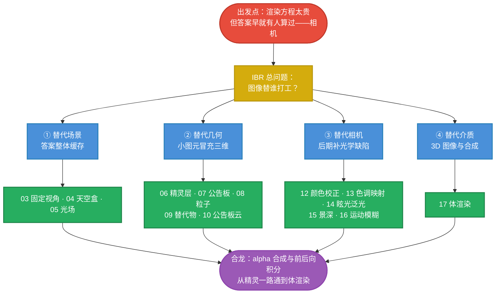

# IBR 起步总述：图像替谁打工

> 本篇在思维链上的位置：**总入口**。本专题讲"基于图像的渲染"（Image-Based Rendering）的 16 项技术——从固定视角全景到体渲染。它们看起来五花八门（有的是几何技巧、有的是后期滤镜），但共享同一个底层直觉：**渲染方程的答案，相机早就替你算过一次**。本篇把这个直觉立起来，给 16 项技术一张统一的地图。

## IBR 一句话

> **几何渲染从"模型"出发逐步模拟光；IBR 从"答案"出发——先把光用相机采样成图像存下来，再在图像世界里查询、插值、加工。** 图像不是几何管线的输出品，而是一等公民的渲染原料。

$$
\boxed{
\text{IBR}
=
\underbrace{\text{提前采样光}}_{\text{相机 / 烘焙 / 离线渲染}}
+
\underbrace{\text{运行时重采样}}_{\text{投影 · 插值 · 合成 · 滤波}}
}
$$

## 图像到底是什么：全光函数的切片

Adelson 与 Bergen 把"能看到的一切"总结为**全光函数**（plenoptic function）：空间中任意一点、朝任意方向、任一波长、任一时刻接收到的光：

$$
\boxed{
P = P(x,\,y,\,z,\;\theta,\,\phi,\;\lambda,\;t)
}
$$

七个自由度。一张普通照片做了什么？——**把 $(x,y,z,t)$ 冻结**，只保留 $(\theta,\phi)$（再对 $\lambda$ 积分成 RGB）：

| 冻结了谁 | 剩下的自由度 | 得到什么 |
|---|---|---|
| $x,y,z,t$ | $(\theta,\phi)$ | 一张全景图 / 照片 |
| $x,y,z$（保留 $t$） | $(\theta,\phi,t)$ | 一段视频 |
| $t$、物体几何 | 逐点 $(\theta,\phi)$ | 一组环境探针 |
| 什么都不冻结 | 7D | 现实本身 |

于是"渲染"有了第二种读法：**渲染 = 为当前相机的那族光线，去全光函数里查值**。几何渲染是"现场算"，IBR 是"提前采样 + 查表"。16 项技术的全部差别，只在**冻结了哪些维度、用什么插值补回来**。

## 统一视角：图像替谁打工

把 16 项分成四组，每组回答同一个问题——**图像替代了渲染的哪个环节**：

| 组 | 图像替代什么 | 成员 | 核心代价 |
|---|---|---|---|
| **① 替代场景** | 整个场景的"答案" | 02 渲染谱 · 03 固定视角 · 04 天空盒 · 05 光场 | 自由度被冻结 |
| **② 替代几何** | 物体的表面与外观 | 06 精灵与层 · 07 公告板 · 08 粒子 · 09 替代物 · 10 公告板云 | 视角范围受限、穿帮 |
| **③ 替代相机** | 光学系统的"缺陷" | 11 图像处理 · 12 颜色校正 · 13 色调映射 · 14 眩光与泛光 · 15 景深 · 16 运动模糊 | 模拟对象是假想相机 |
| **④ 替代介质** | 3D 的"体"本身 | 17 体渲染 | 采样与合成最重 |

三句话预览：

- **①② 是"用图像省几何"**：场景或表面不再用三角形描述，用预计算的图像描述——便宜，但观众一旦越出设计好的视角区间就穿帮；
- **③ 是"用图像补光学"**：几何管线是一台完美的针孔相机（零快门、无限动态范围、理想镜片），反而**假得不像"拍出来的"**——后期处理把真实相机与人眼的缺陷一项项补回去。电影感 = 缺陷感；
- **④ 是"图像升维"**：2D 图像的思想推广到 3D 体纹理，光可以在"体"里发射、吸收、散射。

## 全专题思维链路

（谱系的坐标系由 [[学习笔记/cg/games202/专题/ibr/02-渲染谱.md|02 渲染谱：从几何到图像的连续谱]] 单独铺开，它是理解四组关系的骨架。）

## 16 篇地图

| 篇 | 一句话 |
|---|---|
| [[学习笔记/cg/games202/专题/ibr/02-渲染谱.md|02 渲染谱：从几何到图像的连续谱]] | 从纯几何到纯图像的连续谱：每个技术 = 谱上一点，预计算与运行时计算在兑换 |
| [[学习笔记/cg/games202/专题/ibr/03-固定视角渲染.md|03 固定视角渲染：把答案整张存下来]] | 纯旋转下全景图是**精确解**而非近似——最彻底的答案缓存 |
| [[学习笔记/cg/games202/专题/ibr/04-天空盒.md|04 天空盒：环境在无穷远的极限形态]] | 冻结相机位置、只留方向：环境的"无穷远极限形态" |
| [[学习笔记/cg/games202/专题/ibr/05-光场渲染.md|05 光场渲染：把视差买回来]] | 自由空间里 5D 降 4D，双平面参数化——任意视角 = 一次四线性插值 |
| [[学习笔记/cg/games202/专题/ibr/06-精灵与层.md|06 精灵与层：图像当表面的开端]] | 图像当表面：层合成与 alpha over——全专题的第一块基石 |
| [[学习笔记/cg/games202/专题/ibr/07-公告板.md|07 公告板：一张图冒充一个三维对象]] | 平面图冒充三维对象：消除视差，换来朝向自由 |
| [[学习笔记/cg/games202/专题/ibr/08-粒子系统.md|08 粒子系统：公告板 × 数量 × 时间]] | 公告板 × 数量 × 时间：用随机性弥散没有表面的东西 |
| [[学习笔记/cg/games202/专题/ibr/09-替代物.md|09 替代物（Impostor）：缓存一次渲染，顶替整个物体]] | 从"手绘贴图冒充"升级为"真实渲染结果的缓存" |
| [[学习笔记/cg/games202/专题/ibr/10-公告板云.md|10 公告板云：用一簇图重构几何]] | 反向流动：一簇静态小公告板**重构**物体表面 |
| [[学习笔记/cg/games202/专题/ibr/11-图像处理.md|11 图像处理：后期滤镜的数学地基]] | 后半场的数学地基：卷积、PSF、采样与重建 |
| [[学习笔记/cg/games202/专题/ibr/12-颜色校正.md|12 颜色校正：响应曲线的艺术版]] | 相机响应曲线的"艺术版"：几条曲线 + 一张 LUT |
| [[学习笔记/cg/games202/专题/ibr/13-色调映射.md|13 色调映射：把 HDR 世界装进 LDR 显示]] | 动态范围压缩：HDR 场景进 LDR 显示的 S 曲线 |
| [[学习笔记/cg/games202/专题/ibr/14-镜头眩光与泛光.md|14 镜头眩光与泛光：把光学的渗漏补回来]] | 光学缺陷一：镜片散射 PSF 与内反射鬼影 |
| [[学习笔记/cg/games202/专题/ibr/15-景深.md|15 景深：孔径有限，焦外成圆]] | 光学缺陷二：孔径有限 → 空间变化的模糊核 |
| [[学习笔记/cg/games202/专题/ibr/16-运动模糊.md|16 运动模糊：快门不为零，像素在积分]] | 光学缺陷三：快门非零 → 时间维的积分 |
| [[学习笔记/cg/games202/专题/ibr/17-体渲染.md|17 体渲染：图像升到三维的毕业篇]] | 毕业：图像升到 3D，alpha 合成从精灵一路通到体积分 |

## 三条阅读路线

- **按序读**（推荐）：思维链从"理论光谱"到"几何冒充"到"相机模拟"再到"体积毕业"；
- **工程急救**：做远景森林/人群 → 直奔 07 / 09 / 10；做过场氛围 → 12 / 13 / 14；
- **理论派**：只读 02 / 03 / 04 / 05 / 17，理解"渲染 = 重采样全光函数"的大图。

## 与已有专题的接口

- [[学习笔记/cg/games202/专题/ibr/04-天空盒.md|04 天空盒：环境在无穷远的极限形态]] 与 IBL 是同一张环境图的两个用途：**背景**与**光源**（[[学习笔记/cg/games202/专题/ibl/02-环境贴图作为光源.md|02 环境贴图作为光源：两个根基假设]]、[[学习笔记/cg/games202/专题/ibl/03-漫反射-辐照度图.md|03 漫反射 IBL：辐照度图]]）——RTR 的 Image-Space 一章与 GAMES202 的 IBL 在此接驳；
- [[学习笔记/cg/games202/专题/ibr/17-体渲染.md|17 体渲染：图像升到三维的毕业篇]] 的前后向 alpha 合成与 VXGI 锥形追踪是同一个原语（[[学习笔记/cg/games202/专题/vxgi/04-锥形追踪-核心查询原语.md|04 锥形追踪：一次查询同时拿到平均光与沿途遮挡]]）——"体"是 GI 与 IBR 的公共下游；
- [[学习笔记/cg/games202/专题/ibr/08-粒子系统.md|08 粒子系统：公告板 × 数量 × 时间]] 的 billboard 装配在引擎侧的完整实现见 [[学习笔记/cg/tuanjie引擎/总览/第12章-GPU优化与高级专题/03-粒子与VFXGraph渲染.md|03 - 粒子系统与 VFX Graph 渲染]]——本专题讲原理，那篇讲工程。

## 记忆压缩

> **图像是全光函数的采样切片；IBR 就是"提前采样 + 运行时重采样"。** 16 项技术只有一个问题：图像替谁打工——替代场景（02–05）、替代几何（06–10）、替代相机（11–16）、替代介质（17）。针孔相机太完美所以假，真实的光学缺陷反而要花力气买回来。

下一站先立坐标系：[[学习笔记/cg/games202/专题/ibr/02-渲染谱.md|02 渲染谱：从几何到图像的连续谱]]。
