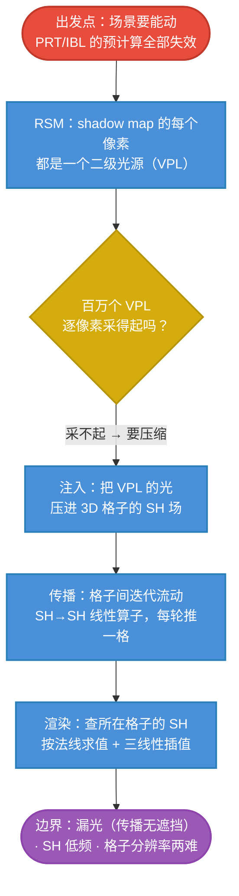

# LPV 原理主线：让光在格子里流动起来

## LPV 一句话

> PRT 和 IBL 都是**预计算**：场景一动就全废。LPV 转入**动态 GI 赛道**：先从光源视角把"被照亮的表面"收集成一堆二级小光源（RSM），再把它们的光**注入一张 3D 格子场**，让光以 SH 波的形式**逐格迭代传播**，着色时直接查场。

$$
\boxed{
\text{LPV}
=
\underbrace{\text{RSM：二级光源}}_{\text{从光视角收集}}
\to
\underbrace{\text{注入 SH 场}}_{\text{空间压缩}}
\to
\underbrace{\text{格子间传播}}_{\text{每轮推一格}}
\to
\underbrace{\text{查场着色}}_{\text{三线性 + SH}}
}
$$

四个步骤全部在**每帧**完成——这就是"动态"二字的含义与代价。

## 全专题的思维链路

## 各篇在主线中的位置

| 篇 | 解决的问题 | 在主线中的角色 |
|---|---|---|
| [[学习笔记/cg/games202/专题/lpv/02-RSM-反射阴影贴图.md|02 RSM 反射阴影贴图：把"被照亮的表面"收集起来]] | 直接光照之后，"被照亮的表面"怎么收集 | 提供 LPV 的燃料：VPL |
| [[学习笔记/cg/games202/专题/lpv/03-注入-从VPL到格子场.md|03 注入：把 VPL 倒进格子场]] | 百万 VPL 如何压成"小而可传播"的表示 | 把光变成场上的初始条件 |
| [[学习笔记/cg/games202/专题/lpv/04-传播-光在格子间流动.md|04 传播：光在格子间一格一格流动]] | 光如何离开发光点充满场景 | **全专题的核心机制** |
| [[学习笔记/cg/games202/专题/lpv/05-渲染查询-从场中读光.md|05 渲染查询：着色点从场里读出自己的入射光]] | 着色点如何从场里读出自己的入射光 | 三次复用 PRT 的 SH 机器 |
| [[学习笔记/cg/games202/专题/vxgi/06-实现管线.md|06 VXGI 实现管线：三大 pass 与真实的账单]] | 每帧的 pass 结构与存储账 | GPU 落地 |
| [[学习笔记/cg/games202/专题/lpv/07-问题与修补.md|07 LPV 的问题与修补：每个瑕疵都能指回推导现场]] | 漏光、低频、闪烁从哪来 | 逐条对应到推导的位置 |
| [[学习笔记/cg/games202/专题/lpv/08-动态GI赛道与对照.md|08 动态 GI 赛道与对照：LPV 的位置和它的思想后裔]] | LPV 在动态 GI 方法梯度上的位置 | 与 RSM/VXGI/RTRT 排队 |

## 与前两个专题的关系：换赛道

| | PRT | IBL | LPV |
|---|---|---|---|
| 贵的东西什么时候算 | 离线一次 | 离线一次（滤波+LUT） | **每帧全算** |
| 场景能动吗 | 不能 | 能（因为假设 V=1） | **能（这是存在的理由）** |
| 有阴影/GI 吗 | 有（精确） | 无 | 有（粗糙的、会漏光的） |
| 核心表示 | 每点 SH 传输系数 | 2D mip 链 + LUT | **3D SH 场** |

> 换赛道的代价结构也变了：PRT 的全部困难在"预计算一次性付清"；LPV 的全部困难在"**每帧预算内完成四步**"——所以每一步都必须极其便宜，于是每一步都引入粗糙近似（这正是 [[学习笔记/cg/games202/专题/lpv/07-问题与修补.md|07 LPV 的问题与修补：每个瑕疵都能指回推导现场]] 的清单来源）。

## 前两个专题的哪些知识会复用

- **SH 基机器**：[[学习笔记/cg/games202/专题/prt/03-函数即向量-基函数与投影.md|03 函数即向量：基函数、投影与正交]]、[[学习笔记/cg/games202/专题/prt/04-球谐函数.md|04 球谐函数：球面上的正交基]]（格子里的方向分布就是 SH；低频截断的老问题又来了）；
- **Â_l 表**：clamped cosine 的 SH 系数（[[学习笔记/cg/games202/专题/prt/04-球谐函数.md|04 球谐函数：球面上的正交基]]），在 [[学习笔记/cg/games202/专题/lpv/05-渲染查询-从场中读光.md|05 渲染查询：着色点从场里读出自己的入射光]] 里第三次出场（第一次 PRT 无遮挡传输，第二次 IBL 辐照度图）；
- **重要性采样 / f·p 语言**：RSM 的采样聚集（[[学习笔记/cg/rt in one weekend/rest_life/09-直接采样光源.md|第 9 章：直接采样光源]] 的面积→立体角换元思想隐含在 VPL 聚集里）；
- **"场"的直觉**：IBL 08 篇的探针（[[学习笔记/cg/games202/专题/ibl/08-局限与PRT对照.md|08 IBL 的局限、探针修补与 PRT 对照]]）——LPV 正是"探针网格 + 自动传播"的祖先形态。

## 记忆压缩

> 每帧：从光眼里拍一张 RSM，把每个像素当二级小灯；小灯太多，就把它们的光**倒进一张 3D 格子图**里（每格用几个 SH 数存方向）；然后光**一格一格往外推**，推几轮就亮几圈；着色时，**看自己泡在哪些格子里**，插值读出 SH，对着法线一算就是入射光。便宜、动态、粗糙——光会穿墙。

下一站从燃料开始：[[学习笔记/cg/games202/专题/lpv/02-RSM-反射阴影贴图.md|02 RSM 反射阴影贴图：把"被照亮的表面"收集起来]]。
