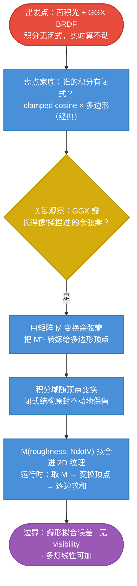

# LTC 原理主线：变形 BRDF，换一个闭式积分

## LTC 一句话

> 面积光（多边形/球形灯）× GGX 微表面 BRDF 的着色积分没有闭式解，实时算不动。LTC 的做法：**用一个线性变换 M 去"揉捏"标准余弦瓣**，使它长成 GGX 瓣的样子——变换是双向的：把 GGX 瓣的问题变换成余弦瓣的问题，而**余弦瓣 × 多边形有经典闭式积分**。BRDF 被变形之后，整个积分变得又快又准。

$$
\boxed{
\text{LTC}
=
\underbrace{\text{GGX 瓣}}_{\text{要积分的对象}}
\approx
\underbrace{\text{M}^{-1}\text{ 变换后的 clamped cosine}}_{\text{可变形的替身}}
\;\Longrightarrow\;
\text{多边形也被 }\text{M}^{-1}\text{ 一起变换，闭式照抄}
}
$$

## 全专题的思维链路

## 各篇在主线中的位置

| 篇 | 解决的问题 |
|---|---|
| [[学习笔记/cg/games202/专题/ltc/02-面积光的难题.md|02 面积光的难题：积分域从"方向"变成"一片方向"]] | 积分到底难在哪；此前的凑合方案各损失了什么 |
| [[学习笔记/cg/games202/专题/ltc/03-闭式积分的钥匙-clamped-cosine.md|03 闭式积分的钥匙：clamped cosine × 多边形]] | 余弦瓣 × 多边形的经典闭式：唯一可用的钥匙 |
| [[学习笔记/cg/games202/专题/ltc/04-线性变换的魔法.md|04 线性变换的魔法：M 揉捏瓣，M⁻¹ 转嫁灯]] | M 如何变形余弦瓣、M⁻¹ 如何转嫁给多边形（核心推导） |
| [[学习笔记/cg/games202/专题/ltc/05-拟合M与运行时求值.md|05 拟合 M 与运行时求值：一张小纹理买下整个面积光]] | 拟合成 2D 纹理 + 完整运行时流程 |
| [[学习笔记/cg/games202/专题/ltc/06-边界与三部曲收官.md|06 LTC 的边界与"谁被变形"三部曲收官]] | 近似误差清单；IBL/PRT/LTC"谁被变形"的终局 |

## 与 IBL / PRT 的关系：三部曲的第三部

实时渲染里"解析光 × 微表面"的组合拳，到此讲过三种，**它们的差别只有一个：变形谁**：

| | IBL（split-sum） | PRT | LTC |
|---|---|---|---|
| 处理什么光 | 环境光（任意复杂贴图） | 环境光（低频） | **解析面积光**（多边形/球） |
| 变形谁 | **变形光照**：按粗糙度预滤波成 mip | **压缩双方**：光照与传输都投 SH | **变形 BRDF**：M 揉捏余弦瓣 |
| 换来什么闭式 | 查表（预滤波 + LUT） | 点乘 | 逐边求和的多边形积分 |
| 慢变因子压进 | mip 链 + 2D LUT | 每点 SH 系数 | **M 的 2D 纹理**（同款 (roughness, NdotV) 轴！） |

$$
\boxed{
\text{谁被变形，谁就换来闭式}：\ \text{IBL 变形光} \quad \text{PRT 压缩光与传输} \quad \text{LTC 变形 BRDF}
}
$$

注意 LUT 轴的呼应：IBL 的 BRDF LUT 与 LTC 的 M 纹理**用完全相同的两个自变量**（粗糙度、视角仰角）索引——因为它们压缩的是同一个东西：**GGX 响应随材质参数的变化**（[[学习笔记/cg/games202/专题/ibl/06-BRDF查找表.md|06 BRDF 查找表：把材质积分压成一张 2D 纹理]] 的伏笔在此兑现）。

## 记忆压缩

> GGX 的瓣不好积分，但**余弦的瓣天生会积分**（对多边形有经典闭式）。LTC 的全部内容：**给余弦瓣戴上一个 4 参数的"整形矩阵" M**，让它在 (粗糙度, 视角) 确定时长得像 GGX 瓣；积分时 M 被反作用到多边形顶点上，闭式公式一个字不用改。**BRDF 的复杂度被搬进了灯的几何里**——灯的顶点变一下形，就替材质付了账。

从难题本身开始：[[学习笔记/cg/games202/专题/ltc/02-面积光的难题.md|02 面积光的难题：积分域从"方向"变成"一片方向"]]。
