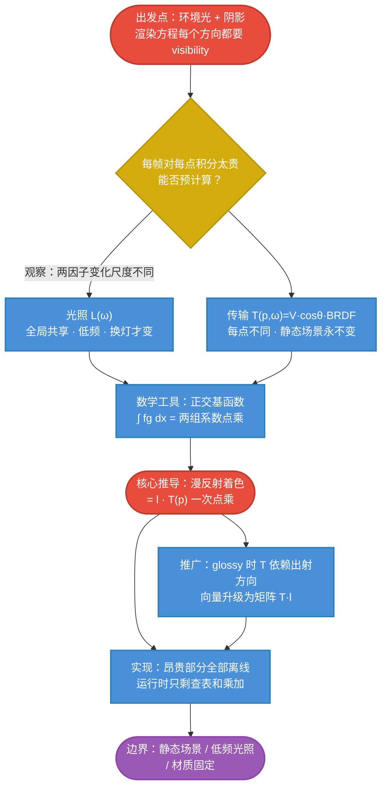

# PRT 原理主线：从环境光阴影难题到实时点乘

## PRT 一句话

> 环境光照下的着色是一个昂贵的球面积分（光照 × BRDF × cosθ × 遮挡）。PRT 的做法是：把积分里的**光照**和**传输**（BRDF·cosθ·visibility 的合称）分别压缩成少数系数，然后利用正交基函数的性质，让运行时的整个积分塌缩成**一次点乘**。

$$
\boxed{
\text{PRT} =
\text{昂贵积分}
\to
\text{（光照系数向量 · 传输系数向量）}
}
$$

$$
\boxed{
L_o(p)
=
\mathbf{l}\cdot\mathbf{T}(p)
\qquad\text{（漫反射，一次点乘）}
\qquad
L_o(p,\omega_o)
=
\mathbf{B}(\omega_o)^T\,\mathbf{T}(p)\,\mathbf{l}
\qquad\text{（光泽，一次矩阵乘）}
}
$$

其中 $\mathbf{l}$ 是环境光投到球谐基上的系数（全场景一份），$\mathbf{T}(p)$ 是每个点预计算好的传输系数（含阴影）。

## 全专题的思维链路

PRT 不是一套孤立技巧，而是一条从问题出发、每一步都必然的推理链：

## 各篇在主线中的位置

| 篇 | 解决的问题 | 在主线中的角色 |
|---|---|---|
| [[学习笔记/cg/games202/专题/prt/02-环境光阴影的困境.md|02 环境光阴影的困境：实时渲染为什么算不动]] | 为什么环境光下的阴影实时算不动 | 提出问题，发现"变化时间尺度分离" |
| [[学习笔记/cg/games202/专题/prt/03-函数即向量-基函数与投影.md|03 函数即向量：基函数、投影与正交]] | 有什么数学工具能把函数变成少数数字 | 建立投影/重建直觉，证明"积分=点乘" |
| [[学习笔记/cg/games202/专题/prt/04-球谐函数.md|04 球谐函数：球面上的正交基]] | 球面上的正交基长什么样 | 熟悉 SH 的结构、频率与旋转三大性质 |
| [[学习笔记/cg/games202/专题/prt/05-漫反射PRT-从积分到点乘.md|05 漫反射 PRT：把整个渲染方程压成一次点乘]] | 漫反射下渲染方程如何塌缩成点乘 | **全专题的核心推导** |
| [[学习笔记/cg/games202/专题/prt/06-光泽PRT-传输矩阵.md|06 光泽 PRT：出射方向依赖让向量升级为矩阵]] | 出射方向依赖时向量怎么升级 | 矩阵形式的推导与代价分析 |
| [[学习笔记/cg/games202/专题/prt/07-实现管线-预计算与运行时.md|07 实现管线：系数怎么算、怎么存、怎么用]] | 系数到底怎么算、怎么存、怎么用 | 离线/运行时两阶段落地 |
| [[学习笔记/cg/games202/专题/prt/08-局限边界与思想延伸.md|08 PRT 的边界：它为什么没能统治实时渲染，以及留下了什么]] | PRT 为什么没能统治实时渲染 | 复查三个前提，看清思想遗产 |

## 三个前提：它们分别"卡"在哪一步

PRT 有三个著名前提，每一个都不是拍脑袋，而是卡在推导的特定位置：

| 前提 | 卡在哪一步 | 违反的后果 |
|---|---|---|
| 场景完全静止 | 传输系数 $\mathbf{T}(p)$ 是离线对每个点算的，含 visibility | 动一个物体 → 全场景 $\mathbf{T}$ 作废重算 |
| 光照低频 | 光照要用少量 SH 基重建（近似只发生在这里） | 小光源/锐利高光丢失 |
| 漫反射或低频 glossy | 漫反射的传输不依赖观察方向；glossy 变矩阵 | 完美镜面需要无穷多系数，无法压缩 |

理解"卡在哪一步"比记住结论重要得多——详见 [[学习笔记/cg/games202/专题/prt/08-局限边界与思想延伸.md|08 PRT 的边界：它为什么没能统治实时渲染，以及留下了什么]]。

## 与已有笔记的连接

- [[学习笔记/cg/games202/lecture6 Real-time Environment Mapping 2.md|lecture6 Real-time Environment Mapping 2]] 里已有 PRT 小节，是**结论速记**；本专题把每条结论背后的"为什么"展开成完整推理链。那张著名的"积分频率取决于最低频率"的图，正是 [[学习笔记/cg/games202/专题/prt/03-函数即向量-基函数与投影.md|03 函数即向量：基函数、投影与正交]] 与 [[学习笔记/cg/games202/专题/prt/05-漫反射PRT-从积分到点乘.md|05 漫反射 PRT：把整个渲染方程压成一次点乘]] 反复使用的论证。
- [[学习笔记/cg/games202/lecture5 Real-time Environment Mapping 1.md|lecture5 Real-time Environment Mapping 1]] 的 prefiltering / split-sum 是 PRT 的"对照组"：它们同样拆分光照与 BRDF，却假设 visibility 恒为 1。PRT 正是把 visibility 放回方程的代价与方案。
- [[学习笔记/cg/rt in one weekend/rest_life/09-直接采样光源.md|第 9 章：直接采样光源]] 解释了 shadow ray 的 PDF 推导——PRT 预计算 transport 时对每个方向发的那条遮挡射线，用的正是这套采样语言。
- [[学习笔记/cg/rt in one weekend/rest_life/03-一维蒙特卡洛积分与重要性采样.md|第 3 章：一维蒙特卡洛积分与重要性采样]] 的 $f/p$ 补偿思想，在 [[学习笔记/cg/games202/专题/prt/07-实现管线-预计算与运行时.md|07 实现管线：系数怎么算、怎么存、怎么用]] 的余弦加权预计算里再次出现。

## 记忆压缩

如果只能记住一段话，记住这个：

> 灯是一列数（环境光投到 SH，全场景共享）；每个点是一列数（传输投到 SH，离线用射线追踪算好，里面藏着阴影）；着色就是把这两列数**点乘**一下。换灯时灯重新投影，物体不动时点的系数永远有效——所以 PRT 能实时旋转天空，却动不了任何一个物体。

# 思维导图

上方的 mermaid 流程图即是本专题的完整思维导图。各篇细节从 [[学习笔记/cg/games202/专题/prt/02-环境光阴影的困境.md|02 环境光阴影的困境：实时渲染为什么算不动]] 开始。
