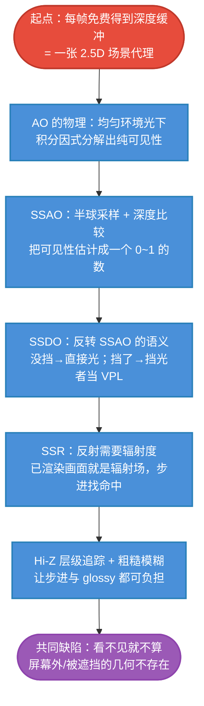

# 屏幕空间方法原理主线：深度缓冲是免费的场景代理

## 一句话

> PRT 离线压场、LPV 每帧推场、VXGI 每帧烤体素——而**每帧光栅化本来就会免费生成一张"场景代理"：深度缓冲**。屏幕空间三兄弟（SSAO / SSDO / SSR）的全部哲学：**不建任何新场，直接在"深度缓冲 + 已渲染画面"这个 2.5D 场上做可见性与辐射查询**。

$$
\boxed{
\text{屏幕空间方法}
=
\underbrace{\text{深度缓冲（2.5D 高度场）}}_{\text{免费的几何}}
+
\underbrace{\text{已渲染画面}}_{\text{免费的可见辐射}}
\quad\Longrightarrow\quad
\text{三种查询：AO / DO / R}
}
$$

## 三兄弟 = 同一场上的三种查询

| 技术 | 查什么 | 回答什么问题 | 用在哪 |
|---|---|---|---|
| **SSAO**（Screen Space Ambient Occlusion） | 上半球的**可见性** | "环境光有多少方向到不了我" | 环境光的遮挡系数 |
| **SSDO**（Screen Space Directional Occlusion） | 每个采样方向的**可见性 + 挡光者颜色** | "光被谁挡了、挡我的东西亮不亮" | 直接光遮挡 + 一弹间接光 |
| **SSR**（Screen Space Reflection） | 反射方向的**辐射度** | "我镜子里的世界长什么样" | 镜面 / glossy 反射 |

```text
            深度缓冲 = 2.5D 高度场
            已渲染画面 = 可见表面的辐射场
                    │
     ┌──────────────┼──────────────┐
  半球采样取平均   采样点看两种命运   沿反射方向走
  （SSAO）        （SSDO）        （SSR）
   环境光变暗     直接光+一弹GI     镜面反射
```

## 全专题的思维链路



## 各篇在主线中的位置

| 篇 | 解决的问题 |
|---|---|
| [[学习笔记/cg/games202/专题/ss/02-AO的物理-遮蔽积分.md|02 AO 的物理：遮蔽积分从哪来]] | AO 到底是渲染方程里的哪一项（纯可见性从哪来） |
| [[学习笔记/cg/games202/专题/ss/03-SSAO-深度场半球采样.md|03 SSAO：在深度场上估那个半球积分]] | 可见性怎么用采样+深度比较估出来；伪影与修补 |
| [[学习笔记/cg/games202/专题/ss/04-SSDO-采样的两种命运.md|04 SSDO：同一批采样的两种命运]] | 同一批采样的两种用法：直接光遮挡 + 一弹 GI |
| [[学习笔记/cg/games202/专题/ss/05-SSR-屏幕空间光线步进.md|05 SSR：在自己的画面里找反射]] | 反射 = 在自己的画面里找命中点 |
| [[学习笔记/cg/games202/专题/ss/06-SSR进阶-层级追踪与粗糙.md|06 SSR 进阶：Hi-Z 层级追踪与粗糙反射]] | Hi-Z 金字塔加速；粗糙反射的模糊 |
| [[学习笔记/cg/games202/专题/ss/07-屏幕空间的共同缺陷.md|07 屏幕空间的共同缺陷：看不见就不算]] | "看不见就不算"在各技术里的具体形态 |
| [[学习笔记/cg/games202/专题/ss/08-屏幕空间对照与GI全景.md|08 屏幕空间三兄弟对照与 GI 全景]] | 三兄弟互比；屏幕空间在"场分辨率阶梯"上的位置 |

## 与前四个 GI 专题的关系：场分辨率阶梯

把五个专题放在一起，一个结构立刻浮现——**它们的差别就是"用什么场近似场景"**：

| 方法 | 场 | 分辨率 | 成本 | 完整性 |
|---|---|---|---|---|
| PRT | 每点精确传输（离线） | 无限细（每点） | 运行时最低 | 场景冻结 |
| IBL | 2D 天空（无限远） | — | 低 | 无遮挡 |
| LPV | 3D SH 格子 | 粗（32³） | 极低 | 漏光 |
| VXGI | 3D 体素 + mip | 中（256³） | 高 | 体素粒度 |
| **屏幕空间** | **2.5D 深度场** | **像素级（最细）** | **低** | **只有看得见的** |

> 屏幕空间方法的独特位置：**分辨率最高（逐像素）、成本最低（场是免费的）、但完整性最差（只含可见几何）**。它不是 GI 方法之间的又一派，而是"零成本高分辨率"与"信息残缺"的极端权衡。

## 记忆压缩

> 屏幕是张免费的地图：**深度图告诉你地形（什么挡我），颜色图告诉你景象（那里多亮）**。SSAO 拿地形算环境光的折扣；SSDO 拿地形+景象算"谁挡我、挡我的多亮"；SSR 顺着地形走、走到谁身上就把谁的景象抄过来。三者都只认识屏幕里的世界——屏幕外和被挡住的东西，在这张地图上不存在。

从 AO 的物理开始：[[学习笔记/cg/games202/专题/ss/02-AO的物理-遮蔽积分.md|02 AO 的物理：遮蔽积分从哪来]]。
