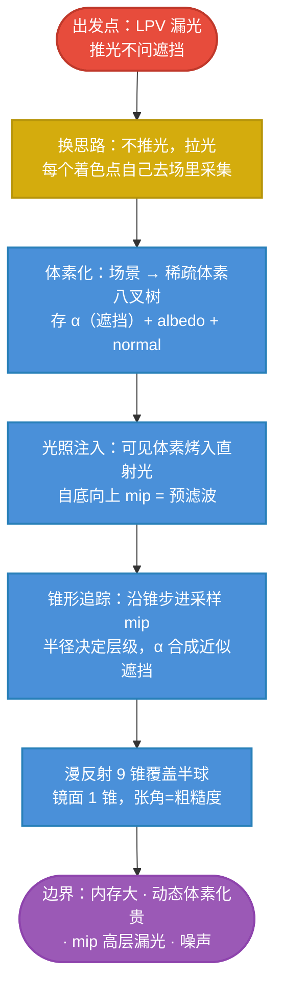

# VXGI 原理主线：体素场上的锥形拉光

## VXGI 一句话

> LPV 把光"推"进格子场时不管遮挡，所以漏光。VXGI 反过来：先把**场景本身**体素化成一张带 mip 链的 3D 场（场景自己变成了"一张预滤波的光照图"），再把**可见的直射光烤进体素**，着色时让每个点**自己发射锥形查询**——沿锥采样 mip 链，一次锥追 = 一束方向的范围积分，**沿途的体素遮挡用 α 合成近似**。

$$
\boxed{
\text{VXGI}
=
\underbrace{\text{体素化场景}\ +\ \text{SVO mip 链}}_{\text{场景变成可查询的场}}
\to
\underbrace{\text{直射光烤进体素}}_{\text{预滤波的"场景自照明"}}
\to
\underbrace{\text{锥形追踪拉光}}_{\text{一次锥 = 一束方向 + 沿途遮挡}}
}
$$

## 全专题的思维链路

## 各篇在主线中的位置

| 篇 | 解决的问题 | 在主线中的角色 |
|---|---|---|
| [[学习笔记/cg/games202/专题/vxgi/02-体素化-把场景变成格点.md|02 体素化：把三角形的世界变成格点世界]] | 场景怎么变成 GPU 好查询的规则结构 | 建"场"：SVO + 保守光栅化 |
| [[学习笔记/cg/games202/专题/vxgi/03-光照注入与体素mip链.md|03 光照注入：把直射光烤进体素 mip 链]] | 间接光的"源"从哪来 | 把直射光烤进叶子体素并逐层滤波 |
| [[学习笔记/cg/games202/专题/vxgi/04-锥形追踪-核心查询原语.md|04 锥形追踪：一次查询同时拿到平均光与沿途遮挡]] | 一次查询怎么同时拿到"平均光 + 沿途遮挡" | **全专题的核心原语** |
| [[学习笔记/cg/games202/专题/vxgi/05-漫反射锥组与镜面锥.md|05 漫反射锥组与镜面锥：怎么摆锥，就是什么材质]] | 漫反射和镜面分别怎么用锥 | 与 IBL split-sum 的漂亮对照 |
| [[学习笔记/cg/games202/专题/vxgi/06-实现管线.md|06 VXGI 实现管线：三大 pass 与真实的账单]] | 三大 pass 的结构与性能账 | 落地 |
| [[学习笔记/cg/games202/专题/vxgi/07-问题与边界.md|07 VXGI 的问题与边界：每个瑕疵指回推导现场]] | 内存、漏光、噪声从哪来 | 逐条指回推导现场 |
| [[学习笔记/cg/games202/专题/vxgi/08-四法对照与收官.md|08 四法对照与收官：PRT × IBL × LPV × VXGI]] | 四个专题合上一张地图 | "场与查询"句式的收官 |

## 与前三个专题的关系

| | 传承 | 升级 |
|---|---|---|
| vs LPV | 同样每帧、同样"场"思想 | 推 → 拉：查询时**顺带**解决遮挡 |
| vs IBL | **mip 预滤波思想原样搬进 3D**（[[学习笔记/cg/games202/专题/ibl/05-预滤波环境贴图.md|05 预滤波环境贴图：把"光照均值"烧进 mip 链]]） | 滤波对象从"天空"变成"场景自己"，且含 α |
| vs PRT | 预滤波后的"响应查询"同一哲学 | 不再需要离线传输，动态场景成立 |

> 一个统一读法：**IBL 把天空压成一张可查 mip 图；VXGI 把场景压成一张可查 mip 场**。查询从"镜面方向查一次"推广成"沿锥查一路"。IBL 的 [[学习笔记/cg/games202/专题/ibl/06-BRDF查找表.md|06 BRDF 查找表：把材质积分压成一张 2D 纹理]]（材质项）在 VXGI 里没有直接对应物——它只管漫反射与低频镜面，省掉了那张 LUT 的麻烦，也放弃了高频镜面。

## 记忆压缩

> 把整个场景**打成乐高**（体素化），乐高的每一格记下"挡不挡光、什么颜色、朝哪"；然后从灯眼里看一遍，把被照到的乐高格**烤亮**并层层**调匀**（mip 预滤波）。着色时，每个点**张开锥子**朝天上地下各扫几道——锥里先撞到谁，谁就是我的间接光；**被前面的格挡住的部分自动不要**（α 合成）。拉光自带遮挡，但每个点都要扫，贵。

细节从"建场"开始：[[学习笔记/cg/games202/专题/vxgi/02-体素化-把场景变成格点.md|02 体素化：把三角形的世界变成格点世界]]。
