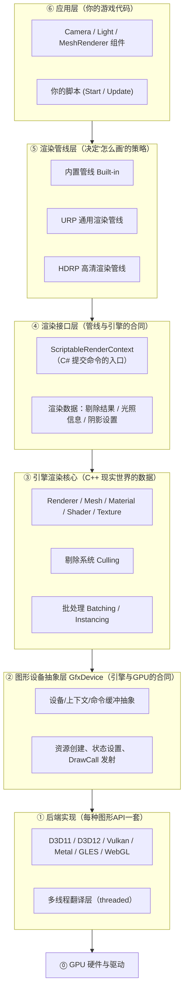

# 01 - 团结引擎渲染系统全景

> 阅读时间：约 30 分钟
> 关键词：分层架构、GfxDevice、SRP、内置管线

---

## 你将学到什么

- 团结引擎（Tuanjie）渲染系统从上到下的完整分层
- 每一层各自负责什么、为什么需要这一层
- 内置管线 / URP / HDRP 三种管线在整个架构中的位置
- 团结引擎特有的部分（TuanjieGI 等）在哪里

---

## 1. 先看全景：一张鸟瞰图

团结引擎的渲染系统是一个经典的**分层架构**（Layered Architecture）。从最贴近用户的 C# 脚本，到最贴近硬件的 GPU 驱动，一共可以分成六层：

一个重要直觉：**越往上越"面向世界"（场景、光照、材质），越往下越"面向机器"（顶点、纹理、同步屏障）**。中间每一层的存在，都是为了解决"上下两层说的话不一样"这个翻译问题。

## 2. 逐层拆解

### ⑥ 应用层：你触摸到的引擎

这是普通开发者唯一直接接触的层：在编辑器里摆 GameObject，挂 `Camera`、`Light`、`MeshRenderer` 组件，写脚本改变它们。这一层的世界观是"**场景图**"——一棵物体树，每个物体带着位置、旋转、缩放。

注意：这一层**没有任何"怎么画"的知识**。摄像机只是描述"从哪里看"，不描述"看到了以后按什么顺序、用什么策略画出来"。那是渲染管线层的事。

### ⑤ 渲染管线层：画面的"总导演"

同样是"一个场景、一盏灯、一个立方体"，不同的策略会得到完全不同的画面效果和性能开销。**渲染管线（Render Pipeline）就是这套策略**：先画阴影还是先画不透明？用一个 Pass 还是多个 Pass？阴影怎么采样？

团结引擎同时维护着**三套策略**，你可以选择其一：

| 管线 | 定位 | 一句话特征 |
|---|---|---|
| **内置管线（Built-in）** | 传统、简单 | 写在引擎 C++ 里，改不了流程，但胜在稳定 |
| **URP（Universal）** | 通用、移动友好 | LWRP 的后继者，C# 写的策略，性能优先 |
| **HDRP（High Definition）** | 高画质 | 光照单位物理化，堆高级特性，只面向高端平台 |

为什么会有三套？本质原因是**游戏类型差异太大**：手游要 3 毫秒内画完一帧，3A 单机可以花 16 毫秒只为更真实的阴影。一套固定的管线无法同时讨好两者，于是引擎把"管线本身"也做成了可选/可编程的——这正是 SRP（Scriptable Render Pipeline，可脚本化渲染管线）这个名字的含义。

### ④ 渲染接口层：管线与引擎之间的"合同"

这层很薄，但理解它非常关键。**渲染管线（C# 写的 URP/HDRP）并不直接操作 GPU**，它只能通过 `ScriptableRenderContext` 这个"遥控器"对引擎核心下达命令：

- "帮我剔除这些摄像机看到的东西"（剔除在 C++ 里做，性能原因）
- "把这些物体按这个 Pass 画一遍"
- "提交所有命令，执行吧（`Submit`）"

这份"合同"的价值在于**职责切分**：剔除、排序、提交这些高频重活留在 C++（快），而"画面的流程编排"放到了 C#（灵活、可定制、可热重载）。这是 2018 年 Unity 引入 SRP 时最重要的架构决策。

> 📁 **源码指引**：这层的 C++ 后端在 `Runtime/Graphics/ScriptableRenderLoop/`，你能看到 `ScriptableCulling.cpp`（剔除）、`ScriptableDrawRenderers.cpp`（画物体）、`ScriptableRenderContext.cpp`（上下文/合同本身）。

### ③ 引擎渲染核心：数据的现实世界

应用层的"组件"只是薄薄的脚本包装，真正的数据都在这层：`Renderer` 组件背后是 C++ 的渲染器对象（含网格引用、包围盒、LOD 层级）、材质背后是 GPU 程序和参数表、纹理背后是各种压缩格式的像素块。

这层还有两个关键系统：

1. **剔除（Culling）**：决定"哪些物体根本不用画"。一帧里 90% 以上的物体其实都在摄像机背后或视野外，把它们提前扔掉，是渲染优化第一大杠杆。
2. **批处理（Batching）**：决定"哪些物体可以合并成一次 DrawCall 画"。GPU 画 1 个三角形和画 1000 个三角形几乎一样快，慢的是"发起一次绘制"这件事本身。

> 📁 **源码指引**：`Runtime/Graphics/Renderer.cpp`、`RendererUpdateManager.cpp`；批处理在 `Runtime/GfxDevice/BatchRendering.cpp`、`InstancingBatcher.cpp`。

### ② GfxDevice 图形设备抽象层：引擎与 GPU 的"合同"

这是整个引擎里**最重要的架构设计**。市面上有六种主流图形 API（D3D11、D3D12、Vulkan、Metal、OpenGL/GLES、WebGL），每种 API 的函数名、资源模型、同步规则都完全不同。引擎不可能为每个平台写六份"渲染核心"，于是有了 GfxDevice：

> **对上（渲染核心）：提供一套统一的、面向概念的操作**——"创建一个 2D 纹理"、"设置混合状态"、"画这批三角形"。
> **对下（各图形API）：把每个操作翻译成对应 API 的调用。**

就像出国旅游用"翻译"——你只说中文（统一接口），翻译负责转成英语、日语、法语（各家 API）。**渲染核心（③层）这辈子都不知道自己跑在什么显卡 API 上**，这让它可以被移植到任何平台——从 Windows 到微信小游戏到 OpenHarmony（这也是团结引擎特别扩展的平台）。

> 📁 **源码指引**：`Runtime/GfxDevice/` 是抽象层本体；`Runtime/GfxDevice/d3d11/`、`d3d12/`、`vulkan/`、`metal/`、`opengl/`、`opengles/` 各是一份翻译实现。`GfxDevice.h` 是"合同"原文。

### ① 后端实现 + ⓪ 硬件

每种 API 的翻译层各有几万到几十万行代码，处理各自的怪癖：D3D12/Vulkan/Metal 这类**现代 API** 需要显式管理内存、同步和命令队列；D3D11/GLES 这类**传统 API** 简单但慢。GfxDevice 还有一个特殊的 `threaded/` 目录——**多线程渲染**：引擎把绘制命令先录制在 CPU 主线程之外，再统一回放给 GPU，避免主线程卡在翻译工作上。

## 3. 把分层串起来：三种管线的差异到底在哪层

一个新手常见困惑："内置管线和 URP 到底差在哪？"

用分层图看就非常清楚：**差异只发生在 ⑤ 和 ④ 层**。

- 内置管线：策略写死在引擎 C++ 里，⑤ 和 ④ 层合并在一起，你无法修改流程；
- URP/HDRP：⑤ 层变成了 C# 包（Packages 目录下），通过 ④ 层的标准合同调用引擎，你甚至可以 fork 它改出自己的管线。

而下面的 ③②① 层，三种管线**完全共用**。所以你学了 GfxDevice 的原理（第03章），对三种管线同时有效。

## 4. 团结引擎特有的渲染部分

团结引擎（Tuanjie）是 Unity 中国在 Unity 2022.3 基础上的分支，渲染方面有几个明显差异值得记住：

| 部分 | 位置 | 说明 |
|---|---|---|
| **TuanjieGI 模块** | `Modules/TuanjieGI/` | 自研的**实时全局光照**方案，基于 **SDF（有向距离场）+ 光线步进**做漫反射 GI，包含 SDF 生成、光线追踪、光照混合等子系统。这是与原版 Unity 最大的渲染差异，第10章会专门讲 |
| **微信小游戏/Playable Ads 平台** | `Platforms/WeixinMiniGame/` | WebGL 变体，渲染后端有专门优化 |
| **OpenHarmony 平台** | `PlatformDependent/OpenHarmonyPlayer/` | 国产系统支持，GLES/Vulkan 后端 |
| **Weixin URP 定制包** | `Packages/` 内含定制 URP | 针对小游戏渲染的特殊管线变体 |
| **其余** | 与 Unity 2022.3 一致 | URP/HDRP/ShaderGraph/VFX Graph 均同步自原版 |

学习策略：本书 95% 的内容适用于一切 Unity 系引擎；涉及 Tuanjie 特有的地方会明确标注"团结特有"。

## 5. 全景图与后续章节的映射

| 全景图中的层 | 本书章节 |
|---|---|
| ⑥ 应用层 | 贯穿全书的例子 |
| ⑤ 渲染管线层 | 第08章（渲染路径）、第09章（SRP/URP/HDRP） |
| ④ 渲染接口层 | 第09章 |
| ③ 渲染核心 | 第04章（剔除）、第05章（材质）、第12章（批处理） |
| ② GfxDevice | 第03章 |
| ① 后端/⓪ 硬件 | 第02章（GPU 管线原理）、第03章（API 对比） |
| 画面质量相关 | 第06、07、10、11章 |

---

## 小结

- 渲染系统是**六层翻译栈**：场景描述 → 管线策略 → 渲染合同 → 引擎核心 → API 抽象 → 硬件后端；
- **GfxDevice** 解决"引擎如何跨图形 API"——接口与实现分离；
- **SRP** 解决"管线策略如何可定制"——C++ 引擎核心 + C# 管线编排的混合架构；
- 内置管线 / URP / HDRP 差异只在策略层，底层完全共用；
- 团结引擎的独特点在 **TuanjieGI 实时全局光照**和面向国内平台的渲染后端。

## 自测问题

1. 一个 URP 项目里，`Camera` 组件的渲染请求，从 C# 到 GPU，依次经过哪几层？
2. 为什么 GfxDevice 必须存在？如果没有它，会怎样？（提示：想象为每个平台×每种管线写一遍引擎核心）
3. "URP 比 HDRP 快"——用分层图思考：这句话真正比较的是哪一层？

---

*下一节：[02-一帧画面的旅程总览](学习笔记/cg/tuanjie引擎/总览/00-导读与全景/02-一帧画面的旅程总览.md) —— 跟随一帧画面，把分层走活。*
