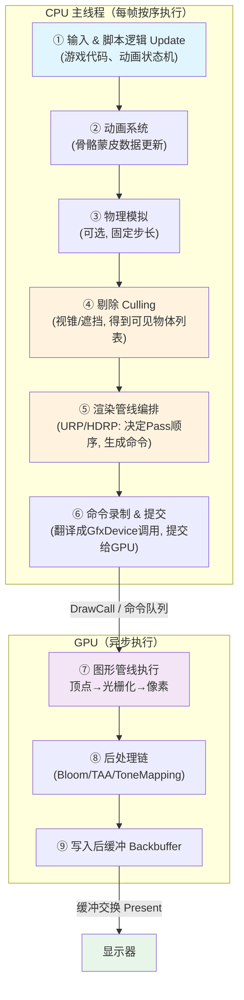

# 02 - 一帧画面的旅程总览

> 阅读时间：约 30 分钟
> 关键词：帧循环、渲染时序、PlayerLoop、DrawCall

---

## 你将学到什么

- 引擎从"Update 开始"到"画面出现在屏幕上"的完整时序
- CPU 侧与 GPU 侧各自的职责，以及它们如何并行
- DrawCall、VSync、"卡"的真实含义
- 本旅程中每一段对应本书哪些章节

---

## 1. 为什么要追踪"一帧"

分层架构（上一篇）是**空间**视角——系统由哪些部分组成；这一篇是**时间**视角——这些部分**以什么顺序、在哪个线程**上干活。把两个视角都建立起来，你对渲染系统的认知就从"名词卡片"变成了"活地图"。

我们的旅程从你按下 Play 键后引擎的每一次心跳说起。

## 2. 帧：引擎的心跳单位

游戏运行时，引擎以固定节拍循环工作，每循环一次称为**一帧（Frame）**。以 60 FPS 为例，每帧的全部预算：

$$
T_{frame} = \frac{1}{60} \approx 16.6 \text{ ms}
$$

这 16.6ms 里，引擎必须完成：**游戏逻辑更新 → 物理模拟 → 剔除 → 绘制命令生成 → 提交 GPU → GPU 算完 → 画面送到显示器**。任何一步超支，玩家就感觉到"掉帧"。

## 3. 一帧的完整旅程



下面逐段讲。

### ① 输入与逻辑：决定"世界里发生了什么"

键盘输入、AI 决策、角色移动……这一段产出的关键渲染相关数据是**变换矩阵**：每个可见物体的"我在哪、朝哪、多大"（World Matrix）。此后一切渲染都围绕这批矩阵展开。

### ④ 剔除：先扔掉看不见的

在真正为任何物体生成绘制命令之前，引擎做了一次大扫除：

- **视锥体剔除**：把包围盒不在摄像机锥形视野内的物体扔掉；
- **遮挡剔除**（可选）：被房子挡住的树也不用画；
- **LOD 选择**：远处的模型换成低模。

一帧里这一步经常能扔掉 80%~95% 的物体。**不做剔除的引擎，再快的 GPU 也会被 DrawCall 淹死**。详见第04章。

### ⑤⑥ 编排与提交：CPU 侧的真正"渲染工作"

剔除得到可见列表后，渲染管线（URP/HDRP 或内置）接管，它的工作本质是**回答一连串"以什么状态、什么顺序、画什么"**：

1. 先画阴影贴图（把场景从灯光视角画一遍）；
2. 再画不透明物体（近到远，先画近的有利于 Early-Z 剔除）;
3. 再画天空盒；
4. 最后画透明物体（远到近，必须排序）;
5. 全屏后处理。

每一条"画 X"最终变成一次 **DrawCall**：CPU 通过 GfxDevice 告诉 GPU"用这个顶点缓冲、这个着色器、这个材质参数，画这几个三角形"。

这里有个新手最容易误解的点：

> ⚠️ **DrawCall 慢的不是 GPU，是 CPU。**
> 每次 DrawCall，CPU 都要做一堆准备工作：切换绑定的纹理、缓冲、着色器，更新参数……干这些活的是 CPU。GPU 画三角形本身快得飞起。所以"DrawCall 太多"的瓶颈含义是"CPU 忙不过来"，这也解释了为什么引擎要有批处理/合批——**把 N 次 DrawCall 合并成 1 次**。详见第04、12章。

### CPU 与 GPU 的并行：真正的时序图

上面流程图容易让人误以为"CPU 全干完，GPU 才开工"。真相是**流水线并行**：

```
时间轴 ─────────────────────────────────────────►

CPU:  [Update+剔除+录制N帧命令][提交N帧][...更新N+1帧...][提交N+1帧]
GPU:                      [执行N帧命令........][.....执行N+1帧...]
屏幕:                                  |显示N-1帧|   |显示N帧|
```

CPU 在第 N 帧提交完命令后**立刻开始准备第 N+1 帧**，GPU 在后台慢慢消化第 N 帧。所以你在屏幕上看到的画面，通常是 GPU 上一帧甚至上上帧提交的内容——这叫**渲染延迟（Latency）**，也是"高帧率但操作跟手慢"这类问题的根源之一。

两个配套机制：

- **命令缓冲**：CPU 不是发一条 GPU 干一条，而是把几百条命令打包进队列，GPU 按序取用。这让"录制"和"执行"彻底解耦——多线程渲染（第03章）就是把"录制"搬到别的线程去干。
- **VSync（垂直同步）**：GPU 画完后不会立刻推翻上一帧，而是等待显示器刷新信号再交换前后缓冲，防止画面"撕裂"。代价是帧率被显示器刷新率取整（60Hz 显示器上 59FPS 会掉到 30FPS 的观感）。

### ⑦ GPU 执行：三角形变成像素

GPU 收到命令后跑**图形管线**：顶点着色（把 3D 坐标变成屏幕 2D 坐标）→ 光栅化（三角形铺成像素）→ 像素着色（算出每个像素的颜色）→ 输出合并（深度测试、混合）。这是第02章的主题，也是全书的"物理层"。

### ⑧⑨ 后处理与送显

所有物体画完后，得到的不是"最终画面"，而是一张**临时图**（HDR 颜色，可能超亮、有锯齿、没有光晕）。后处理链（Bloom 泛光、TAA 抗锯齿、ToneMapping 色调映射、ColorGrading 调色）把它加工成最终图，写入**后缓冲（Backbuffer）**，等待 VSync 时与前台缓冲交换、送显示器。

## 4. 一张表：旅程与全书章节的对应

| 旅程站点 | 深入阅读 |
|---|---|
| 逻辑更新与变换矩阵 | 第01章（数学）、第03章（变换层级） |
| 剔除 Culling | 第04章 |
| 管线编排、渲染路径 | 第08章、第09章 |
| 材质与着色器如何被装填 | 第05章 |
| GPU 图形管线 | 第02章 |
| 光照与阴影 Pass | 第06章、第07章 |
| 全局光照数据 | 第10章 |
| 后处理链 | 第11章 |
| 命令录制、批处理、多线程 | 第03章、第12章 |

## 5. "卡"的三种不同病因（新手高频问题）

理解了时序图，就能精确诊断玩家口中的"卡"：

| 症状 | 机理 | 药方方向 |
|---|---|---|
| **帧率低（掉帧）** | CPU 或 GPU 单帧工作量 > 16.6ms | Profiler 找瓶颈，是 DrawCall/剔除/着色器复杂度里的哪种 |
| **画面撕裂** | 无 VSync，GPU 画一半就被送去显示 | 开 VSync 或用三重缓冲 |
| **输入延迟** | 帧率高但操作跟手慢 | 渲染延迟过大；减 Pass、关三重缓冲、用同样帧数的低延迟模式 |

同理，"优化"这个词至少有三条独立战线：**CPU 侧优化**（减 DrawCall、提速剔除）、**GPU 侧优化**（降着色复杂度、减 Overdraw）、**延迟优化**（减中间 Pass）。混为一谈是新手方案失败的常见起点。第12章会系统展开。

---

## 小结

- 一帧 = 逻辑更新 → 剔除 → 编排 → 录制提交（CPU） ∥ 图形管线 → 后处理 → 送显（GPU）；
- CPU 与 GPU 是**流水线并行**，屏幕画面落后 1~2 帧；
- DrawCall 的代价在 CPU，合批省的也是 CPU；
- VSync 用"等待刷新信号"换取"无撕裂"；
- "卡"至少有帧率、撕裂、延迟三种病因，优化要分清是 CPU 战线还是 GPU 战线。

## 自测问题

1. 从 Update 开始到画面上屏，一帧按序经历哪 9 站？不看图复述一遍。
2. 为什么 DrawCall 多了以后，先累垮的是 CPU 而不是 GPU？
3. 假设你关闭 VSync，帧率从 60 涨到 300，但玩家抱怨"操作反而变飘"——用渲染延迟解释。
4. 画图说明 CPU 提交第 N 帧命令时，GPU 在干什么？显示器在显示第几帧？

---

*至此，全景篇结束。你已拥有整本书的地图，接下来进入第01章——把渲染的数学地基打牢。*
