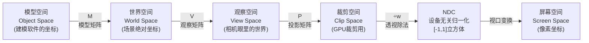

# 02 - 矩阵与坐标变换

> 阅读时间：约 40 分钟
> 关键词：矩阵、Model-View-Projection、齐次坐标、空间变换链

---

## 你将学到什么

- 矩阵在渲染中的真实身份："把向量从一个空间搬到另一个空间"的搬运工
- 齐次坐标：为什么用 4 个数表示 3D 点
- Model → View → Projection 三大变换的几何含义
- 团结/Unity 中各空间的名称与约定

---

## 1. 矩阵是什么：空间的"搬运工"

数学课上的矩阵是"数表"，但渲染里请把矩阵理解为一个**函数**：

$$
\mathbf{v}' = M \mathbf{v}
$$

读作："对向量 $\mathbf{v}$ 施加变换 $M$，得到 $\mathbf{v'}$"。$M$ 可以是"旋转 30°"、"放大 2 倍"、"平移到左边"、"投影到屏幕"——**一切变换都是矩阵**。

矩阵最妙的性质是**可复合**：先旋转 $R$ 再平移 $T$，等价于一个新矩阵 $TR$（注意顺序，矩阵乘法不交换）：

$$
\mathbf{v}' = T(R\mathbf{v}) = (TR)\mathbf{v}
$$

引擎正是靠这个性质，把"物体→世界→相机→屏幕"的漫长征途压缩成**一次矩阵乘法**。

### 1.1 为什么是 4×4：齐次坐标

3D 点明明是三个数，为什么渲染里矩阵都是 4×4、向量都是 4 分量（$(x,y,z,w)$）？

因为**平移无法用 3×3 矩阵表达**。3×3 矩阵只能做旋转/缩放/剪切（线性变换），平移需要加法。第四个分量 $w$ 的引入让"加法"也变成"乘法"：

$$
\begin{bmatrix} x' \\ y' \\ z' \\ 1 \end{bmatrix} =
\begin{bmatrix} 1&0&0&t_x \\ 0&1&0&t_y \\ 0&0&1&t_z \\ 0&0&0&1 \end{bmatrix}
\begin{bmatrix} x \\ y \\ z \\ 1 \end{bmatrix}
= \begin{bmatrix} x+t_x \\ y+t_y \\ z+t_z \\ 1 \end{bmatrix}
$$

约定：**点**的 $w=1$（能被平移），**方向**的 $w=0$（平移对方向无意义——"东北风"不会因为你搬家就变成别的方向）。

$w$ 还有一个了不起的副作用：**除法**。3D 中没有"矩阵除法"，但当 $w \neq 1$ 时，齐次点 $(x,y,z,w)$ 等价于 $(x/w, y/w, z/w, 1)$——除以 $w$（透视除法）恰好就是 3D 到 2D 投影所需的那一步。一个 $w$ 同时解决了"平移"和"透视"两大需求，这是齐次坐标的天才之处。

> 💡 **记忆钩子**：`mul(M, float4(pos, 1))` 给点；`mul(M, float4(dir, 0))` 给方向。$w$ 填错是新手 shader bug 高发区。

## 2. 渲染的空间变换链

一个顶点从模型文件到屏幕像素，要穿越一串空间，每次穿越都是一次矩阵乘法。这是全书最重要的一张图：

三大矩阵 $M$、$V$、$P$ 常被打包为一个：

$$
MVP = P \, V \, M
$$

> ⚠️ **顺序陷阱**：矩阵乘法从右往左作用（离向量最近的先乘）。$MVP$ 读作"先模型、再观察、后投影"。引擎里 `mul(MVP, v)` 与 `mul(v, MVP)` 结果不同——取决于行/列主序约定，团结/Unity 的 `UNITY_MATRIX_MVP` 采用"向量在左"的约定（HLSL 传统），抄 OpenGL 教程（向量在右）时要注意转置。

### 2.1 Model（模型矩阵）：从"我自己"到"世界"

每个物体建模时都住在自己的原点（模型空间）。摆放进场景后，需要把它的顶点搬到场景的绝对位置——这就是模型矩阵 $M$，内容就是你在 Inspector 里看到的 Position/Rotation/Scale 的打包：

$$
M = \text{平移}(T) \cdot \text{旋转}(R) \cdot \text{缩放}(S)
$$

层级嵌套（父物体动子物体跟着动）= 逐级左乘父链矩阵。引擎每帧为可见物体更新这批矩阵（即上一章说的"Update 阶段产出变换矩阵"）。

### 2.2 View（观察矩阵）：站到相机的眼睛里

渲染需要一个统一观察点。约定：**把整个世界变换，使相机位于原点、看向固定方向**——通常约定相机看 $-Z$（OpenGL 传统；Unity 系内部对左手系做了适配，但语义相同）。

直觉：不是"相机去拍摄世界"，而是"世界倒过来塞给相机"。相机在 $(0, 10, -20)$ 看向原点？那 View 矩阵就是把整个世界**反向平移、反向旋转**——相机搬回原点，所有物体跟着搬。

$$
V = (M_{camera})^{-1}
$$

### 2.3 Projection（投影矩阵）：把视野"捏"成标准盒子

世界是 3D 的，屏幕是 2D 的。投影矩阵不直接做除法，而是把**视野（视锥体，Frustum）**扭曲成一个标准形状：

**透视投影**（近大远小，人眼/相机的感觉）——视锥体是一个**四棱台**（近平面小、远平面大）。投影矩阵的几何作用是"把棱台压成长方体"：靠压缩 $z$ 与设置 $w=z$ 实现"远处的点除以大的数→变小"。

透视投影矩阵（fov 视场角、宽高比 $a$、近平面 $n$、远平面 $f$）：

$$
P_{persp} =
\begin{bmatrix}
\frac{1}{a\tan(\text{fov}/2)} & 0 & 0 & 0 \\
0 & \frac{1}{\tan(\text{fov}/2)} & 0 & 0 \\
0 & 0 & \frac{f+n}{f-n} & -\frac{2fn}{f-n} \\
0 & 0 & 1 & 0
\end{bmatrix}
$$

重点看最后一行：$(0,0,1,0)$ 意味着 **输出 $w$ = 输入 $z$**。顶点离相机越远（$z$ 越大），$w$ 越大，除完越小——这就是"近大远小"的数学实现。

**正交投影**（无透视感，工程图/CAD/2D 游戏）——视锥体本来就是长方体，矩阵只是线性缩放 $z$，输出 $w$ 恒为 1（除以 1，无透视）。

$$
P_{ortho} = \begin{bmatrix}
\frac{2}{r-l} & 0 & 0 & -\frac{r+l}{r-l} \\
0 & \frac{2}{t-b} & 0 & -\frac{t+b}{t-b} \\
0 & 0 & -\frac{2}{f-n} & -\frac{f+n}{f-n} \\
0 & 0 & 0 & 1
\end{bmatrix}
$$

### 2.4 裁剪与 NDC：GPU 的"标准化考场"

乘完 $P$ 后顶点处于**裁剪空间**。GPU 在这里做一次廉价检查：分量都在 $[-w, w]$ 内（即除以 $w$ 后落在 $[-1,1]$）→ 保留；全在外 → 丢弃；跨越边界 → **剪断三角形**（比如一个压在屏幕边缘的三角形，只有一半可见，GPU 会沿边界生成新顶点）。

然后是**透视除法**：

$$
(x, y, z, w) \rightarrow \left(\frac{x}{w}, \frac{y}{w}, \frac{z}{w}\right)
$$

得到 **NDC**（Normalized Device Coordinates，归一化设备坐标）。NDC 是图形 API 的"普通话"：无论屏幕分辨率多少、什么 API，都先归到 $[-1,1]^3$ 标准立方体里。

> ⚠️ **深度方向陷阱**：NDC 的 $z$ 范围各 API 约定不同——OpenGL 是 $[-1,1]$，D3D 系（含团结/Unity）是 $[0,1]$，且 D3D 的近/远映射相反。引擎的投影矩阵会按当前后端自动适配，所以你在引擎里看到的投影矩阵数值和教科书不同，不是引擎算错了。

最后**视口变换**把 $[-1,1]$ 的 $x,y$ 拉伸成像素坐标（如 $1920\times1080$），$z$ 存进深度缓冲。

## 3. 团结/Unity 空间约定速查

| 空间名 | Shader 内宏 | 谁定义 |
|---|---|---|
| 模型空间 | `unity_ObjectToWorld`（obj→world） | 物体的 Transform |
| 世界空间 | `unity_MatrixV`（world→view） | 相机 Transform 求逆 |
| 观察空间 | `UNITY_MATRIX_VP`（view→clip） | 相机 fov/aspect/near/far |
| 裁剪空间 | `UNITY_MATRIX_VP` | 投影矩阵 |
| — | `UNITY_MATRIX_MVP`（obj→clip，MVP 合体） | 引擎每帧打包 |

引擎还有两个重要的"逆转置"矩阵：

- **法线矩阵** `unity_WorldToObject` 的转置的逆——法线不能直接用模型矩阵变换（含非均匀缩放时方向会被剪歪），必须用逆转置。这是新手法线错误的高发点，记住结论："**法线永远用逆转置矩阵搬家**"。

## 4. 一个完整数值例子

把顶点 $(1, 0, 0, 1)$ 从模型原点出发，物体在世界 $(0,0,5)$，相机在原点看 $+Z$，简单透视。

1. **M**（只有平移）：$\mathbf{v}_{world} = (1, 0, 5, 1)$；
2. **V**（相机无变换，$V=I$）：仍 $(1, 0, 5, 1)$；
3. **P**（取 fov=90°，$a=1$，$n=1$，$f=100$）：
   - $x' = \frac{1}{\tan45°} x = 1$，$y' = 0$，
   - $z' = \frac{f+n}{f-n} z - \frac{2fn}{f-n} \cdot 1 = \frac{101}{99} \times 5 - \frac{200}{99} = 5 - \frac{200{,}000}{9{,}900}\cdot\frac{1}{100}\ldots$ 精确值不必手算，代入即可；
   - $w' = z = 5$。
4. **透视除法**：$(1/5, 0, z'/5) = (0.2, 0, \ldots)$ —— $x$ 被除以深度 5，从"1 米外偏 1 米"压缩成屏幕上偏向中心的方向。**透视感就诞生在这一步**。

## 5. 在引擎中

- 矩阵库：`Runtime/Math/`（SIMD `float4x4` 等）；
- 内置 shader 矩阵参数的每帧更新：`Runtime/GfxDevice/BuiltinShaderParams.cpp` 与 `BuiltinMatrixParamCache.h`（你可以在这里看到引擎如何按物体批量缓存矩阵）；
- SRP 路线（URP）在 C# 侧组装相机数据：`Packages/com.unity.render-pipelines.universal/Runtime/UniversalAdditionalCameraData.cs` 等，最终仍通过 `ScriptableRenderContext` 传给同一套 C++ 内置参数机制；
- 剔除用的视锥体平面也是从 $VP$ 矩阵中提取的（Gribb-Hartmann 法）——见第04章。

---

## 小结

- 矩阵 = 空间间的搬运函数，可复合，$MVP$ 一次乘法完成"模型→屏幕"；
- **齐次坐标 $w$**：点 $w=1$、方向 $w=0$；$w$ 兼职承载"透视除法"；
- 透视投影的本质：把视锥棱台压成长方体，让 $w=z$，远处除以大数→变小；
- 裁剪空间是 GPU 的裁剪考场，NDC 是各 API 的普通话，$z$ 方向约定不同需留意；
- 法线必须走逆转置矩阵。

## 自测问题

1. 为什么方向向量 $w=0$？如果给"北偏东 30° 的风"填 $w=1$ 会怎样？
2. $MVP$ 矩阵从右往左各做什么？为什么顺序不能变？
3. 透视除法除以的 $w$ 来自投影矩阵的哪一行？它等于哪个输入分量？
4. 物体被非均匀缩放（$x$ 方向拉长 3 倍），为什么法线不能直接用这个缩放矩阵变换？（提示：想象一根斜 45° 的法线被拉成什么样）

---

*下一节：[03-投影：从3D到2D](学习笔记/cg/tuanjie引擎/总览/第01章-渲染数学基础/03-投影从3D到2D.md) —— 专门深入透视的细节，以及 FOV、宽高比与深度的精确关系。*
