# 01 - 图形管线总览与顶点处理

> 阅读时间：约 35 分钟
> 关键词：图形管线、顶点着色器、图元装配、透视校正插值

---

## 你将学到什么

- GPU 图形管线的完整阶段图（本篇是第02章的总纲）
- 顶点着色器的职责：不止是变换
- 图元装配与背面剔除
- 透视校正插值：为什么"屏幕上等距"不等于"3D 里等距"

---

## 1. 图形管线：硬件视角的全景

第01章讲了"一个顶点如何变到屏幕坐标"（数学），现在看 GPU 把这件事变成流水线的**硬件视角**。每次 DrawCall 提交一组顶点和"怎么画"的规则，GPU 跑一遍这条流水线：

```mermaid
flowchart LR
    V["顶点缓冲<br/>Vertex Buffer"] --> IA["输入装配 IA<br/>(按索引取顶点组成三角形)"]
    IA --> VS["顶点着色器 VS<br/>(逐顶点: 变换/蒙皮/位移)"]
    VS --> PA["图元装配<br/>(组装三角形+背面剔除)"]
    PA --> CL["裁剪 Clipping<br/>(视锥边界剪断)"]
    CL --> NDC["透视除法 + 视口变换<br/>(NDC → 屏幕像素坐标)"]
    NDC --> RS["光栅化 Rasterizer<br/>(三角形 → 覆盖哪些像素)"]
    RS --> PS["像素/片元着色器 PS<br/>(逐像素: 纹理+光照=颜色)"]
    PS --> OM["输出合并 OM<br/>(深度/模板测试 + 混合)"]
    OM --> RT["渲染目标 RenderTarget<br/>(最终图或中间图)"]
    
    style VS fill:#fff3e0
    style PS fill:#fff3e0
    style RS fill:#f3e5f5
    style OM fill:#f3e5f5
```

**橙色 = 可编程**（你写 shader 的地方），**紫色 = 固定功能**（GPU 硬件写死、你只能配置状态）。

两个贯穿全章的直觉：

1. **逐顶点与逐像素的分界**：光栅化之前是"每顶点算一次"的世界（便宜，顶点数少），之后是"每像素算一次"的世界（昂贵，像素数巨大）。优化的核心思路之一就是把计算从 PS 搬到 VS。
2. **数量的爆炸**：3 个顶点 → 上百万像素。一个全屏三角形在 1080p 下覆盖约 200 万像素，PS 里每多一次乘法，就是 200 万次乘法。

## 2. 输入装配（IA）：从"数字堆"到"三角形"

顶点缓冲只是一堆数字：$[x,y,z, u,v, nx,ny,nz, \ldots]$。GPU 怎么知道哪三个数是一组、哪三个顶点是一个三角形？靠**顶点布局**（Vertex Layout / Input Layout）+ **图元拓扑**（Topology）：

- 布局："每 32 字节一个顶点：0~11 位置，12~19 UV，20~31 法线"（模型导入时定好的 stride/offset）；
- 拓扑：`TriangleList`（每 3 个顶点一三角形）、`TriangleStrip`（滑动窗口）、`LineList`、`Points` 等。

大多数网格另有**索引缓冲（Index Buffer）**：顶点数据只存一份，索引序列 $[0,1,2, 2,1,3, 3,1,4,\ldots]$ 指明"第 n 个三角形用哪三个顶点"。一个立方体的 8 个顶点可被 12 个三角形共享，索引让显存和顶点着色器开销都大减。

> 📁 **源码指引**：顶点布局描述是 GfxDevice 的核心数据结构之一：`Runtime/GfxDevice/VertexDeclaration.cpp`、`VertexInputMasks.h`。Unity Mesh 类背后对应 `Runtime/Graphics/Mesh/` 里的若干缓冲。

## 3. 顶点着色器（VS）：一顶点一次的魔法

顶点着色器的**最低职责**只有一个：把顶点从模型空间搬到裁剪空间（第01章的 MVP 乘法）。GPU 规定每个顶点着色器必须输出裁剪空间位置，后面的管线才知道把它放到屏幕的哪里。

但"逐顶点的任意计算"这个机制本身，让 VS 成为大量特效的舞台：

| 用途 | 做法 |
|---|---|
| **GPU 蒙皮** | 读取骨骼矩阵（最多 255 根/对象），按权重把顶点拉到动画姿态。引擎的 GPU skinning 就在 VS（或 compute pass）里做 |
| **顶点位移** | 海浪、飘动的草：按时间+噪声函数在 VS 里偏移位置 |
| **程序化几何** | billboard（始终面向相机的广告牌）、粒子朝向 |
| **LOD 细分入口** | 与 tessellation 阶段配合加密三角形 |

**性能直觉**：一个角色网格 1~5 万顶点，一次 VS 调用做 10 次乘加，总开销是几十万次浮点——对 GPU 而言是毛毛雨。这就是为什么"能用 VS 干的别用 PS 干"。

## 4. 图元装配与背面剔除

顶点着色完，GPU 把顶点按拓扑拼成三角形。接着是一个古老而精妙的优化：**背面剔除（Backface Culling）**。

一个封闭网格（比如球）的三角形，永远有一半背对着你。约定每个三角形的顶点绕向（顺/逆时针）为"正面朝向"，GPU 检查屏幕投影后的绕向：

- 投影后绕向与约定一致 → 正面，继续画；
- 相反 → 背面，**直接丢弃，连像素着色器都不进**。

$$
\text{屏幕面积符号} \propto \frac{1}{2} \det \begin{bmatrix} x_B-x_A & x_C-x_A \\ y_B-y_A & y_C-y_A \end{bmatrix}
$$

符号为负（或正，按约定）→ 剔除。这就是第01章"顶点绕向决定法线方向"在硬件层的落地——**建模/导入时的绕向错乱，表现为整块面"消失"，只在另一侧看得到**，属于新手经典故障。

引擎材质面板上的 `Cull Off / Front / Back` 开关，配置的就是这个阶段。

## 5. 裁剪：视锥边界的手术

三角形若跨越视锥边界（半个身子在屏幕外），GPU 必须精确剪断：边界面与三角形边求交点，多出的顶点重新连成新三角形。数学上用**齐次空间裁剪**（在透视除法之前，判断 $|x| \le w$ 等），避免除法带来的不等号翻转问题。

被完全裁掉的三角形整个跳过光栅化——这步是"GPU 内建的视锥体剔除"，但注意：**它按三角形工作，太晚也太细**。引擎在 CPU 侧的"视锥体剔除"（第04章）按物体包围盒工作，把整只整只的物体挡在 DrawCall 之外，比这里高效得多。两者是不同层级的同一思想。

## 6. 透视除法与视口变换

裁剪空间 $(x,y,z,w)$ → 除以 $w$ → NDC $[-1,1]^3$（第01章已详述）→ 缩放到像素坐标系（视口原点+宽高）。此后顶点有了"屏幕像素"身份，准备铺三角形。

## 7. 顶点数据的插值：从"3 个值"到"每个像素都有"

VS 的输出不止位置，还有 UV、法线、颜色等。光栅化铺像素时，每个被覆盖的像素需要**插值**得到自己的版本。核心是**重心坐标**（第02篇详解）：三角形内任意点 $P$ 可表示为

$$
P = \alpha A + \beta B + \gamma C, \qquad \alpha + \beta + \gamma = 1, \quad \alpha,\beta,\gamma \ge 0
$$

任一顶点属性 $V$ 插值为 $\alpha V_A + \beta V_B + \gamma V_C$。

但**屏幕空间直接插值是错的**——透视下"屏幕等距"≠"3D 等距"。看图中 AB 两个顶点的中点 M：屏幕上在正中，但 3D 中真正的中点因透视靠后，投影偏近 A。所以 GPU 做的是**透视校正插值（perspective-correct interpolation）**：属性先除以各自 $w$ 插值，最后再乘回插值出的 $w$：

$$
V_P = \frac{\alpha \frac{V_A}{w_A} + \beta \frac{V_B}{w_B} + \gamma \frac{V_C}{w_C}}{\alpha \frac{1}{w_A} + \beta \frac{1}{w_B} + \gamma \frac{1}{w_C}}
$$

> ⚠️ 你不需要背这条公式，但要知道**硬件默认所有插值都是透视校正的**。透视校正插值 + 硬件 sRGB 解码（第01章），是"硬件替你处理的两大隐形正确性"，一旦自己手搓光栅化（compute）就都得自己来。

---

## 小结

- 管线 = 输入装配 → VS（可编程）→ 装配/背面剔除 → 裁剪 → 透视除法/视口 → 光栅化 → PS（可编程）→ 输出合并；
- VS 逐顶点便宜，PS 逐像素昂贵，优化原则之一是"上移计算"；
- 索引缓冲让顶点复用；背面剔除靠顶点绕向；
- 插值默认是透视校正的——硬件替你保证透视下属性正确。

## 自测问题

1. 画出管线各阶段，标出哪两个是可编程的、哪两个是"三角形生死"阶段（装配剔除、裁剪）。
2. 为什么索引缓冲能同时省显存和省顶点着色器开销？
3. 一张贴在透视地面上的棋盘格纹理，如果用屏幕空间线性插值 UV，会看到什么错误？（提示：远处格子应更密却变得均匀）
4. 背面剔除发生在哪个阶段？为什么背面连 PS 都进不了？

---

*下一节：[02-光栅化与重心插值](学习笔记/cg/tuanjie引擎/总览/第02章-GPU图形管线原理/02-光栅化与重心插值.md) —— 三角形如何精确地"覆盖"像素，以及 GPU 怎么把一件事干到每秒几十亿次。*
