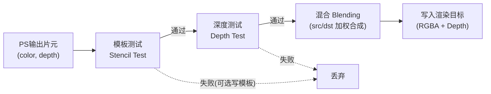
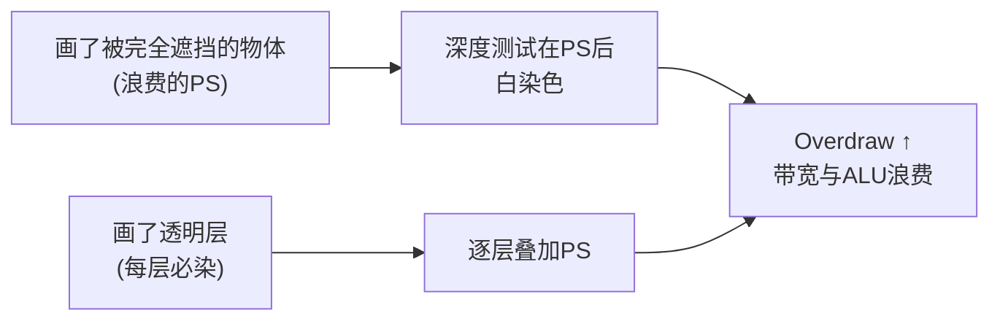

# 03 - 像素着色与输出合并

> 阅读时间：约 35 分钟
> 关键词：像素着色器、深度测试、Early-Z、混合、Overdraw

---

## 你将学到什么

- 像素着色器的工作：从插值属性到最终颜色
- 输出合并的全部测试：深度、模板
- Early-Z：把深度测试提前带来的巨大性能
- 混合（Blending）：透明物体如何合成
- Overdraw：多画了谁

---

## 1. 像素着色器：颜色诞生的地方

像素着色器（Pixel Shader / Fragment Shader）拿到一个片元 + 光栅化插值好的全套属性（UV、法线、世界位置、顶点色……），输出一个 RGBA 颜色。这是整条管线里**最自由、也最昂贵**的阶段——你在里面想干什么都行，但每行代码 × 数百万像素。

典型一次 PS 干的事（也是第05、06章的预演）：

```
1. 采样主贴图 albedo = tex2D(_MainTex, uv)
2. 采样法线贴图 → 解码 → 世界空间法线 n
3. 拿到光照方向 l、视线方向 v（引擎内置参数）
4. 光照模型计算 BRDF（Lambert/Blinn-Phong/PBR）
5. 加上环境光、阴影采样
6. 输出最终 HDR 颜色
```

**输入**：插值属性 + 常量（材质参数、引擎内置参数如相机位置、光源表、阴影矩阵……）+ 各类纹理。
**输出**：至少一个 4 分量颜色（也可多个，见 MRT）。

### 多渲染目标（MRT）

PS 可以**同时写多个渲染目标**（Multiple Render Targets）——一次 PS 输出 4~8 张图。这是**延迟渲染**的基石（第08章）：一次 PS 把法线、材质参数、颜色分别写进 G-Buffer 的不同附件，光照阶段再来消费。引擎的 `RenderTexture` 支持 MRT（`Runtime/Graphics/RenderTexture.cpp`），GfxDevice 层抽象见 `RenderSurface.h` 与渲染目标绑定接口。

## 2. 输出合并：像素的"生死竞赛"

PS 算完颜色，还不能直接写入帧缓冲——要过输出合并阶段的一串"关卡"：



### 2.1 深度测试：谁挡住谁

深度缓冲与颜色缓冲同分辨率，存每个像素的"当前最近表面的深度"。新片元带着自己的深度 $z_{new}$ 与缓冲里的 $z_{buf}$ 比较，按材质配置的比较函数（通常是 `Less`）：

$$
z_{new} < z_{buf} \Rightarrow \text{通过（我更近，我能被看见）}
$$

通过则颜色覆盖写入（或混合），同时深度也写入。这就是遮挡的真相：**不是近的把远的"擦掉"，而是远的先/后来竞争同一像素，近者胜**。

深度比较 + 更新都是硬件对整块像素并行执行的，这也是 GPU 深度缓冲带宽需求的来源。

### 2.2 Early-Z：把测试提前

上面流程图里深度测试在 PS **之后**。但想一个场景：一堵墙后面藏着 10 万个像素的物体，PS 每个像素都跑完复杂光照，最后却因"墙更近"被丢弃——**白算**。

现代 GPU 的解法：**Early-Z（提前深度测试）**——在 PS 执行**之前**先做深度测试，挡住的片元直接跳过 PS。等于免费的遮挡剔除。

$$
\text{普通: } [\text{PS} \to \text{深度测试} \to \text{写}] \qquad
\text{Early-Z: } [\text{深度测试} \to \text{PS} \to \text{写}]
$$

**但它有前提**：PS 不能在着色时改深度（写 `SV_Depth`）、不能丢弃片元后依赖深度（discard）——一旦 PS 声明了这些行为，GPU 只能退回"后测试"，性能断崖。

由此得出引擎排序的经典策略（第08、09章会反复见到）：

> **不透明物体：从近到远画**（先画近的，把深度缓冲快速"垫高"，后面的全被 Early-Z 白白跳过——越跳越赚）；
> **透明物体：从远到近画**（因为要做混合，必须按序，见下）。

引擎内置管线与 URP 的排序规则正是这么干的：RenderQueue：`Geometry`（2000）近→远，`Transparent`（3000）远→近。

### 2.3 模板测试：像素级的"门票"

模板缓冲是每像素一个整数"标签"（通常 8 位）。渲染前可以要求"模板值等于 X 才能画 / 画完把模板设成 Y"。用途：描边（把原物体写入模板，放大版描边 pass 只画模板外）、镜面限定区域、延迟光的 volume 标记等。配置接口：材质/RenderState 里的 `Stencil` 块，抽象于 `Runtime/GfxDevice/GfxDeviceTypes.h` 的 `StencilOp` 等。

## 3. 混合（Blending）：透明的合成

透明玻璃看到后面的东西 = **前景色与背景色按比例混合**。硬件提供可配置的混合公式：

$$
C_{out} = f_{src} \otimes C_{src} \; \text{op} \; f_{dst} \otimes C_{dst}
$$

最常见 **alpha 混合**（`SrcAlpha, OneMinusSrcAlpha`）：

$$
C_{out} = \alpha \, C_{src} + (1-\alpha) \, C_{dst}
$$

透明物体的 alpha（0~1）就是"我占的比重"。直觉：60% 透明的红玻璃 = 60% 红 + 40% 背景。

**为什么透明必须从远到近**：混合公式里背景必须在混合前**已经是"最终背景"**。若先混近的再混远的，远处物体错误地挡在前面。且透明物体**不写深度**（写深度会阻止后面物体通过深度测试），所以也不能享受 Early-Z 的遮挡剔除。结论：

> 透明是最贵的绘制类别：不能 Early-Z、必须排序、容易多层叠加 → 每像素被 PS 执行多次（Overdraw）。

**其它常用混合模式**：`Additive`（加法，火花/光效：$C_{out} = C_{src} + C_{dst}$）、`Multiply`（变暗）、`Premultiplied Alpha`（颜色预乘 alpha，第11章 UI 合成会再遇到）。

## 4. Overdraw：每个像素被画了几次

**Overdraw = 同一像素被 PS 染色的次数**。三次即"3 倍 Overdraw"。产生原因：

- 半透明物体层层叠叠（粒子、头发、雾面）；
- 不透明物体顺序错乱（先画远的，深度没垫高，后面的照样全染）；



诊断工具：引擎的 **Overdraw 视图**（Scene 视图 DrawMode → Overdraw，基于 MRT 伪染色），手机端用 RenderDoc/骁龙分析。解法：减少透明层数、不透明先近后远、合理利用遮挡剔除（第04章）。

## 5. 小结（管线闭环 + 后续地图）

至此，几何（顶点）→ 光栅化（覆盖）→ 着色（颜色）→ 合并（竞争写入）全链闭环。之后的章节将沿两条线展开：

- **引擎如何组织这条管线的执行**（第03~05章：架构、剔除、材质）；
- **PS 里到底算什么才是"物理正确"**（第06~07章：光照与阴影）。

## 自测问题

1. 深度测试通过的条件是什么？为什么说"遮挡是竞争出来的，不是擦出来的"？
2. Early-Z 为什么要求 PS 不写深度/不 discard？如果 shader 里有 alpha test（discard），性能会发生什么？
3. 为什么不透明物体近→远、透明物体远→近？两个顺序各自优化/保证了什么？
4. Additive 混合的火花特效，排序错乱会有视觉错误吗？为什么？（答案：加法可交换，加法混合天然无序敏感）

---

*下一节：[04-纹理采样与Mipmap](学习笔记/cg/tuanjie引擎/总览/第02章-GPU图形管线原理/04-纹理采样与Mipmap.md) —— 显存中的"图案"如何被正确、高效地贴到像素上。*
