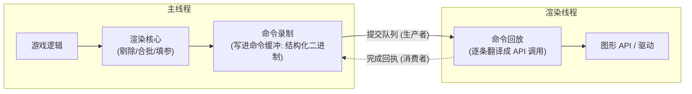
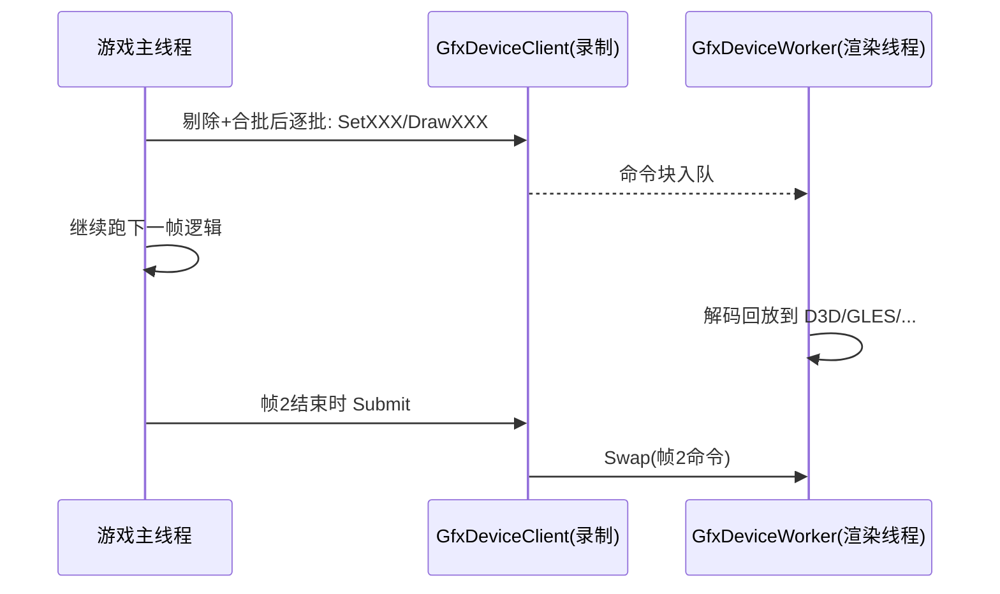

# 03 - 多线程渲染与命令流

> 阅读时间：约 35 分钟
> 关键词：命令录制/回放、Client-Worker、渲染线程、主线程加速

---

## 你将学到什么

- 为什么"主线程直接调 GPU"不是最优解
- 录制与执行分离：命令流架构
- 团结引擎 GfxDevice 的 Client-Worker 模型（`threaded/` 目录）
- 渲染线程与主线程如何协作、谁等谁
- 多线程录制在现代 API 时代的延伸

---

## 1. 问题：主线程直接发号施令的困境

第02篇说过，传统 API（D3D11/GLES）是"即时"调用——CPU 调 `Draw()`，驱动当场处理（内部再排队）。这带来两个困境：

**困境一：主线程被驱动占用。** 驱动内部要做合法性检查、资源转换、命令打包——几十微秒级的 API 调用开销发生在**主线程**上。1000 次 DrawCall × 每次 50μs = 50ms，一帧没了。

**困境二：无法并行。** GPU 在后台慢慢画，主线程串行地"一边想下一步一边逐个调用"——录制工作无法分给多个线程（D3D11 的 context 单线程假设）。

解法早在 GPU 编程黎明期就出现：**把"决定画什么"与"翻译成 API 调用"拆成两个阶段、两个线程**。

## 2. 命令流架构：录与放分离

关键洞察：

1. **命令缓冲 = 序列化的 API 调用意图**。"绑定纹理 #12、设置常量 alpha=0.5、DrawIndexed(96)"——不是函数调用，是**字节流**。生产（录制）与消费（回放）天然解耦；
2. **录制是纯 CPU 内存操作**，极快（写几十字节 vs 驱动调用几十微秒）；翻译发生在渲染线程，**不占主线程**；
3. 回放顺序与录制顺序一致 → 渲染语义不变；主线程一帧录制，渲染线程消费，**两条流水线重叠**（第00篇时序图的引擎级实现）。

命令缓冲里"命令"的粒度值得体会——不是一条 GPU 命令（那是现代 API 的事），而是**一条引擎级意图**（如"绘制这批合批后的几何"），回放时才展开成几十条 API 调用。粒度越粗，翻译摊销越好。

## 3. 团结引擎的落地：Client-Worker

GfxDevice 的多线程模型（`Runtime/GfxDevice/threaded/`）由三个主角构成：

| 组件 | 角色 | 源码 |
|---|---|---|
| **GfxDeviceClient** | 主线程侧接口的化身：渲染核心调用的 `SetTexture/Draw...` 实际被录制成命令 | `GfxDeviceClient.cpp` |
| **GfxCommands** | 命令流的编码/解码器：压缩的命令缓冲 + 参数块 | `GfxCommands.h` |
| **GfxDeviceWorker** | 渲染线程本体：循环取命令块 → 解码 → 调用**真正的** GfxDevice（各 API 后端） | `GfxDeviceWorker.cpp` |

架构上是标准的**生产者-消费者**：

- 主线程：`Client` 把命令编码进块分配器（`ClientWorkerBlockAllocator`），投递给队列，继续干下一件事；
- 渲染线程：`Worker` 取块、逐命令回放到真实设备；
- 同步点：**Swap（提交一帧）** 与 **Sync（等待回放追上）**——前者给信号，后者用于"主线程需要 GPU 结果/需要复用某个资源"时强制等待。

> 💡 **为什么这套对传统 API 也有奇效**：即使 D3D11 内部单线程，"驱动调用全被推到渲染线程"已经让主线程轻装——引擎的"Jobs/多线程逻辑"收益才装得进来。

**编辑器与玩家的差异**：编辑器里你看到的 Render Thread、Job.Worker 线程在 Profiler 里排成列——主线程做逻辑与录制，Render Thread 做回放。玩家构建同样保持该模型（移动端也如此，只是渲染线程可能更细粒度节流）。

## 4. 现代延伸：从"单渲染线程"到"多线程录制"

D3D12/Vulkan/Metal 的 CommandList 允许**多线程同时录制**（各自录制各自的命令表，最后按序提交）。引擎层面怎么用？

- **PSO/着色器创建、纹理上传**这类昂贵工作，早就被推到辅助线程（`GfxCreateGpuProgramQueue`——着色器编译队列，避免卡主线程）；
- **并行录制 Pass**：现代管线（HDRP/URP 的 RenderGraph）将 Pass 编录工作在多线程间切分——每个 Pass 独立命令表，合并提交。GPU Driven 思路的 CPU 侧版本；
- **异步 Compute**：现代 API 的 compute 队列与图形队列并行，阴影预渲染、粒子模拟与主画面重叠执行（第12章）。

这套架构的极限形态就是"GPU 自渲染"：CPU 只投递极少量命令，大场景剔除、绘制都由 GPU 自己用 compute 完成（第12章 GPU Driven 专题）。

## 5. 与渲染语义的关系：谁等谁

命令流改变了"调用顺序 = 执行顺序"的直觉，必须建立**帧内依赖**意识：

- **资源被命令流引用期间不可销毁/修改**——引擎用 `RenderTexture` 的生命周期管理、`GfxDeviceResources` 的延迟销毁（命令回放完成后才真删）保证安全；
- **CPU 想读 GPU 结果**（如 `AsyncGPUReadback`、屏幕截图）必须走异步回读请求+回执轮询（`ThreadedAsyncReadbackData.h`），主线程硬等会卡整个流水线；
- **同步屏障的选择**是现代管线的显式课题（`GfxDeviceAsyncCommand.h` 的异步队列抽象、屏障语义），第04篇在 Vulkan/D3D12 语境下展开。

> ⚠️ **调试提示**：渲染问题定位时先看 Profiler 的线程图——是主线程瓶颈（逻辑/合批/录制过载）还是 Render Thread 瓶颈（回放过载：DrawCall 碎、状态切换频繁）？两者药方完全不同（第12章）。

---

## 小结

- 命令流 = "录"（主线程，快）与"放"（渲染线程，慢）分离，重叠除瓶颈；
- 团结引擎实现为 **GfxDeviceClient（录制）/ GfxCommands（编码）/ GfxDeviceWorker（回放）** 三件套；
- 主线程只感知 Client；真实 API 调用全在 Worker；
- Swap/Sync 是主-渲两线程的同步点；资源生命周期由回放时序保证；
- 现代延伸：多线程录制 PSO、异步回读、异步 compute。

## 自测问题

1. 命令录制为什么快？回放为什么慢？各自在哪个线程？
2. 没有 Swap/Sync 会怎样？各举一个必须 Sync 的场景。
3. 渲染线程忙不过来（Render Thread 100%）时，优化方向有哪些？（对比主线程 100% 的优化方向）
4. 现代命令表与引擎命令缓冲，粒度有何不同？

---

*下一节：04-现代API对比 —— D3D11/GLES vs D3D12/Vulkan/Metal：代差的全景，以及团结引擎的平台后端图鉴。*
