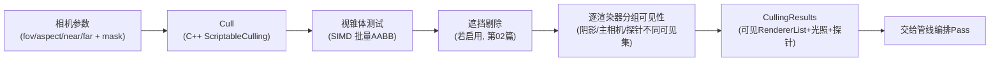

# 01 - 包围盒与视锥体剔除

> 阅读时间：约 35 分钟
> 关键词：AABB、视锥体、Gribb-Hartmann、剔除流水线、CullingResults

---

## 你将学到什么

- 为什么剔除是渲染优化的第一杠杆
- AABB 包围盒：O(1) 的"替身"
- 视锥体平面的数学提取（Gribb-Hartmann 法）
- 剔除的完整流程与团结/Unity 的 Culling API

---

## 1. 剔除：先扔掉，再谈画

第00篇说过：一帧里 90% 的物体在摄像机背后或视野外。**最便宜的三角形是不画的三角形**——GPU 画一个三角形也许 0.01μs，但主线程为它做合批、填参、录制命令的开销是几微秒，全是白干。

剔除回答一个问题：

> **"这个物体有没有可能出现在画面上？没有就直接跳过它的一切下游开销。"**

它发生在 DrawCall 生成之前，省的是**CPU 全链路**（合批、参数、录制、回放、状态切换）加 GPU 执行。性能工程里，它排第一杠杆：一帧从 5000 个物体剔到 500 个，后面的每一步都自动省 10 倍。

## 2. AABB：物体的"替身"

对几千个物体做精确几何可见性判断，本身比渲染还贵。所以需要一个**廉价替身**：**轴对齐包围盒（AABB，Axis-Aligned Bounding Box）**——一个把物体完全罩住的、轴与世界坐标轴平行的盒子。

$$
\text{AABB} = \{ \mathbf{p} \mid \min_x \le p_x \le \max_x,\ \min_y \le p_y \le \max_y,\ \min_z \le p_z \le \max_z \}
$$

- **存储**：仅 6 个浮点数（min/max 两个点）；
- **变换代价**：物体旋转后包围盒要重新放大（按世界旋转取保守包围），但物体是刚体时**预计算一次**即可；团结/Unity 中静态物体包围盒缓存于 Renderer 数据，动态物体按需重算；
- **判断代价**：与视锥体求交是纯比较运算，SIMD 一次测 8 个盒子。

替身的精度损失（盒子比物体本身大一圈）只会**多画不会漏画**——剔除的首要原则：**宁可多画，不可漏画**（漏画 = 画面缺东西 = 事故；多画 = 性能小损）。

> 💡 家族速览：包围球（1 判断更快，用于粗筛）、OBB（贴体但判断贵，少用）、AABB（折中，引擎主力）。移动的物体用**保守 AABB**（罩住旋转后所有姿态）避免每帧重算。

## 3. 视锥体的数学：6 个平面的免费提取

### 3.1 视锥体是 6 个半空间

第01章知道视锥体 = 近/远/上/下/左/右 6 个面围成的棱台。一个点在视锥内 ⇔ 它在 6 个面的**内侧**。每个平面写成**法线式**：

$$
\text{平面 } \pi: \quad \mathbf{n} \cdot \mathbf{p} + d = 0, \qquad \text{内侧} \iff \mathbf{n} \cdot \mathbf{p} + d \ge 0
$$

### 3.2 Gribb-Hartmann：从 VP 矩阵"抠"出 6 平面

经典技巧：不需要独立算 6 个面的法线——**组合矩阵 $M_{VP} = V \times P$ 的 4 个行向量，加减即得 6 平面**（把 $M_{VP}$ 各行视为 4 维向量 $\mathbf{m}_i$）：

$$
\begin{aligned}
\pi_{left} &= \mathbf{m}_3 + \mathbf{m}_0 \quad & \pi_{right} &= \mathbf{m}_3 - \mathbf{m}_0 \\
\pi_{bottom} &= \mathbf{m}_3 + \mathbf{m}_1 \quad & \pi_{top} &= \mathbf{m}_3 - \mathbf{m}_1 \\
\pi_{near} &= \mathbf{m}_3 + \mathbf{m}_2 \quad & \pi_{far} &= \mathbf{m}_3 - \mathbf{m}_2 \\
\end{aligned}
$$

（$\mathbf{m}_3$ 是 $w$ 行——即 $\pm w \pm x \ge 0$ 这类裁剪不等式的等价形式，就是第02章"裁剪空间测试 $|x| \le w$"的平面版本。）归一化后 $d$ 还携带"点到面的带符号距离"，剔除与投影雾都能直接用。

**为什么这免费**：剔除与"投影视角"本来就是同一份数学（$M_{VP}$），只是从"逐顶点测试"（GPU 裁剪）改写为"物体级测试"（CPU 剔除）。

### 3.3 AABB vs 平面：三种关系

盒子对平面 $\pi$ 的测试（取盒子在法线正/负方向的极值点投影，"最正点" $p^{+}$、"最负点" $p^{-}$）：

| 测试 | 结果 |
|---|---|
| $\mathbf{n} \cdot p^{+} + d < 0$ | 盒子整体在平面**外侧** → **不可见**（最快剔除） |
| $\mathbf{n} \cdot p^{-} + d \ge 0$ | 盒子整体在平面**内侧** → 对此平面**无遮挡**，继续测下一平面 |
| 其它 | 盒子**跨越**平面 → 保守按可见处理，测下一平面 |

6 个平面全测完仍在 → 进可见集。**注意**：跨面即保——一个大盒子跨过左平面就算可见，哪怕它 99% 在外。这就是"把大场景合并成一个大 Mesh 反而毁掉剔除"的经典事故根源（第04篇静态合批的代价分析）。

## 4. 团结/Unity 的剔除流水线

引擎侧完整流程（URP 为例）：

要点：

1. **一个物体可能被多次可见性判定**：主相机可见集、阴影投射可见集（从**光源视角**再剔一次，第07章）、反射探针可见集（从探针视角）——剔除按"视点"组织，相机与灯与探针**共用同一套机制**；
2. **剔除结果的形态**：URP 里你拿到 `CullingResults.visibleRenderers`（渲染器列表 + 排序键），第09章的 Pass 会按它逐层过滤成 `RendererList`；
3. **裁剪掩码**：相机 Layer Culling Mask 在剔除时生效——根本不进可见集，比"进来了 shader 里丢弃"便宜得多。

> 📁 **源码指引**：`Runtime/Graphics/ScriptableRenderLoop/ScriptableCulling.cpp`（C++ 剔除主战场，SIMD 实现）、`Runtime/Camera/`（相机参数）、`Runtime/Graphics/RenderLayer.h`（层掩码）。渲染器可见性管理在 `Renderer.cpp` 的 `UpdateVisible` 系函数（含"探针可见集"分支）。

## 5. LOD：剔除的"温和版"

剔除是 0/1 判断，**LOD 是分级版本**：远处的物体不是不画，而是换成"低成本替身"（少顶点的网格、甚至 billboard）。LOD 选择基于**包围盒与相机的距离/屏幕占比**（Screen-space size），一次距离比较即可。团结/Unity 的 LODGroup 按包围盒对角线与视场角的比值选档。

> ⚠️ **LOD 闪变**：物体在档位边界来回横跳（59.9%→60.1%）导致模型交替闪烁。解法：滞回（hysteresis）——升档与降档用不同阈值。引擎 LODGroup 内置轻微滞回；自定义系统时务必记得。

---

## 小结

- 剔除是性能第一杠杆：省 CPU 全链路 + GPU；
- AABB 是 O(1) 替身，"宁多勿漏"；
- Gribb-Hartmann：从 VP 矩阵行向量加减免费提取 6 平面；
- 剔除按视点组织（相机/灯/探针共用），产出可见集交给管线；
- LOD 是分级剔除，注意滞回防闪变。

## 自测问题

1. 为什么剔除的原则是"宁多勿漏"？举一个"漏画"比"多画"严重得多的具体后果。
2. 大 Mesh 合并为什么毁剔除？（用"跨面即保"规则解释）
3. 阴影的剔除视角与主相机的剔除视角一样吗？为什么源灯（背对相机的光）也要剔除？
4. 用滞回解决 LOD 闪变：升档 60% 降档 55%，为什么这样设计就不闪了？

---

*下一节：[02-遮挡剔除](学习笔记/cg/tuanjie引擎/总览/第04章-剔除与提交/02-遮挡剔除.md) —— 视锥内的物体也可能全被墙挡住。*
