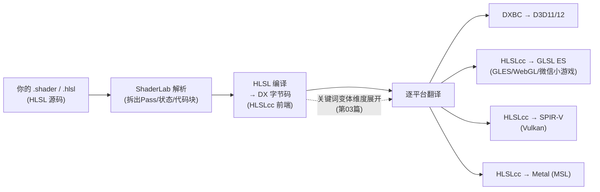

# 02 - 着色语言与跨平台编译

> 阅读时间：约 35 分钟
> 关键词：HLSL、HLSLcc、编译管线、平台目标、着色器缓存

---

## 你将学到什么

- 为什么团结/Unity 选 HLSL 作为唯一源语言
- 一次编译的完整旅程：源码 → 字节码 → 各平台目标
- 编译时点：离线、导入、运行时
- 着色器缓存的体系与"shader 卡顿"的来源

---

## 1. 一份源码，七个目标

第03章说过图形 API 各有亲儿子语言：D3D 用 HLSL、Metal 用 MSL、GLES/WebGL 用 GLSL ES、Vulkan 用 SPIR-V 字节码。理想主义方案是"每种平台写一套 shader"——没人这么干（维护 4 份代码是噩梦）。

团结/Unity 的选择：**HLSL 作为唯一创作语言**，编译器家族负责翻译到每个目标：



**为什么先编译到 DX 字节码再翻译**（而不是 HLSL→各语言直接翻译）：统一中间层把"N 源 × M 目标"的网状问题降为"1 中间 × M 目标"的星形问题；且 DX 字节码自带成熟优化器。**HLSLcc** 正是这个"字节码 → GLSL/MSL/SPIR-V"翻译器家族的名字（Unity 开源项目）。

> 💡 对新手的实践意义：写 shader 只写 HLSL；遇到平台差异（precision、修饰符），用宏 + `#pragma require` 声明能力，不写双份代码。

## 2. ShaderLab：HLSL 的"包装信封"

团结/Unity 的 .shader 文件 = **ShaderLab 语法**包裹 HLSL 代码：

```
Shader "name"        ← 信封：名字/属性/状态/Pass组织
  Properties {...}
  SubShader {
    Pass {
      Cull Back      ← 状态（非HLSL，ShaderLab关键字）
      HLSLPROGRAM    ← 从这里开始才是"纯 HLSL"
      #include "..."
      #pragma vertex Vert
      #pragma fragment Frag
      ENDHLSL
    }
  }
```

引擎先解析信封（Pass 结构、状态、属性表），再对每个 Pass 的 HLSL 块做真正编译。所以你在 ShaderLab 里看到的"语法大杂烩"其实是**两套语言**：描述组织的 ShaderLab + 描述算法的 HLSL。

## 3. 编译发生在什么时候

三个时点，各司其职：

**① 编辑器交互时（开发体验关键路径）**——选中材质、改关键词时，Editor 按需编译并缓存。改动代码后第一次出现的组合会"小卡"一下。为了不阻塞主线程，引擎把 shader 编译塞进了后台任务池（第03章的 `GfxCreateGpuProgramQueue`——队列化、异步化）。

**② 打包时**——所有"被引用且未剔除"的变体全部编好，**压缩进包体**。这是包体膨胀大户（10 万变体的项目 shader 资产数 GB 的真实案例——第03篇的主题）。

**③ 运行时（尽力避免）**——首次遇到"没预热"的变体 = 现场编译 = **卡顿**（GLES/移动端尤其痛，编译可能上百毫秒）。解法：**预暖**（Warmup），打包器收进 variant collection 或手动 `ShaderVariantCollection.WarmUp()` 在 loading 画面里提前编好。

## 4. 着色器缓存：三层加速

编译很贵，所以引擎有三层缓存（你知道它们的存在，才不会误判"什么时候该清缓存"）：

| 层 | 存什么 | 什么时候失效 |
|---|---|---|
| **本地 Library/ShaderCache** | 编译中间结果 | shader 源码 / 关键词集合 / 编译器版本变 |
| **包体内编译产物** | 全部打包变体的目标码 | 每次构建重新生成 |
| **驱动级 PSO/程序缓存** | GPU 最终程序对象 | 驱动升级 / GPU 换代 |

"改了 shader 没生效""缓存疑似坏了"——依次清这三层（Library、打包、驱动缓存），是引擎开发的标准排查动作。

## 5. 精度与目标：移动端的关键差异

跨平台编译不只翻译语法，还处理**精度体系差异**：

- GLES/GLSL 提供 `lowp/mediump/highp` 修饰符；桌面 HLSL 一律 32 位浮点。翻译器按引擎策略选择：**位置与深度用 highp、颜色可用 mediump**（移动 GPU 上 mediump 吞吐量约 2 倍）。团结/Unity 的 `half`（HLSL 的最小类型）在移动端映射 mediump、桌面退化为 float——这就是为什么 URP shader 里遍地 `half4`：**写 half 是免费的移动优化**；
- 老移动 GPU（高通 Adreno 某些代、Mali 某些代）highp 在 VS/PS 可用性不同，历史上有各种 workaround；
- **#pragma target / require**：声明需要的着色器模型（2.5/3.0/4.5...）或特性（mrt5、cubearray、compute...），导入时引擎据此决定该 SubShader 能否在此平台跑（第01篇的"SubShader 能力分级"落地机制，`GraphicsCaps.cpp` 管能力检测）。

## 6. 你在 Frame Debugger 里看到的"着色器名"

调试时每个 DrawCall 显示形如 `Hidden/InternalErrorShader (Pass 0)` 或长串带关键词的名字——它就是"变体全名"：shader 名 + Pass 序号 + **激活关键词列表**。第03篇就讲这个名字里藏着什么。

> 📁 **源码指引**：`Runtime/Shaders/Shader.cpp`（Shader 资产与编译协调）、`SerializedShader*.cpp`（导入后形态——你看到的 .shader 在数据侧其实是 SerializedShader）、`GpuPrograms/`（目标程序存储）、`GraphicsCaps.cpp`（能力检测）。编辑器侧的导入/编译流水线在 `Editor/`（C++）与 C# 的 ShaderImporter。

---

## 小结

- HLSL 单源 → DX 字节码中间层 → HLSLcc 翻译到 GLSL ES/SPIR-V/MSL，星形架构；
- ShaderLab 信封（结构+状态）+ HLSL 信瓤（算法）；
- 三个编译时点：编辑异步、打包全量、运行时（要预暖避免卡顿）；
- 三层缓存：Library / 包体 / 驱动；按层排查；
- `half` 写法在移动端是真实优化，桌面零成本。

## 自测问题

1. 为什么"先编 DX 字节码再翻译"比"每种目标直接翻译"更好？（维护性角度）
2. 运行时首次编译变体为什么卡顿？在哪个阶段可以消除它？
3. URP 模板里为什么颜色计算都用 half4？桌面会损失精度吗？
4. ShaderLab 与 HLSL 各管什么？`Cull Off` 属于哪套语言？

---

*下一节：[03-变体系统与剔除](学习笔记/cg/tuanjie引擎/总览/第05章-材质与Shader系统/03-变体系统与剔除.md) —— 10 万个变体是怎么悄悄长出来的，以及如何消灭它们。*
