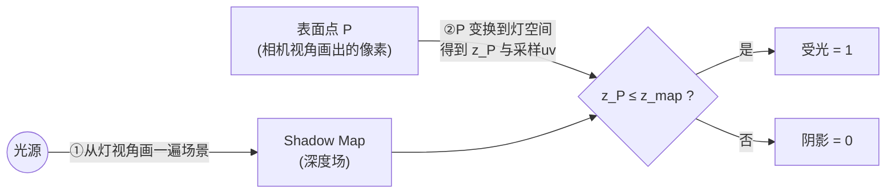
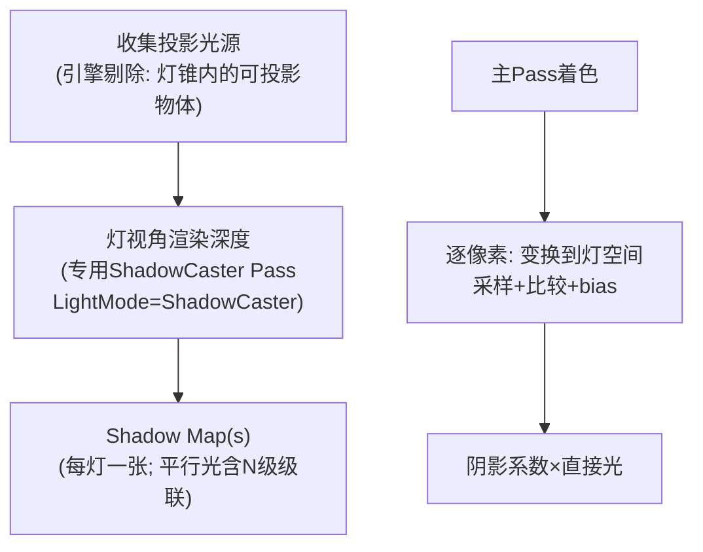

# 01 - 阴影映射原理：Shadow Map

> 阅读时间：约 40 分钟
> 关键词：Shadow Map、深度比较、Shadow Acne、Peter-Panning、Bias、HLSL

---

## 你将学到什么

- Shadow Map 的两步法思想：深度渲染 + 深度比较
- 采样时的坐标变换链
- 阴影的两个经典病：acne（阴影粉刺）与 peter-panning（悬浮）
- Bias、Normal Offset、深度斜率补偿的原理与权衡

---

## 1. 思想：从灯的视角问"谁离我最近"

阴影的本质几何定义：

> **点 P 在阴影中 ⇔ 在"光源→P"的连线上，存在比 P 更靠近光源的遮挡物。**

实时渲染里最主流的解法——**阴影映射（Shadow Mapping）**——把"连线检测"转化为"两次深度比较"：

**第一步：Light Pass（从灯的视角画深度）**
把场景从光源位置渲染一遍，**不画颜色，只存深度**——得到一张"灯眼中的深度图"（Shadow Map）。它的语义：**"从灯到它最近能看到的表面"的距离场**。

**第二步：Main Pass（从相机视角画场景时逐像素判定）**
对每个像素：
1. 把该点用"灯的 VP 矩阵"变换到**灯的裁剪空间**，得到它在 Shadow Map 上的采样坐标与"到灯的距离" $z_P$；
2. 采样 Shadow Map 得到 $z_{map}$（灯最近看到的表面）；
3. 比较：

$$
\text{阴影系数} = \begin{cases} 1 & z_P \le z_{map} \quad \text{（我与灯之间没有东西→受光）} \\ 0 & z_P > z_{map} \quad \text{（我被更近的东西挡住→阴影）} \end{cases}
$$

**为什么这个方法统治了实时渲染 20+ 年**：
- 两遍"画深度"完全复用硬件管线（第02章）；
- 与场景复杂度解耦（只取决于 Shadow Map 分辨率）；
- 天然并行（每像素独立比较）。

代价也在此埋下：**精度由图说话**——一张 2048 的图要覆盖整个游戏世界，还要"每像素比较浮点深度"。

## 2. 采样变换：那条坐标链

PS 里阴影采样的完整坐标旅程（HLSL 中 `_ShadowCoord` 的来源）：

$$
P_{world} \xrightarrow{M_{lightVP}} (x,y,z,w) \xrightarrow{\div w} \text{NDC} \xrightarrow{\times 0.5 + 0.5} \text{UV} \in [0,1]
$$

- $M_{lightVP}$：灯的 View × Projection——平行光是正交投影（第01章）、点光用 6 面 Cubemap（全方位）或 Face 投影、聚光用透视投影；
- NDC→[0,1]：**深度比较发生在同一坐标系**（第01章 D3D 的 z∈[0,1] 约定在此就位——引擎在矩阵/采样配置里替你统一，Reverse-Z 时比较方向相应翻转，第01章）。

判定公式（软系数见第03篇）：

$$
\text{shadow} = (z_P - bias) > z_{map}[\text{uv}] \; ? \; 0 : 1
$$

## 3. 双病之源：离散采样 + 浮点误差

### 3.1 Shadow Acne（阴影粉刺）

想象一块平地被平行光照着。地面某点 P 的 $z_P$ 与 Shadow Map 里存的 $z_{map}$ **理论上相等**（P 就是"灯看到的表面"）。但：

- Shadow Map 是离散格：P 的采样 UV 落在格子边缘时，可能取到**邻居格子的深度**——那是远处凸起处的更浅深度；
- 浮点精度：$z_P$ 计算（像素着色器插值矩阵乘）与 $z_{map}$ 存储（另一遍光栅化）走了两条数值路径。

结果：$z_P$ 微大于 $z_{map}$ → 判"阴影" → **整片表面出现条纹状自阴影**（像被砂纸磨过）。这就是 acne。

**药方一：Depth Bias（深度偏移）**

$$
z_P - bias > z_{map} \; ? \; \text{阴影}
$$

把比较阈值向"受光"方向松一点，把精度误差淹没。**bias 是全局值**——太小治不了 acne，太大治过头：

### 3.2 Peter-Panning（彼得潘阴影）

bias 过大后：**真正贴着地面的物体接触处**（阴影应该恰好衔接的地方）反而全部判为"受光"——影子与物体之间**脱开一条缝**，物体像悬浮着。联系与阴影的视觉锚点断裂。

**药方二：Normal Offset（法线偏移）**

不只松比较阈值，直接**把 P 沿表面法线挪一点再投影**：

$$
P' = P + \mathbf{n} \cdot scale \cdot \rho(\text{光斜率})
$$

沿法线挪动对"接近平面"的表面效果拔群（acne 主因是斜射光线的采样离散），且不会造成 peter-panning 那样的"接缝断裂"（挪动方向垂直于表面，接触点几乎不动）。URP 的 Shadow 资产设置同时提供 depth bias + normal offset 两旋钮，**先 normal offset 后小 bias** 是实践基线。

### 3.3 药方三：Slope-Scaled Bias（斜率补偿）

acne 的概率随**光线与表面的斜率**增大（斜射时相邻格子深度差被放大）。硬件提供**按斜率自动加大 bias** 的比较模式（`slope-scaled depth bias`）：

$$
bias_{eff} = bias + slope \cdot m, \qquad m = \max\left(\left|\frac{\partial z}{\partial x}\right|, \left|\frac{\partial z}{\partial y}\right|\right)
$$

GfxDevice 的 rasterizer 状态里就有它（`Runtime/GfxDevice/GfxDeviceTypes.h` 的深度偏移枚举）——"在灯视角渲染那遍"时启用，比纯全局 bias 更对症。

## 4. 一次完整的引擎级 Shadow Pass

把阴影放进管线（第04章剔除视角的"多视点"在此回收）：

- **投影者与受影者分离**：物体可只投不收或反之（Cast Shadows / Receive Shadows 开关——只投的物体仍要画进深度图，只收的不必画）；
- **ShadowCaster 是独立 Pass**：shader 必须带这个 LightMode 的 Pass 才能投影（自定义 shader 忘写 → 物体在别人阴影里缺一块——经典 bug）；
- **剔除的第二次登场**：阴影渲染本身也要视锥剔除（灯的视锥）——`ScriptableDrawShadows.cpp` 就是这场编排的 C++ 侧（`Runtime/Graphics/ScriptableRenderLoop/`）。

> ⚠️ **性能直觉**：每盏投影灯 = 整个"深度渲染"流程一次（剔除+合批+DrawCall 全套）。**阴影是"第二次场景渲染"**，预算上要按一个"半个场景渲染"计价。4 盏全投影的实时点光可能比 100 盏不投影灯更贵。

---

## 小结

- Shadow Map = 灯视角深度场 + 像素级深度比较，两步法复用硬件管线；
- 采样链：世界点 → 灯 VP → NDC → [0,1] UV；
- acne：离散采样+双路径浮点误差 → 条纹自阴影；解药 bias / normal offset / 斜率补偿；
- bias 过大 → peter-panning（接触缝断裂）：先 normal offset、后小 bias；
- 阴影按"第二次场景渲染"计价；ShadowCaster Pass 是投 影资格证。

## 自测问题

1. 为什么"斜射光线"比"正射"更容易 acne？（用相邻格子深度差解释）
2. depth bias 和 normal offset 各自的作用点在哪一步？哪个更不容易引起接缝断裂？
3. 平行光与点光的 Shadow Map 几何有什么不同？（投影方式与张数）
4. 一个物体在别人阴影里"缺一块"，最可能缺的是哪个 Pass？

---

*下一节：[02-级联阴影CSM](学习笔记/cg/tuanjie引擎/总览/第07章-阴影/02-级联阴影CSM.md) —— 用"金字塔分辨率分配"解决 2048 覆盖世界的难题。*
