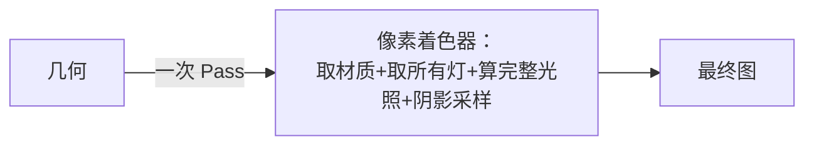

# 01 - 前向渲染

> 阅读时间：约 35 分钟
> 关键词：前向渲染、逐像素灯、Base Pass / Add Pass、性能剖析

---

## 你将学到什么

- 前向渲染的"一遍成像"结构与它的直接成本模型
- 内置管线的 Base+Add 多 Pass 光照机制（及其变体灾难）
- URP 前向的改进：每物体光列表 + 少变体
- 前向的优缺点总账

---

## 1. 最直觉的画法：一遍成像

**前向渲染**：像"写生"——对屏幕每个像素，把能影响它的所有光源**当场**算进颜色里。数据流：



每个像素的成本：

$$
C_{pixel} = C_{material} + N_{lights} \times (C_{BRDF} + C_{shadow})
$$

**成本与"这个像素周围有几盏灯"成正比**。这就是前向的核心矛盾：白天户外（1 盏太阳）便宜得像白送；但夜市灯光场景（20 盏灯）像素成本直接 ×20。

## 2. 内置管线的多 Pass 前向：Base + Add

老内置管线（团结/Unity 内置管线继承自 Unity 传统）解决多灯的方式——**把"每像素 N 灯"拆成"N 遍几何"**：

- **ForwardBase（Base Pass）**：画一遍，算"最重要的 1 盏平行光（含阴影）+ 环境光 + 球谐补光 + 顶点光"；
- **ForwardAdd（Add Pass）**：**对每盏额外的逐像素光再画一遍该物体**，用**加法混合**把结果累加上去。

$$
L_{total} = \underbrace{L_{base}}_{\text{Pass1: 主光+环境}} + \underbrace{\sum_i L_{add,i}}_{\text{每灯一遍（Additive Blend）}}
$$

**几何提交成本**：$N$ 盏逐像素灯 → 物体画 $N$ 遍。100 个物体 × 8 灯 = 800 次 DrawCall 的噩梦，而且：

> ⚠️ **变体灾难回收站**：第05章的"光源数 ×3"变体维度正是这套机制（`LIGHTMAP`/`POINT`/`SPOT` 每盏 Add Pass 都要对应类型变体）。内置管线的 shader 巨大不是没有理由的——它是这套"多 Pass 多类型多数量"排列的必然。

**优点**（别只看缺点）：
- **兼容万物**：任何硬件（支持 MRT 前）、任何平台（WebGL/小游戏友好）；
- **透明物体天然支持**（延迟渲染做不了透明——第02篇展开）；
- **MSAA 硬件抗锯齿直接可用**（第11章）——延迟用 MSAA 很麻烦；
- 内存占用低（无 G-Buffer 带宽，见第02篇）；
- 修改光照逻辑=改一个 shader，不用管线介入。

## 3. URP 前向的现代化改造

URP 还是前向，但把"多 Pass 逐灯"改成了"**单 Pass + 光列表**"：

1. 剔除后给**每个物体**分配一个"影响它的逐像素光索引列表"（`LightIndexCache.h` 的 C++ 落地——第06章提过）；
2. 物体画**一遍**，PS 里循环自己的光列表：

```hlsl
for (i = 0; i < _AdditionalLightsCount; i++) {
    Light l = GetAdditionalLight(i, positionWS);
    color += LightingPhysicallyBased(brdfData, l);
}
```

3. 数量上限由管线控制（URP asset 的 `Per Object Limit`，默认 4，移动常设 2~8）——**超出的灯降级为球谐/顶点光贡献**。

**收益**：几何只画一遍（DrawCall 不再随灯数膨胀）；变体只剩"附加光循环展开档位 × 少量"；**移动端就靠这套**。

**保留的矛盾**：像素成本仍 ∝ 灯数（一个像素可能被 8 盏灯各算一遍 BRDF）；**半透明仍全走前向**（第02篇讲为什么延迟帮不了它们）。

## 4. 前向的性能总账

| 维度 | 表现 |
|---|---|
| 几何成本 | ∝ 物体数（URP）或 物体×灯数（内置） |
| 像素成本 | ∝ **该像素覆盖区域的灯数** ×（BRDF+阴影采样） |
| Overdraw 放大 | **有**（重像素处灯数也最多——双重浪费） |
| 内存 | 低（无 G-Buffer） |
| 透明支持 | ✅（唯一原生选项） |
| MSAA | ✅ 简单 |
| 平台 | 全平台（含小游戏/老 GLES） |

**适用场景画像**：灯少（户外/月光/暗巷）、透明多（玻璃/水面/植被 alpha test 与 blend）、平台杂（微信小游戏）、内存紧。**这是团结引擎的微信小游戏管线选择前向的最底层原因**。

> 📁 **源码指引**：URP 附加光循环 `Packages/com.unity.render-pipelines.universal/Shaders/Lighting.hlsl`（`GetAdditionalLight` 与循环展开）；引擎侧每物体光列表 `Runtime/Graphics/ScriptableRenderLoop/LightIndexCache.h`；内置管线的 ForwardBase/Add 组织在 `Runtime/Shaders/`（SerializedShader 的 Pass LightMode 与 shader include 家族）。

---

## 小结

- 前向=一遍成像，像素成本 ∝ 灯数——多灯场景是天敌；
- 内置 Base+Add：几何 × 灯遍数 + 变体爆炸（历史方案）；
- URP：单 Pass + 每物体光列表 + 上限降级（现代前向）；
- 前向四宝：透明支持、MSAA、全平台、低带宽——小管线（小游戏）与透明大户的本命。

## 自测问题

1. 用 Base+Add 解释"为什么内置管线物体 DrawCall 随灯数上涨"；
2. URP 把灯列表放"每物体"而不是"每像素"——灯多且交叠时，一个像素被重复算几遍？
3. 为什么半透明物体在任何管线里都只能走前向光照？
4. 微信小游戏为什么必然是前向？用总账的哪几行回答？

---

*下一节：[02-延迟渲染与G-Buffer](学习笔记/cg/tuanjie引擎/总览/第08章-渲染路径/02-延迟渲染与GBuffer.md) —— 把"像素成本∝灯数"改成"灯成本∝屏占比"的置换术。*
