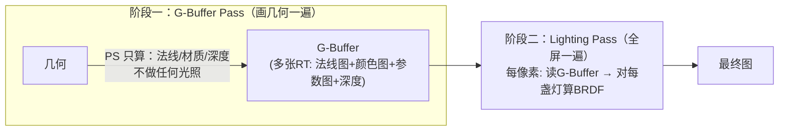

# 02 - 延迟渲染与 G-Buffer

> 阅读时间：约 40 分钟
> 关键词：延迟渲染、G-Buffer、MRT、光照 Pass、带宽

---

## 你将学到什么

- 延迟渲染的两阶段结构（几何→光照）
- G-Buffer 的典型布局与各通道编码
- 为什么延迟把"像素×灯"变成"灯×受影响像素"
- 延迟的四宗罪：透明、MSAA、带宽、材质单一

---

## 1. 置换术：把光照从"几何里"搬到"屏幕上"

前向的死穴：**光照计算被绑在几何绘制里**——画物体时才算光，同一像素被后来的物体重算、被 Overdraw 白算。

延迟渲染的置换：**先把几何"压扁"成属性图，再在全屏上算光**：

**G-Buffer（几何缓冲）** 是"几何的解剖图"——把物体打碎成逐像素属性：

| RT | 内容（典型） | 格式 |
|---|---|---|
| RT0 | **Albedo.rgb** + AO/材质标记.a | sRGB8/ARGB32 |
| RT1 | **法线**（world/view 编码） | ARGB32（BC5 类压缩存 xy） |
| RT2 | **Smoothness** + **Metallic** + 保留 | ARGB32 |
| RT3（HDRP） | 发光/烘焙光照/其他 | HDR16F |
| Depth | 深度（光照的世界位置由此反推） | 24/32F |

阶段二里，像素 $\mathbf{p}$ 的位置从深度反推（第02章的逆投影）、法线与材质从 RT 读出——**光照计算拥有屏幕上每个点的完整解剖信息，且每像素只算一次**（几何阶段 Overdraw 只浪费便宜的属性填写，昂贵的光照在最后唯一存活的像素上算——**延迟天然抗 Overdraw**）。

**灯的成本公式**（灯被画成"受影响的屏幕区域"——一个矩形/球投影到屏幕）：

$$
C_{light} = \sum_{l} \text{受影响像素数}(l) \times C_{BRDF}
$$

灯的成本只由**它照亮的屏幕面积**决定，与场景物体数、Overdraw 无关。100 盏小台灯可能比 1 盏大射灯还便宜——**灯多灯小 = 延迟的天下**（夜店、霓虹街、室内阵列光）。

## 2. 延迟的四宗罪

**罪一：透明物体无处安放。**
半透明背后"还没确定的背景"，没有最终深度与唯一表面——G-Buffer 的"每像素一个表面"假设崩溃。**工业答案：透明物体回退前向光照**（延迟管线的透明 Pass 就是个嵌入式前向渲染器）。于是双份 shader 体系：Lit（延迟）+ Lit Forward（透明）——**材质开发成本 ×2**。

**罪二：MSAA 昂贵。**
硬件 MSAA 要给每个采样点保存几何信息——G-Buffer 尺寸直接 ×4/×8（带宽爆炸），工业实践要么放弃 MSAA（用 TAA，第11章）、要么各种"深度/法线仅 1 采样"的混合技巧。HDRP 的选择：默认 TAA，不提供 MSAA。

**罪三：带宽大户。**
G-Buffer 写入（几何 Pass MRT×4）+ 光照 Pass 全读 + 输出——**一像素几十字节的读写**。4K 延迟管线带宽轻松上百 GB/s：桌面可以，**移动端（尤其老 GLES）几乎不可用**——这就是移动前向的根本原因（不是"前向更简单"这么简单，是带宽墙）。

**罪四：材质单一化。**
光照阶段读到的只是"解码后的标准参数"，**所有物体共享同一个 BRDF**（或按材质 ID 分支，分支成本高）。想做"头发各向异性高光+皮肤次表面+布料"的混搭，延迟要么塞进一张超级 BRDF（复杂、变体式浪费），要么让特殊材质回退前向（又一套）。**PBR 统一材质文化的最大推手其实就是延迟**——不是美术偏好，是管线偏好。

## 3. 谁在用延迟

- **HDRP**：默认 Deferred（可选 Forward——但透明永远前向）；
- **URP**：可选 Deferred（默认 Forward；移动一般不Deferred）；
- **内置管线**：老 Deferred（Classic + G-Buffer 布局开放给自定义 Debug）；
- **主机/PC 3A**：几乎清一色延迟（灯海是 3A 夜景的刚需）。

> 📁 **源码指引**：延迟的 G-Buffer 布局与光照 Pass 在 HDRP 包 `Runtime/RenderPipeline/ShaderPass/`（GBuffer pass 与 DeferredLighting pass）；URP 的可选延迟 `Packages/com.unity.render-pipelines.universal/Runtime/RendererFeatures/` 与 `Shaders/Utils`（GBuffer 相关）；引擎侧 MRT 与格式支持：`Runtime/Graphics/RenderTexture.cpp`（MRT 绑定）、`Format.h`（各平台 RT 格式能力——罪三的"平台带宽差异"就是查它）。

---

## 小结

- 延迟=几何压扁成 G-Buffer + 全屏光照，光照天然抗 Overdraw；
- 灯成本 = 受影响屏幕面积——灯多灯小的夜场之王；
- 四宗罪：透明回退前向、MSAA 困难、带宽巨大、材质单一；
- 桌面 3A=延迟，移动=前向，中间地带看灯的分布。

## 自测问题

1. 用成本公式对比：1000 盏小灯夜市 vs 1 盏太阳户外——两条路径各自的账单？
2. 为什么延迟管线里"透明物体多的项目"实际是"前向为主的混合管线"？
3. G-Buffer 带宽估算：ARGB32×3 + Depth24 一像素多少字节？4K@60fps 需要多少 GB/s（仅几何阶段写入）？
4. 延迟如何塑造"PBR 统一材质"的行业文化？

---

*下一节：[03-前向+与光的分块](学习笔记/cg/tuanjie引擎/总览/第08章-渲染路径/03-前向+与光的分块.md) —— 不存 G-Buffer，也把灯的成本拉下来：Forward+ / Tiled / Clustered。*
