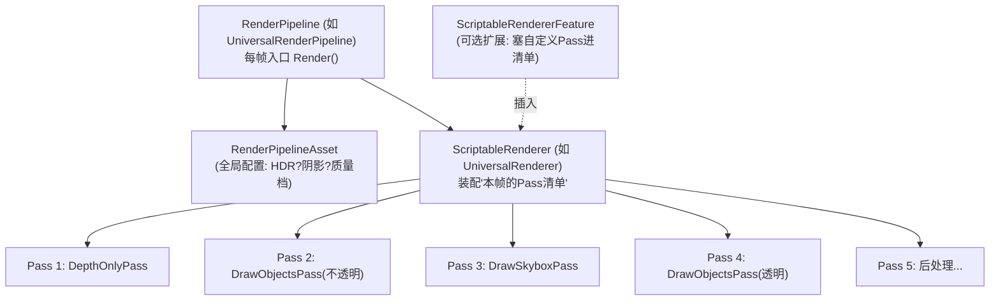

# 01 - SRP 架构：管线即程序

> 阅读时间：约 40 分钟
> 关键词：ScriptableRenderPipeline、ScriptableRenderContext、RenderPass、RendererFeature

---

## 你将学到什么

- SRP 的三件套：Pipeline、Renderer、Pass 的分工
- `ScriptableRenderContext`：C# 与 C++ 引擎的"隔窗点菜"
- 剔除-排序-提交的 SRP 主循环骨架
- RendererFeature / RenderGraph 的扩展点

---

## 1. SRP 的核心承诺

第00章埋的问题在此回收："管线策略为什么放 C#？"

```
第0.5层（引擎渲染核心，C++）      ← 快：剔除/合批/参数/命令
第0.4层（管线策略，C#）           ← 灵：流程编排、热重载、可发行源码
```

**SRP（Scriptable Render Pipeline）** 的架构承诺：

1. **引擎重活留在 C++**（剔除、合批、提交——性能敏感且无需定制）；
2. **流程编排放 C#**（Pass 顺序、开关、条件——产品需要频繁定制）；
3. 中间靠一个**受控接口**（`ScriptableRenderContext`）过渡——C# 不能直接摸 GPU，防止"自由过度的 API 崩坏底层"。

## 2. 三件套：Pipeline → Renderer → Pass



| 层 | 职责 | 例子 |
|---|---|---|
| **RenderPipeline** | 帧循环、相机遍历、全局流程 | `UniversalRenderPipeline.Render` |
| **ScriptableRenderer** | 每相机的"Pass 装配器" | `UniversalRenderer`（它决定本帧用 Forward 还是 Deferred） |
| **ScriptableRenderPass** | 单个执行单元（一次或一组渲染操作） | `DrawObjectsPass`、`DepthOnlyPass` |
| **RendererFeature** | 向 Renderer 动态**注入 Pass** | SSAO、Decal、自定义卡通描边 |

**每个 Pass 的生命周期**（背下来，写自定义管线必备）：

```
Setup():      声明输入输出（需要什么RT、写什么RT）→ 加入排序
Execute():    拿 context，编写命令
（内部顺序: Configure RT → cmd.Clear/Blit → DrawRenderers）
```

## 3. ScriptableRenderContext：隔窗点菜

C# 侧的**所有**渲染意图都打包进 `CommandBuffer`（`context.command`），经 context 提交：

```csharp
// 典型 Pass 的 Execute 内部（示意）
var cmd = CommandBufferPool.Get("MyPass");
cmd.SetRenderTarget(colorRT, depthRT);
cmd.ClearRenderTarget(true, true, clearColor);
cmd.DrawMesh(myMesh, matrix, myMaterial);        // 直接画（特效常用）
context.ExecuteCommandBuffer(cmd);               // 上交
// 或者——"引擎式"绘制：
context.DrawRenderers(cullingResults, ref drawingSettings, ref filteringSettings, ref stateBlock);
context.Submit();                                  // 帧/阶段末统一提交
```

**关键理解**：`context` 是**录制器不是执行器**——C# 编排像"写购物清单"，C++ 拿到清单后按第03/04章的流水线（合批、填参、GfxDevice 命令流）执行。所以：

- **顺序语义**：清单顺序=执行顺序（SRP 的可预测性来源）；
- **性能语义**：`ExecuteCommandBuffer` 多次只是"追加录制"，真正开销在 C++ 执行与"清单过长"的查找里——**Pass 内命令数量也要节制**（每条 cmd 都是第04章 DrawCall 固定开销的候选）。

> ⚠️ 新手高频 bug：`cmd` 是池化对象，忘 `CommandBufferPool.Release` 会泄漏；在 Pass 外直接用 `Graphics.DrawMesh` 系列会**绕过管线**（RT 状态与管线不知情）——SRP 项目里统一走 context。

## 4. 主循环骨架（伪码）

一个 URP 相机的渲染，去掉血肉后的骨架（你可以拿它对照第00章"一帧旅程"）：

```csharp
Render(ScriptableRenderContext ctx, Camera[] cameras) {
    SetupCameras();                                  // 收集相机栈
    foreach (camera in cameras) {
        if (!camera.TryGetCullingParameters(out var cp)) continue;
        var cull = ctx.Cull(ref cp);                 // ① C++ 剔除（第04章）
        renderer.AddPasses(camera);                  // ② 按配置装配 Pass 清单
        foreach (pass in renderer.passes)
            pass.Setup(...);                         // ③ 声明RT依赖
        renderer.Setup(ctx);                         //    中间RT分配（RenderGraph）
        ctx.SetupCameraProperties(camera);           // ④ 内置参数注入（第03章）
        foreach (pass in renderer.passes)
            pass.Execute(ctx, cmd);                  // ⑤ 逐Pass录制命令
        ctx.Submit();                                // ⑥ 一次性交给 C++ 执行
    }
}
```

**重要行为**：`Submit` 后才开始真正的 C++ 侧执行/回放（第03章命令流）——你看到的 Frame Debugger 的"Pass 列表"正是这批命令的 C++ 化视图。

## 5. 扩展点：RendererFeature 的用法边界

**能**：插入全屏/几何 Pass（描边、SSR、自定义贴花）、借 `RenderObjects`（URP 内置的通用 Pass 注入器）覆盖渲染状态、按 Layer+Queue 画子集。

**不能**：改变剔除逻辑（C++ 定死）、绕过 context 直摸 GfxDevice、安全地"重排别人的 Pass"（Pass 间顺序靠 Setup 声明与注入顺序约定）。

**RenderGraph（新）**：新一代 URP/HDRP 的中间 RT 管理器——你声明"读写谁"，它自动算生命周期与复用（第11章后处理的"中间 RT 爆炸"问题的系统解）。思想=显式数据流图：**写 Pass 像"声明式"而非"命令式"**。学习建议：先懂"手写 RT"的老式代码（海量的 URP 文章/教程都基于它），再迁移到 RenderGraph 思维。

> 📁 **源码指引**：C# 三件套本体在 `Packages/com.unity.render-pipelines.universal/Runtime/`（`UniversalRenderPipeline.cs`、`UniversalRenderer.cs`、`Passes/*.cs`）；`ScriptableRenderContext` 的 C++ 后端 `Runtime/Graphics/ScriptableRenderLoop/ScriptableRenderContext.cpp`（你看 C# 只是接口，C++ 才是合同实体）；`ScriptableBatchRenderer.cpp`——`DrawRenderers` 背后的合批执行现场。

---

## 小结

- SRP 分层：Pipeline（帧循环）/ Renderer（Pass 装配）/ Pass（执行单元）/ Feature（注入器）；
- Context=录制器，C# 写"清单"，C++ 执行重活——快与灵活分而治之；
- 主循环：Cull → 装 Pass → Setup → Execute → Submit；
- 扩展守则：只做"Pass 级"注入，不碰剔除、不绕 context；
- RenderGraph 是"声明式中间 RT 管理"的下一代方向。

## 自测问题

1. 为什么 `DrawRenderers` 走 context 而不能 C# 直接循环画？（合批与命令流在谁手里）
2. 自定义"卡通描边 Pass"插到透明之前——用哪层扩展点？什么时机装配？
3. `Submit` 前后各发生了什么？（录制 vs 执行）
4. RenderGraph 解决的"中间 RT 爆炸"是什么问题？（第11章后处理做铺垫）

---

*下一节：[02-URP管线流程详解](学习笔记/cg/tuanjie引擎/总览/第09章-SRP可编程渲染管线/02-URP管线流程详解.md) —— 逐 Pass 走一遍真实 URP 帧。*
