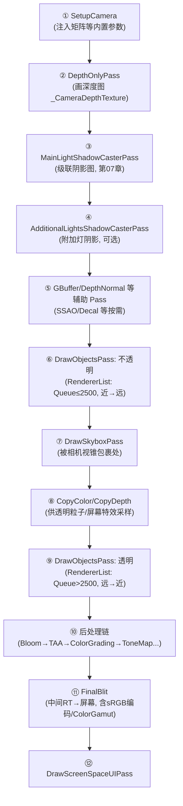

# 02 - URP 一帧的逐 Pass 解剖

> 阅读时间：约 45 分钟
> 关键词：URP Pass 序列、DepthOnly、DrawObjects、RendererList、后处理链

---

## 你将学到什么

- 一个真实 URP（Forward）相机的完整 Pass 序列与每步目的
- 不透明/透明的 `RendererList` 是怎么从 Culling 结果筛出来的
- 相机栈与 Base/Overlay 的关系
- 中间 RT 的生命周期与 FinalBlit

---

## 1. 全景：一个默认 URP 相机的帧

打开 Frame Debugger，标准 URP（Forward、无自定义 Feature、无后处理）一帧大致长这样（顺序号与名称以 `Runtime/Passes/` 对应）：



逐个讲"为什么要有它"。

### ①② 深度先行：为什么先把深度画出来

`DepthOnlyPass` 只画**不透明几何的深度**到 `_CameraDepthTexture`——第02章末的"全屏地基图"。谁消费它：

- **软粒子**（深度差淡出）；
- **SSAO/SSDO**（屏幕空间环境光遮蔽）；
- **屏幕空间效果**（雾、水、边缘检测）；
- **Depth Priming**（如果开：主 Pass 用它做 Early-Z 预垫——第02章的 Depth Prepass 战术）。

**代价**：几何画两遍（顶点×2）。开不开 Depth Texture 是 URP 第一个要按需决策的开关（不用这些效果就关）。

### ③④ 阴影 Pass

第07章的落地：主平行光画级联（MainLightShadowCaster），逐像素附加灯按预算画阴影立方/图集（AdditionalLightsShadowCaster）。**注意它们在几何 Pass 之前**——主 Pass 着色时阴影图已就绪。

### ⑤ 按需的辅助层

SSAO（需要 DepthNormal）、Decal（贴花缓冲）、Forward+（光分桶 compute，第08章）……这些以 RendererFeature 形式注入，插序由 Setup 声明。

### ⑥ 不透明主力：DrawObjectsPass 的内部

`DrawObjectsPass.Execute` 核心是**构造三个"过滤器参数"**，然后 `context.DrawRenderers`（C++ 干重活）：

```csharp
// 过滤：哪些渲染器
filteringSettings = new FilteringSettings {
    renderingLayerMask = 1,                    // Rendering Layer
    layerMask = camera.cullingMask,           // 第04章 Layer
    renderQueueRange = RenderQueueRange.opaque // 队列区间 [0, 2500] ← 第04章!
};
// 排序：什么顺序
drawingSettings.sortingFlags = SortingCriteria.CommonOpaque; // 材质哈希→近→远
// 状态：SRP Batcher 合批路径
rendererList = RendererList.Create(...);
context.DrawRenderers(cullingResults, ref drawSettings, ref filterSettings);
```

**RendererList（新 API）**：把"过滤+排序+状态"打包成显式列表——`context.DrawRendererList(list)`。URP 正迁移到它（与 RenderGraph 配套），**思想与"几何画一遍但按不同视图复用剔除结果"一致**。

C++ 侧 `ScriptableDrawRenderers.cpp` 拿到过滤参数后：排序 → 按材质/合批兼容分组 → 逐批填参与命令录制（第04/05章全部机制的现场会师）。

### ⑦ 天空盒：夹缝中的规则

天空盒必须在**不透明之后、透明之前**：
- 不透明先画 → 天空盒被深度测试自动裁掉"被物体挡住的部分"（只画"没被盖住的天空"）；
- 透明最后画 → 需要背景（含天空）就位。

优化细节：URP 用 "ZPrepass + ZEqual" 画天空盒——只在没有几何的像素画（深度测试 LessEqual），天空盒 shader 只在"孔洞"处跑 PS。

### ⑧ Copy：透明需要的"背景快照"

透明粒子（软粒子）与部分特效需要**当时的颜色/深度**。CopyColor/CopyDepth 把中间图复制进专用 RT（供 PS 采样）。**这是一笔不小的带宽**——不用软粒子就关（URP asset 的 Opaque Texture / Depth Texture 开关）。

### ⑨⑩⑪ 后处理与 FinalBlit

第11章的主题（Bloom/ColorGrading/Tonemapping 全链）。**FinalBlit 的隐藏职责**：整个中间渲染在**线性 HDR RT**（若开 HDR）里进行，最后一步才 ToneMap + sRGB 编码（第01章色彩链的闭环）+ HDR 输出（HDRDisplay，`Runtime/GfxDevice/HDROutputSettings.cpp`）。**为什么"最后才编码"：所有计算保持线性**——第一章的色彩铁律在管线层的落地。

### ⑫ Screen Space UI

URP 的 Screen Space Overlay UI 有专属 Pass（相机之后直写屏幕）——UI 与场景的 RT/排序隔离（第12章 UI 渲染会展开）。

## 2. 相机栈：Base 与 Overlay

URP 的多相机合并机制：

- **Base Camera**：常规相机（自己的剔除与 RT）；
- **Overlay Camera**：只把内容**叠加**进 Base 的画面（无独立输出）——武器相机、小地图边框、3D 名牌的实现方案；
- 渲染时 Overlay 的剔除结果**并入** Base 的 Pass（同一次 DrawRenderers 合并渲染器集）——**比逐相机渲染省**（这正是它存在的原因）。

与内置管线"每相机独立画"对比：URP 相机栈把"N 个相机"优化为"1 次渲染管线 + N 份可见集"。

## 3. 中间 RT 的"一帧内存剧场"

一帧 URP（开了 HDR+Depth+后处理）的 RT 阵容（1080p 桌面示意）：

| RT | 格式 | 大小 | 寿命 |
|---|---|---|---|
| `_CameraDepthTexture` | R32F/24 | 8MB | 全帧 |
| Shadowmap | D16×4级 | 4~32MB | 全帧 |
| 中间 ColorRT | B16F（HDR） | 16MB | 全帧 |
| Bloom mip 链 | B16F×7 | 5MB | 后处理段 |
| TAA/历史帧 | B16F | 16MB | **跨帧** |
| LUT | ARGB32 | 2MB | 跨帧可缓存 |

**RenderGraph 的意义**：这些 RT 在"没用的时候"应该立刻释放/复用——手写管理的工业实践是一张一张 new/dispose，Graph 自动化（声明"谁在哪段读写"→ 自动活期分析）。移动端这种内存压力下是生存问题。

> 📁 **源码指引**：全部 Pass 在 `Packages/com.unity.render-pipelines.universal/Runtime/Passes/`（本篇每个编号都有对应 .cs 文件）；装配逻辑 `Runtime/UniversalRenderer.cs`（Forward/Deferred 分叉、按配置启用 Pass 的 if 堆——读懂这个文件=读懂 URP 配置面板）；RendererList 底层 `Runtime/Graphics/ScriptableRenderLoop/RendererList.cpp`。

---

## 小结

- 标准 URP 帧：深度→阴影→不透明→天空盒→Copy→透明→后处理→Blit→UI；
- 每个 Pass 存在的理由=它服务的消费方（深度图给软粒子/SSAO；Copy 给透明粒子）；
- DrawObjectsPass 三要素：过滤（队列+Layer）、排序（材质→距离）、合批路径；
- 天空盒夹在不透明与透明之间，靠深度裁剪只画"孔洞"；
- 相机栈把 N 相机合并成 1 次管线；中间 RT 是"内存剧场"，RenderGraph 负责排剧。

## 自测问题

1. 不需要软粒子与 SSAO 时为什么必须关 DepthOnly？（顶点×2 的代价）
2. 天空盒如果放在不透明之前画会怎样？（Overdraw 全屏爆炸）
3. 武器相机不穿模的实现：相机栈各层配置（Base/Overlay、mask、depth）？
4. 用"内存剧场"表估算：把 Depth Texture 从 32F 换 16 位、关 Bloom——省多少？（1080p）

---

*下一节：[03-HDRP管线流程详解](学习笔记/cg/tuanjie引擎/总览/第09章-SRP可编程渲染管线/03-HDRP管线流程详解.md) —— 高端管线在 URP 之上又堆了哪些"物理世界"的积木。*
