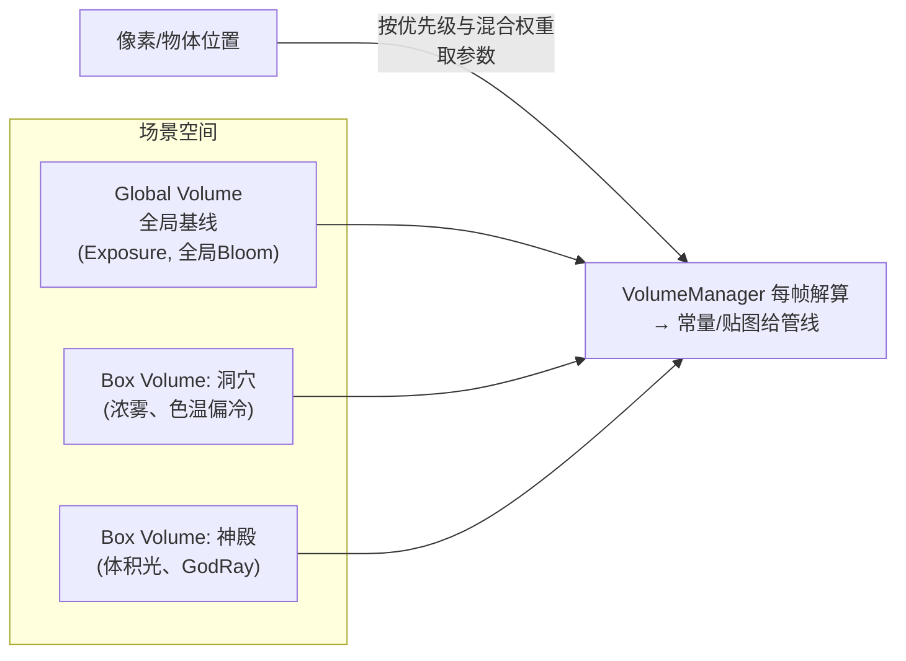

# 03 - HDRP：物理世界的高端管线

> 阅读时间：约 40 分钟
> 关键词：Volume、物理光照单位、LTC、RenderGraph（LTX）、调试工具链

---

## 你将学到什么

- HDRP 的世界观：可测量、可复现的物理画面
- Volume 系统：把一切参数变成"空间中的场"
- HDRP 相对 URP 多出的核心积木清单
- 帧结构差异与调试工作流（LookDev/Rendering Debugger）

---

## 1. 世界观：HDRP 的三个"物理承诺"

第08章说 URP 与 HDRP 是世界观差异。HDRP 的三个承诺：

1. **光的单位物理化**：平行光 lux、点/聚光 lm、面光 nit（第06章对照表）——场景亮度可直接用**测光表数据**（正午 100,000 lux、办公室 500 lux）；
2. **相机物理化**：ISO/快门/光圈/曝光补偿——**画面亮度=曝光的输出**，与摄影语言统一（第11章 Tonemapping 曝光模型的入口）；
3. **一切参数空间化**：雾浓度、白平衡、Bloom 阈值……都是**位置函数**——走到哪、配到哪。

承诺的回报：**"所见即所量"**——美术调色与实拍参考可互换，LookDev 里对 HDRI 环境的材质验证可预期，团队协作有共同语言（"曝光降一档"）。

## 2. Volume 系统：参数的三层空间化

HDRP 的组织核心。**Volume = 一个带形状的参数容器**（Global/Box/Sphere），其内含的 **Volume Profile** 装着各组件（Fog、Bloom、Exposure、HDShadowSettings…）：



**解算规则**：
- 参数按 **Volume 的优先级 + 距离衰减权重**混合（重叠 Volume 插值——"走进洞口雾渐浓"的实现）；
- Blend Distance 控制跨界柔和度；
- 全体组件（含后处理）共享这套机制——**URP 的"全局 Post Volume"+ 简化版就是它的降维实现**。

> 💡 学习价值：即使做 URP 项目，理解 Volume 的"参数场"思维对关卡灯光设计极有用（把"氛围"当成贴在空间里的实体管理）。

## 3. HDRP 多出的积木清单

相对 URP，HDRP 的主要增量（每项一两句话，深入各有专章或查阅文档）：

**光照侧**
- **Forward+（Clustered）** 默认：第08章的光分桶（海量灯）；
- **区域光+LTC**：Area Light 用线性变换余弦（LTC）解析近似"面光源 BRDF"——第06章 D 项的扩展（把 GGX 积分预卷进 LUT，实时解面光）；
- **体积系统**：Volumetric Fog（3D 环境贴图+散射近似）、Volumetric Clouds、Light Shafts（体积阴影第07章）；
- **反射增强**：Screen Space Refl（SSR，第11章）+ Planar Reflection（平面镜）+ SSR/探针三级混合；
- **DLSS/FSR/STP 等超分/时域放大**：低分辨率渲染+AI 重建（Temporal 类全家桶）。

**材质侧**
- 更完整的 **StackLit**（多层材质：镀膜、彩虹）与 Fabric/头发各向异性材质模型；
- **贴花** 管线级支持（DBuffer）。

**管线侧**
- **RenderGraph（内部曾名 LTX）**：强制声明式 RT 管理（URP 新版本同源）——所有 Pass 用"数据流"描述，自动内存与屏障；
- **异步 compute**：现代 API 的 compute 队列重叠执行阴影/粒子模拟（第03/12章）；
- **Reflex/低延迟**链路。

**调试侧（对学习者最友好）**
- **Rendering Debugger**（窗口）：实时开关任意 Pass/特性、画 cost 热图、直接看到管线内部状态（比"盲调"高效一个量级）；
- **LookDev**：HDRI 环境下对单材质打光验证（PBR 资产质检台）；
- **Frame Debugger/APTRacing**：CPU/GPU 全 Pass 热度。

## 4. 帧结构：HDRP 的一帧长什么样

宏观上仍是 SRP 循环（第01篇），但内部块的颗粒更粗（Block 化，配合 RenderGraph）：

```
[更新GpuBuffer: 全物体/灯光/探针的大常量缓冲]
[剔除（CullingBatcher）
[预通道块: 深度Prepass→GBuffer(Deferred)或直接前向
[阴影块: 级联+点光体积阴影+接触阴影（分层预算）
[光计算块: LightLoop（Forward+/Deferred 统一入口）
[不透明输出 → SSR/探针混合
[体积块: Volumetric Fog 半分辨率 3D 体积
[透明块: 前向光照+体积雾采样子
[后处理块: 曝光→Bloom→DoF→TAA/DLSS→ColorGrading
[最终输出（含HDR10/scRGB 输出链, HDROutputSettings）
```

与 URP 的直观差异：**"块"更大、绑定更自动化（RenderGraph）、全帧 HDR 物理单位**。每个块可单独开关/降采样（Volumetric 常半分辨率再升采样——经典"贵的都低分辨率做，最后合成"模式）。

## 5. 学习建议（新手路线）

1. **不要从 HDRP 开始学**——它把 URP 的一切概念再加物理层包装。先把第01-02篇的 SRP/URP 心智模型打牢，再上 HDRP；
2. 拿官方 HDRP 示例场景，用 **Rendering Debugger** 逐 Pass 开关（亲眼看每个 Pass 的贡献——最高效的"实验室"）；
3. 记住物理单位的三个直觉值：正午阳光 100,000lux、阴天 1,000lux、室内 300~500lux——从单位开始想象场景，是 HDRP 美术的正确打开方式；
4. 移动端目标**不要**碰 HDRP（第08章铁律）。

> 📁 **源码指引**：`Packages/com.unity.render-pipelines.high-definition/`（Runtime/ 下有 RenderPass 定义全家桶；`Lighting/LightLoop/` 第08章讲过；`Volumes/` 本篇核心）；材质 StackLit 与 LTC 在 `Material/`；Weixin/移动变体不存在——对照第08章的平台矩阵。

---

## 小结

- HDRP 三承诺：物理光单位、物理相机曝光、参数空间化；
- Volume = 参数场：优先级+混合权重+Blend 距离，一切特效皆 Volume 组件；
- 增量积木：Forward+、LTC 面光、体积云雾、SSR、StackLit、RenderGraph 强制化、异步 compute；
- 帧结构块化+全 HDR 单位+半分辨率昂贵块再合成；
- 新手路线：先 URP 心智模型 → 官方示例 + Rendering Debugger 逐 Pass 实验。

## 自测问题

1. "走进洞口雾渐浓"用 Volume 怎么搭？（三个关键参数）
2. HDRP 曝光与 URP"直接亮度"的差异会给美术流程带来什么变化？（实拍参考/测光表）
3. 体积雾为什么半分辨率渲染再升采样？这个模式的通用名是什么？
4. Rendering Debugger 对学习管线为什么比看文档高效？

---

*下一节：[04-ShaderGraph原理](学习笔记/cg/tuanjie引擎/总览/第09章-SRP可编程渲染管线/04-ShaderGraph原理.md) —— 节点图如何变成可运行 shader，以及它和手写 shader 的取舍。*
