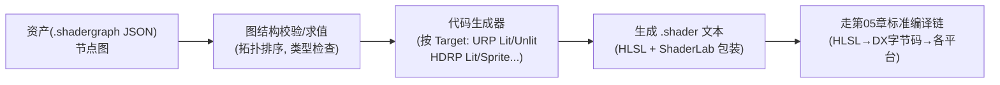

# 04 - ShaderGraph 原理

> 阅读时间：约 30 分钟
> 关键词：节点图编译、黑板属性、SubGraph、生成代码、跨管线 Target

---

## 你将学到什么

- ShaderGraph 的架构：图 → 中间表示 → 各管线目标代码
- SubGraph 与黑板属性的组织逻辑
- 生成代码长什么样、何时该用 SG 何时手写
- 团结/Unity 的内置包（com.unity.shadergraph）的模块结构

---

## 1. 为什么要有节点图

手写 HLSL 的痛点：门槛高（编程+图形学双知识）、不可视化（改了要脑补结果）、团队协作难（美术无法参与）。**ShaderGraph（SG）** 的承诺：**用"数据流图"表达 shader**——美术拖节点连线，代码由工具生成。

但先立正确的期望：**SG 不是另一套 shader 语言，而是 HLSL 的"可视化前端"**。你连的每条线=一个值，每个节点=一段函数，最终**展开生成的还是第05章那套 HLSL**（带 URP/HDRP 的 include 体系）。理解这一点，SG 的所有限制（节点粒度、动态分支表达力）与优势（可视化、模板安全）都自然明了。

## 2. 编译架构：一张图，多个目标



- **同一张图可面向多个 Target**（URP/HDRP、Lit/Unlit）——图是"意图"，Target 是"落地约定"；
- 生成物是**真实的 .shader**（可在 SG 里点"View Generated Shader"看到全部）——**调试 SG 的终极方法就是看生成代码**；
- 生成后走与手写完全相同的编译/变体/合批体系（第05章03篇的变体规则对 SG 一样生效：Keywords 在 SG 里以"黑名单/白名单节点"形式声明）。

**节点求值的本质**：拓扑排序后，从输出节点（PBR Master/Unlit Master）**反向收集依赖**，每个节点展开成 HLSL 语句。所以：

- 图里**未被输出引用的分支会被剔除**（死节点不进代码）；
- 共享子图（同输入连接多处）不会重复求值（CSE 公共子表达式处理）。

## 3. 三层组织：Graph / SubGraph / Blackboard

**Blackboard（黑板）**：SG 版的 `Properties` 块（第05章01篇）——暴露参数（滑条、颜色、贴图、Keyword）给材质面板。与手写 Properties 一一对应，包含 `_Name`、类型、默认值、引用名。

**SubGraph（子图）**：函数的图版本——封装可复用的片段（做旧、边缘光、程序噪声），跨 .shadergraph 共享。注意 SubGraph 有**显式输入/输出端口**——它强制你把"接口"想清楚，这本身就是好的 shader 设计训练。

**Master Stack（主栈）**：目标输出的组装位（新版把"Master 节点"变成一个**可扩展的垂直栈**：Position/Color/Alpha/Emission 分层插槽）——对应手写的 VS/PS 结构框架。**Target 决定 Master 的插槽集**（URP Lit 有 PBR 插槽；Unlit 只有 Color/Emission）。

## 4. 生成代码与手写的对照

一个"PBR + 采样两张贴图 lerp"的图，生成物骨架（简化示意）：

```hlsl
// ---------- 自动生成的 .shader ----------
Shader "Graphs/MyShader" {
    Properties { _MainTex(...); _DetailTex(...); ... }
    SubShader {
        Tags { "RenderPipeline"="Universal" "RenderType"="Opaque" }
        Pass {   // URP 的 UniversalForward
            HLSLPROGRAM
            #include "Packages/com.unity.render-pipelines.universal/.../Core.hlsl"
            // -- 属性区（SRP Batcher 合规的 UnityPerMaterial 块, 第05章04篇）
            CBUFFER_START(UnityPerMaterial)
                float4 _MainTex_ST; half4 _Color; ...
            CBUFFER_END
            // -- SG 展开的自定义函数（你连的每个节点）
            float3 MyNoise(float2 UV) { ... }
            // -- Master 栈填充: PBR 输出
            half4 frag(...) : SV_Target {
                SurfaceDescriptionInputs i = ...;
                SurfaceDescription s = SurfaceDescriptionFunction(i); // 你的图
                return UniversalFragmentPBR(...);                    // 引擎的BRDF
            }
            ENDHLSL
        }
        // 隐含追加的: ShadowCaster / DepthOnly Pass（SG 自动带全套）
    }
}
```

**关键观察**：
1. **`UnityPerMaterial` 块自动生成**——SG 天然 SRP Batcher 合规（手写易漏，SG 不会错）；
2. **全套 Pass（ShadowCaster/DepthOnly/...）自动生成**——SG 材质"能投影/能进深度图"不需要你写（手写常忘，第07章的"缺一块阴影"bug 在 SG 不会发生）；
3. 你的图被填进 `SurfaceDescription` 结构，**光照仍走引擎 PBR 函数**——SG 换光照模型=换 Target 的开关，不是改你的图。

## 5. 用还是不用：诚实的对比

| | ShaderGraph | 手写 HLSL |
|---|---|---|
| 上手 | 低（美术可参与） | 高 |
| 常规 PBR/UV 效果 | ✅ 快 | ✅ 但慢 |
| 复杂控制流/循环 | ❌ 表达笨拙（节点化 for/if 很痛） | ✅ 自然 |
| Compute/高级技巧（光步进、MSAA hack） | ❌ 基本不行 | ✅ |
| SRP Batcher/全套 Pass | ✅ 自动保证 | 手动容易漏 |
| 调试 | 生成代码可看但"间接" | 直接 |
| 变体管理 | Keyword 节点声明（同第05章规则） | 同 |

**实践共识**：常规材质 SG、特殊效果（卡通渲染、水体、溶解）SG 或手写皆可、**计算密集型/管线级技巧必手写**。团队里最好两条腿都有。

> 📁 **源码指引**：`Packages/com.unity.shadergraph/`（Editor/ 是全部节点与生成器——想深挖"节点→代码"映射，看 `Editor/Data/Nodes/` 与生成器 `Editor/Data/Generation/`；Runtime/ 是 Master 与 SubGraph 资产定义）。变体方面：SG 的 Keyword 管理（Blackboard 的 Keyword 类型 + 第05章03篇的规则）与项目共享同一套机制。

---

## 小结

- SG=HLSL 的可视化前端，不是新语言；图→拓扑求值→按 Target 生成 .shader→走标准编译链；
- 三个组织层：Blackboard（属性）、SubGraph（复用函数）、Master Stack（输出栈）；
- 生成物自动带 UnityPerMaterial（合批合规）与全套 Pass（阴影/深度）——SG 的两大"防呆"红利；
- 复杂控制流、compute、管线技巧仍是手写领地。

## 自测问题

1. 为什么 SG 生成代码能天然 SRP Batcher 兼容？（谁负责写 UnityPerMaterial）
2. 你的 SG 图里连了个"未接到输出"的噪点分支——生成代码里有它吗？为什么？
3. 用 SubGraph 封装"边缘光"要定义什么？（输入/输出端口+黑板暴露的参数各是谁的）
4. 判断题：要做 SSR（屏幕空间反射），SG 里能实现吗？为什么？

---

*第09章完。管线层全线贯通。下一章深入"画面的另一半"——全局光照与团结自研 TuanjieGI。*
