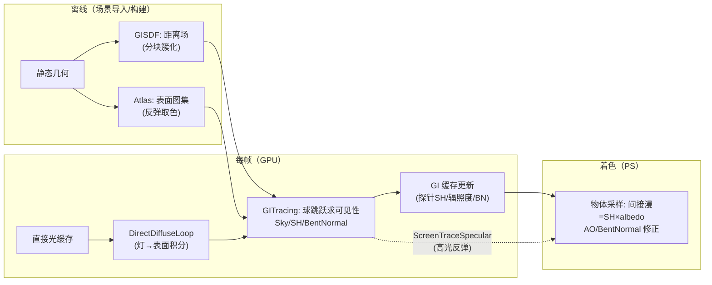

# 05 - 实时 GI 与 TuanjieGI（团结自研）

> 阅读时间：约 45 分钟
> 关键词：TuanjieGI、SDF、光步进、Bent Normal、SH、间接漫反射

---

## 你将学到什么

- 实时 GI 的根本难点与工业候选方案
- TuanjieGI 的整体架构（团结引擎自研，`Modules/TuanjieGI/`）
- SDF：把场景变成"可查询距离的场"
- 光步进求可见性 → 探针 SH 更新 → 物体采样的完整数据流
- Bent Normal 与 GI 质感的关联

---

## 1. 实时 GI 到底难在哪

第01章的递归在实时里意味着：**"物体反弹给物体的光"每帧都在变**（门开了、灯亮了、桌子挪了）。烘焙救不了动态，探针（静态烘焙的）也救不了"开关门后墙上的红反弹必须消失"。实时 GI 要每帧近似：

$$
L_{indirect}(\mathbf{p}) \approx \sum_{q \in \text{表面}} \underbrace{V(\mathbf{p} \leftrightarrow q)}_{\text{可见性}} \cdot \underbrace{B(q)}_{\text{q 的反弹亮度}} \cdot \ldots
$$

三大工业候选的困境：

| 方案 | 核心思路 | 痛点 |
|---|---|---|
| **VXGI**（体素化） | 把场景体素化，光在体素间传播 | 体素化精度/成本、细结构丢失 |
| **LPV/DDGI**（探针场） | 网格探针每帧重算，光传播 | 探针间漏光、需要配套结构 |
| **SDF 光步进**（TuanjieGI 选择） | 距离场求交，探针级积分 | SDF 生成/内存、几何一致性 |

团结引擎选择了第三条路，并且把它工程化成了模块——**这是国内引擎在渲染前沿少有的自研投入**，也是"团结 vs Unity"渲染层最大的差异点。

## 2. TuanjieGI 的分层架构

先看目录（`Modules/TuanjieGI/`）就能读懂设计意图：

```
Modules/TuanjieGI/
├── GISDF/          ← 场景的 SDF 表示（距离场生成与维护）
│     GISDFScene / GISDFMesh / GISDFTracer / GIClusterTracer
├── Atlas/          ← 场景表面摊平进图集（给反弹光"取色"用）
├── GITracing/      ← 光步进核心（可见性、Bent Normal、SH 积分）
│     ScreenTracer / QuadTraceSH / SkyLightTracer / GITraceBentNormal / ScreenTraceSpecular
├── GILighting/     ← 光源侧（DirectDiffuse、DirectionalDiffuse 循环）
├── GIFacet/ GIPipeline/ GIDataBuilder/ RayTracing/ RenderPipeline/ ...
```

**一句话架构**：

> **"把静态场景烘焙成 SDF+图集；每帧在探针/表面上用 SDF 光步进求可见性，把直接光按可见性积分成间接光（SH/辐照度），物体采样这些结果。"**

分四层展开。

## 3. 第一层：SDF——场景的"可查询距离场"

**有向距离场（Signed Distance Field）**：空间中任意点 $\mathbf{p}$ 到最近表面的**带符号距离**：

$$
\text{SDF}(\mathbf{p}) \begin{cases} > 0 & \mathbf{p} \text{ 在外（距表面该数值）} \\ < 0 & \mathbf{p} \text{ 在内} \\ = 0 & \text{恰好表面} \end{cases}
$$

**为什么 SDF 对 GI 是天作之合**：
- 求交不再"步进采样三角形"（BVH 光线追踪的慢），而是**球跳跃法（Sphere Tracing）**：当前位置查距离 → 沿光方向安全跳这么远 → 再查 → 每步是"最大安全步长"，收敛快：
  
$$
\mathbf{p}_{k+1} = \mathbf{p}_k + \mathbf{d} \cdot \text{SDF}(\mathbf{p}_k)
$$

- 一次 SDF 采样（3D 纹理查询）的代价比"三角形求交"低一个量级；
- **还能免费拿到法线**（SDF 的梯度 $\nabla \text{SDF}$ 即表面法线）——GI 网格的表面重建免费用。

**TuanjieGI 的组织**：静态场景 → 分块簇化——`GISDFScene` 全场调度，`GIClusterTracer` 按簇步进；配合 `Atlas/` 把表面反照率/直接光摊平成图集（SDF 求交后，到"撞到的那个表面"的图集位置**取反弹色**——没有图集，"红墙反弹红光"就无从取色）。

> ⚠️ SDF 的固有代价：**静态几何专用**（动态物体要么排除、要么走另一条低频通道——`ScreenTracer` 与探针的组合就是干这个的）。SDF 生成时间与内存也是"按场景静态规模"的预算——大世界要分块流式。

## 4. 第二层：光步进求可见性（GITracing）

有了 SDF，"点 $\mathbf{p}$ 沿方向 $\mathbf{d}$ 能不能看到灯/天空"就是一次球跳跃。这是**一切 GI 运算的原子操作**，TuanjieGI 用它组合出：

- **SkyLightTracer**：从探针/表面向天空锥形采样多个方向，步进判"是否被挡" → **天空可见性积分**（烘焙了数十年 skylight 的实时版）；
- **GITraceBentNormal / GISampleBentNormal**：把"所有未遮挡方向的平均"记录下来——
  
$$
\mathbf{n}_{bent} = \text{normalize}\Big( \sum_{\mathbf{d}:\ \text{可见}} \mathbf{d} \cdot w \Big)
$$

  **Bent Normal（弯折法线）**是 GI 质感的灵魂：墙角处"天空可见方向"都朝上偏内 → bent normal 向内弯 → 环境光按弯折方向采样 → **墙角自然变暗**（图示 AO 的方向版）。**没有 bent normal 的环境光是"平铺的亮"，有了它角落才"塌下去"**。
  
- **QuadTraceSH**：把表面（quad 为单位）向环境积分成 **SH 系数**——第04篇的球谐在**实时更新**版：开关门 → 门后区域探针 SH 重算 → 红反弹消失/出现。

## 5. 第三层：光照侧与屏幕侧的组合（GILighting / ScreenTrace）

- **GILighting/DirectDiffuseLoop**：把每盏灯的直接光按 SDF 可见性积分进"反弹源"（供给上一层的 SH/辐照度缓存）——**多光源 GI** 而不只 skylight；
- **ScreenTraceSpecular**：屏幕空间的高光反弹补充（第01篇三路解法的"屏幕补丁"位），近似"桌面上对面的亮物体反射"。

## 6. 完整数据流一图流



**对比第04篇探针**：Light Probe 是"烘焙好的静态 SH 网格"；TuanjieGI 是"**SDF 光步进实时更新的 SH/辐照度**"——支持动态光源与开关门（几何变化需重建 SDF 的除外），是**烘焙与完全实时的中间态**，成本介于两者之间。

## 7. 实践视角：怎么用好它

- **适用**：中大型静态场景 + 动态光/时间变化（昼夜循环、开关灯）——TuanjieGI 的甜蜜区正是"想要昼夜循环又不肯烘焙多套"的开放世界/大厅；
- **预算意识**：SDF 内存（场景静态体积相关）、每帧步进成本（探针/更新频率分级——近处每帧、远处分帧）是两个主旋钮；
- **与烘焙协作**：远景仍可 Lightmap（TuanjieGI 管近处动态段）——混合流水线；
- **学习路径**：先看 `GISDFVisualize/GITraceVisualize/GIGBufferVisualize`（模块自带可视化）——**用 Debug 视图理解 GI 管线是最高效的入门**（HDRP Rendering Debugger 思想的同款实践）。

> 📁 **源码指引**：整个模块就是本篇的主菜：`Modules/TuanjieGI/`（GISDF 距离场、GITracing 步进族、GILighting 光积分、GIPipeline 总调度、RayTracing 硬件光追变体、TrackedApi 公开跟踪接口）。模块注册在 `TuanjieGIModuleRegistration.cpp`。

---

## 小结

- 实时 GI 难在"动态可见性"，三条工业路线里团结选择 **SDF 光步进**并做成模块；
- SDF=可查询距离场：球跳跃求交便宜、梯度免费得法线、Atlas 补反弹取色；
- GITracing 三绝：skylight 可见性、Bent Normal（角落塌陷的灵魂）、实时 SH；
- 数据流：离线 SDF+图集 → 每帧步进积分 → 缓存更新 → PS 采样；屏幕空间补高光；
- 定位：烘焙与全实时之间的"动态中间态"，昼夜循环大场景的答案。

## 自测问题

1. 球跳跃为什么比"步进查三角形"快？写出安全步长公式。
2. Bent Normal 与 AO 的区别：一个只有"暗"，一个多了什么？（方向性）
3. TuanjieGI 的 SDF 是静态的——那"门开关"怎么进 GI？（哪层重算）
4. 与 Lightmap 混合的流水线：近景与远景各交给谁，接缝靠什么匹配？

---

*第10章完。全局光照全线贯通（烘焙/探针/实时三路）。下一章：后处理——画面的"暗房冲洗"环节。*
