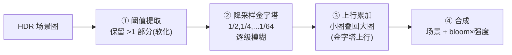

# 02 - Bloom 与 ToneMapping

> 阅读时间：约 35 分钟
> 关键词：Bloom、阈值、降采样金字塔、ACES、Reinhard、曝光

---

## 你将学到什么

- Bloom 的完整管线（阈值→金字塔→合成）与每步原理
- 为什么 Bloom 必须有（胶片/眼睛的散射）
- ToneMapping 的必要性与三大曲线（Reinhard/ACES/Neutral）
- 自动曝光与曲线的配合

---

## 1. Bloom：亮处的"晕"

真实相机镜头不是完美光学系统：强光在镜片组内**散射**，把高亮点"糊"到周围（halation）。人眼也有类似散射。所以画面里"真正亮的东西"（太阳、霓虹、发光材质）**必须**向外辐射柔和光晕，否则看起来像"贴上去的白纸片"。

### 1.1 完整管线

**① 阈值提取**：只让"真的亮"发光（不是把所有像素都糊）：

$$
c_{bright} = \max(0, c - \text{threshold}) \quad \text{（硬阈，可软化过渡）}
$$

阈值在 **HDR 值域**（>1 的部分才配晕开）——这就是"关 HDR 就没有 Bloom"的原因（第01篇三连 bug 之一）。

**②③ 金字塔升降采样**：为什么不用一次大模糊？大半径模糊=大卷积核=海量采样。**降采样金字塔**：每级模糊 1 次（小核），层次自带"不同半径"：

$$
\frac{1}{64} \text{ 图上模糊一次} \equiv \text{全分辨率上} 64\times \text{半径的模糊}
$$

上行时各级累加——一个 $O(\log R)$ 的多尺度模糊，且**天然带"越大的晕越柔"**（真实 halation 的分形感）。Bloom 的"高级感"参数其实主要是 pyramid 层数与合成权重。

**④ 合成**：$\text{final} = \text{scene} + \text{bloom} \cdot \text{intensity}$（在 HDR 域加，随后一起 ToneMap——顺序错了高光就"糊成一片灰"）。

> 💡 移动端裁剪：金字塔层数减到 2~3、或半分辨率执行整段（第01篇）；微信小游戏常只留 1~2 级。

## 2. ToneMapping：从"物理"到"可显示"

### 2.1 必要性

屏幕是 LDR 设备（8bit，[0,1]）。HDR 底片里太阳=50.0、白墙=2.0、阴影=0.05——**直接截断**（clamp）等于把 50 和 2 都显示成 1.0：白墙与太阳一样亮、天空与灯泡融为一体（高光细节全灭）。必须一条**压缩曲线**：大的压得多、小的压得少：

$$
c_{display} = f(c_{HDR} \cdot E_{exposure}) \in [0, 1]
$$

### 2.2 曲线三杰

**Reinhard**（最简单）：

$$
f(x) = \frac{x}{1+x}
$$

单调、永不超 1，但亮部"灰化"（渐近线缓慢爬升，无纯白），且暗部对比度低——历史意义大于实用。

**ACES**（好莱坞调色标准，团结/Unity 默认选项之一）：

$$
f(x) = \frac{x(2.51x + 0.03)}{x(2.43x + 0.59) + 0.14}
$$

S 曲线：暗部稳、亮部柔和滚降、中段对比强（胶片感）——**"专业感"的来源**。代价：整体偏冷、参数少（它是拟合曲线，不因场景变）。

**Neutral**（Unity 自研）：更中性的 S 曲线，高光滚降较平缓——"不抢调色"的默认选项。

**选择直觉**：要电影感=ACES；要后期自己 LUT 调色=Neutral（把风格决策留给调色环节）。

### 2.3 曝光：曲线之前的"灵敏度"

曲线作用前的乘法 $E_{exposure}$ 决定"把哪段 HDR 区间映射到曲线的工作区"：

- **固定曝光**：可控但关卡灯光一变画面就崩；
- **自动曝光**：统计画面亮度（降采样 mip 求均值，mip 金字塔又被复用！），按目标亮度（EV）算曝光，随场景自适应（进洞变亮、出门变暗）——HDRP 的物理相机 ISO/快门就是这套的物理化参数版。

$$
E = \frac{\text{targetEV}}{\text{avgLum} + \varepsilon}
$$

**平滑**是自动曝光的工程灵魂：直方图突变会闪、镜头快慢要有"人眼适应感"——引擎用时间滤波（快门式的渐变）。

## 3. 调色与 ToneMap 的关系（下一层的入口）

ToneMap 之后接 **ColorGrading**（调色）：
- **LUT 工作流**：美术在 Photoshop/DaVinci 调一张 32×32×32 的 3D LUT，引擎按 ToneMap 后的像素查 LUT——**把任意复杂调色"烘焙成一次纹理查询"**（第01篇说 LUT 属于数据纹理，Linear 标记）；
- **参数化调色**：引擎内置的（对比/饱和/通道混合/阴影中调高光）实时合成——URP 的 Color Adjustments 组件。

> ⚠️ **顺序铁律**：Bloom 在 HDR 域（ToneMap 前），调色在 LDR 域（ToneMap 后）——调色是对"最终显示色"的艺术决策。顺序颠倒 = Bloom 输出被曲线二次扭曲、调色被曝光二次漂移——两种"说不清哪里怪"的总根源。

> 📁 **源码指引**：URP `Shaders/PostProcessing/Bloom.shader`（金字塔升降采样内核）、`Tonemapping.hlsl`（ACES/Neutral 的函数族）、`ColorGrading.hlsl` + `ColorGradingLutPass`（3D LUT 烘焙与采样）；HDRP 物理相机与自动曝光在 `Runtime/PostProcess/` 与 `Exposure/`。

---

## 小结

- Bloom 四步：阈值（HDR 域）→金字塔降采样→上行累加→合成；层数=质感、层级=半径；
- ToneMap 把 HDR 压回 [0,1]：Reinhard 简单、ACES 胶片感、Neutral 留调色余地；
- 曝光先选"工作区间"（自动曝光=mip 均值+时间平滑）；
- 顺序铁律：Bloom（HDR）→ ToneMap → 调色（LDR）。

## 自测问题

1. 金字塔模糊比"一次大核模糊"快多少？算一下 64× 半径的等价关系。
2. 为什么"没开 HDR 就没有 Bloom"？阈值在哪个值域上工作？
3. ACES 为什么有"电影感"？S 曲线的三段各自贡献什么？
4. 自动曝光为什么必须时间平滑？不平滑会看到什么？

---

*下一节：[03-抗锯齿：MSAA-FXAA-TAA](学习笔记/cg/tuanjie引擎/总览/第11章-后处理/03-抗锯齿MSAA-FXAA-TAA.md) —— 从硬件采样到时域重投影的三个时代。*
