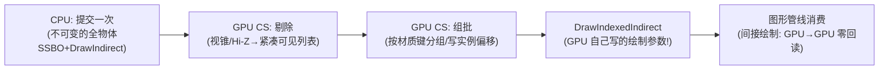

# 02 - Compute Shader 与 GPU Driven 渲染

> 阅读时间：约 40 分钟
> 关键词：Compute、线程组、共享内存、GPU Culling、GPU Particle、异步 Compute

---

## 你将学到什么

- Compute 的执行模型（线程组/线程/共享内存——与图形管线的差异）
- 引擎里 Compute 的用武之地清单
- GPU Driven 的完整闭环：GPU 剔除+组批+间接绘制
- 异步 Compute：现代 API 的并行红利

---

## 1. Compute：丢掉三角形外壳的 GPU

图形管线的"输入装配→光栅化"外壳对通用计算是束缚。**Compute Shader**：没有顶点、没有光栅化——GPU 直接按**线程网格**执行你的程序：

```hlsl
[numthreads(8, 8, 1)]   // 每组 8×8×1 = 64 线程
void CSMain(uint3 id : SV_DispatchThreadID) {
    // id = 全局线程坐标——天然就是"像素坐标/数据下标"
    buffer[id.x + id.y * width] = ...;
}
// C#: Dispatch(gx, gy, 1) → gx×gy 个组 → 线程总数 = 组数×64
```

**三层执行模型**：
- **线程**：最小执行单元（图形管线的 quad 对应物没了——**分支自由**，第02章 quad 痛点消失）；
- **线程组**：共享一段**共享内存**——组内线程可同步与交换数据（做 tile 级缓存优化的基础：前向+的光分桶正是"每 tile 共享光列表"）；
- **Dispatch**：CPU 发一次，GPU 并行展开。

**为什么 Compute 碾 CPU 某些活**：浮点吞吐+带宽是 CPU 的数十倍；但单线程弱、分支弱、串行逻辑弱——**"大量数据、彼此独立"的活**才配得上。

## 2. 引擎里 Compute 的六大岗位（回收全书伏笔）

| 岗位 | 干什么 | 已见于 |
|---|---|---|
| **粒子模拟** | 数万粒子的位置/速度积分（VS 生成 billboard） | 本篇+第03篇 |
| **GPU 剔除** | 包围盒 vs 视锥/Hi-Z 的批量测试，输出紧凑可见列表 | 第04章（预告） |
| **光分桶** | Tiled/Clustered 的光列表构建 | 第08章 |
| **烘焙/卷积** | GI 的辐照度卷积、Cubemap 预滤波、Lightmap 过滤 | 第06/10章 |
| **后处理** | 色调映射、模糊、SSR 的 tile 优化版 | 第11章 |
| **数据压缩/解压** | 纹理 BCn 编码、 Crunch 解码 | 第02章（`Runtime/Graphics/CrunchCompression.cpp`） |

引擎的 C# 接口：`ComputeShader` 类（`Runtime/Shaders/ComputeShader.cpp`）+ `GraphicsBuffer`（`GraphicsBuffer.cpp`）——URP 的 Forward+ 与烘焙器都是这个接口的消费者。

## 3. GPU Driven：让 CPU 只发"一句话"

**动机**：第04章的剔除/排序/组批都在 CPU——10 万物体时 CPU 侧排序与合批本身就成瓶颈（几毫秒）。**终极形态**：这些也搬上 GPU。



**关键组件**：
- **间接绘制**：`DrawIndexedInstancedIndirect`——DrawCall 的"画多少、用哪段索引"由 **GPU 缓冲里的数**决定，CPU 不知道也不需要知道；
- **不可变场景数据**：所有物体的包围盒/矩阵/材质键预上传（`ByteAddressBuffer` 大数组）；
- **GPU 排序**：bitonic 排序的并行实现（只排必要的：透明前若干）。

**收益**：CPU 提交成本与**物体数彻底解耦**（一句话画 50 万实例）；Hi-Z 剔除的精确遮挡（第04章运行时遮挡流派）。
**代价**：管线的复杂度陡升（调试地狱）、GLES 老平台不可用——**PC/主机 3A 的专属兵器**。URP 侧的对应物是 Forward+ 与间接绘制 API 的逐步普及。

## 4. 异步 Compute：第 03 章伏笔的收线

现代 API（第03章）的**多队列**：图形队列 + compute 队列**并行执行**——只要没有依赖：

- 主画面在图形队列跑光栅化，**同时** compute 队列算下一帧的阴影/粒子模拟；
- 障碍只需声明"谁等谁"（第03章 barrier）；
- **GPU 占用率榨干**：光栅化吃不满的小块空闲被 compute 填满。

HDRP 的异步 compute、主机游戏的"影子队列"都是这套。**检查你的项目**：现代 API+有重 compute（粒子/GI 更新）时，async 是白捡的百分之几到十几。

> 📁 **源码指引**：`Runtime/Shaders/ComputeShader.cpp`（资产与绑定）、`ComputeShaderStructs.cpp`（参数布局）、`GraphicsBuffer.cpp`（SSBO/间接缓冲的创建）、`Runtime/GfxDevice/GfxDeviceAsyncCommand.h`（异步队列抽象）；硬件光追相关的引擎层（`Runtime/Shaders/RayTracingShader.cpp`、`Runtime/Graphics/RayTracingAccelerationStructure.cpp`——DXR/RTX 接口，HDRP 的路径追踪/光追反射的地基，本套笔记把它标为"下一本书"的起点）。

---

## 小结

- Compute=无线程级外壳的 GPU 通用计算：线程网格+共享内存，分支自由；
- 六大岗位：粒子、剔除、光桶、卷积、后处理、压缩——全书各章的 GPU 后台原来是它；
- GPU Driven=剔除/组批/间接绘制全上 GPU，CPU 成本与物体数解耦——3A 专属；
- 异步 Compute=多队列并行，榨满 GPU 的白捡红利；
- 硬件光追接口已在引擎就位（DXR），是进阶学习的下一站。

## 自测问题

1. Compute 的线程组共享内存为什么让"光分桶"这类 tile 算法起飞？
2. 间接绘制为什么是 GPU Driven 的"闭环最后一步"？（CPU 不知道 N 也能画）
3. 为什么 GPU 排序用 bitonic 而不是快排？（并行性与固定步数）
4. 异步 Compute 什么条件下白捡？什么条件下反而添乱？（依赖多的管线）

---

*下一节：[03-粒子与VFX Graph](学习笔记/cg/tuanjie引擎/总览/第12章-GPU优化与高级专题/03-粒子与VFXGraph渲染.md) —— 万人战场的烟花怎么画：从 CPU 粒子到 GPU 化的输出装配。*
