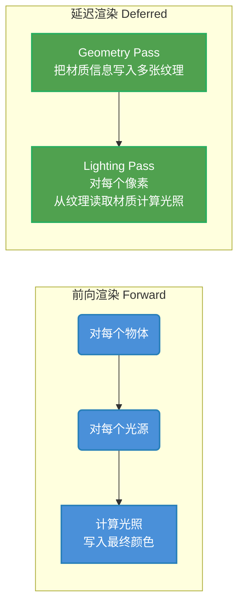
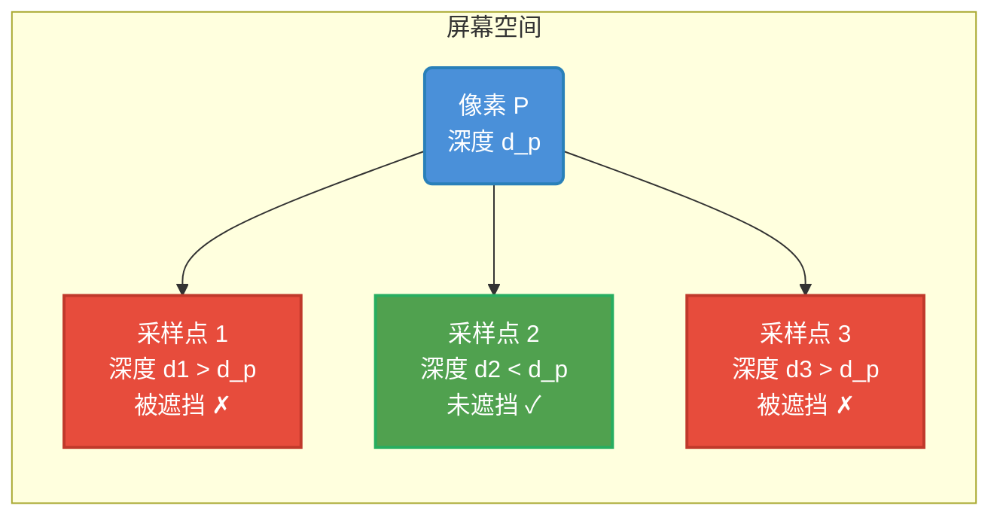
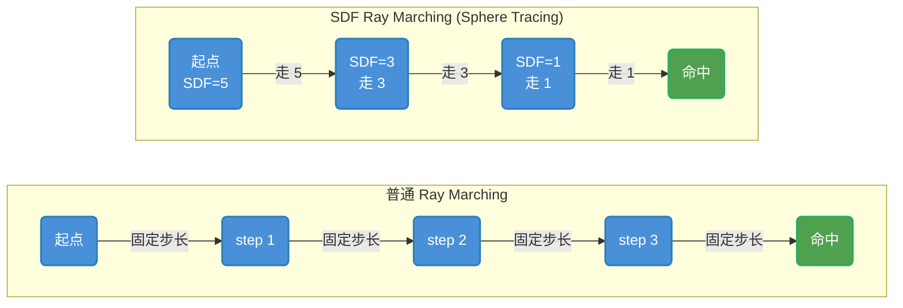
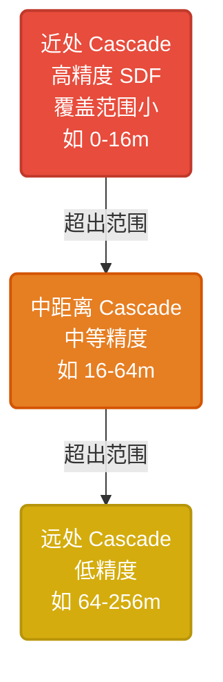
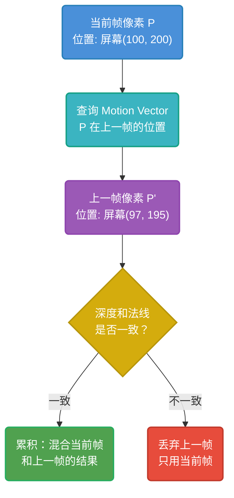
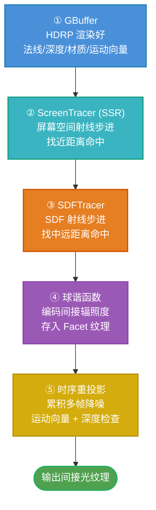

# Phase 0 — 地基检查与补课

> [!info] 本阶段目标
> 确认 GAMES101 的知识能接上 TuanjieGI 的需求，补齐 5 个实时渲染关键概念。
> **本阶段以理解概念为主**，代码只做"知道在哪"的定位，不逐行阅读。
>
> 上一步：[[学习笔记/cg/unityGI代码学习/TuanjieGI 学习路线图.md|TuanjieGI 学习路线图]]
> 下一步：Phase 1 — GI 要解决什么问题

---

## 0.1 你应该已经会的

> [!check] GAMES101 覆盖的知识，对照确认

### 渲染方程

这是整个图形学的核心公式，也是 TuanjieGI 存在的理由：

$$L_o(x, \omega_o) = L_e(x, \omega_o) + \int_{\Omega} f_r(x, \omega_i, \omega_o) \cdot L_i(x, \omega_i) \cdot \cos\theta_i \, d\omega_i$$

拆开看：

| 符号 | 含义 | 通俗解释 |
|---|---|---|
| $L_o$ | 出射辐射度 | 你眼睛/相机看到的光 |
| $L_e$ | 自发光 | 灯泡、发光体自己发的光 |
| $f_r$ | BRDF | 材质属性——这个表面怎么反射光 |
| $L_i$ | 入射辐射度 | 从四面八方打到这个点的光 |
| $\cos\theta_i$ | 余弦项 | 光线越斜，能量越分散 |
| $\int_\Omega$ | 半球积分 | 把所有方向的入射光加起来 |

> [!important] 核心难点
> $L_i$（入射光）本身也是其他表面反射的 $L_o$。
> 要知道桌子接收了多少光，得先知道墙壁反射了多少光；
> 要知道墙壁反射了多少光，得先知道地板反射了多少光……
>
> **这就是递归**。离线渲染（Path Tracing）靠发射大量射线递归求解；实时 GI 需要在毫秒级近似求解。TuanjieGI 的全部工作就是在做这个近似。

### 光栅化管线

```
顶点 → 变换 → 投影 → 裁剪 → 视口变换 → 光栅化 → 片元着色 → 输出像素
```

TuanjieGI 的输入就是这个管线的输出——屏幕已经画好了，它在此基础上补充间接光。

### Phong 光照模型

```
最终颜色 = 环境光(Ambient) + 漫反射(Diffuse) + 高光(Specular)
```

> [!note] Phong 的环境光就是 GI 的最粗糙近似
> Phong 模型里 `Ambient = 常数 × 材质颜色`，这是一个极度简化的间接光——假设所有表面接收的间接光都一样。
> 实际上角落比开阔处接收的间接光少（被遮挡），不同颜色的墙壁互相反射会让颜色"串"。
> **TuanjieGI 就是来替换这个粗糙 Ambient 项的。**

---

## 0.2 GBuffer 与延迟渲染

> [!abstract] 这是什么
> GAMES101 讲了光栅化管线，但可能没有深入延迟渲染。TuanjieGI 的 HDRP 集成完全依赖 GBuffer。

### 前向渲染 vs 延迟渲染



**前向渲染**：物体数 × 光源数 = 计算量。光源多时很慢。
**延迟渲染**：先把所有几何信息存到纹理（GBuffer），再对每个像素只算一次光照。光源数增加不影响几何处理。

### GBuffer 里存了什么

在 HDRP 中，GBuffer 是 4 张纹理：

| 纹理 | 通道 | 存储内容 |
|---|---|---|
| GBuffer0 | RGB | 漫反射颜色（diffuseColor） |
| GBuffer0 | A | 材质特征标记（materialFlags） |
| GBuffer1 | RGB | 高光颜色（fresnel0） |
| GBuffer1 | A | 光照模型参数 |
| GBuffer2 | RGB | 法线（八面体编码） |
| GBuffer2 | A | 感知粗糙度（perceptualRoughness） |
| GBuffer3 | RGB | 自发光颜色（emissiveColor） |

> [!note] 法线的八面体编码
> 法线是 3D 向量，但 GBuffer 的 RGB 只有 3 个通道。
> 直接存会浪费精度。HDRP 用"八面体编码"把 3D 法线压成 2D，再存到 RGB 的前两个通道，第三个通道存粗糙度。
> 读取时解码还原。

### TuanjieGI 怎么用 GBuffer

TuanjieGI 不需要自己渲染几何体，它直接从 HDRP 已经渲染好的 GBuffer 读取信息：

```
GBuffer (HDRP 渲染) → TuanjieGI 读取 → 重建材质 → 追踪射线 → 计算间接光 → 写回间接光纹理
```

在代码中，这个"读取"发生在 `ViewContextHDRP::ReadMaterial()` 里。**现在不用读这个函数**，只需要知道：TuanjieGI 从 GBuffer 拿到法线、粗糙度、材质类型，就知道每个像素是什么材质，从而知道怎么反射光。

> [!tip] 代码定位（现在不读）
> - GBuffer 声明：TuanjieGIForHDRP.h 中 `ViewContextHDRP` 的 `GBuffer0`~`GBuffer3`
> - 材质解码：同文件的 `ReadMaterial()` 方法（搜索 `ReadMaterial`）
> - BSDF 数据结构：同文件中搜索 `struct BSDFData`

### ✅ 自检

- [ ] 能解释前向渲染和延迟渲染的区别
- [ ] 能说出 GBuffer 至少存了哪些信息
- [ ] 理解 TuanjieGI 是"消费者"——它读 GBuffer，不写 GBuffer
- [ ] 知道 `ReadMaterial()` 在哪，但不读实现

---

## 0.3 屏幕空间技术（SSAO / SSR）

> [!abstract] 这是什么
> "屏幕空间"意味着只能看到屏幕上已有的信息（深度、颜色、法线），看不到屏幕外的东西。
> TuanjieGI 的 `ScreenTracer` 本质就是屏幕空间射线追踪。

### 屏幕空间有什么

经过延迟渲染的 Geometry Pass 后，屏幕上有：

| 纹理 | 信息 |
|---|---|
| 深度图（Depth Buffer） | 每个像素离相机多远 |
| 法线图（Normal Buffer） | 每个像素表面的朝向 |
| 颜色图（Color Buffer） | 每个像素的最终颜色 |
| 运动向量图（Motion Vector Buffer） | 每个像素在上一帧的位置 |

### SSAO 原理（环境光遮蔽）

> [!note] 核心思想
> 角落和缝隙接收的间接光少，因为周围有几何体遮挡。
> SSAO 用屏幕空间深度图近似判断"这个点有多少方向被挡住了"。

```
SSAO 算法：
1. 对每个像素，在它周围半径 R 内的半球采样 N 个点
2. 对每个采样点，比较它的深度和当前像素的深度
3. 如果采样点比当前像素"远"（被遮挡）→ 计入遮挡
4. 遮挡比例 = 被挡住的方向 / 总采样方向
5. 用遮挡比例降低环境光强度
```



### SSR 原理（屏幕空间反射）

> [!note] 核心思想
> 反射就是把视线方向按法线翻转，看翻转后的射线打到什么。
> SSR 在屏幕空间沿射线方向步进深度图，找到第一个被射线"穿过"的像素。

```
SSR 算法：
1. 给定像素 P，视线方向 V，法线 N
2. 反射方向 R = reflect(V, N)
3. 沿 R 方向，在屏幕空间一步步前进
4. 每步检查：当前射线深度 vs 该位置的深度图值
5. 如果射线深度 > 深度图值 → 射线穿到表面下方了 → 命中
6. 返回命中像素的颜色作为反射颜色
```

> [!warning] 屏幕空间的根本局限
> 屏幕空间只能看到"相机能看到的"。
> 如果反射射线指向相机背后的物体——屏幕里没有，SSR 就找不到。
> 这就是为什么 TuanjieGI 除了 ScreenTracer，还需要 SDFTracer / CascadedSDFTracer 来追踪屏幕外的东西。

### TuanjieGI 中的 ScreenTracer

`ScreenTracer` 是 TuanjieGI 最快的追踪器，原理和 SSR 一模一样。它在屏幕空间沿射线步进深度金字塔（Depth Pyramid，一种多级深度图），找到命中点。

```
TuanjieGI 追踪器优先级：
ScreenTracer（快，但只看得到屏幕内）
    ↓ 没命中
SDFTracer（中速，可以追踪屏幕外）
    ↓ 没命中
CascadedSDFTracer（慢，可追踪很远）
```

> [!tip] 代码定位（现在不读）
> - ScreenTracer：ScreenTracer.h
> - 深度金字塔采样：TuanjieGIForHDRP.h 中搜索 `SampleHZB()`
> - HZB = Hierarchical Z Buffer（层级 Z 缓冲），就是多级深度图，用来加速步进

### ✅ 自检

- [ ] 能解释 SSAO 的原理（半球采样 + 深度比较）
- [ ] 能解释 SSR 的原理（沿反射方向步进深度图）
- [ ] 能说出屏幕空间技术的根本局限（看不到屏幕外）
- [ ] 理解为什么 TuanjieGI 需要多种追踪器组合

---

## 0.4 有符号距离场（SDF）

> [!abstract] 这是什么
> SDF 是 TuanjieGI 的核心加速结构之一。Games101 的射线追踪讲的是 BVH（层次包围盒），TuanjieGI 额外用了 SDF 来加速射线步进。

### 什么是 SDF

对于一个 3D 场景，SDF 是一个函数 `d = SDF(p)`：

- `d > 0`：点 p 在表面外面，d 是到最近表面的距离
- `d = 0`：点 p 正好在表面上
- `d < 0`：点 p 在表面内部

```
        表面
          |
  外面    |    里面
  d > 0   |   d < 0
          |
----------|---------- d = 0
          |
```

### SDF 如何加速射线步进

普通射线步进（Ray Marching）每步走固定距离，可能走太多步才命中表面，也可能步子太大穿过去了。

SDF 的优势：**每步可以安全地走 SDF(p) 那么远**，因为保证不会穿过任何表面。



> [!note] Sphere Tracing
> 这种"用 SDF 确定安全步长"的算法叫 Sphere Tracing。
> 每步以当前点为圆心、SDF 值为半径画一个球，球内保证没有表面，可以一口气走到球边。

### 级联 SDF（Cascade SDF）

单个 SDF 覆盖范围有限。远处用粗分辨率的 SDF，近处用细分辨率的，这就是"级联"——类似 Mipmap 的思路。



### TuanjieGI 中的 SDF

TuanjieGI 的 SDF 不是从原始三角形直接构建的，而是从 Facet 场景（面片图集）构建的。这形成了一个三级加速结构：

```
场景三角形 → Facet 场景（面片光栅化到纹理）→ SDF 场景 → 级联 SDF
```

- **Facet 场景**：把三角形"拍扁"到一张大纹理上，存颜色、法线、自发光
- **SDF 场景**：从 Facet 场景构建 3D 距离场
- **级联 SDF**：分级覆盖大范围

> [!tip] 代码定位（现在不读）
> - SDF 场景：GISDFScene.h
> - 级联 SDF：GICascadedSDF.h
> - SDF 追踪器：GISDFTracer.h
> - 级联 SDF 追踪器：CascadedSDFTracer.h
> - `referenceFar` 字段控制最大范围：TuanjieGIForHDRP.h 搜索 `referenceFar`，以及 TuanjieGIFramecontext.h

### ✅ 自检

- [ ] 能解释 SDF 的含义（正=外面，负=里面，零=表面）
- [ ] 能解释为什么 SDF 能加速射线步进（安全步长 = SDF 值）
- [ ] 能解释级联 SDF 为什么近处精远处粗
- [ ] 理解 TuanjieGI 的三级加速链路（Facet → SDF → Cascade SDF）

---

## 0.5 时序抗锯齿（TAA）与运动向量

> [!abstract] 这是什么
> TuanjieGI 的降噪策略直接复用了 TAA 的核心机制。理解 TAA 就理解了 TuanjieGI 的时序重投影。

### 为什么单帧渲染有噪声

如果每帧只发射少量射线，结果会充满噪点（蒙特卡洛噪声）。解决方案：

| 策略 | 思路 | 问题 |
|---|---|---|
| 空间滤波 | 把周围像素的颜色平均一下 | 边缘会模糊 |
| 多帧累积 | 每帧发射不同方向的射线，多帧叠加 | 运动了怎么办？ |

### TAA 的核心思想

**用上一帧的信息补充当前帧**，但要知道上一帧的哪个像素对应当前帧的哪个像素。



### 运动向量（Motion Vector）

运动向量记录了每个像素在相邻两帧间的位移：

```
MotionVector(P) = P_prev_frame_position - P_curr_frame_position
```

产生运动向量的原因：
- **相机移动**：像素对应的世界点没动，但相机动了，屏幕位置变了
- **物体移动**：世界点自己动了
- **两者兼有**

### TAA 的抖动（Jittering）

每帧对投影矩阵加一个微小偏移（sub-pixel jitter），让采样位置在像素内变化：

```
Frame 1: 采样位置 = 像素中心 + (0.1, 0.3)
Frame 2: 采样位置 = 像素中心 + (0.7, 0.5)
Frame 3: 采样位置 = 像素中心 + (0.4, 0.8)
...
```

多帧累积后，相当于在一个像素内做了超采样 → 抗锯齿效果。

> [!note] TuanjieGI 中的抖动
> TuanjieGI 也有自己的抖动——每个 Quad（屏幕块）根据蓝噪声偏移中心位置：
> - HDRP 用 `GetQuadJitter()` 返回 [0,1) 的偏移（TuanjieGIForHDRP.h 搜索 `GetQuadJitter`）
> - URP 用同样的方式（TuanjieGIForURP.h 搜索 `GetQuadJitter`）
> - 抖动函数是 `frac(frame / 8)` + `reversebits(frame) / 65536` 的序列
> - 这让每帧的射线采样方向略有不同，多帧累积后覆盖更全面

### 时序累积公式

```
累积结果 = (1 - α) × 历史帧结果 + α × 当前帧结果
```

- α 是混合因子（通常 0.05~0.2）
- α 越小越平滑，但拖影越严重
- α 越大越锐利，但噪声越多
- `reprojectionMaxFrames`（默认 8）控制最大累积帧数

### TuanjieGI 中的时序重投影

TuanjieGI 的重投影逻辑和 TAA 完全一致：

1. 从 motion buffer 读取运动向量
2. 算出当前像素在上一帧的位置
3. 比较上一帧该位置的深度/法线是否和当前帧一致
4. 一致 → 累积；不一致 → 丢弃

> [!tip] 代码定位（现在不读）
> - 运动向量解码：TuanjieGIForHDRP.h 搜索 `GetHistoryUV`
> - 历史帧深度/法线比较：同文件搜索 `ReflectionHistoryColorAndCount`
> - 抖动函数：同文件搜索 `GetQuadJitter` / `GetHistoryQuadJitter`
> - 重投影主逻辑：同文件搜索 `ReprojectHistoryTextures`
> - 蓝噪声：BlueNoise.h

### ✅ 自检

- [ ] 能解释为什么单帧射线追踪结果是噪声的
- [ ] 能解释运动向量在 TAA 中的作用
- [ ] 能解释时序累积公式中 α 的影响
- [ ] 理解 TuanjieGI 的抖动用蓝噪声实现
- [ ] 知道 `GetHistoryUV()` 和 `ReprojectHistoryTextures()` 在哪，但不读实现

---

## 0.6 球谐函数（Spherical Harmonics）

> [!abstract] 这是什么
> TuanjieGI 用球谐函数编码低频间接光照。这一步只需要理解"球谐是什么"和"为什么用它"，不涉及数学推导。

### 什么是球谐函数

球谐函数（SH）是一组定义在球面上的正交基函数。类比傅里叶变换把信号分解为不同频率的正弦波，球谐把球面上的函数分解为不同频率的基函数。

```
傅里叶变换：一维信号 → 频率分量
球谐变换：  球面函数 → 球谐系数

前 0 阶（1个系数）：平均值（整体亮度）
前 1 阶（4个系数）：方向性趋势（哪边亮一点）
前 2 阶（9个系数）：更细的方向变化（适合漫反射间接光）
前 3 阶（16个系数）：更精细（开始有高频信息）
```

> [!note] 为什么只用 3 阶（9 个系数）？
> 漫反射光照本身就是低频的——一个粗糙表面把光"抹匀"了，高频细节丢失。
> 所以用 9 个球谐系数就能很好地表示漫反射间接光。
> 镜面反射是高频的，不能用 SH 编码，需要直接存方向颜色。

### TuanjieGI 怎么用球谐


- **编码（投影）**：把射线命中的颜色转成 9 个球谐系数
- **存储**：系数存在 Facet 场景的 `IndIrradiance` 纹理中
- **解码（评估）**：渲染时根据法线方向，从球谐系数重建该方向的间接光颜色

> [!note] 直觉理解
> 不用管球谐的数学公式。只需知道：
> - SH 是一种"压缩"方式——把球面上的光分布压缩成几个数字
> - 前几个数字表示"整体多亮"，后面的数字表示"哪个方向亮一点"
> - 存储和读取都很高效，适合 GPU
> - 漫反射光天生低频，SH 的前 3 阶就够用

> [!tip] 代码定位（现在不读）
> - 球谐函数实现：SphericalHarmonics.h / SphericalHarmonics.cpp
> - SH 编码的间接光照追踪：QuadTraceSH.h
> - Facet 场景中的 IndIrradiance 纹理：GIFacetScene.h 搜索 `IndIrradiance`

### ✅ 自检

- [ ] 能解释球谐函数的作用（把球面函数压缩为有限个系数）
- [ ] 能解释为什么漫反射间接光适合用 SH 编码（低频）
- [ ] 能解释为什么镜面反射不适合用 SH（高频，需要方向颜色）
- [ ] 知道 TuanjieGI 用前 3 阶（9 个系数）编码间接辐照度

---

## 0.7 五个概念如何串起来

> [!abstract] 全景回顾
> 以下是 TuanjieGI 一帧中，5 个概念各自出现的位置：



| 步骤 | 概念 | TuanjieGI 中的角色 |
|---|---|---|
| ① | GBuffer / 延迟渲染 | 输入——从 HDRP 的 GBuffer 读取材质和深度 |
| ② | 屏幕空间技术 | ScreenTracer——最快的追踪器，先试它 |
| ③ | SDF | SDFTracer + CascadedSDFTracer——追踪屏幕外的物体 |
| ④ | 球谐函数 | 编码间接辐照度，存入 Facet 场景纹理 |
| ⑤ | TAA / 时序重投影 | 多帧累积去噪 + 蓝噪声抖动 |

> [!tip] 代码全部对应的位置（下个阶段开始读）
>
> | 概念 | 文件 | 关键方法 |
> |---|---|---|
> | GBuffer 读取 | TuanjieGIForHDRP.h | 搜索 `ReadMaterial` |
> | 屏幕空间追踪 | ScreenTracer.h | — |
> | SDF 追踪 | GISDFTracer.h | — |
> | 球谐函数 | SphericalHarmonics.h | `Evaluate()` / `Project()` |
> | 时序重投影 | TuanjieGIForHDRP.h | 搜索 `GetHistoryUV` / `ReprojectHistoryTextures` |

---

## 补课资源汇总

> [!example]- 推荐资源（点击展开）

| 概念 | 资源 | 类型 | 时长 | 推荐理由 |
|---|---|---|---|---|
| 延迟渲染 | [LearnOpenGL - Deferred Shading](https://learnopengl.com/Advanced-Lighting/Deferred-Shading) | 博客 | 30 min | 最直观的 GBuffer 讲解 |
| 延迟渲染 | [LearnOpenGL - GBuffer](https://learnopengl.com/Advanced-Lighting/Deferred-Rendering) | 博客 | 20 min | GBuffer 各通道详解 |
| SSAO | [LearnOpenGL - SSAO](https://learnopengl.com/Advanced-Lighting/SSAO) | 博客 | 1 hr | 从零实现 SSAO，配图清晰 |
| SSR | [Screen Space Reflection - SIGGRAPH](https://casual-effects.com/marknoonan/SSR/) | 博客 | 40 min | 含原理和伪代码 |
| SDF | [Sebastian Lague - SDF Ray Marching](https://www.youtube.com/watch?v=CPp3...) | YouTube | 20 min | 动画演示，最直观 |
| SDF | [GPU Gems 2 Ch.8](https://developer.nvidia.com/gpugems/gpugems2/part-i-geometric-complexity/chapter-8-pixel-displacement-mapping) | 书 | 1 hr | 更系统的讲解 |
| TAA | [Temporal AA and the Quest for Clean Pixels](https://www.elopezr.com/temporal-aa-and-the-quest-for-clean-pixels/) | 博客 | 30 min | TAA 原理和实现细节 |
| TAA | [GAMES202 Lecture 6](https://www.bilibili.com/video/BV1YK4y1M77j) | 课程 | 1 hr | 闫令琪讲 TAA |
| 球谐函数 | [Spherical Harmonics for dummies](https://www.ppsloan.org/publications/shdummy.pdf) | PDF | 30 min | 不讲数学，讲直觉 |
| 球谐函数 | [Stupid SH Tricks](https://www.ppsloan.org/publications/StupidSH36.pdf) | PDF | 1 hr | 更全面的 SH 实用指南 |

---

## ✅ Phase 0 总自检

- [ ] 能说出渲染方程的含义和它为什么是递归的
- [ ] 能解释 GBuffer 存了哪些信息，TuanjieGI 如何使用它
- [ ] 能解释 SSAO 和 SSR 的原理
- [ ] 能解释 SDF 如何加速射线步进（Sphere Tracing）
- [ ] 能解释级联 SDF 为什么近处精远处粗
- [ ] 能解释 TAA 的核心机制（motion vector + history buffer + jitter）
- [ ] 能解释球谐函数的作用和为什么只用了前 3 阶
- [ ] 能把 5 个概念串起来，口述 TuanjieGI 一帧中它们各自出现的位置

---

> [!success] Phase 0 完成！
> 如果以上自检都通过了，你已经具备了阅读 TuanjieGI 源码所需的全部基础概念。
>
> 下一步：Phase 1 — GI 要解决什么问题

---

## 🏷️ 标签

#unity #tuanjie-engine #global-illumination #source-code #roadmap #learning #phase-0
