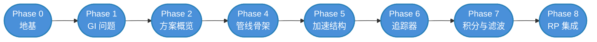
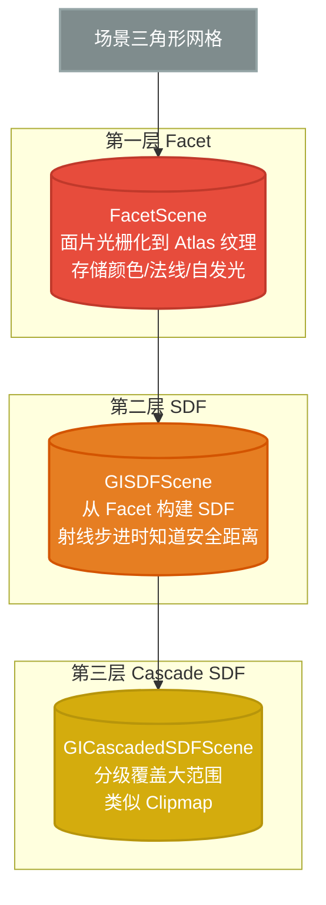
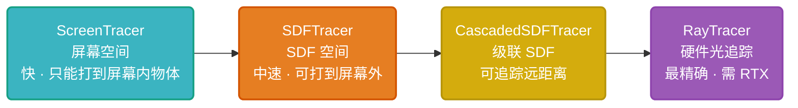

# 🗺️ TuanjieGI 学习路线图

> [!info] 你是谁、你要去哪
> **起点**：学过 GAMES101，了解光栅化、Phong 光照、射线追踪基础、BRDF/渲染方程概念
> **终点**：能独立阅读和修改 `Modules/TuanjieGI/` 下的任意源码文件
> **总览**：先读 [[学习笔记/cg/unityGI代码学习/TuanjieGI 模块总览.md|TuanjieGI 模块总览]] 了解全局架构

> [!tip] 怎么用这份路线图
> - 每个 Phase 有**概念理解**和**代码阅读**两部分
> - 前期以概念为主，代码只需扫一眼知道在哪
> - 后期反过来，概念已经会了，重点是逐行读代码
> - 每个阶段结束有 ✅ 自检清单，确认都过了再进入下一阶段

---

## 全局路线



---

## Phase 0 — 地基检查与补课

> [!abstract] 目标
> 确认 Games101 的知识能接上，补齐几个实时渲染的关键概念。这一步不碰代码。

### 你应该已经会的（Games101 内容）

| 概念 | 用在哪 |
|---|---|
| 光栅化（三角形→像素） | 理解 GBuffer 是怎么来的 |
| Phong 光照模型（环境光+漫反射+高光） | 理解为什么需要间接光 |
| 渲染方程 L_o = ∫ f_r · L_i · cos θ dω | TuanjieGI 的核心就是在近似解这个方程 |
| BRDF（双向反射分布函数） | `BSDFData` 结构体就是 GPU 端的 BRDF 参数 |
| 射线追踪（Ray Tracing）基础 | ScreenTracer、SDFTracer 都是射线追踪的变体 |
| 四元数、视图/投影矩阵 | `ViewContextHDRP` 中的坐标变换 |

### 需要补课的（Games101 没讲或讲得浅）

| 概念 | 为什么需要 | 补课建议 |
|---|---|---|
| **GBuffer 与延迟渲染** | TuanjieGI 从 GBuffer 读取材质/法线/深度 | 搜 "Deferred Shading GBuffer"，理解 GBuffer0-3 各通道存什么 |
| **屏幕空间技术（SSAO/SSR）** | ScreenTracer 本质就是屏幕空间射线追踪 | 搜 "SSAO tutorial"、"Screen Space Reflection" |
| **有符号距离场（SDF）** | SDFTracer 用 SDF 做快速光线步进 | 搜 "Signed Distance Field ray marching"，推荐 Sebastian Lague 的 YouTube 视频 |
| **时序抗锯齿（TAA）原理** | 时序重投影就是 TAA 的核心机制 | 搜 "Temporal Anti-Aliasing"，理解 motion vector + history buffer |
| **球谐函数（SH）** | 间接光照用 SH 编码/解码 | 搜 "Spherical Harmonics for dummies"，只需理解前 3 阶（9 个系数） |

> [!example] 建议的补课顺序
> 1. GBuffer / 延迟渲染 → 2. SSAO / SSR → 3. SDF Ray Marching → 4. TAA → 5. 球谐函数
>
> 每个花 30-60 分钟看一篇博客或视频即可，不需要精通，知道概念就行。

### ✅ 自检清单

- [ ] 能说出 GBuffer 至少存了哪些信息（法线、深度、颜色、粗糙度）
- [ ] 能解释 SSAO 的原理（采样半球内深度比较）
- [ ] 能解释 SDF 如何加速射线步进（距离场告诉你最多能走多远）
- [ ] 能解释 TAA 为什么要用 motion vector（当前像素对应上一帧哪个像素）
- [ ] 能说出渲染方程的含义（出射辐射度 = 自发光 + 反射的入射辐射度积分）

---

## Phase 1 — 理解 GI 要解决什么问题

> [!abstract] 目标
> 理解全局光照（GI）的 "G" 是什么，为什么实时 GI 很难，TuanjieGI 选择了什么策略。

### 概念理解

**直接光 vs 间接光：**

```
直接光：光源 → 表面 → 眼睛（Games101 的 Phong 模型只算这个）
间接光：光源 → 墙壁 → 桌子 → 眼睛（光线弹了不止一次）
```

> [!important] GI 要解决的核心问题
> 渲染方程中的 `L_i`（入射辐射度）本身也是其他表面反射的 `L_o`。
> 这是一个**递归积分**：要知道一个点接收了多少光，得先知道它周围所有表面反射了多少光。
>
> 离线渲染（Path Tracing）通过发射大量射线递归求解——慢但准确。
> 实时 GI 需要在毫秒级近似求解——快但有误差。

**TuanjieGI 的策略（对照概念）：**

| 渲染方程的部分 | TuanjieGI 的近似方法 |
|---|---|
| `L_i`（入射光） | 不做完整 Path Tracing，而是追踪有限条射线 |
| 射线从哪来 | 从屏幕像素出发（ScreenTracer）或从场景面片出发（SDFTracer） |
| 射线打到什么 | 打到 SDF 场景（近似几何）或 Facet 场景（面片图集） |
| 积分怎么算 | 用球谐（SH）编码低频间接光 + 屏幕空间采样 |
| 噪声怎么去 | 时序累积（多帧平均）+ 双边滤波（空间去噪） |

### ✅ 自检清单

- [ ] 能解释直接光和间接光的区别
- [ ] 能说出渲染方程为什么是递归的
- [ ] 能说出 TuanjieGI 的 4 个核心近似策略（射线追踪、SDF/Facet 场景、SH 编码、时序滤波）

---

## Phase 2 — TuanjieGI 方案概览（概念为主）

> [!abstract] 目标
> 从高层理解 TuanjieGI 的"流水线"，知道每个步骤干什么，但不看代码实现。

### 概念理解

先读 [[学习笔记/cg/unityGI代码学习/TuanjieGI 模块总览.md|TuanjieGI 模块总览]] 的前半部分，重点理解这张数据流图：

1. **输入**：HDRP/URP 渲染完 GBuffer、深度、法线、运动向量后，调用 TuanjieGI
2. **构建场景表示**：把场景三角形转成 Facet（面片图集）→ SDF（距离场）→ Cascade SDF（级联距离场）
3. **追踪射线**：从屏幕像素发射射线，穿过多层加速结构
4. **计算光照**：射线命中后，从命中点读取材质/法线，计算间接光
5. **时序累积**：用 motion vector 把上一帧的结果搬过来，和当前帧混合
6. **空间滤波**：双边滤波让结果更平滑
7. **输出**：把间接光纹理交回给 HDRP/URP 混合到最终画面

> [!note] 类比理解
> 想象你在画一幅画：
> - GBuffer = 你已经画好的线稿（知道每个像素是什么材质）
> - Facet 场景 = 你做了一个微缩模型（把 3D 场景"拍扁"到纹理上）
> - SDF = 你给微缩模型套了一层"距离壳"，告诉你离最近表面多远
> - 追踪 = 你从每个像素射出一根针，扎到微缩模型上，看扎到哪
> - 光照计算 = 扎到的地方是什么颜色，就是间接光
> - 时序累积 = 你画了好几遍，叠在一起看效果更好
> - 滤波 = 画完后用手指抹一下让颜色更均匀

### 代码定位（只需知道在哪，不读实现）

| 概念 | 对应文件 | 先做什么 |
|---|---|---|
| 管线入口 | `Public/TuanjieGIManager.h` | 扫一眼类结构，找到 `RenderGI()` 方法 |
| 帧上下文 | `Public/TuanjieGIFramecontext.h` | 看 `FrameContext` 结构体有哪些字段 |
| 管线实现 | `GIPipeline/SWRTPipeline.h` | 扫一眼有哪些成员（不用看懂） |
| HDRP 适配 | `RenderPipeline/TuanjieGIForHDRP.h` | 找到 `Execute()` 和 `updateView()` |

### ✅ 自检清单

- [ ] 能口述 TuanjieGI 一帧的 7 个步骤
- [ ] 能在代码中找到每个步骤对应的大致位置
- [ ] 理解 Facet / SDF / Cascade SDF 是三种不同精度的"场景替身"

---

## Phase 3 — Oceanus DSL（理解 GPU 代码的工具）

> [!abstract] 目标
> TuanjieGI 的 GPU 代码全部用 Oceanus DSL 编写。不理解 DSL 就无法读懂任何 Shader 逻辑。

> [!warning] 前置
> 这是整个路线图中**最关键的过渡阶段**。跳过这一步直接读代码会完全看不懂。

### 概念理解

**什么是 DSL？** Domain-Specific Language（领域特定语言）。TuanjieGI 没有直接写 HLSL，而是用 C++ 写了一种"类似 HLSL 但嵌入在 C++ 中"的语言，由 Oceanus 编译器翻译成真正的 HLSL。

**为什么用 DSL？**
- 可以用 C++ 的模板、类型系统做编译时检查
- 可以做排列组合编译（`$permutation_if`），自动生成多个 Shader 变体
- 可以热重载（`hotfix::HotfixSlot`）

### DSL 语法对照表

| DSL 语法 | 对应的 HLSL / C++ | 含义 |
|---|---|---|
| `Float3 v` | `float3 v` | 浮点向量 |
| `Uint2 coord` | `uint2 coord` | 无符号整数向量 |
| `Float4x4 m` | `float4x4 m` | 矩阵 |
| `Var<T> x` | `T x` | 声明一个 DSL 变量 |
| `Var<BSDFData> mat` | `BSDFData mat` | 声明一个结构体变量 |
| `$if (cond) { ... }` | `if (cond) { ... }` | 条件分支 |
| `$for(i, N) { ... }` | `for(uint i=0; i<N; i++) { ... }` | 循环 |
| `$switch(x) { $case(v): ...; }` | `switch(x) { case v: ...; }` | 多分支 |
| `call<float>("FuncName", args)` | `FuncName(args)` | 调用 HLSL 函数 |
| `macro<float4>("_ScreenSize")` | `_ScreenSize` | 引用 Shader uniform |
| `include("path.hlsl")` | `#include "path.hlsl"` | 包含 HLSL 文件 |
| `$permutation_if($permu("name"))` | `#ifdef name` | 条件编译变体 |
| `depthBuffer.load(uint4(...))` | `DepthTexture.Load(uint4(...))` | 纹理读取 |
| `tex.write(uint3(...), color)` | `RWTexture2D[uint2] = color` | 纹理写入 |
| `make_float3(x, y, z)` | `float3(x, y, z)` | 构造向量 |
| `cast<uint>(x)` | `(uint)x` | 类型转换 |

### 代码阅读（第一个要精读的文件）

**文件**：`Public/TuanjieGIDSLResource.h`

这个文件定义了所有 GI 用的 GPU 资源类型。重点理解：

| 要理解的 | 怎么看 |
|---|---|
| `GITexture2D<T>` 是什么 | 它是对 `PooledRenderTexture` 的智能指针封装，`T` 是元素类型 |
| `GIStructuredBuffer<T>` 是什么 | GPU 上的结构化数组，`T` 是每个元素的类型 |
| `GIConstantBuffer<T>` 是什么 | GPU 常量缓冲，CPU 每帧上传一次 |
| `GIAccel` 是什么 | 光追踪加速结构（RTAS）的句柄 |
| `OC_STRUCT` / `OC_PARAM_STRUCT` 宏 | 把 C++ 结构体注册为 DSL 可用的类型 |

**文件**：`RenderPipeline/TuanjieGIForHDRP.h`

找以下函数，**逐行理解 DSL 代码**：

1. `ViewportCoordToWorldPosition(Uint2 positionSS)` — 把屏幕坐标转世界坐标（深度重建）
2. `ViewportCoordToWorldNormal(Uint2 positionSS)` — 从 GBuffer 读取法线
3. `GetHistoryUV(Uint2 positionSS, ...)` — 用 motion vector 算历史帧 UV

> [!tip] 阅读 DSL 代码的方法
> 1. 先忽略所有 `oceanus::` 前缀和模板参数
> 2. 把 `Float3` 读成 `float3`、`Uint2` 读成 `uint2`
> 3. 把 `call<T>("Func", args)` 读成 `Func(args)`
> 4. 把 `macro<T>("Name")` 读成 `Name`
> 5. 把 `$if` `$for` `$switch` 读成 `if` `for` `switch`
> 6. 这样 DSL 代码就读起来就像 HLSL 了

### ✅ 自检清单

- [ ] 能把一段 DSL 代码口述翻译成 HLSL
- [ ] 理解 `GITexture2D` / `GIStructuredBuffer` / `GIConstantBuffer` 的区别和用途
- [ ] 能读懂 `ViewportCoordToWorldPosition` 的每一行
- [ ] 理解 `OC_STRUCT` / `OC_PARAM_STRUCT` 的作用（注册类型给 DSL 用）

---

## Phase 4 — 管线骨架与生命周期（代码精读开始）

> [!abstract] 目标
> 精读管线从创建到执行的完整代码路径，理解各组件如何被组装在一起。

### 代码阅读顺序

**第一层：模块注册**
1. `TuanjieGIModuleRegistration.cpp` — 引擎启动时创建 `TuanjieGIManager` 单例

**第二层：Manager**
2. `Public/TuanjieGIManager.h` — 精读全部，重点关注：
   - `RenderGI()` — 每帧调用入口
   - `ExecuteGIPipeline(FrameContext&)` — 执行管线
   - `SetPipelineType()` / `RecreatePipeline()` — 管线切换
   - 事件系统 `onBeforeUpdateFrame` / `onUpdateFrame` / `onAfterUpdateFrame`
   - `GetDSLShader<T>()` — 热重载机制

**第三层：管线**
3. `GIPipeline/ITuanjieGIPipeline.h` — 抽象基类 + 管线类型枚举 + 工厂函数
4. `GIPipeline/ITuanjieGIPipeline.cpp` — X-macro 自动生成管线类和工厂

**第四层：SWRTPipeline**
5. `GIPipeline/SWRTPipeline.h` — **这是最重要的文件之一**，定义了所有组件的组装

> [!important] SWRTPipeline 阅读重点
> 不要试图一次理解所有成员。按以下顺序关注：
> 1. `GIForRP giForRP` — 渲染管线适配器
> 2. `FacetSceneWithLighting facetScene` — 面片场景
> 3. `GISDFScene sdfScene = facetScene` — SDF 场景（注意它从 facetScene 构造）
> 4. `GICascadedSDFScene csdfScene = sdfScene` — 级联 SDF（从 sdfScene 构造）
> 5. `IndirectLightingScene<...> indirectLightingScene` — 间接光照场景
> 6. 各 Tracer 成员（`screenTracer`、`sdfTracerRadiosity` 等）
> 7. `TracingView indirectView` / `indirectViewReflection` — 追踪视图
>
> 理解它们的构造依赖关系：Facet → SDF → CascadeSDF → Tracer → TracingView

### ✅ 自检清单

- [ ] 能画出从引擎启动到 `RenderGI()` 被调用的完整调用链
- [ ] 能解释 `SWRTPipeline` 中每个成员变量的构造依赖链
- [ ] 理解 `TUANJIE_GI_PIPELINE_TYPE` 宏如何自动生成管线类
- [ ] 能解释 `hotfix::HotfixSlot` 的作用

---

## Phase 5 — 场景加速结构（Facet + SDF + Cascade）

> [!abstract] 目标
> 理解 TuanjieGI 如何把 3D 场景转化为可以快速查询的加速结构。这是理解所有 Tracer 的前提。

### 概念理解

**为什么要加速结构？**

射线追踪的暴力做法是每条射线测试所有三角形——太慢。需要加速结构让射线快速跳过大块区域。

**TuanjieGI 的三层加速结构：**



**Facet（面片）是什么？**
- 把场景的三角形"拍扁"光栅化到一张大纹理（Atlas）上
- 每个纹素存储：颜色、法线、自发光、间接辐照度、辐射度
- 类似把 3D 场景做了一张"纹理化的微缩模型"

**SDF（有符号距离场）是什么？**
- 对于空间中任意一点，SDF 告诉你离最近表面的距离
- 正值在表面外，负值在表面内，0 在表面上
- 射线步进时：用 SDF 知道"安全步长"，不会穿过表面
- TuanjieGI 的 SDF 是从 Facet 场景构建的

**Cascade SDF（级联 SDF）是什么？**
- 越远的区域用越粗的 SDF（类似 Clipmap / Mipmap）
- 近处精度高，远处精度低但覆盖范围大
- 用 `referenceFar` 控制最大范围

### 代码阅读顺序

| 顺序 | 文件 | 读什么 |
|---|---|---|
| 1 | `GIFacet/GIFacetScene.h` | `FacetSceneWithLighting` 的类结构，它存储了哪些纹理/Buffer |
| 2 | `GIFacet/GIFacetMesh.h` | Facet 网格数据结构 |
| 3 | `GIFacet/GIFacetVGRasterize.h` | 面片光栅化的接口（理解输入输出即可） |
| 4 | `GISDF/GISDFScene.h` | `GISDFScene` 类，它如何从 FacetScene 构造 |
| 5 | `GISDF/GISDFTracer.h` | SDF 追踪器接口，`Trace()` 方法的签名 |
| 6 | `GISDF/GIClusterTracer.h` | 聚类追踪器 |
| 7 | `GISDFExt/GICascadedSDF.h` | 级联 SDF 的类结构 |
| 8 | `GISDFExt/CascadedSDFTracer.h` | 级联 SDF 追踪器 |
| 9 | `GISDFExt/GICascadeMipSpreading.h` | Mip 层级扩展策略 |

> [!tip] 读 SDF 代码的方法
> 先不纠结 SDF 是怎么"构建"的（那是离线过程），只关注"怎么查询"：
> - 给定一条射线（起点+方向），追踪器返回命中点和距离
> - 理解 `Trace()` 方法的签名：输入什么、输出什么
> - 然后再回头看构建过程

### ✅ 自检清单

- [ ] 能解释 Facet 场景存储了哪些数据（5 种纹理数据）
- [ ] 能解释 SDF 如何加速射线步进（安全步长概念）
- [ ] 能解释 Cascade SDF 为什么要分级（近精远粗）
- [ ] 能在代码中找到 `FacetSceneWithLighting` → `GISDFScene` → `GICascadedSDFScene` 的构造链
- [ ] 理解 Facet 的 Visitor 模式（`GIRadiosityVisitor`、`GIBaseColorVisitor` 等）

---

## Phase 6 — 追踪器（Tracer）

> [!abstract] 目标
> 理解每种追踪器的原理和适用场景，精读至少一个追踪器的核心逻辑。

### 概念理解

TuanjieGI 有 7 种追踪器，按精度从低到高：



| 追踪器 | 射线行走方式 | 优点 | 缺点 | 适用场景 |
|---|---|---|---|---|
| ScreenTracer | 屏幕空间深度图步进 | 最快，只需要深度图 | 打不到屏幕外的物体 | 像素附近的小范围反射 |
| SDFTracer | SDF 体素步进 | 可以打到屏幕外的物体 | 精度受 SDF 分辨率限制 | 中距离间接光 |
| ClusterTracer | SDF 聚类步进 | 比纯 SDF 快 | 精度更低 | 快速预览 |
| CascadedSDFTracer | 级联 SDF 步进 | 可以追踪很远 | 远处精度低 | 远距离间接光 |
| SkyLightTracer | 直接采样天空 | 极快 | 只处理天空光 | 天空光贡献 |
| InlineRayTracer | 硬件内联光追踪 | 精确 | 需要 RTX GPU | 精确反射 |
| RayTracer | 硬件光追踪管线 | 最精确 | 最慢，需要 RTX | 高质量反射 |

### 代码阅读顺序

| 顺序 | 文件 | 重点 |
|---|---|---|
| 1 | `GITracing/ScreenTracer.h` | **第一个精读的 Tracer**，理解屏幕空间射线步进 |
| 2 | `GITracing/TracingDispatcher.h` | 追踪调度器，理解多种 Tracer 如何组合 |
| 3 | `GITracing/IndirectLightingScene.h` | 间接光照场景，管理 per-camera 追踪状态 |
| 4 | `GISDF/GISDFTracer.h` | SDF 追踪器 |
| 5 | `GISDFExt/CascadedSDFTracer.h` | 级联 SDF 追踪器 |
| 6 | `GITracing/SkyLightTracer.h` | 天空光追踪器 |
| 7 | `GITracing/ScreenTraceSpecular.h/.cpp` | 屏幕空间镜面反射（SSR 的变体） |
| 8 | `RayTracing/RayTracer.h`（可选） | 硬件光追踪，需要 GPU 支持 |

> [!note] TracingView 是什么
> `TracingView` 不是一个 Tracer，而是一个**组合器**：
> 它接收一个射线查询请求，先试 ScreenTracer（快但范围小），
> 没命中再试 SDFTracer，再没命中试 CascadedSDFTracer。
> 这是一种"级联回退"策略。

### ✅ 自检清单

- [ ] 能解释 ScreenTracer 的工作原理（在屏幕空间沿射线方向步进深度图）
- [ ] 能解释为什么需要多种 Tracer 组合（速度 vs 精度的权衡）
- [ ] 能读懂 `TracingDispatcher` 如何决定用哪个 Tracer
- [ ] 理解 `IndirectLightingScene` 如何管理 per-camera 状态
- [ ] 能口述一个射线从发射到命中的完整流程

---

## Phase 7 — 光照积分、时序重投影与滤波

> [!abstract] 目标
> 理解射线命中后如何计算光照、如何跨帧累积去噪、如何做空间滤波。

### 概念理解

**光照积分：**

射线命中后，需要计算命中点接收了多少光：
- 直接光贡献（从光源直接照射）
- 天空光贡献（从天空环境光）
- 自发光贡献（命中点本身是光源）
- 其他表面的间接辐射度（从 Facet 场景读取）

这些贡献用球谐函数（SH）编码为低频信号，存储在 Facet 的 `IndIrradiance` 纹理中。

**时序重投影：**

单帧追踪的射线太少 → 结果有噪声。解决方法：
1. 用 motion vector 把上一帧的结果"搬"到当前帧位置
2. 检查上一帧的像素和当前帧像素是否一致（深度+法线比较）
3. 一致则累积，不一致则丢弃
4. 累积 `reprojectionMaxFrames` 帧（默认 8 帧）

**双边滤波：**

即使时序累积后仍有噪声。双边滤波在空间上去噪：
- 普通模糊：忽略边界，全抹平
- 双边滤波：考虑深度差异和法线差异，只在"相似"的像素间模糊
- 结果：平坦区域被平滑，边缘被保留

### 代码阅读顺序

| 顺序 | 文件 | 重点 |
|---|---|---|
| 1 | `Math/SphericalHarmonics.h/.cpp` | 球谐函数的评估和投影 |
| 2 | `GILighting/DirectDiffuse.h` | 直接光漫反射计算 |
| 3 | `GILighting/DirectionalDiffuse.h` | 方向光漫反射 |
| 4 | `GILighting/GILightDataForDSL.h` | 光源数据结构 |
| 5 | `RenderPipeline/TuanjieGIForHDRP.h` | 找到以下方法精读： |
| | | • `QueryHistoryCoordDepth()` — 历史帧坐标查询 |
| | | • `ReflectionHistoryColorAndCount()` — 历史颜色读取 |
| | | • `ReprojectHistoryTextures()` — 重投影主函数 |
| 6 | `Math/BilateralFilter.h` | 双边滤波实现 |
| 7 | `RenderPipeline/ReprojectHistory.h` | 重投影逻辑 |
| 8 | `GITracing/QuadTraceSH.h` | SH 编码的间接光照追踪 |

> [!tip] 球谐函数阅读建议
> 不需要推导 SH 的数学公式。只需理解：
> - SH 是一种把球面函数编码为有限个系数的方法
> - 前 3 阶（9 个系数）可以表示低频光照（漫反射）
> - TuanjieGI 用 SH 编码间接辐照度，存在 Facet 纹理中
> - `SphericalHarmonics::Evaluate()` 把系数解码为某方向的颜色

### ✅ 自检清单

- [ ] 能解释为什么单帧追踪结果是噪声的
- [ ] 能解释 motion vector 在时序重投影中的作用
- [ ] 能解释双边滤波和普通高斯模糊的区别
- [ ] 能读懂 `QueryHistoryCoordDepth` 的逻辑
- [ ] 理解 SH 在 TuanjieGI 中的用途（编码间接辐照度）
- [ ] 能口述"射线命中 → 读取 SH → 解码颜色 → 时序累积 → 滤波"的完整链路

---

## Phase 8 — 渲染管线集成（HDRP / URP）

> [!abstract] 目标
> 理解 TuanjieGI 如何与 Unity 的 HDRP / URP 集成，最终把间接光混合到画面中。

### 概念理解

**HDRP 集成流程：**
1. HDRP 完成 GBuffer Pass（写入 GBuffer0-3、深度、法线、运动向量）
2. HDRP 的 Custom Pass 调用 `GIForHDRP::Execute(context)`
3. TuanjieGI 从 GBuffer 读取材质信息（`ReadMaterial()`），重建 BSDF
4. 执行 GI 追踪和积分
5. 输出间接光纹理（`GetDiffuseIndirectTexture()` 等）
6. HDRP 在光照计算中把间接光叠加到最终画面

**URP 集成的区别：**
- URP 没有 GBuffer（前向渲染），用简化的法线/深度缓冲
- `URPBSDFDataDummy` 只有 normalWS + roughness，没有完整的 BSDF
- `fLightRangeCompressFactor` 不同（URP: 1.6384, HDRP: 16384.0）

### 代码阅读顺序

| 顺序 | 文件 | 重点 |
|---|---|---|
| 1 | `RenderPipeline/TuanjieGIForHDRP.h` | 精读以下部分： |
| | | • `ExecutionContextHDRP` — 从 HDRP 接收的输入 |
| | | • `ViewContextHDRP` — GPU 端上下文 |
| | | • `LightingContextHDRP` — 光照计算（`calcLightIntensity` 系列） |
| | | • `QuadGPU` — 屏幕分块采样器 |
| | | • `ReadMaterial()` — 从 GBuffer 解码材质 |
| 2 | `RenderPipeline/TuanjieGIForHDRP.cpp` | `Execute()` 和 `updateView()` 的实现 |
| 3 | `RenderPipeline/TuanjieGIForURP.h` | 对比 URP 版本的差异 |
| 4 | `RenderPipeline/TuanjieGIForURP.cpp` | URP `Execute()` 实现 |

### HDRP vs URP 对比阅读

同一段逻辑在两个文件中对比看：

| 逻辑 | HDRP 文件 | URP 文件 | 关键差异 |
|---|---|---|---|
| 世界坐标重建 | `ViewportCoordToWorldPosition` | 同名方法 | HDRP 用 camera-relative，URP 用绝对坐标 |
| 法线读取 | `ViewportCoordToWorldNormal` | 同名方法 | HDRP 从 NormalBuffer 八面体解码，URP 直接读 |
| 材质解码 | `ReadMaterial()` | 同名方法 | HDRP 完整 BSDF，URP 只有法线+粗糙度 |
| 运动向量解码 | `call<void>("DecodeMotionVector", ...)` | `DecodeMotionVector3D()` 手动实现 | URP 手动解码因为格式不同 |
| 光照计算 | `LightingContextHDRP` | `LightingContextURP` | HDRP 支持 7 种光源，URP 支持 3 种 |

### ✅ 自检清单

- [ ] 能解释 TuanjieGI 如何被 HDRP Custom Pass 调用
- [ ] 能读懂 `ReadMaterial()` 从 GBuffer 解码 BSDF 的过程
- [ ] 能说出 HDRP 和 URP 集成的 3 个关键差异
- [ ] 理解 `QuadGPU` 如何将屏幕分块进行追踪
- [ ] 能口述从 `Execute()` 到输出间接光纹理的完整流程

---

## 附录 A — 推荐阅读材料

> [!note] 按阶段推荐

| 阶段 | 材料 | 类型 | 时长 |
|---|---|---|---|
| Phase 0 | GAMES101 Lecture 16-22 | 课程 | 已学过，复习 |
| Phase 0 | [LearnOpenGL Deferred Shading](https://learnopengl.com/Advanced-Lighting/Deferred-Shading) | 博客 | 30 min |
| Phase 0 | [Sebastian Lague - SDF Ray Marching](https://www.youtube.com/watch?v=CPp3...) | YouTube | 20 min |
| Phase 0 | [TAA explained](https://www.elopezr.com/temporal-aa-and-the-quest-for-clean-pixels/) | 博客 | 30 min |
| Phase 0 | [Spherical Harmonics for dummies](https://www.ppsloan.org/publications/shdummy.pdf) | PDF | 30 min |
| Phase 1 | Real-Time Rendering, Ch.11 Global Illumination | 书 | 2 hr |
| Phase 1 | [DDGI paper (Morgan McGuire)](https://research.nvidia.com/publication/2019-08_Dynamic-Diffuse-Global) | 论文 | 1 hr |
| Phase 3 | Oceanus DSL 源码 `Runtime/Oceanus/` | 代码 | 按需 |
| Phase 5 | [GPU Gems 2 Ch.8 SDF](https://developer.nvidia.com/gpugems/gpugems2/part-i-geometric-complexity/chapter-8-pixel-displacement-mapping) | 书 | 1 hr |
| Phase 6 | [SSAO tutorial](https://learnopengl.com/Advanced-Lighting/SSAO) | 博客 | 1 hr |
| Phase 7 | [SVGF paper](https://research.nvidia.com/publication/2017-10_Spatiotemporal-Variance-Guided) | 论文 | 1 hr |

---

## 附录 B — 关键术语表

| 术语 | 英文 | 含义 |
|---|---|---|
| 全局光照 | Global Illumination (GI) | 模拟光线在场景中的多次弹射 |
| GBuffer | Geometry Buffer | 延迟渲染的几何/材质缓冲 |
| 有符号距离场 | Signed Distance Field (SDF) | 空间中每点到最近表面的距离 |
| 级联 | Cascade | 分级精度，近处精远处粗 |
| 面片 | Facet | 场景三角形光栅化到纹理上的表示 |
| 球谐函数 | Spherical Harmonics (SH) | 球面函数的有限系数编码 |
| 时序重投影 | Temporal Reprojection | 用运动向量把上一帧结果搬到当前帧 |
| 双边滤波 | Bilateral Filter | 保边去噪滤波器 |
| 运动向量 | Motion Vector | 像素在相邻帧间的位移 |
| 渲染方程 | Rendering Equation | 光传输的数学描述 |
| 双向反射分布函数 | BRDF / BSDF | 描述表面如何反射光 |
| 天空光 | Sky Light | 来自天空环境的光照 |
| 环境光遮蔽 | Ambient Occlusion (AO) | 角落/缝隙因遮挡变暗 |
| Bent Normal | Bent Normal | 被遮蔽方向"弯曲"后的法线 |
| 光追踪加速结构 | Ray Tracing Acceleration Structure (RTAS) | 硬件光追踪的 BVH |
| 领域特定语言 | Domain-Specific Language (DSL) | 嵌入 C++ 的 GPU 编程语言 |

---

## 附录 C — 各 Phase 对应的源码文件索引

| Phase | 文件 | 路径 |
|---|---|---|
| 0-1 | 模块总览 | [[学习笔记/cg/unityGI代码学习/TuanjieGI 模块总览.md|TuanjieGI 模块总览]] |
| 2 | 管线入口 | TuanjieGIManager.h |
| 2 | 帧上下文 | TuanjieGIFramecontext.h |
| 2 | 管线抽象 | ITuanjieGIPipeline.h |
| 3 | DSL 资源 | TuanjieGIDSLResource.h |
| 3 | HDRP 上下文 | TuanjieGIForHDRP.h |
| 4 | 管线组装 | SWRTPipeline.h |
| 4 | 模块注册 | TuanjieGIModuleRegistration.cpp |
| 5 | Facet 场景 | GIFacetScene.h |
| 5 | SDF 场景 | GISDFScene.h |
| 5 | 级联 SDF | GICascadedSDF.h |
| 6 | 屏幕追踪 | ScreenTracer.h |
| 6 | 间接光照场景 | IndirectLightingScene.h |
| 6 | 追踪调度 | TracingDispatcher.h |
| 7 | 球谐函数 | SphericalHarmonics.h |
| 7 | 双边滤波 | BilateralFilter.h |
| 7 | 重投影 | ReprojectHistory.h |
| 7 | SH 追踪 | QuadTraceSH.h |
| 8 | HDRP 集成 | TuanjieGIForHDRP.h / .cpp |
| 8 | URP 集成 | TuanjieGIForURP.h / .cpp |

---

## 📅 建议时间安排

| Phase | 建议时长 | 累计 |
|---|---|---|
| Phase 0 — 地基补课 | 3-5 天 | 3-5 天 |
| Phase 1 — GI 问题理解 | 1-2 天 | 4-7 天 |
| Phase 2 — 方案概览 | 1-2 天 | 5-9 天 |
| Phase 3 — Oceanus DSL | 3-5 天 | 8-14 天 |
| Phase 4 — 管线骨架 | 2-3 天 | 10-17 天 |
| Phase 5 — 加速结构 | 5-7 天 | 15-24 天 |
| Phase 6 — 追踪器 | 5-7 天 | 20-31 天 |
| Phase 7 — 积分与滤波 | 5-7 天 | 25-38 天 |
| Phase 8 — RP 集成 | 3-5 天 | 28-43 天 |

> [!tip] 不要追求快
> 这是一份 4-6 周的学习计划。每个 Phase 的代码阅读可以反复多轮：第一遍扫结构，第二遍读逻辑，第三遍理解边界条件。学到这里已经非常深入了，慢即是快。

---

## 🏷️ 标签

#unity #tuanjie-engine #global-illumination #source-code #roadmap #learning
