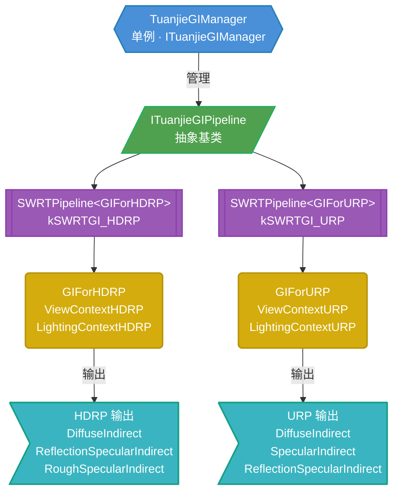
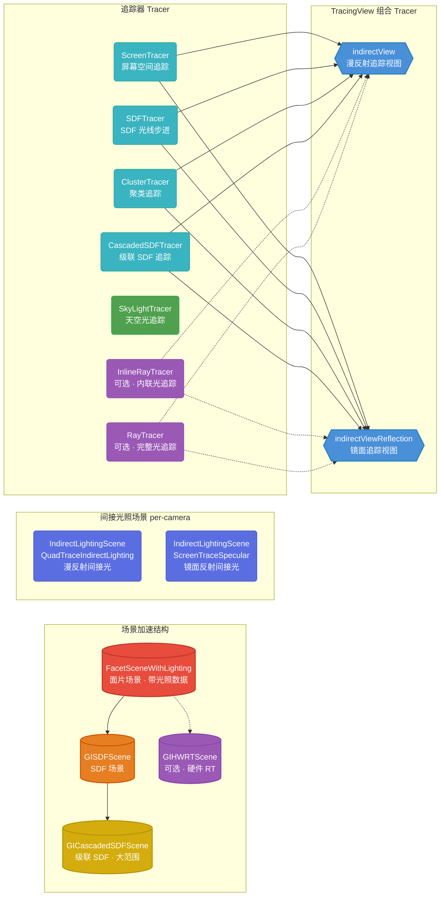
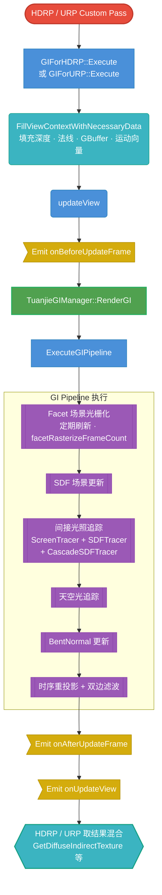

# 🔬 TuanjieGI 模块总览

> [!info] 模块定位
> TuanjieGI 是 Tuanjie 引擎**自研的实时全局光照（GI）系统**，独立于 Unity 原版的 Enlighten / Progressive Lightmapper。它是一个**运行时动态全局光照方案**，同时支持 HDRP 和 URP 渲染管线。
>
> - **编译开关**：`PLATFORM_TUANJIEGI`
> - **硬件光追踪**：`PLATFORM_HWRT_TUANJIEGI`（可选）
> - **源码路径**：`Modules/TuanjieGI/`

> [!tip] 阅读建议
> 本文是 TuanjieGI 模块的总索引。建议按以下顺序阅读：
> 1. 先读本页的 **架构总览** 和 **数据流**
> 2. 再读 Oceanus DSL 工作原理（前置依赖）
> 3. 然后按兴趣深入各子系统

---

## 📁 目录结构

```text
Modules/TuanjieGI/
├── Public/              模块公共接口（Manager、Config、Options、事件、FrameContext）
├── GIPipeline/          GI 管线抽象（SWRT 软件光追踪管线、DFAO 管线）
├── GIFacet/             Facet 场景（三角形面片光栅化）
├── GISDF/               SDF 场景（有符号距离场追踪）
├── GISDFExt/            级联 SDF（Cascade SDF，大场景分级追踪）
├── GITracing/           屏幕空间追踪 & 间接光照场景
├── RayTracing/          硬件光追踪（InlineRayTracer、RayTracer）
├── GILighting/          光照计算（直接光漫反射、方向光漫反射、光源数据）
├── RenderPipeline/      RP 适配层（HDRP / URP 的 ViewContext、ExecutionContext）
├── GIDataBuilder/      离线数据构建（使用 RadeonRays 进行预计算）
├── Atlas/               纹理图集（Texture2DAtlas）
├── Math/                数学库（球谐、蓝噪声、双边滤波、BC 压缩等）
├── TrackedApi/          各平台 API 跟踪文件
└── Utility/             工具类（GPU Buffer/Texture 跟踪、场景监听、分配器等）
```

---

## 🏗️ 架构总览



### TuanjieGIManager 职责

| 职责 | 说明 |
|---|---|
| 管线生命周期 | `CreatePipeline()` / `RecreatePipeline()` / `DestroyPipeline()` |
| 场景监听 | `SceneWatcher<T>` 模板，追踪 Camera / MeshRenderer 的增删改 |
| DSL 上下文 | `oceanus::Device` + `oceanus::OCContext`，GPU 计算的入口 |
| 帧事件 | `onBeforeUpdateFrame` / `onUpdateFrame` / `onAfterUpdateFrame` / `onGfxCleanup` |
| 调试可视化 | `RenderDebug()` / `SetDebugTextureIndex()` / `DoRenderDebug()` |

> [!important] 管线类型枚举
> ```cpp
> enum class TuanjieGIPipelineType {
>     kDisableTuanjieGI,
>     kSWRTGI_HDRP,   // SWRTPipeline<GIForHDRP>
>     kSWRTGI_URP,    // SWRTPipeline<GIForURP>
>     kCount,
> };
> ```
> 通过宏 `TUANJIE_GI_PIPELINE_TYPE` X-macro 模式自动生成实现类和工厂函数。

---

## 🔧 SWRTPipeline 内部结构

> [!abstract] SWRTPipeline 是核心
> `SWRTPipeline<GIForRP>` 是实际的 GI 管线实现。它组合了**多层场景加速结构**和**多种追踪器**，通过模板参数 `GIForRP`（`GIForHDRP` 或 `GIForURP`）适配不同渲染管线。



### 场景加速结构层级

| 层级 | 类名 | 基于 | 说明 |
|---|---|---|---|
| 最细 | `FacetSceneWithLighting` | — | 场景三角形面片光栅化到 Atlas 纹理，存储 BaseColor、Emissive、Normal、Indirect Irradiance、Radiosity |
| 中间 | `GISDFScene` | FacetScene | 从 Facet 场景构建 SDF，用于快速光线步进 |
| 最粗 | `GICascadedSDFScene` | SDFScene | 级联 SDF，分级覆盖大范围（类似 Clipmap） |
| 可选 | `GIHWRTScene` | FacetScene | 硬件光追踪加速结构（RTAS），需 `PLATFORM_HWRT_TUANJIEGI` |

### 追踪器列表

| 追踪器 | 文件 | 用途 |
|---|---|---|
| `ScreenTracer` | `GITracing/ScreenTracer.h` | 屏幕空间追踪（SSGI / SSR） |
| `SDFTracer` | `GISDF/GISDFTracer.h` | SDF 空间光线步进 |
| `ClusterTracer` | `GISDF/GIClusterTracer.h` | 聚类 SDF 追踪 |
| `CascadedSDFTracer` | `GISDFExt/CascadedSDFTracer.h` | 级联 SDF 大范围追踪 |
| `SkyLightTracer` | `GITracing/SkyLightTracer.h` | 天空光追踪 |
| `InlineRayTracer` | `RayTracing/InlineRayTracer.h` | 内联光追踪（Inline Raytracing） |
| `RayTracer` | `RayTracing/RayTracer.h` | 完整光追踪（RaytracingPipeline） |

---

## 📊 数据流（一帧渲染）



---

## 🌊 Oceanus DSL

> [!warning] 前置知识
> TuanjieGI 的所有 GPU 代码不是直接写 HLSL，而是使用名为 **Oceanus** 的 C++ DSL（领域特定语言）。理解 Oceanus 是阅读所有 GI shader 代码的前提。

| DSL 语法 | 对应 HLSL | 说明 |
|---|---|---|
| `Float3`, `Uint2`, `Float4` | `float3`, `uint2`, `float4` | 类型 |
| `$if(cond) { ... }` | `if (cond) { ... }` | 条件分支 |
| `$for(i, N) { ... }` | `for(uint i=0; i<N; i++) { ... }` | 循环 |
| `$switch(x) { $case(v): ...; }` | `switch(x) { case v: ...; }` | 分支 |
| `$permutation_if($permu("name"))` | `#ifdef name` | 排列组合编译 |
| `call<T>("FuncName", args...)` | `FuncName(args...)` | 调用 HLSL 函数 |
| `macro<float4>("_ScreenSize")` | `_ScreenSize` | 引用 shader uniform |
| `include("path.hlsl")` | `#include "path.hlsl"` | 包含文件 |
| `Var<T> x` | `T x` | DSL 变量声明 |
| `Var<StructType> x` | `StructType x` | DSL 结构体变量 |

详见 Oceanus DSL 工作原理。

---

## 🧱 关键概念

### Quad（四叉树像素块）

> [!note] Quad
> 屏幕空间被划分为 `kLightingQuadSize = 8` 的网格块（`kLog2LightingQuadSize = 3`）。每个 Quad 是 GI 计算的基本单位，追踪光线后通过**双边滤波**上采样到逐像素。
>
> - `quadInterval`：Quad 的像素间隔（HDRP 默认 16，URP 默认 16）
> - `QuadGPU`：DSL 端的 Quad 操作类，提供 `ScreenJitteredCenter()`、`GetJitteredCenterWorldPos()` 等
> - **SmartQuad**（仅 HDRP）：动态放置的 Quad，用于改善边缘质量
> - **Blue Noise 抖动**：每个 Quad 根据蓝噪声采样偏移中心位置，减少视觉噪点

### Facet（面片）

> [!note] Facet
> 将场景三角形面片光栅化到 Atlas 纹理上，存储：
> - `BaseColor` — 基础颜色
> - `Emissive` — 自发光
> - `WorldSpaceNormal` — 世界空间法线
> - `IndIrradiance` — 间接辐照度
> - `Radiosity` — 辐射度
> - `UVDebug` — UV 调试网格
>
> 相关文件：`GIFacet/GIFacetScene.h`、`GIFacet/GIFacetVGRasterize.h`

### SDF + Cascade（有符号距离场 + 级联）

> [!note] SDF
> 从 Facet 场景构建 SDF 用于快速光线步进。级联 SDF（Cascade SDF）分级覆盖大范围，类似 Clipmap。
>
> - `GISDFScene` — 基础 SDF 场景
> - `GICascadedSDFScene` — 级联 SDF，`referenceFar` 控制 AABB 范围
> - `GICascadeMipSpreading` — Mip 层级扩展策略

### Temporal Reprojection（时序重投影）

> [!note] 时序累积
> 使用运动向量做时间重投影，累积历史帧结果降噪。
> - `reprojectionMaxFrames`：默认 8 帧
> - `QueryHistoryCoordDepth()` — 通过运动向量回溯历史帧坐标和深度
> - `ReflectionHistoryColorAndCount()` — 读取历史帧颜色和累积计数
> - 深度/法线一致性检查 → 不一致时丢弃历史数据

### GIOption（选项系统）

> [!note] 类型安全的运行时选项
> ```cpp
> GIOption<float> referenceNear = GIOption<float>::Add(
>     2.f, "GIForHDRP.referenceNear",
>     "Set this value to fake bilateral sigma near plane."
> );
> ```
> 支持 Bool / Int / Float，带变更回调 `onChange`，自动注册到 C# API。

### SceneWatcher（场景监听）

> [!note] 场景对象变更监听
> 模板类 `SceneWatcher<T>` 追踪 `Camera`、`MeshRenderer` 等对象的增删改。
> ```cpp
> TuanjieGIListener onRemoveCamera =
>     TuanjieGIManager::GetInstance()->GetSceneWatcher<Camera>().Remove.AddListener(
>         [this](Camera& camera) { ... }
>     );
> ```

### Hotfix（热重载）

> [!note] 运行时 Shader 热重载
> ```cpp
> template <typename ShaderClass>
> auto& GetDSLShader() {
>     static hotfix::HotfixSlot<ShaderClass> slot;
>     return slot->GetShader(m_dsl_device);
> }
> ```
> 使用 `hotfix::HotfixSlot<T>` 实现 Shader 运行时热重载，不需重启编辑器。

---

## 📦 GPU 资源封装

`TuanjieGIDSLResource.h` 定义了 GI 专用的 GPU 资源类型，都是对 Oceanus RHI 的 `SharedObjectPtr` 封装：

| GI 类型 | Oceanus 基类 | 用途 |
|---|---|---|
| `GITexture2D<T>` | `OCTexture2D<T>` | 2D 纹理 |
| `GITexture2D_UNORM<T>` | `OCTexture2D_UNORM<T>` | 2D 纹理（UNORM） |
| `GITexture2DArray<T>` | `OCTexture2DArray<T>` | 2D 纹理数组 |
| `GITexture3D<T>` | `OCTexture3D<T>` | 3D 纹理 |
| `GIConstantBuffer<T>` | `OCConstantBuffer<T>` | 常量缓冲 |
| `GIStructuredBuffer<T>` | `StructuredBuffer<T>` | 结构化缓冲 |
| `GIBuffer<T>` | `Buffer<T>` | 通用缓冲 |
| `GIByteAddressBuffer` | `ByteBuffer` | 字节地址缓冲 |
| `GIAccel` | `Accel` | 光追踪加速结构（RTAS） |

> [!example] 创建资源示例
> ```cpp
> GITexture2D<float3> tex = GITexture2D<float3>::create(
>     uint2(1920, 1080), kFormatR16G16B16A16_SFloat, "GI_DiffuseIndirect"
> );
> GIStructuredBuffer<float4> buf = GIStructuredBuffer<float4>::create(
>     1024, "GI_LightData"
> );
> ```

---

## 🔗 渲染管线集成

### HDRP 集成 — `GIForHDRP`

| 组件 | 说明 |
|---|---|
| `ExecutionContextHDRP` | 从 HDRP 传入的上下文（GBuffer0-3、深度金字塔、法线缓冲、运动向量、颜色缓冲等） |
| `ViewContextHDRP` | DSL GPU 上下文，继承 `LightingContextHDRP`，在 GPU DSL 代码中直接调用 HDRP 的光照函数 |
| `ViewContextHDRP::QuadGPU` | 四叉树像素采样器，将屏幕分块为 Quad 网格进行追踪 |
| `BSDFData` / `BuiltinData` | HDRP 材质数据结构，用于从 GBuffer 重建材质属性 |
| 输出接口 | `GetDiffuseIndirectTexture()`、`GetReflectionSpecularIndirectTexture()`、`GetRoughSpecularIndirectTexture()`、`GetTransparentSpecularIndirectTexture()` |

> [!info] HDRP 特有
> - `fLightRangeCompressFactor = 16384.0f` — 光照范围压缩因子
> - `hasSmartQuad = true` — 支持 SmartQuad 动态放置
> - `useBentNormal = true` — 使用 Bent Normal
> - `ReadMaterial()` 从 GBuffer 解码完整 BSDF 材质

### URP 集成 — `GIForURP`

| 组件 | 说明 |
|---|---|
| `ExecutionContextURP` | 从 URP 传入的上下文（简化版，无 GBuffer 复杂解码） |
| `ViewContextURP` | DSL GPU 上下文，继承 `LightingContextURP` |
| `URPBSDFDataDummy` | URP 使用简化版材质结构（仅 normalWS + perceptualRoughness） |
| 输出接口 | `GetDiffuseIndirectTexture()`、`GetSpecularIndirectTexture()`、`GetReflectionSpecularIndirectTexture()` |

> [!warning] URP 限制
> - `fLightRangeCompressFactor = 1.6384f`（精度更低）
> - `hasSmartQuad = false` — 不支持 SmartQuad
> - `useBentNormal = false` — 不使用 Bent Normal
> - `enableInterleavedUpdate = true` — 默认开启交错更新
> - `ReadMaterial()` 更简单，从 normalBuffer 直接读取

---

## 📐 数学库

| 文件 | 说明 |
|---|---|
| `Math/SphericalHarmonics.cpp/.h` | 球谐函数（用于间接光照编码） |
| `Math/BlueNoise.cpp/.h` | 蓝噪声采样（用于 Quad 抖动） |
| `Math/BilateralFilter.h` | 双边滤波（用于上采样和降噪） |
| `Math/Matrix3x4f.h` | 3×4 矩阵（轻量变换矩阵） |
| `Math/SphereMapping.cpp/.h` | 球面映射 |
| `Math/OrthoNormalBasis.h` | 正交基构造 |
| `Math/GPUCone.h` | GPU 锥体（用于锥形追踪） |
| `Math/GPUCylinder.h` | GPU 圆柱体 |
| `Math/InterlockedFloat.h` | 原子浮点操作 |
| `Math/BCCompression.cpp/.h` | BC 纹理压缩 |
| `Math/TextureCodec.h` | 纹理编解码 |

---

## 🛠️ 工具库

| 文件 | 说明 |
|---|---|
| `Utility/SceneWatcher.h` | 场景对象变更监听模板 |
| `Utility/TransformTracker.h` | Transform 变换追踪器 |
| `Utility/TrackedList.h` | 跟踪列表（增删改追踪） |
| `Utility/StableTrackedList.h` | 稳定跟踪列表 |
| `Utility/TrackedGPUBuffer.h` | GPU Buffer 跟踪管理器 |
| `Utility/TrackedGPUTexture3D.h` | GPU 3D 纹理跟踪 |
| `Utility/SpanAllocator.h` | Span 分配器 |
| `Utility/TSpanArrayAllocator.h` | 线程安全 Span 数组分配器 |
| `Utility/GPUItemAllocator.h` | GPU 对象分配器 |
| `Utility/UpdateList.h` | 更新列表 |
| `Utility/FullUpdateGPUBuffer.h` | 全量更新 GPU Buffer |
| `Utility/GlobalConfig.h` | 全局配置 |
| `Utility/VRAMRef.h` | VRAM 引用 |

---

## 📋 前置依赖知识

> [!abstract] 要深入理解 TuanjieGI，以下引擎子系统是前置知识

| 前置模块 | 路径 | 需要了解的内容 |
|---|---|---|
| Oceanus DSL 工作原理 | `Runtime/Oceanus/` | DSL 语法、资源管理、Stream/Device — **最重要** |
| Camera 模块地图 | `Runtime/Camera/Camera.h` | FrameContext 中的 Camera 使用方式 |
| GfxDevice | `Runtime/GfxDevice/` | RenderTexture、GraphicsBuffer 等底层图形设备 |
| Bindings 系统 | `Tools/BindingsGenerator/` | C++ → C# API 导出机制 |

---

## 🔍 子系统深入入口

> [!tip] 选择感兴趣的子系统深入阅读
> - Oceanus DSL 工作原理 — 理解所有 GI shader 代码的关键
> - Facet 场景光栅化 — 面片场景的数据组织和光栅化
> - SDF 与级联 SDF — SDF 构建和追踪算法
> - 屏幕空间追踪 ScreenTracer — SSGI/SSR 实现
> - 间接光照集成 QuadTraceSH — 球谐光照
> - 时序重投影与滤波 — 降噪和上采样
> - RenderPipeline 适配层 — HDRP/URP 集成细节

---

## 📎 关键文件速查

| 文件 | 用途 |
|---|---|
| `Public/TuanjieGIManager.h` | 模块管理器（单例入口） |
| `Public/TuanjieGIFramecontext.h` | 帧上下文（FrameContext） |
| `Public/TuanjieGIEvent.h` | 事件系统 |
| `Public/TuanjieGIDSLResource.h` | GPU 资源封装 + DSL 类型注册 |
| `Public/TuanjieGIOptions.h` | 运行时选项系统 |
| `GIPipeline/ITuanjieGIPipeline.h` | 管线抽象基类 |
| `GIPipeline/SWRTPipeline.h` | SWRT 管线实现（核心） |
| `RenderPipeline/TuanjieGIForHDRP.h` | HDRP 适配层 |
| `RenderPipeline/TuanjieGIForURP.h` | URP 适配层 |
| `RenderPipeline/TuanjieGIForRPCommon.h` | RP 通用类型 |
| `GIFacet/GIFacetScene.h` | Facet 场景 |
| `GISDF/GISDFScene.h` | SDF 场景 |
| `GISDFExt/GICascadedSDF.h` | 级联 SDF |
| `GITracing/ScreenTracer.h` | 屏幕空间追踪器 |
| `GITracing/IndirectLightingScene.h` | 间接光照场景 |
| `GITracing/TracingDispatcher.h` | 追踪调度器 |
| `RayTracing/RayTracer.h` | 硬件光追踪器 |
| `Math/SphericalHarmonics.h` | 球谐函数 |
| `Math/BlueNoise.h` | 蓝噪声 |
| `Math/BilateralFilter.h` | 双边滤波 |
| `TuanjieGIModuleRegistration.cpp` | 模块注册入口 |
| `TuanjieGIModule.jam.cs` | 构建配置 |

---

## 🏷️ 标签

#unity #tuanjie-engine #global-illumination #source-code #index
