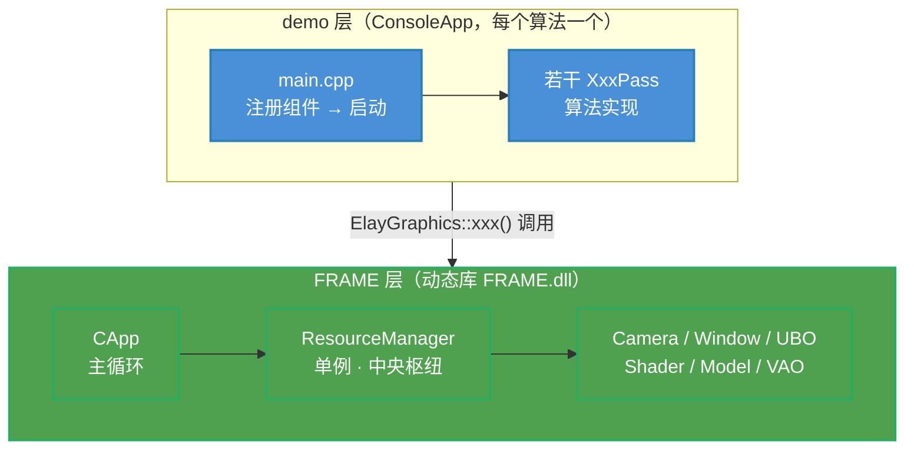
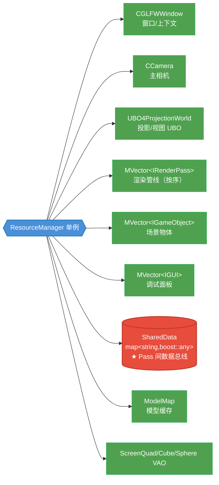
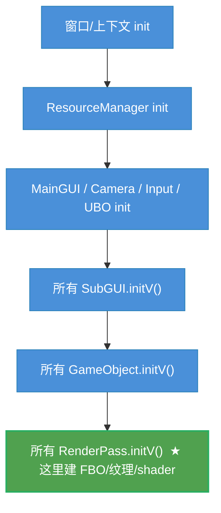
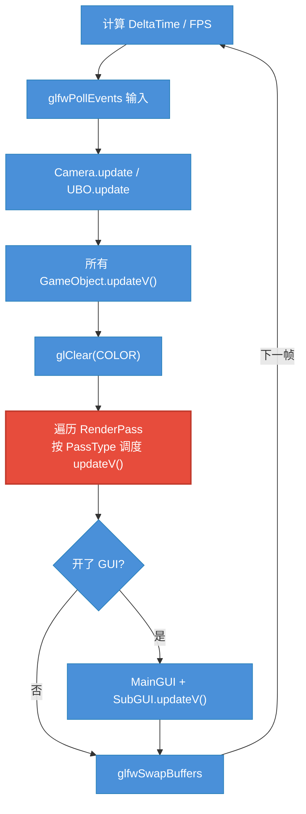
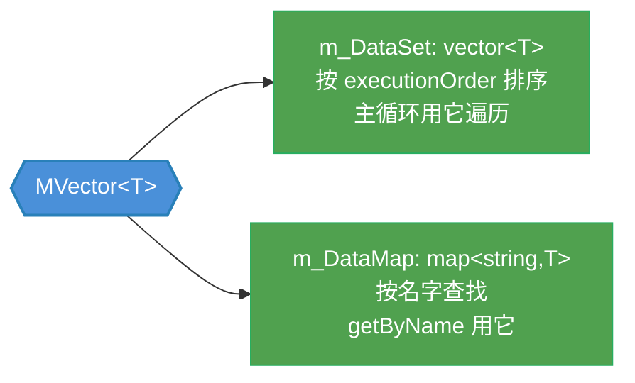
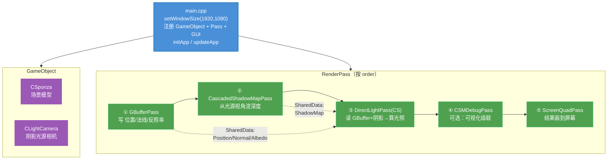

# 01 框架（FRAME）

> [!info] 本阶段目标
> 彻底理解 FRAME 框架的运转方式：组件如何注册、主循环如何调度、Pass 之间如何传数据。
> **这是读懂全部 28 篇 demo 的钥匙**——之后每篇只是这套机制的特例。
>
> 上一步：[[学习笔记/cg/经典算法实现/00 前期准备.md|00 前期准备]]
> 下一步：02 实时阴影（或回到 [[学习笔记/cg/经典算法实现/roadmap.md|GraphicAlgorithm 学习路线图]]）

---

## 1.1 全景：两层结构



- **demo 层**：只 `#include "Interface.h"`，用框架提供的函数组装管线，自己不碰 OpenGL 细节。
- **FRAME 层**：提供窗口、相机、shader、FBO 工具、资源管理、**渲染管线调度**。

---

## 1.2 ElayGraphics：唯一公共门面

`FRAME/Interface.h` 把框架能力组织成一个命名空间层级，demo 只用它：

| 命名空间 | 干什么 |
|---|---|
| `ElayGraphics::App` | `initApp()` / `updateApp()` —— 启动与主循环 |
| `::WINDOW_KEYWORD` | 窗口大小、标题、光标 |
| `::Camera` | 主相机的位置/方向/FOV/投影矩阵 |
| `::ResourceManager` | **核心**：注册/查询 Pass、GameObject、GUI、SharedData |
| `::InputManager` | 按键状态 |
| `::COMPONENT_CONFIG` | 开关 GUI |

> [!tip] 记住这个口诀
> demo 的 main.cpp 里几乎全是 `ElayGraphics::ResourceManager::registerXxx(...)`。
> 框架的对外接口，看 Interface.h 这一个文件就够了。

---

## 1.3 ResourceManager：中央枢纽（单例）

`ResourceManager` 是单例，持有运行时的所有"东西"：



> [!important] 最关键的两块
> - **Pass 集合**（有序）：决定渲染管线长什么样
> - **SharedData**（字符串键）：决定 Pass 之间怎么传数据
>
> 抓住这两块，就抓住了 FRAME 的灵魂。

---

## 1.4 三类可注册组件

main 里能 `register` 的就三类，都遵循"initV / updateV 回调"约定：

| 组件 | 基类 | initV / updateV | 典型子类 |
|---|---|---|---|
| 渲染 Pass | `IRenderPass` | 必须实现（纯虚） | `GBufferPass`、`CascadedShadowMapPass` |
| 场景物体 | `IGameObject` | 必须实现（纯虚） | `CSponza`（模型）、`CLightCamera`（光源相机） |
| 调试面板 | `IGUI` | 可空实现 | `CCustomGUI`（ImGui 控件） |

- **IRenderPass**：算法的载体。构造时给 `(名字, 执行顺序号)`，框架按顺序号调度。
- **IGameObject**：带 transform（位置/旋转/缩放 → ModelMatrix）、持有 `CModel`。常用来封装一个场景模型，或一个特殊相机（如阴影光源相机）。
- **IGUI**：对 ImGui 的封装，提供 slider/combo/button 等一堆 widget，用来实时调参。

---

## 1.5 生命周期：启动与主循环

### initApp() —— 启动时（各调一次）

`CApp::init()` 按固定顺序初始化，最后**依次调用所有组件的 `initV()`**：



> [!note] initV 里做什么
> 典型 Pass 的 `initV()`：创建纹理（`genTexture`）→ 建 FBO（`genFBO`）→ 加载 shader（`CShader`）→ 设置不变的 uniform → **把产物 `registerSharedData` 出去**。

### updateApp() —— 每帧主循环

`CApp::update()` 的每一帧：



> [!warning] 注意
> 主循环只 `glClear(GL_COLOR_BUFFER_BIT)`，**不清深度**。
> 深度清理由各 Pass 在自己绑定的 FBO 里负责（如 `glClear(GL_COLOR_BUFFER_BIT | GL_DEPTH_BUFFER_BIT)`）。
> 因为每个 Pass 用的 FBO/深度缓冲不同，框架没法统一清。

---

## 1.6 RenderPass 执行模型（重点）

### 按 executionOrder 排序

注册时第二个参数就是顺序号：

```cpp
ElayGraphics::ResourceManager::registerRenderPass(std::make_shared<GBufferPass>("GBufferPass", 1));
ElayGraphics::ResourceManager::registerRenderPass(std::make_shared<CascadedShadowMapPass>("...", 2));
ElayGraphics::ResourceManager::registerRenderPass(std::make_shared<CDirectLightPass>("...", 3));
```

框架用自定义容器 `MVector` 在插入时排序（见 1.8），主循环就按 1→2→3 顺序执行。

### 五种 PassType（决定"怎么执行"）

`ERenderPassType` 控制 Pass 的执行方式：

| PassType | 行为 |
|---|---|
| **Normal**（默认） | 每帧都执行 `updateV()` |
| **Once** | 执行一次 `updateV()` 后 `finishExecute()`，永久跳过 |
| **Parallel** | 相同 order 的一组 Pass 连续执行（意图并行，实为连续调用） |
| **ParallelOnce** | 相同 order 一组连续执行后，全部 `finishExecute()` |
| **Delay** | 本帧不执行，把自己降级成 Normal，下一帧才开始 |

> [!note] finishExecute 的实现
> 就是把该 Pass 的 `executionOrder` 设为 `-1`。
> 主循环里 `if (order == -1) continue;` 直接跳过——所以 Once/ParallelOnce 执行完就再也不跑了。
> 典型用途：只算一次的预计算 Pass。

---

## 1.7 SharedData：Pass 之间的数据总线（灵魂）

Pass 之间**不直接互引**，全靠 `ResourceManager` 的字符串键传数据，类型用 `boost::any` 擦除：


```cpp
// 生产者：GBufferPass::initV
auto Tex4Pos = std::make_shared<ElayGraphics::STexture>();
Tex4Pos->InternalFormat = GL_RGBA32F;
genTexture(Tex4Pos);                                   // 填上 TextureID
m_FBO = genFBO({Tex4Pos, Tex4Normal, Tex4Albedo});     // 挂到 FBO
ElayGraphics::ResourceManager::registerSharedData("PositionTexture", Tex4Pos);

// 消费者：任意后续 Pass
auto posTex = ElayGraphics::ResourceManager::getSharedDataByName<std::shared_ptr<ElayGraphics::STexture>>("PositionTexture");
```

### 带变更检测的取值（GUI 调参场景）

```cpp
// 第三参 vioDataChanged：当值和上次不同时返回 true，避免重复上传 GPU
bool changed = false;
auto val = ElayGraphics::ResourceManager::getSharedDataByName<float>(
    "LightIntensity", m_LastValue, changed);
if (changed) { /* 重新 setUniform */ }
```

> [!important] 为什么这么设计
> SharedData 让 Pass **彻底解耦**——DirectLightPass 不需要 `#include "GBufferPass.h"`，
> 只要双方约定同一个字符串键。这让管线可以自由增删 Pass。
> **代价**：类型安全靠人（`boost::any_cast` 类型错了运行时崩），键名靠约定（写错查不到）。
> 所以读 demo 时，grep 出所有键名是第一要务。

---

## 1.8 MVector：保序 + 按名双视图

`MVector<T>` 是框架自定义容器，内部维护**两份数据**：



- `push_back(name, item, 1)`：用 `lower_bound` + 对象的 `operator<` 把 item **插入到有序位置**（第三个参数 `1` 走解引用 shared_ptr 的比较），同时塞进 map。
- `operator[](int)` → vector 下标（有序遍历用）；`operator[](string)` → map 查找。
- `begin()/end()` → vector 的迭代器。

> [!note] 为什么不用 std::vector
> 框架需要"既能按顺序遍历（主循环）、又能按名字查（getByName）"。
> MVector 一个容器同时满足两种访问模式，省得维护两份结构。

---

## 1.9 STexture + genTexture / genFBO

`STexture`（定义在 `Common.h`）是"纹理描述符"，字段超多但套路固定：

```cpp
auto Tex = std::make_shared<ElayGraphics::STexture>();
Tex->InternalFormat = GL_RGBA32F;   // 内部格式（精度）
Tex->ExternalFormat = GL_RGBA;      // 外部格式
Tex->DataType = GL_FLOAT;           // 数据类型
Tex->isMipmap = false;
genTexture(Tex);                    // ★ 创建 OpenGL 纹理，回填 Tex->TextureID

// 多张纹理挂到一个 FBO（GBuffer 的 MRT）
GLuint fbo = genFBO({Tex4Pos, Tex4Normal, Tex4Albedo});
// 各 Tex 的 FrameBufferID / AttachmentID 也被回填
```

> [!tip] 记忆点
> `genTexture` 填 `TextureID`；`genFBO` 把一组纹理挂到帧缓冲，回填各纹理的 `FrameBufferID/AttachmentID`。
> 之后 Pass 的 `updateV()` 里 `glBindFramebuffer(GL_FRAMEBUFFER, fbo)` 就能往这些纹理写。

---

## 1.10 CShader：按文件名加载 GLSL

```cpp
// 图形管线 shader（VS + FS，可选 GS/Tess）
m_pShader = std::make_shared<CShader>("GBuffer_VS.glsl", "GBuffer_FS.glsl");
// 计算着色器（单文件）
m_pShader = std::make_shared<CShader>("DirectLightPass_CS.glsl");

m_pShader->activeShader();                                  // glUseProgram
m_pShader->setMat4UniformValue("u_ModelMatrix", ptr);       // 设 uniform
m_pShader->setFloatUniformValue("u_Near", near);
m_pShader->setTextureUniformValue("u_PosTex", posTex);      // 绑纹理 + 设 sampler
```

shader 文件与 Pass 同目录、同名配对（命名约定见 [[学习笔记/cg/经典算法实现/00 前期准备.md#0.4 目录约定|00 前期准备]]）。

---

## 1.11 一个完整 demo 的组装（以 018 CSM 为例）



读这个 demo 的顺序：
1. `main.cpp`：看到 5 个 Pass 的顺序号 → 管线骨架
2. grep `registerSharedData` / `getSharedDataByName` → 看到 GBufferPass 生产 `PositionTexture/NormalTexture/AlbedoTexture`，CascadedShadowMapPass 生产 `ShadowMap`，DirectLightPass 消费它们 → 数据流
3. 按 ①→⑤ 逐个读 `initV/updateV`

> [!success] 这就是全部套路
> 换成 RSM、LPV、HBAO、LTC……都是同样的"注册 Pass + SharedData 串联"。
> 你已经具备读任意 demo 的能力了。

---

## 1.12 新建一个 demo

1. 建目录 `0XX_论文名/`
2. 写 `premake5.lua`（两行）：
   ```lua
   includeexternal ("../function.lua")
   create_console_project("0XX_论文名")
   ```
3. 在根 `premake5.lua` 加一行 `include "0XX_论文名"`
4. 写 `main.cpp`（注册三件套 + initApp/updateApp）+ 若干 Pass（同名 .h/.cpp/.glsl）
5. 重新 `set.bat` 生成工程，先 build Frame，再设为启动项

---

## ✅ 01 自检

- [ ] 能画出"demo + FRAME"两层结构
- [ ] 能说出 ResourceManager 持有的关键两块（Pass 集合 + SharedData）
- [ ] 能列出三类组件（IRenderPass / IGameObject / IGUI）及回调约定
- [ ] 能口述 initApp 和 updateApp 主循环的顺序
- [ ] 能解释 executionOrder 排序与五种 PassType
- [ ] 能解释 SharedData 如何让 Pass 解耦，以及带变更检测的重载
- [ ] 知道 MVector 同时维护"有序 vector + 按名 map"两份
- [ ] 能复述 018 CSM 的 5 个 Pass 及其数据流
- [ ] 会新建一个 demo 工程

---

> [!success] 框架通关！
> 接下来按 [[学习笔记/cg/经典算法实现/roadmap.md|GraphicAlgorithm 学习路线图]] 进入具体算法。第一个主题：02 实时阴影。

---

## 🏷️ 标签

#cg #opengl #realtime-rendering #graphic-algorithm #source-code #framework #learning #phase-1
