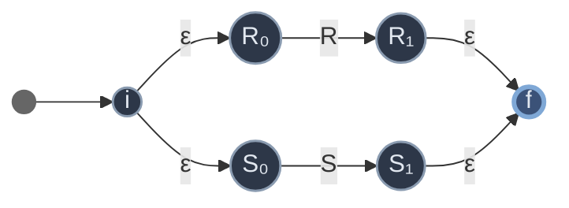
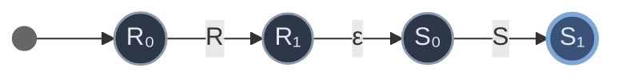
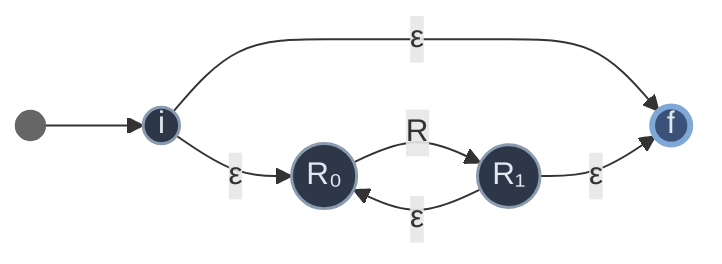

# 第三章 词法分析

> 把字符流切成单词符号（TOKEN）。理论基础是**正规文法（3 型）**，识别器是**有限自动机**。
> 上游：[[学习笔记/计算机基础/编译原理/02-高级语言及其语法描述.md|第二章 高级语言及其语法描述]]（正规文法/Chomsky 3 型）· 关联：[[学习笔记/计算机基础/编译原理/04-语法分析-自上而下.md|第四章 语法分析——自上而下分析]]

> [!abstract] 本章主线：一条等价链
> **正规式 ≡ NFA ≡ DFA ≡ 正规文法**——四者描述同一类语言（正规语言 / 3 型语言），可互相转换：
> ```
> 正规式 ──Thompson──> NFA ──子集构造──> DFA ──最小化──> 最小DFA
>   <──状态消去──        <──（DFA是NFA特例）──
> ```
> 两大必考算法：**NFA→DFA 确定化**、**DFA 最小化**。

---

## 1. 词法分析器的要求

### 功能

从左至右逐个字符扫描源程序，产生一个个**单词符号（TOKEN）**，把字符流改造成单词符号串。

### 单词符号的五大分类

| 类别 | 举例 | 是否确定 |
|---|---|---|
| **关键字**（保留字/基本字） | int、while、if | 确定 |
| **标识符** | 变量名、过程名 | **不确定** |
| **常数** | 整型、实型 | **不确定** |
| **运算符** | + - * / | 确定 |
| **界符** | ; , ( ) | 确定 |

### 输出形式：二元式

```
(单词种别, 单词符号的属性值)
```

- **种别**：语法分析需要的信息（通常用整数编码）。
- **属性值**：编译其他阶段需要的信息（简称单词值）。

> [!info] 属性值放什么？
> - **标识符** → 符号表项的**指针**（或内部字符串）；
> - **常数** → 常数表项的**指针**（或二进制形式）；
> - **关键字、运算符、界符**（一符一种）→ **不需要**属性值（种别已唯一确定它），填 `-`。

### 分类方法（种别怎么编）

- 标识符一般**统归一种**；常数宜**按类型分种**（整/实/布尔）；
- 关键字可全体一种，也可**一字一种**（实际处理更方便）；
- 运算符、界符一般**一符一种**。

> [!example]- 例 `while (i>=j) i--;` 的词法分析结果
> ```
> <while, ->   <(, ->   <id, ptr-i>   <>=, ->   <id, ptr-j>
> <), ->       <id, ptr-i>   <--, ->   <;, ->
> ```
> 关键字/界符/运算符属性值都是 `-`；标识符属性值是符号表指针。

---

## 2. 词法分析器的设计（状态转换图）

### 实现方式

- **完全独立方式**：词法分析作为单独一遍，输出给语法分析。结构清晰。
- **相对独立方式**：作为语法分析的一个**子程序**，需要新符号时调用。效率高，避免中间文件。

### 超前搜索

某些单词必须多读几个字符才能确定。如 FORTRAN 中 `DO99K = 1,10`（DO 是关键字）vs `DO99K = 1.10`（DO99K 是标识符）——要看到 `,` 还是 `.` 才能区分。读多的字符要**退还**（Retract）。

### 状态转换图（转换图的雏形）

- **结点** = 状态（圆圈）；**初态**通常一个；**终态**至少一个（**双圈**）；
- **弧**上的标记 = 在该状态下可能出现的输入字符；
- 只含**有限**个状态。
- **路**：从初态到终态的弧上标记序列；能产生某串 β 的路存在 → β 被接受。

> [!tip] 转换图本质就是一个不形式化的 DFA
> 后面把转换图"形式化"就得到 DFA/NFA。

---

## 3. 正规式与正规集

> [!abstract] 先分清两个概念
> - **正规式**：一个"模式表达式"（你写的式子，如 `a(b|c)*`）。
> - **正规集**：该模式能匹配的**所有符号串的集合**（即它描述的语言 L(R)），是 Σ* 的子集。
> 一句话：正规式是**模具**，正规集是**模具压出的所有成品串**。每个正规式 R 唯一对应一个正规集 L(R)。

### 三个原子（递归定义的基础）

| 原子正规式 | 正规集 | 人话 |
|---|---|---|
| **ε** | `{ε}` | 只匹配**空字**这 1 个串 |
| **∅** | `∅`（空集） | 什么都不匹配（0 个串） |
| **a**（a∈Σ） | `{a}` | 只匹配**单字符 a**这 1 个串 |

> [!danger] 三个原子最易混（高频考点）
> - **ε** → 正规集有 **1** 个元素，元素是**空串**；
> - **∅** → 正规集有 **0** 个元素（空集）；
> - **a** → 正规集有 **1** 个元素，元素是**字符 a**。
> ε 和 a 都是"1 个元素"，区别在元素是空串 vs 字符 a；∅ 是"一个都没有"。

### 三种运算（归纳规则）

若 U、V 是正规式（正规集 L(U)、L(V)），则：

| 运算 | 正规式 | 正规集 | 人话 |
|---|---|---|---|
| **或** | `(U\|V)` | L(U)∪L(V) | 二选一 |
| **连接** | `(U·V)` | L(U)L(V) | U 的串**后接** V 的串 |
| **闭包** | `(U)*` | (L(U))* | 重复 **0 次及以上** |

- 连接符 `·` 可省：`ab` = `a·b`。
- 闭包**含 0 次**：`a*` = {ε, a, aa, …}（0 个 a 即 ε，所以 `a*` 必含 ε）。
- **只有**有限次用上述规则构造的才是正规式。

### 优先级 & 运算律

**优先级**：`*` > `·` > `|`
- `ab*` = `a(b*)`，≠ `(ab)*`
- `a|bc` = `a|(bc)`

**运算律**（U、V、W 为正规式）：
- 交换律：`U|V = V|U`（**或可交换**）

> [!warning] 连接不可交换：`UV ≠ VU`（`ab` ≠ `ba`）——这是正规式和普通乘法最大的不同

- 结合律：`U|(V|W)=(U|V)|W`，`U(VW)=(UV)W`
- 分配律：`U(V|W)=UV|UW`，`(V|W)U=VU|WU`
- 单位元：`εU = Uε = U`（空字是连接的单位元，类似乘法的 1）
- 核心恒等式：**`A* = ε | AA*`**（闭包 = 0 次 ε，或 1 次 A 接更多 A）

### 实例（Σ={a,b}，从简到繁）

> [!example]- Level 1–2：单字符与或
> - `a` → {a}；`a|b` → {a, b}；`a|b|c` → {a, b, c}

> [!example]- Level 3–4：连接与组合
> - `ab` → {ab}
> - `(a|b)(a|b)` → {aa, ab, ba, bb}（长度恰为 2 的所有串）
> - `ab|cd` → {ab, cd}

> [!example]- Level 5：闭包
> - `a*` → {ε, a, aa, aaa, …}
> - `ba*` → {b, ba, baa, baaa, …}（b 开头后跟任意多 a，0 个 a 时就是 b）
> - `(a|b)*` → Σ 上**所有**串（含 ε）

> [!example]- Level 6：经典模式
> - 以 a 开头的任意 a/b 串：`a(a|b)*`
> - 含两个相继相同字符（aa 或 bb）：`(a|b)*(aa|bb)(a|b)*`
> - 所有二进制串：`(0|1)*`
> - 标识符：`字母(字母|数字)*`；整数：`数字(数字)*`

> [!example]- 集合层面的运算演示（理解 L(U)、L(V) 怎么算）
> 设 L={001,10,111}，M={ε,001}：
> - `L|M` = {ε, 10, 001, 111}（并集）
> - `LM` = {001, 10, 111, 001001, 10001, 111001}（L 每个串后接 M 每个串）
> - 设 L={0,11}：`L*` = {ε, 0, 11, 00, 011, 110, 1111, …}（任意次拼接）

### 两类题型

> [!tip] 题型 A：给正规式 → 展开正规集
> 逐步按运算展开。如 `a(b|c)*`：先 `(b|c)*`={ε,b,c,bb,bc,cb,cc,…}，前面接 a → {a,ab,ac,abb,abc,…}。

> [!tip] 题型 B：给文字描述 → 写正规式（更常考）
> - "若干 a 后跟若干 b" → `a*b*`
> - "以 ab 结尾" → `(a|b)*ab`
> - 套路：**重复**→`X*`，**二选一**→`|`，**拼接**→连接，**位置**→用 `Σ*` 锚定前后。

---

## 4. 有限自动机

> [!abstract] 自动机本质
> **状态 + 输入 + 规则 → 状态迁移**。一个控制器读输入带上的字符，按规则改状态，到达终态即"接受"该串。

### DFA（确定有限自动机）

**五元组** `M = (S, Σ, δ, s0, F)`：

| 部分 | 含义 |
|---|---|
| **S** | 有限状态集 |
| **Σ** | 有限输入字母表 |
| **δ** | 转换函数 `δ: S×Σ → S`（**确定**：一个状态读一个字符到**唯一**下一状态） |
| **s0** | **唯一**初态，s0 ∈ S |
| **F** | 终态集，F ⊆ S |

- 可用**状态转换矩阵**表示（行=状态，列=字符，元素=`δ(s,a)`）。
- **接受的语言**：`L(M) = {α | δ'(s0, α) ∈ F}`（读完 α 停在终态）。若 `s0 ∈ F`，则 ε 被接受。

### NFA（非确定有限自动机）

**五元组** `M = (S, Σ, δ, S0, F)`：

| 部分 | 含义 |
|---|---|
| **S, Σ, F** | 同 DFA |
| **δ** | 转换函数 `δ: S×Σ → 2^S`（**状态子集**：可到多个状态、可无转移、可有 ε 转移） |
| **S0** | **初态集**（非空，可有多个） |

- 状态转换矩阵每项都是**集合**（含空集 ∅，表示无转移）。
- **接受的语言**：`L(M) = {α | δ'(S0, α) ∩ F ≠ ∅}`（到达的状态集**与终态集相交**即接受）。

### DFA vs NFA 对照

| | DFA | NFA |
|---|---|---|
| δ 返回 | **单个状态** | **状态子集** |
| 同一(状态,字符) | 唯一转移 | 可多个 / 可无 / 可 ε |
| 初态 | 唯一 s0 | 初态集 S0 |
| 接受判定 | 终态 ∈ F | δ' ∩ F ≠ ∅ |
| 关系 | NFA 的特例 | 更一般 |

> [!question] DFA 和 NFA 谁的能力强？
> **一样强**（等价）！任何 NFA 都能转换为等价的 DFA（子集构造法），二者识别的正规语言类相同。NFA 表达更简洁、DFA 执行更确定。

---

## 5. 等价性一：正规式 → NFA（Thompson 算法）

> [!abstract] 思想
> 对正规式的每种结构（ε、a、`R+S`、`RS`、`R*`）给出一个**固定的 NFA 模板**，递归拼装。

**基础**（原子，都是"两状态 + 一条弧"；ε 同理把弧标换成 ε）：

```mermaid
flowchart LR
    s(( )) --> i((i))
    i -->|a| f((f))
    class s start
    class i state
    class f final
    classDef start fill:#666,stroke:#666,color:#666
    classDef state fill:#2d3748,stroke:#8a9bb0,stroke-width:1.5px,color:#e2e8f0
    classDef final fill:#3b5278,stroke:#7fa8d6,stroke-width:3px,color:#e2e8f0
```



**归纳**（组合，**全靠 ε 连接**——Thompson 的精髓，保证拼接时只增不减；下图 R、S 代表已构造的子 NFA，用单条弧表示）：

**`R+S`（或/并联）**：新初态经 ε 分叉到 R、S 初态；R、S 终态经 ε 汇到新终态。



**`RS`（连接）**：R 的终态经 ε 接 S 的初态。



**`R*`（闭包）**：新初态经 ε 直达新终态（允许 0 次）和 R 初态；R 终态经 ε 回 R 初态（循环）+ 到新终态。



> [!example]- 例 正规式 `1*0(0|1)*` 的 NFA 构造
> 先对子式 `1*`、`0`、`(0|1)*` 各用模板构造，再用 ε 串联：`1*` 的终态 ε 接 `0` 的初态，`0` 的终态 ε 接 `(0|1)*` 的初态。Thompson 构造的 NFA 特点是**状态多、ε 转移多**（所以要靠子集构造法确定化）。

---

## 6. 等价性二：NFA → DFA（子集构造法 / 确定化）⭐重难点

> [!abstract] 核心思想
> DFA 的**一个状态 = NFA 的一个状态子集**。读字符 a 后，DFA 从子集 I 走到子集 Ia。

### 两个关键工具

**① ε-闭包 `ε-CLOSURE(I)`**（I 是状态子集）：
1. I 中每个状态 q 都在闭包里；
2. 从 q 出发**经任意条 ε 弧**能到的状态也在闭包里。

**② `Ia`**（I 是子集，a 是字符）：
- 先求 J = 从 I 中某状态出发**经一条 a 弧**到达的状态全体；
- 再 `Ia = ε-CLOSURE(J)`（到达后还要沿 ε 扩散）。

> [!info] 直觉
> `Ia` = "从子集 I 出发，读一个 a（之后可任意走 ε），能到达的所有状态"。

### 构造步骤

1. DFA 初态 = `ε-CLOSURE({NFA初态})`；
2. 对当前每个子集 I 和每个字符 a，算 `Ia`，作为新状态（若未出现则加入）；
3. 重复直到不再产生新子集；
4. **含 NFA 终态的子集** = DFA 终态；子集重命名为 0,1,2,…。

### 完整例题：NFA → DFA（识别 `a*b`）

> [!example]- 设 NFA M（识别 a*b，即任意个 a 后跟一个 b）：
> 状态 {0,1,2,3,4,5}，初态 0，终态 {5}，转移：
> ```
> 0 --ε--> 1        1 --a--> 2        2 --ε--> 1   （a* 循环）
> 1 --ε--> 3        3 --b--> 4        4 --ε--> 5
> ```
>
> NFA 状态图（5 为终态）：
> ```mermaid
> flowchart LR
>     s(( )) --> 0((0))
>     0 -->|ε| 1((1))
>     1 -->|a| 2((2))
>     2 -->|ε| 1
>     1 -->|ε| 3((3))
>     3 -->|b| 4((4))
>     4 -->|ε| 5((5))
>     class s start
>     class 0,1,2,3,4 state
>     class 5 final
>     classDef start fill:#666,stroke:#666,color:#666
>     classDef state fill:#2d3748,stroke:#8a9bb0,stroke-width:1.5px,color:#e2e8f0
>     classDef final fill:#3b5278,stroke:#7fa8d6,stroke-width:3px,color:#e2e8f0
> ```
>
> **第 1 步：DFA 初态 = ε-CLOSURE({0})**
> 从 0 经 ε：0→1→3（1 经 ε 到 3）。**A = {0,1,3}**
>
> **第 2 步：算 A 的 Ia、Ib**
> - A 经 a 弧到达：只有 1--a-->2，J={2}；ε-CLOSURE({2})={2,1,3}（2→ε→1→ε→3）。**B = {1,2,3}**
> - A 经 b 弧到达：只有 3--b-->4，J={4}；ε-CLOSURE({4})={4,5}。**C = {4,5}**
>
> **第 3 步：算 B、C 的 Ia、Ib**
> - B={1,2,3}：经 a → {2}（1--a-->2）→ ε-CLOSURE = {1,2,3}=B；经 b → {4}（3--b-->4）→ {4,5}=C
> - C={4,5}：经 a → ∅；经 b → ∅（4、5 都无 a/b 转移）
>
> **状态转换矩阵**：
>
> | 子集 | Ia | Ib |
> |---|---|---|
> | A={0,1,3} | B={1,2,3} | C={4,5} |
> | B={1,2,3} | B | C |
> | C={4,5} | ∅ | ∅ |
>
> **终态**：含 NFA 终态 5 的子集 = **C**。
>
> 结果 DFA（C 为终态，对 a/b 是死状态 ∅ 故省略）：
> ```mermaid
> flowchart LR
>     s(( )) --> A((A))
>     A -->|a| B((B))
>     A -->|b| C((C))
>     B -->|a| B
>     B -->|b| C
>     class s start
>     class A,B state
>     class C final
>     classDef start fill:#666,stroke:#666,color:#666
>     classDef state fill:#2d3748,stroke:#8a9bb0,stroke-width:1.5px,color:#e2e8f0
>     classDef final fill:#3b5278,stroke:#7fa8d6,stroke-width:3px,color:#e2e8f0
> ```
>
> **验证**：输入 "aab" → A --a--> B --a--> B --b--> C(终态) ✓ 接受；输入 "a" → A --a--> B(非终态) ✗（a*b 必须以 b 结尾）✓。

---

## 7. 等价性三：DFA → 正规式（状态消去法）

> [!abstract] 思想
> 允许弧上标**正规式**（不止单字符）；逐步消去中间状态，合并弧，最后只剩初态 X 到终态 Y 的一条弧，其上的正规式即所求。

步骤：
1. 增加新初态 X、新终态 Y，用 ε 连到原初态/终态（使初终态唯一）；
2. 反复消中间状态，合并规则：
   - **并联**（i 到 j 有两条弧 A、B）→ 合成 `A|B`
   - **串联**（i→k→j，弧 A、B）→ 消 k，i→j 弧 `AB`
   - **带自环**（i→k→j，i 到 k 是 A、k 自环 B、k 到 j 是 C）→ 消 k，i→j 弧 `AB*C`
3. 直到只剩 X、Y，X→Y 上的正规式即答案。

> [!example]- 例：求下面 DFA 的正规式（识别 `ab*c`）
> DFA：0(初态) --a--> 1；1 自环 b、1 --c--> 2(终态)。
>
> ```mermaid
> flowchart LR
>     s(( )) --> 0((0))
>     0 -->|a| 1((1))
>     1 -->|b| 1
>     1 -->|c| 2((2))
>     class s start
>     class 0,1 state
>     class 2 final
>     classDef start fill:#666,stroke:#666,color:#666
>     classDef state fill:#2d3748,stroke:#8a9bb0,stroke-width:1.5px,color:#e2e8f0
>     classDef final fill:#3b5278,stroke:#7fa8d6,stroke-width:3px,color:#e2e8f0
> ```
>
> **① 加 X、Y**：X --ε--> 0，2 --ε--> Y（使初终态唯一）。
>
> **② 消状态 0**（入边来自 X，出边 a→1）：X→0→1 = ε·a = **a** → 新弧 X --a--> 1，删 0。
>
> **③ 消状态 1**（自环 b，入边来自 X，出边 c→2）：X→1→(b*)→2 = a·b*·c = **ab\*c** → 新弧 X --ab*c--> 2，删 1。
>
> **④ 消状态 2**（入边来自 X，出边 ε→Y）：X→2→Y = ab*c·ε = **ab\*c** → X --ab*c--> Y。
>
> **结果：`ab*c`** ✓（一个 a、任意个 b、一个 c）。若某步消去后两状态间出现多条弧，用 `|` 并联合并（如 ac|bc）。

---

## 8. 等价性四：正规文法 ↔ FA

> [!abstract] 先回顾：正规文法是什么（第二章的 3 型文法）
> 正规文法 = **3 型文法**，产生式只有两种形式（A、B 是非终结符，a 是终结符）：
> - **右线性**：`A → aB` 或 `A → a`（终结符 a 在前，非终结符 B 在后）
> - **左线性**：`A → Ba` 或 `A → a`
>
> 它产生的语言是**正规语言**——和正规式、DFA、NFA 描述的是**同一类语言**。
>
> **怎么写 / 表示什么**：就是一组产生式，每条 `A→aB` 描述"在状态 A 读入 a 转到状态 B"——本质就是自动机的转移。
> 例：`<标识符> → 字母 | <标识符>字母 | <标识符>数字` 就是一个描述标识符的正规文法。

### 右线性文法 → NFA

非终结符当状态，开始符 S 当初态，加一个新终态 f：
- `A → aB`：在状态 A 读 a 转到 B → `δ(A,a) ∋ B`
- `A → a`（右部无非终结符）：在状态 A 读 a 到终态 → `δ(A,a) ∋ f`

### DFA → 右线性文法

状态当非终结符，转移变产生式。对 `δ(A,a) = B`：
- B **非终态** → `A → aB`
- B **是终态** → `A → a | aB`（多一条 `A→a`，表示读 a 即可接受）

> [!example]- 例：DFA → 右线性正规文法
> 设 DFA M=({A,B,C,D,f}, {0,1}, δ, A, {f})（f 为终态）：
> ```
> δ(A,0)={B,f}   δ(A,1)={D}
> δ(B,0)={D}     δ(B,1)={C}
> δ(C,0)={B,f}   δ(C,1)={D}
> δ(D,0)={D}     δ(D,1)={D}
> ```
> 对应右线性文法 G=({A,B,C,D}, {0,1}, A, P)：
> ```
> A → 0 | 0B | 1D     （δ(A,0)到 f 和 B：到 f 得 A→0，到 B 得 A→0B；δ(A,1)到 D：A→1D）
> B → 0D | 1C         （δ(B,0)到 D：B→0D；δ(B,1)到 C：B→1C）
> C → 0 | 0B | 1D
> D → 0D | 1D         （δ(D,0/1)都到 D：自环）
> ```
> 规律：**转移 δ(X,a)=Y 直接对应产生式 X→aY**；若 Y 是终态 f，去掉 f 变 `X→a`。

> [!example]- 延伸：把上面这个 DFA 转成正规式（状态消去法，每步附图）
> **原图**（A 初态、f 终态、D 陷阱态）：
> ```mermaid
> flowchart LR
>     s(( )) --> A((A))
>     A -->|0| B((B))
>     A -->|0| f((f))
>     A -->|1| D((D))
>     B -->|0| D
>     B -->|1| C((C))
>     C -->|0| B
>     C -->|0| f
>     C -->|1| D
>     D -->|0,1| D
>     class s start
>     class A,B,C,D state
>     class f final
>     classDef start fill:#666,stroke:#666,color:#666
>     classDef state fill:#2d3748,stroke:#8a9bb0,stroke-width:1.5px,color:#e2e8f0
>     classDef final fill:#3b5278,stroke:#7fa8d6,stroke-width:3px,color:#e2e8f0
> ```
>
> **① 删陷阱态 D**（0/1 自环且非终态，进了出不来 → 无贡献，删；A、C 转移相同，删 D 后都成「0→B, 0→f」）：
> ```mermaid
> flowchart LR
>     s(( )) --> A((A))
>     A -->|0| B((B))
>     A -->|0| f((f))
>     B -->|1| C((C))
>     C -->|0| B
>     C -->|0| f
>     class s start
>     class A,B,C state
>     class f final
>     classDef start fill:#666,stroke:#666,color:#666
>     classDef state fill:#2d3748,stroke:#8a9bb0,stroke-width:1.5px,color:#e2e8f0
>     classDef final fill:#3b5278,stroke:#7fa8d6,stroke-width:3px,color:#e2e8f0
> ```
>
> **② 消状态 C**（入边 B[1]，出边到 B[0]、f[0] → B 自环 `10`、B→f 弧 `10`）：
> ```mermaid
> flowchart LR
>     s(( )) --> A((A))
>     A -->|0| B((B))
>     A -->|0| f((f))
>     B -->|10| B
>     B -->|10| f
>     class s start
>     class A,B state
>     class f final
>     classDef start fill:#666,stroke:#666,color:#666
>     classDef state fill:#2d3748,stroke:#8a9bb0,stroke-width:1.5px,color:#e2e8f0
>     classDef final fill:#3b5278,stroke:#7fa8d6,stroke-width:3px,color:#e2e8f0
> ```
>
> **③ 消状态 B**（自环 `10`，到 f 弧 `10` → A→0→B→(10)*→f = `0(10)*(10)`，与直接 `0` 并存）：
> ```mermaid
> flowchart LR
>     s(( )) --> A((A))
>     A -->|0| f((f))
>     A -->|"0(10)*(10)"| f
>     class s start
>     class A state
>     class f final
>     classDef start fill:#666,stroke:#666,color:#666
>     classDef state fill:#2d3748,stroke:#8a9bb0,stroke-width:1.5px,color:#e2e8f0
>     classDef final fill:#3b5278,stroke:#7fa8d6,stroke-width:3px,color:#e2e8f0
> ```
>
> **④ 合并 A→f 两弧**：`0 | 0(10)*(10)` = `0(10)*`（`0(10)*(10)=0(10)⁺`，加零个 10 的 `0`，合成 `0(10)*`）：
> ```mermaid
> flowchart LR
>     s(( )) --> A((A))
>     A -->|"0(10)*"| f((f))
>     class s start
>     class A state
>     class f final
>     classDef start fill:#666,stroke:#666,color:#666
>     classDef state fill:#2d3748,stroke:#8a9bb0,stroke-width:1.5px,color:#e2e8f0
>     classDef final fill:#3b5278,stroke:#7fa8d6,stroke-width:3px,color:#e2e8f0
> ```
>
> **结果：`0(10)*`**（以 0 开头后跟任意个 "10"；接受 "0"/"010"/"01010"…，拒 "00"/"01"/"1"）。印证 §8 文法与此正规式同语言——四者等价的闭环。

> [!tip] 闭环：四者完全等价
> 至此 **正规式 ↔ NFA ↔ DFA ↔ 正规文法** 四者完全等价，都刻画**正规语言（3 型）**。词法分析用任意一种描述，最终都化为 DFA 实现。

---

## 9. DFA 的化简（最小化）⭐重难点

> [!abstract] 目标
> 找一个状态数更少的 DFA M'，使 `L(M') = L(M)`。

### 两个术语

- **状态 s、t 等价**：从 s 读任一串 α 能到终态 ⟺ 从 t 读 α 也能到终态（**行为完全一致**）。
- **状态 s、t 可区别**：不等价（存在某串使一个到终态、另一个不到）。**终态与非终态天然可区别。**

> [!info] 思路
> 把状态集**划分**成不相交子集：同一子集内状态等价（可合并），不同子集状态可区别。每个子集合并成一个新状态。

### 划分法（Hopcroft）步骤

1. **初始划分** `∏0 = {终态集, 非终态集}`；
2. 检查 ∏ 中每个子集 I 是否**还能再分**：
   - 对某字符 a，若 `Ia`（I 中各状态经 a 到达的状态集）**不全落在 ∏ 的同一个子集**里 → 把 I 按"a 的去向"细分；
3. 重复步骤 2，直到 ∏ **不再变化**；
4. 每个子集合并为一个状态（选一个代表）。

### 完整例题：DFA 最小化

> [!example]- 化简识别"以 a 结尾的 {a,b} 串"的 DFA（带冗余状态）：
> 状态 {A,B,C,D}，初态 A，终态 {B,D}，Σ={a,b}，转移：
> ```
> δ(A,a)=B   δ(A,b)=C
> δ(C,a)=B   δ(C,b)=C      （C 与 A 行为一致 → 冗余）
> δ(B,a)=D   δ(B,b)=A
> δ(D,a)=B   δ(D,b)=C      （D 与 B 行为一致 → 冗余）
> ```
>
> 原 DFA（B、D 为终态）：
> ```mermaid
> flowchart LR
>     s(( )) --> A((A))
>     A -->|a| B((B))
>     A -->|b| C((C))
>     C -->|a| B
>     C -->|b| C
>     B -->|a| D((D))
>     B -->|b| A
>     D -->|a| B
>     D -->|b| C
>     class s start
>     class A,C state
>     class B,D final
>     classDef start fill:#666,stroke:#666,color:#666
>     classDef state fill:#2d3748,stroke:#8a9bb0,stroke-width:1.5px,color:#e2e8f0
>     classDef final fill:#3b5278,stroke:#7fa8d6,stroke-width:3px,color:#e2e8f0
> ```
>
> **∏0 = {终态 {B,D}, 非终态 {A,C}}**
>
> 检查 **{B,D}**：
> - `{B,D}a = {D,B} = {B,D} ⊆ {B,D}` ✓
> - `{B,D}b = {A,C} ⊆ {A,C}` ✓
> - 都落在同一子集 → **不再分**
>
> 检查 **{A,C}**：
> - `{A,C}a = {B} ⊆ {B,D}` ✓
> - `{A,C}b = {C} ⊆ {A,C}` ✓
> - 都落在同一子集 → **不再分**
>
> ∏0 已稳定：**{A,C} 合并、{B,D} 合并**，5→... 原 4 状态化为 **2 状态**：
> - {A,C} --a--> {B,D}(终态)，--b--> {A,C}
> - {B,D} --a--> {B,D}，--b--> {A,C}
>
> 化简后 DFA（2 状态，{B,D} 为终态）：
> ```mermaid
> flowchart LR
>     s(( )) --> AC((AC))
>     AC -->|a| BD((BD))
>     AC -->|b| AC
>     BD -->|a| BD
>     BD -->|b| AC
>     class s start
>     class AC state
>     class BD final
>     classDef start fill:#666,stroke:#666,color:#666
>     classDef state fill:#2d3748,stroke:#8a9bb0,stroke-width:1.5px,color:#e2e8f0
>     classDef final fill:#3b5278,stroke:#7fa8d6,stroke-width:3px,color:#e2e8f0
> ```
>
> **验证**："a"→终态✓；"ab"→{A,C}--a-->{B,D}--b-->{A,C}非终态✓（不以 a 结尾）；"aba"→终态✓。

> [!example]- 进阶：多轮划分的最小化（6 状态 → 4 状态）
> DFA：状态 {0,1,2,3,4,5}，初态 0，终态 {4,5}，Σ={a,b}：
> ```
> δ(0,a)=1  δ(0,b)=2     δ(1,a)=3  δ(1,b)=4
> δ(2,a)=3  δ(2,b)=5     δ(3,a)=3  δ(3,b)=3   （3 非终态陷阱）
> δ(4,a)=4  δ(4,b)=4     δ(5,a)=5  δ(5,b)=5   （4,5 终态自循环）
> ```
> 原图：
> ```mermaid
> flowchart LR
>     s(( )) --> 0((0))
>     0 -->|a| 1((1))
>     0 -->|b| 2((2))
>     1 -->|a| 3((3))
>     1 -->|b| 4((4))
>     2 -->|a| 3
>     2 -->|b| 5((5))
>     3 -->|a,b| 3
>     4 -->|a,b| 4
>     5 -->|a,b| 5
>     class s start
>     class 0,1,2,3 state
>     class 4,5 final
>     classDef start fill:#666,stroke:#666,color:#666
>     classDef state fill:#2d3748,stroke:#8a9bb0,stroke-width:1.5px,color:#e2e8f0
>     classDef final fill:#3b5278,stroke:#7fa8d6,stroke-width:3px,color:#e2e8f0
> ```
>
> **∏0 = {非终 {0,1,2,3}, 终 {4,5}}**
> - 查 {4,5}：a,b 都落 {4,5} → 不分。
> - 查 {0,1,2,3}：按 a → {1,3} 全在非终组（不分）；按 b → {2,4,5,3}，其中 2,3 落非终组、4,5 落终组 → **散落**，按 b 去向细分：b 到非终组的 **{0,3}**（0→b→2、3→b→3）、b 到终组的 **{1,2}**（1→b→4、2→b→5）。
>
> **∏1 = {{0,3}, {1,2}, {4,5}}**
> - 查 {0,3}：按 a → 0→1∈{1,2}、3→3∈{0,3} → **散落**，细分为 {0}、{3}。
> - 查 {1,2}：a 都到 3∈{3}、b 都到 {4,5} → 不分。
> - 查 {4,5}：不分。
>
> **∏2 = {{0}, {3}, {1,2}, {4,5}}**（稳定）
>
> 化简后 DFA（{1,2}、{4,5} 各合并，6→4 状态）：
> ```mermaid
> flowchart LR
>     s(( )) --> Z0(("0"))
>     Z0 -->|a,b| Z12(("1,2"))
>     Z12 -->|a| Z3(("3"))
>     Z12 -->|b| Z45(("4,5"))
>     Z3 -->|a,b| Z3
>     Z45 -->|a,b| Z45
>     class s start
>     class Z0,Z12,Z3 state
>     class Z45 final
>     classDef start fill:#666,stroke:#666,color:#666
>     classDef state fill:#2d3748,stroke:#8a9bb0,stroke-width:1.5px,color:#e2e8f0
>     classDef final fill:#3b5278,stroke:#7fa8d6,stroke-width:3px,color:#e2e8f0
> ```
>
> 要点：此例 **∏0→∏1→∏2 两轮细分**——先按 b 把 {0,1,2,3} 拆成 {0,3}/{1,2}，再按 a 把 {0,3} 拆成 {0}/{3}；终态组 {4,5} 自始至终等价。

> [!warning] 最小化常考陷阱
> - 初始划分**必须**按 {终态, 非终态} 二分起步（终态与非终态天然可区别）。
> - 判断"能否再分"看**所有字符**的 `Ia`，只要**有一个字符**使状态散落到不同子集，就要分。
> - 细分时，按"该字符下去向落在哪些子集"把 I 分成若干组。

---

## 10. 词法分析器自动生成（LEX）

### LEX 源程序结构

```
{辅助定义部分}     ← 给正规式起简名
  识别规则部分     ← 正规式 + 对应动作
{用户子程序部分}
```

- 辅助定义：`letter → A|B|…|Z`，`digit → 0|1|…|9`，`id → letter(letter|digit)*`
- 识别规则：`Pi { Ai }`（识别到正规式 Pi 的单词时执行动作 Ai，如 `RETURN(6, ...)`）

### LEX → 词法分析器的实现流程

1. 对每条规则 Pi 构造一个 NFA Mi；
2. 引入新初态 X，用 ε 连成一个大 NFA M；
3. **子集法确定化** → **化简** → 得 DFA；
4. 把 DFA 转成词法分析程序（状态转换表 + 控制程序）。

> [!danger] 两大匹配原则（必考）
> 1. **最长匹配原则**：总是匹配**最长**的可能子串。
> 2. **最前优先原则**：当多个正规式都能匹配同一最长子串时，以**书写在前**的规则为准。
>
> **例** LEX 规则（按书写顺序）① `a`　② `abb`　③ `a*bb*`，输入 `abbbabb`，逐段切分：
> ```
> 输入： a  b  b  b  a  b  b
> 位置： 0  1  2  3  4  5  6
>
> 【第 1 段 · 从位置 0 · 最长匹配】
>   ① a       → "a"     (长 1)
>   ② abb     → "abb"   (长 3)
>   ③ a*bb*   → "abbb"  (长 4)  ← 最长
>   ⇒ 输出 abbb（按 ③ a*bb*）
>
> 【第 2 段 · 从位置 4 · 剩余 "abb"】
>   ① a       → "a"     (长 1)
>   ② abb     → "abb"   (长 3)
>   ③ a*bb*   → "abb"   (长 3)  ← ②③并列最长
>   ⇒ ②写在③前 → 输出 abb（按 ②，最前优先）
> ```
> 结果：`abbb`(③) + `abb`(②)。**第 1 段考最长匹配**（a*bb* 赢在更长），**第 2 段考最前优先**（abb 与 a*bb* 同长 3，abb 赢在写得前）。

---

## ✅ 自测题（先自己想，再展开答案）

> [!question]- Q1. 词法分析器的输出是什么形式？单词符号分哪五类？哪些是"确定"的？
> 输出**二元式 `(种别, 属性值)`**。五类：关键字、标识符、常数、运算符、界符。
> **确定**的：关键字、运算符、界符（一符一种）；**不确定**的：标识符、常数（值可变）。

> [!question]- Q2. 写出"标识符"和"整数"的正规式。
> - 标识符：`字母(字母|数字)*`
> - 整数：`数字(数字)*`，即 `(0|1|…|9)(0|1|…|9)*`

> [!question]- Q3. 正规式有哪三种运算？优先级如何？
> 或 `|`（最低）、连接 `·`（中，可省）、闭包 `*`（最高）。如 `ab*` = `a(b*)`。

> [!question]- Q4. DFA 和 NFA 的五元组有何不同？δ 函数的区别？
> - DFA：`δ: S×Σ → S`（返回**单个状态**），初态**唯一** s0；
> - NFA：`δ: S×Σ → 2^S`（返回**状态子集**），初态是**集** S0，可有 ε 转移。
> 接受判定：DFA 终态 ∈ F；NFA δ'∩F ≠ ∅。

> [!question]- Q5. 什么是 ε-闭包？什么是 Ia？
> - **ε-CLOSURE(I)**：I 中状态经**任意条 ε 弧**能到的所有状态（含 I 自身）。
> - **Ia**：从 I 出发**经一条 a 弧**到达的状态 J，再取 ε-CLOSURE(J)。即"读一个 a（后可走 ε）能到的全体"。

> [!question]- Q6. 简述 NFA→DFA 子集构造法的步骤。DFA 的终态如何确定？
> ① DFA 初态 = ε-CLOSURE({NFA初态})；② 对每个子集 I 和字符 a 算 Ia 作为新状态；③ 重复到无新子集；④ 子集重命名；⑤ **含 NFA 终态的子集 = DFA 终态**。

> [!question]- Q7. 简述 DFA 最小化的步骤。初始划分怎么分？
> ① 初始划分 `∏0 = {终态集, 非终态集}`；② 检查每个子集能否再分（看各字符 Ia 是否全落同一子集，否则细分）；③ 重复到 ∏ 不变；④ 每子集合并为一状态。

> [!question]- Q8. 正规式、NFA、DFA、正规文法四者是什么关系？
> **完全等价**，都描述**正规语言（3 型语言）**。转换链：正规式 Thompson→ NFA 子集构造→ DFA 最小化→ 最小DFA；反向：DFA 状态消去→ 正规式；正规文法 ↔ FA 互相转换。

> [!question]- Q9. LEX 的两大匹配原则是什么？
> **最长匹配**（总是匹配最长可能子串）+ **最前优先**（多规则同匹配时，以书写在前的为准）。

---

## 📌 速查表

| 问 | 答案要点 |
|---|---|
| 词法输出 | 二元式 (种别, 属性值) |
| 单词五类 | 关键字/标识符/常数/运算符/界符 |
| 正规式优先级 | `*` > `·` > `\|` |
| 正规式恒等式 | `A* = ε\|AA*`；`εU=U` |
| DFA 五元组 | (S,Σ,δ,s0,F)；δ:S×Σ→S |
| NFA 五元组 | (S,Σ,δ,S0,F)；δ:S×Σ→2^S |
| DFA vs NFA 能力 | 等价（都识别正规语言） |
| 子集构造核心 | DFA状态 = NFA状态子集；用 ε-CLOSURE 和 Ia |
| DFA 终态判定 | 含 NFA 终态的子集 |
| 最小化初始划分 | {终态集, 非终态集} |
| 最小化细分依据 | 某字符的 Ia 散落到不同子集则分 |
| 四者等价 | 正规式≡NFA≡DFA≡正规文法（正规语言/3型） |
| 正规式→NFA | Thompson 算法 |
| NFA→DFA | 子集构造法 |
| DFA→正规式 | 状态消去法 |
| LEX 两原则 | 最长匹配 + 最前优先 |

---

## 下一步

- [[学习笔记/计算机基础/编译原理/04-语法分析-自上而下.md|第四章 语法分析——自上而下分析]]：从 3 型（正规）升级到 **2 型（上下文无关文法 CFG）**，**LL(1) 三条件、FIRST/FOLLOW、预测分析表**（🔴 重难点）
- 回到 [[学习笔记/计算机基础/编译原理/02-高级语言及其语法描述.md|第二章 高级语言及其语法描述]] · 00-总览
