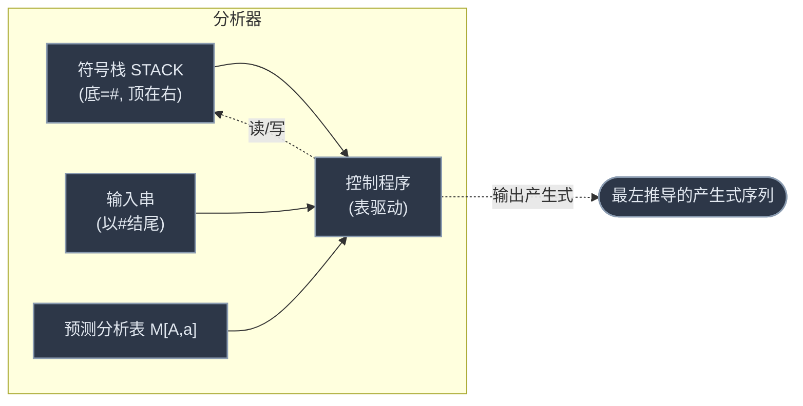

# 第四章 语法分析——自上而下分析

> 判断输入串 `w` 是否属于 `L(G)`。**自上而下** = 从开始符出发构造**最左推导**推出 `w`。
> 上游：[[学习笔记/计算机基础/编译原理/03-词法分析.md|第三章 词法分析]]（提供单词符号）· 关联：[[学习笔记/计算机基础/编译原理/05-语法分析-自下而上.md|第五章 语法分析——自下而上分析]]（另一流派）

> [!abstract] 本章主线
> 自上而下分析有**回溯、左递归**两大病 → 用**消除左递归 + 提取左因子 + FIRST/FOLLOW** 把文法改造成 **LL(1) 文法** → 用 **预测分析表 + 栈** 实现**不回溯**的分析。
> 贯穿全章的经典文法（消除左递归后的表达式文法）：
> ```
> E  → T E'         E' → + T E' | ε
> T  → F T'         T' → * F T' | ε
> F  → ( E ) | i
> ```

---

## 1. 语法分析概述 & 两大流派

**任务**：对任一输入串 `w ∈ V_T*`，判断 `w ∈ L(G)` 是否成立。

| 流派 | 方向 | 代表方法 |
|---|---|---|
| **自上而下**（本章） | 从开始符 **S 出发向下推导**（最左推导），推出 w | LL(1)、递归下降、预测分析 |
| **自下而上**（第五章） | 从 w 出发**向上归约**（最右推导的逆），归约到 S | 算符优先、LR |

**LL(1) 含义**：从 **L**eft 到右扫描 / 构造 **L**eftmost 推导 / 每步向前看 **1** 个字符。

---

## 2. 自上而下的三大困难

> [!example]- 引例：回溯是怎么发生的
> 文法 `S→xAy`，`A→**|*`，识别 `x*y`：
> ```
> S ⇒ xAy ⇒ x**y  ✗（用 A→**，匹配失败，回溯）
> S ⇒ xAy ⇒ x*y   ✓（改用 A→*，成功）
> ```
> 选错候选式就得**退回去重试** → 回溯。

| 困难 | 表现 | 后果 |
|---|---|---|
| **左递归** | `A ⇒ Aα`（直接 `A→Aα` 或间接 `A→B…, B→A…`） | 自上而下**无限循环**（一直展开 A） |
| **虚假匹配** | 候选式匹配了一部分后被推翻 | 浪费工作 |
| **回溯** | 选错候选式要退回重选 | 时空开销大、错误定位难（穷尽试探） |

LL(1) 的目标：**消灭这三个问题**，做不回溯的分析。

---

## 3. 困难一：消除左递归

### 直接左递归

`P → Pα | β`（α≠ε，β 不以 P 开头）改写为：
```
P  → β P'
P' → α P' | ε
```

> [!tip] 直觉
> 原来 `P⇒Pα⇒Pαα⇒…` 产生 `β、βα、βαα、…`（β 后跟任意个 α）。
> 改写后 `P→βP'`，`P'→αP'|ε` 用**右递归**产生同样的串，但自上而下不再无限循环。

> [!example]- 经典例：消除表达式文法的左递归
> 原：`E→E+T|T`，`T→T*F|F`，`F→(E)|i`
> 消除后（这就是全章要用的文法）：
> ```
> E  → T E'        E' → + T E' | ε      （E' 接管原来的"E+T"循环）
> T  → F T'        T' → * F T' | ε
> F  → ( E ) | i
> ```

**一般形式**：`P → Pα1|…|Pαm | β1|…|βn` →
```
P  → β1 P' | β2 P' | … | βn P'
P' → α1 P' | … | αm P' | ε
```

### 间接左递归

先**排序 + 代入**化成直接左递归，再消。算法：
1. 非终结符排序 P1,…,Pn；
2. 对每个 Pi，把 `Pi→Pjγ`（j<i）中的 Pj 用其候选式代入，再消 Pi 的直接左递归；
3. 删除从 S 不可达的产生式。

> [!info] 间接左递归的消除结果与排序无关（只是中间步骤不同）。

---

## 4. 困难二：消除回溯（提取公共左因子）

### 回溯的根源

`A→α1|α2|…|αn`，若多个 `αi` 能推导出的**首终结符**有重叠 → 当前输入符 a 无法唯一指派候选式 → 回溯。

> [!example]- 看看回溯是怎么发生的
> 文法 `S→aAd`，`A→ab|ac`，识别 `aac`。A 的两候选 **ab、ac 都以 a 开头**（首符集相交 `{a}∩{a}≠∅`）。
> ```
> 1. S ⇒ aAd，匹配输入首字符 a ✓
> 2. 展开 A，当前输入仍是 a（第 2 字符）→ ab/ac 都以 a 开头，不知选哪个
> 3. 先试 ab：A ⇒ ab，匹配 a ✓，但下一该匹配 b，输入是 c → c≠b，失败！
> 4. 退回（回溯），换 ac：A ⇒ ac，匹配 a ✓、c ✓ → 成功
> ```
> 第 3 步「**匹配到一半才发现错、退回重试**」就是回溯——已做的匹配和子树作废，效率低、报错难定位。
> 根因：`FIRST(ab)∩FIRST(ac)={a}≠∅`。提取左因子 `A→aA'`、`A'→b|c` 后，A 只剩唯一候选 `aA'`，绝不回溯。

### 解决：提取公共左因子

`A → δβ1 | δβ2 | … | δβn | γ1 | … | γm`（γ 不以 δ 开头）改写为：
```
A  → δ A' | γ1 | … | γm
A' → β1 | β2 | … | βn
```

> [!example]- 例 `S→aSb|aS|ε`
> 两个候选都以 `aS` 开头，提取：
> ```
> S → a S A | ε
> A → b | ε
> ```

提取后，每个非终结符的**候选首符集两两不相交** → 无回溯。

---

## 5. FIRST 集（终结首符集）

### 先认准「经典表达式文法」（本章反复用，先记住它）

就是 §3 消除左递归得到的那个文法，描述由 `+ * ( ) i` 组成的算术表达式：

```text
E  → T E'          E' → + T E' | ε
T  → F T'          T' → * F T' | ε
F  → ( E ) | i
```

- 非终结符 V_N = {E, E', T, T', F}；终结符 V_T = {+, *, (, ), i}。
- 本章 FIRST、FOLLOW、分析表、栈变化**全用它**演示。看不懂某个例子时，先回到这 6 条产生式。

### FIRST 是什么 / 解决什么问题

**动机**：分析器面对输入符 a、要展开 A 时，必须**一眼选定**用哪条候选式（否则就回溯）。怎么选？看 a 落在哪个候选「能以哪些终结符开头」的集合里。**FIRST(α) 就是这个集合**——α 能以哪些终结符开头。

**定义**：`FIRST(α) = { a | α ⇒* a…, a∈V_T }`；若 `α ⇒* ε` 则 `ε ∈ FIRST(α)`。
读法：把 α 往下推，能推出的各种串里**第一个终结符可能是什么**，凑成集合；若 α 还能推空，再加 ε（表示「α 可能消失」）。

### 构造规则

**FIRST(X)**（X 是单个符号）：
1. X ∈ V_T（终结符）→ `FIRST(X) = {X}`；
2. X → `a…`（a 是终结符）→ 加 a；X → `ε` → 加 ε；
3. X → `Y…`（Y 非终结符）→ 加 `FIRST(Y) − {ε}`；若 `X→Y1Y2…Yk` 且 `Y1…Yi−1` 都能推空 → 加 `FIRST(Yi) − {ε}`；若全部 Yj 都能推空 → 加 ε。

**FIRST(α)**（α 是符号串 `X1X2…Xn`）：
1. 加 `FIRST(X1) − {ε}`；
2. 若 `X1…Xi−1` 都含 ε → 加 `FIRST(Xi) − {ε}`；
3. 若全部 Xj 都含 ε → 加 ε。

> [!tip] 规则的本质
> 顺着符号串**从左往右**看：第一个能「推出非空」的符号决定 FIRST；若前面那些符号都可能消失（推空），就继续往后看；若全都可能消失，整个串就可能为空 → 加 ε。

### 用经典文法求 FIRST（完整，带依据）

> [!example]- 逐个非终结符的 FIRST
> 从「不依赖别人」的 F 算起（F 直接推出终结符开头）：
> ```text
> FIRST(F)  = { (, i }      F→(E) 开头 ( ；F→i 开头 i
> FIRST(T)  = { (, i }      T→FT'，F 不推空 → FIRST(T)=FIRST(F)
> FIRST(E)  = { (, i }      E→TE'，T 不推空 → FIRST(E)=FIRST(T)
> FIRST(T') = { *, ε }      T'→*FT' 开头 * ；T'→ε → 加 ε
> FIRST(E') = { +, ε }      E'→+TE' 开头 + ；E'→ε → 加 ε
> ```

> [!example]- 各产生式右部（符号串）的 FIRST
> ```text
> FIRST(TE')   = { (, i }    FIRST(+TE') = { + }
> FIRST(FT')   = { (, i }    FIRST(*FT') = { * }
> FIRST((E))   = { ( }       FIRST(i)    = { i }
> ```

> [!tip] 怎么用（回到它解决的问题）
> 栈顶 E、输入 `(`：`(` ∈ FIRST(E) → 用 `E→TE'`。栈顶 E'、输入 `+`：`+` ∈ FIRST(E') → 用 `E'→+TE'`。若输入是 `)`（不在 FIRST(E')里）→ 要看 FOLLOW（下节）决定是否 `E'→ε`。

---

## 6. FOLLOW 集（后继终结符集）

### FOLLOW 是什么 / 解决什么问题

**动机**：FIRST 回答「α 能以**什么开头**」，但有一种情况它处理不了——当非终结符 A 能推空（`A⇒*ε`）时，分析器该不该让 A 匹配 ε（即让 A 消失）？这取决于 **A 后面本来该跟什么**：如果当前输入符正是「A 后面会出现的终结符」，那 A 消失合法；否则是语法错误。

**FOLLOW(A) 回答的就是「A 后面可能跟哪些终结符」**。所以 FOLLOW 是 FIRST 的**搭档**：FIRST 管"开头"，FOLLOW 管"后面"，合起来才能处理含 ε 的候选。

### 定义（符号拆解）

`FOLLOW(A) = { a | S ⇒* …Aa…, a∈V_T }`；若 `S ⇒* …A`（A 在句型末尾），则 `# ∈ FOLLOW(A)`。

| 符号 | 含义 |
|---|---|
| `A` | 一个**非终结符**（FOLLOW 只对非终结符定义） |
| `S ⇒* …Aa…` | 从开始符 S 推出的某个句型里，A 后面**紧跟着终结符 a** |
| `a ∈ V_T` | a 是终结符 |
| `#` | 输入结束符；当 A 能出现在句型末尾时加入 |

**连起来读**：FOLLOW(A) = 所有句型中**紧跟在 A 后面的终结符**全体；若 A 能出现在末尾（后面没字符了），加 `#`。

### 构造规则（反复迭代到不再增大）

1. **开始符** S → `# ∈ FOLLOW(S)`（输入结束符总跟在整体之后）；
2. `B → α A β` → 把 `FIRST(β) − {ε}` 加进 FOLLOW(A)（A 后面紧跟 β，β 能开头的终结符就是 A 的后继）；
3. `B → α A` 或 `B → α A β` 且 `β ⇒* ε` → 把 **FOLLOW(B)** 加进 FOLLOW(A)（A 后面"没东西"或 β 消失时，A 的后继 = B 的后继）；
4. **反复用 2、3**，直到所有 FOLLOW 不再增大。

> [!tip] 规则本质
> - 规则 2：「A 后面有 β」→ A 的后继 ⊇ β 能开头的终结符。
> - 规则 3：「A 后面没东西（或 β 能消失）」→ A 的后继 ⊇ B 的后继（**继承**宿主）。
> 一句话：**FOLLOW 是"谁站在 A 后面"**——有 β 就看 β 的开头，没 β 就继承宿主 B 的后继。

### 用经典文法求 FOLLOW（完整，带依据）

> [!example]- 逐个非终结符的 FOLLOW
> 先给开始符 E 放 `#`，再反复套规则 2、3：
> ```text
> FOLLOW(E)  = { #, ) }        E 是开始符→#；F→(E) 中 E 后紧跟 ) → 加 )
> FOLLOW(E') = { #, ) }        E→TE'，E' 在末尾(规则3) → 继承 FOLLOW(E)
> FOLLOW(T)  = { +, #, ) }     E→TE'，T 后是 E'→FIRST(E')−{ε}={+}(规则2)；E' 可空→继承 FOLLOW(E)(规则3)
> FOLLOW(T') = { +, #, ) }     T→FT'，T' 在末尾(规则3) → 继承 FOLLOW(T)
> FOLLOW(F)  = { *, +, #, ) }  T→FT'，F 后是 T'→FIRST(T')−{ε}={*}(规则2)；T' 可空→继承 FOLLOW(T)(规则3)
> ```
> 规律：`E' / T'` 这种"加在末尾的辅助非终结符"，FOLLOW 直接等于它**宿主**的 FOLLOW。

> [!tip] 怎么用（和 FIRST 配合）
> 栈顶 E'、输入 `)`：`)` 不在 FIRST(E')={+,ε} 里，**但** `)` ∈ FOLLOW(E') → 用 `E'→ε`（E' 消失合法，因为 `)` 本来就能跟在 E' 后）。若输入符既不在 FIRST 也不在 FOLLOW 里（如栈顶 E 遇到 `*`）→ 语法错误。

---

## 7. LL(1) 文法的三个条件（核心）

> [!abstract] 什么是 LL(1) 文法
> 一个文法能被**不带回溯**的自上而下分析器分析，当且仅当它是 **LL(1) 文法**——对每个非终结符 `A→α1|α2|…|αn` 同时满足下面三条。三条分别针对三种"病因"，各有处理手段（复习课点名要会）。

### 三个条件 & 各自的处理手段

| # | 条件（针对的病因） | 不满足时**怎么处理** |
|---|---|---|
| ① | **无左递归**（病因：无限循环） | **消除左递归**（§3） |
| ② | 候选首符集**两两不相交**：`FIRST(αi)∩FIRST(αj)=∅`（i≠j）（病因：选不出唯一候选→回溯） | **提取公共左因子**（§4） |
| ③ | 若 A 有 ε 候选，则 `FIRST(A)∩FOLLOW(A)=∅`（病因：a 既能匹配某候选、又能让 A 推空→二义） | **硬约束**，不能靠简单改写绕过，需**重新设计文法** |

### 条件①：无左递归

> [!example]- 反例与处理
> `E → E+T | T` 是**直接左递归**（E→E…），自上而下会**无限展开** E → 不满足①。
> **处理**：消除左递归（§3）→ `E→TE'`，`E'→+TE'|ε`，变成右递归，满足①。

### 条件②：候选首符集两两不相交

> [!example]- 反例与处理
> `A → ab | ac`：`FIRST(ab)={a}`，`FIRST(ac)={a}`，交集 `{a}≠∅` → 输入 a 时**选不出唯一候选** → 回溯 → 不满足②。
> **处理**：提取公共左因子 `a`（§4）→ `A→aA'`，`A'→b|c`。现在 A 只剩一个候选 `aA'`，满足②。

### 条件③：有 ε 候选时 FIRST(A)∩FOLLOW(A)=∅（最易错）

> [!danger] 为什么有这条
> 当 A 面临输入 a，但 a 不在任何候选的 FIRST 里，而 A 又能推 ε：该不该让 A 匹配 ε？**只有 a∈FOLLOW(A)**（a 本来就能跟在 A 后）才允许 A→ε。若同时 `a∈FIRST(A)`，同一个 a **既能触发某候选、又能触发 A→ε** → 二义。故要求：A 有 ε 候选时，FIRST(A) 与 FOLLOW(A) 不相交。

> [!example]- 反例（不满足③）
> `S → A a | b`，`A → a | ε`。
> - FIRST(A) = {a, ε}（A→a 推 a，A→ε 推空）
> - FOLLOW(A)：A 出现在 `S→Aa`，后跟 a → FOLLOW(A) = {a}
> - `FIRST(A) ∩ FOLLOW(A) = {a,ε} ∩ {a} = {a} ≠ ∅` → **不满足③，不是 LL(1)**
> - 直觉：输入 a 面对栈顶 A —— A 既可用 `A→a`（吃掉 a），也可用 `A→ε`（消失，让后面的 a 来匹配）→ 二义
> - **处理**：③ 是**硬约束**，不能像①②那样机械改写；需**重新设计文法**（如把 A 的展开直接并入 S：原语言是 {aa, a, b}，可写成 `S→aS'|b`，`S'→a|ε`，再验证三条件）

### 综合实例：判定经典表达式文法是不是 LL(1)

> [!example]- 逐条验证 `E→TE', E'→+TE'|ε, T→FT', T'→*FT'|ε, F→(E)|i`
> **① 无左递归？** ✓（已在 §3 消除，全是右递归形式）
>
> **② 候选首符集两两不相交？**（只有一个候选的非终结符不用查）
> - E'：`FIRST(+TE')={+}` ∩ `FIRST(ε)={ε}` = ∅ ✓
> - T'：`FIRST(*FT')={*}` ∩ `FIRST(ε)={ε}` = ∅ ✓
> - F ：`FIRST((E))={(}` ∩ `FIRST(i)={i}` = ∅ ✓
>
> **③ 有 ε 候选的，FIRST(A)∩FOLLOW(A)=∅？**
> - E'：`FIRST(E')={+,ε}`，`FOLLOW(E')={#,)}`，交集 ∅ ✓
> - T'：`FIRST(T')={*,ε}`，`FOLLOW(T')={+,#,)}`，交集 ∅ ✓
> - E、T、F 无 ε 候选，跳过
>
> **结论：经典表达式文法是 LL(1) 文法 ✓**（所以后面能用预测分析表分析它）

### LL(1) 分析方法（满足三条件后，怎么选候选式）

面对输入 a、要展开 `A→α1|…|αn`，按这个决策：
1. 若 `a ∈ FIRST(αi)` → 用 αi；
2. 否则若 `ε∈FIRST(A)` 且 `a∈FOLLOW(A)` → 用 `A→ε`；
3. 否则 → 语法错误。

> [!tip] 一句话总纲
> 三条件 = 消除三种病因（左递归 / 首符相交 / ε 二义），保证**每对 (栈顶非终结符, 当前输入符) 唯一对应一种动作** → 不回溯、不二义。

---

## 8. 递归下降分析程序（LL(1) 的直接实现）

### 是什么 / 解决什么问题

§7 定义了 LL(1) 文法"该怎么选候选式"，但要真跑起来分析输入串，得有个**实现方式**。最直接的实现：**给每个非终结符写一个递归过程**，过程体按 FIRST/FOLLOW 选候选式调用——这就是递归下降。

> [!abstract] 核心思想
> 一组**互相递归**的过程，每个非终结符 A 对应一个过程 P(A)；过程体读当前输入符 ch，按 §7 的决策选候选式，遇到非终结符就调它的过程（递归），遇到终结符就匹配。

### 程序骨架

```text
P(A):                                  // A→α1|α2|…|αn
  IF    ch IN FIRST(α1) THEN P(α1)     // ch 在 α1 首符集 → 选 α1
  ELSE IF ch IN FIRST(α2) THEN P(α2)
  ...
  ELSE IF ε∈FIRST(A) AND ch IN FOLLOW(A) THEN RETURN  // A→ε 自动匹配
  ELSE ERROR

P(α):                                  // α=γ1γ2…γm
  依次调 P(γ1); P(γ2); …; P(γm)
  其中 γi∈V_T → IF ch=γi THEN read(ch) ELSE ERROR
        γi∈V_N → 调 P(γi)
```

> [!example]- 例子：经典文法的 P(F)
> `F → (E) | i`，FIRST((E))={(}、FIRST(i)={i}：
> ```text
> P(F):
>   IF ch='(' THEN { read(ch); P(E); IF ch=')' THEN read(ch) ELSE ERROR }
>   ELSE IF ch='i' THEN read(ch)
>   ELSE ERROR
> ```
> 看到 `(` → 走 `(E)` 分支（顺便调 P(E) 递归处理括号里的表达式）；看到 `i` → 直接读；否则出错。

> [!warning] 局限
> 递归下降**依赖宿主语言支持递归过程**（分析栈由函数调用机制隐式管理）。为此发展出**预测分析程序**：用**显式栈**代替递归调用 → §9。

---

## 9. 预测分析程序（LL(1) 分析器，重点）

### 是什么 / 解决什么问题

递归下降用"函数调用栈"隐式管理分析，依赖语言支持递归。**预测分析**把那个隐式栈**显式化**成一个符号栈，配上**分析表**驱动——不依赖递归，纯表驱动，是 LL(1) 分析器的标准实现。

### 三大部件



- **栈 STACK**：底放 `#`，压入开始符 S。栈存"还没推导完的符号"（待匹配）。**分析成功 = 栈剩 `#` 且输入也到 `#`**。
- **输入串**：以 `#` 结尾，指针指向当前字符。
- **分析表 M[A,a]**：行=非终结符 A，列=终结符 a（含 #）；格子放"A 面临 a 时用哪条产生式"（空=出错）。
- **控制程序**：反复看「栈顶 X + 当前输入 a」，查表决策。

### 总控逻辑（三大动作）

| 栈顶 X | 输入 a | 动作 |
|---|---|---|
| `X = a = #` | | **分析成功**结束 |
| `X = a ≠ #`（X 终结符） | 匹配 | 弹 X，输入指针后移（吃掉一个匹配的终结符） |
| X 是非终结符 A | 查 M[A,a] | ① `A→X1…Xk` → 弹 A，**右部逆序压栈**；② `A→ε` → 只弹 A；③ 空 → 出错 |

> [!tip] 为什么"逆序压栈"
> 栈是后进先出。产生式右部 `X1X2…Xk` 要**先匹配 X1**，所以 X1 必须在栈顶 → 压栈时**反过来**压（Xk→…→X1），X1 最后压就在顶。

### LL(1) 分析表怎么构造

对每条产生式 `A→α`：
1. 若 `a ∈ FIRST(α)` → `M[A,a] = A→α`（α 能以 a 开头，a 来时用这条）；
2. 若 `ε ∈ FIRST(α)`（这条能推空）→ 对每个 `b ∈ FOLLOW(A)` 置 `M[A,b] = A→ε`（A 消失后可能跟 b，b 来时让 A→ε）；
3. 其余 `M[A,a]` = ERROR（空）。

> [!tip] 本质
> 把 §7 的"选候选式决策"**固化进表格**：FIRST 命中的填产生式，ε 候选修按 FOLLOW 填 A→ε。表驱动后无需现场算 FIRST/FOLLOW。

> [!example]- 经典表达式文法的预测分析表
> 列：终结符 `i + * ( ) #`；行：非终结符
>
> | | i | + | `*` | ( | ) | # |
> |---|---|---|---|---|---|---|
> | **E** | `E→TE'` | | | `E→TE'` | | |
> | **E'** | | `E'→+TE'` | | | `E'→ε` | `E'→ε` |
> | **T** | `T→FT'` | | | `T→FT'` | | |
> | **T'** | | `T'→ε` | `T'→*FT'` | | `T'→ε` | `T'→ε` |
> | **F** | `F→i` | | | `F→(E)` | | |
>
> 填法示例：`E→TE'`，FIRST(TE')={(,i} → 填 M[E,i]、M[E,(]；`E'→ε`，FOLLOW(E')={),#} → 填 M[E',)]、M[E',#]。

### 分析过程：输入 `i+i*i#` 的完整栈变化（⭐复习课重点）

**怎么读这个表**：每行是一个时刻的快照——「栈」（顶在右）、「输入」（指针指首字符）、「动作」（这一步做了啥）。**下一步的栈 = 上一步对栈顶执行动作后的结果**。

> [!example]- 17 步分析（栈顶在右；匹配后输入指针后移）
> | 步 | 栈 | 输入 | 动作（看栈顶+输入，查表） |
> |---|---|---|---|
> | 0 | `#E` | `i+i*i#` | 初始：压入 E |
> | 1 | `#E'T` | `i+i*i#` | 栈顶 E、输入 i → M[E,i]=E→TE'，逆序压入 E'T |
> | 2 | `#E'T'F` | `i+i*i#` | 栈顶 T、输入 i → M[T,i]=T→FT'，压入 T'F |
> | 3 | `#E'T'i` | `i+i*i#` | 栈顶 F、输入 i → M[F,i]=F→i，压入 i |
> | 4 | `#E'T'` | `+i*i#` | 栈顶 i = 输入 i → 匹配，弹 i、指针后移 |
> | 5 | `#E'` | `+i*i#` | 栈顶 T'、输入 + → M[T',+]=T'→ε，弹 T' |
> | 6 | `#E'T+` | `+i*i#` | 栈顶 E'、输入 + → M[E',+]=E'→+TE'，压入 E'T+ |
> | 7 | `#E'T` | `i*i#` | 栈顶 + = 输入 + → 匹配 |
> | 8 | `#E'T'F` | `i*i#` | 栈顶 T、输入 i → M[T,i]=T→FT' |
> | 9 | `#E'T'i` | `i*i#` | 栈顶 F → F→i |
> | 10 | `#E'T'` | `*i#` | 匹配 i |
> | 11 | `#E'T'F*` | `*i#` | 栈顶 T'、输入 `*` → `M[T',*]=T'→*FT'`，压入 `T'F*` |
> | 12 | `#E'T'F` | `i#` | 匹配 * |
> | 13 | `#E'T'i` | `i#` | 栈顶 F → F→i |
> | 14 | `#E'T'` | `#` | 匹配 i |
> | 15 | `#E'` | `#` | 栈顶 T'、输入 # → M[T',#]=T'→ε，弹 T' |
> | 16 | `#` | `#` | 栈顶 E'、输入 # → M[E',#]=E'→ε，弹 E' |
> | 17 | 成功 | | 栈剩 #、输入到 # → X=a=# → **分析成功** |
>
> 输出的产生式序列（`E→TE'、T→FT'、F→i、T'→ε、E'→+TE'、T→FT'、F→i、T'→*FT'、F→i、T'→ε、E'→ε`）就是 `i+i*i` 的**最左推导**。

> [!tip] 实质（一句话）
> **栈**存"待匹配的部分句型"，**表**告诉非终结符按哪条展开；栈顶是终结符就匹配输入、是非终结符就查表展开并逆序压栈；输出产生式序列 = 最左推导；不匹配立刻报错。

---

## 10. 分析表 ↔ LL(1) 文法

### 判据

> [!danger] 一一对应
> 文法 G 是 LL(1) **当且仅当**它的预测分析表 **M[A,a] 没有多重定义入口**（每个格子最多一条产生式）。

**为什么**：分析表的填法直接来自 §7 的三条件。
- 若某格能填**两条以上**产生式 → 说明存在两个候选 α、β，a 同时 ∈ FIRST(α) 和 FIRST(β)（违反条件②），或 a 既触发某候选又触发 A→ε（违反条件③）→ 二义 → 不是 LL(1)。
- 反之三条件都满足 → 每格至多一条 → 是 LL(1)。

等价表述：对 A 的任意两个不同产生式 `A→α|β`：
1. `FIRST(α) ∩ FIRST(β) = ∅`（条件②）；
2. 若 `β⇒*ε`，则 `FIRST(α) ∩ FOLLOW(A) = ∅`（条件③）。

> [!question] 思考：LL(1) 文法可能是二义文法吗？
> **不可能**。LL(1) 的三条件保证**每步推导唯一确定**（每对 (栈顶, 输入) 只对应一种动作）→ 推导唯一 → 语法树唯一 → 无二义。
> 但注意：**LL(1) 必无二义，反之不成立**——无二义文法不一定是 LL(1)（如某些无二义文法含左递归或首符集相交，仍不是 LL(1)）。

> [!tip] 一句话串联全章
> 自上而下的终极目标 = **不回溯**。路径：消左递归（条件①）→ 提左因子（条件②）→ 满足 ε 约束（条件③）→ 得 LL(1) 文法 → 构造无冲突的预测分析表 → 表驱动栈分析。**FIRST/FOLLOW 是贯穿全程的工具**。

---

## ✅ 自测题（先自己想，再展开答案）

> [!question]- Q1. LL(1) 的三个字母分别是什么意思？自上而下分析的核心目标是什么？
> **L**eft 到右扫描 / **L**eftmost 推导 / 向前看 **1** 个字符。核心目标：构造**不带回溯**的自上而下分析器。

> [!question]- Q2. 自上而下分析的三大困难是什么？左递归为什么导致无限循环？
> 左递归、虚假匹配、回溯。左递归 `A→Aα` 会使分析**不断展开 A**（A→Aα→Aαα→…），永远推不出终结符，无限循环。

> [!question]- Q3. 把直接左递归 `A→Aα|β` 改写成无左递归形式。
> ```
> A  → β A'
> A' → α A' | ε
> ```
> 用右递归产生同样的语言（β 后跟任意个 α），但不再无限展开。

> [!question]- Q4. FIRST(α) 和 FOLLOW(A) 各是什么？
> - **FIRST(α)**：α 能推导出的**第一个终结符**全体（α 能推空则含 ε）。
> - **FOLLOW(A)**：所有句型中**紧跟 A 的终结符**全体（A 能在末尾则含 #）。
> FIRST 看"能推出什么开头"，FOLLOW 看"后面能跟什么"。

> [!question]- Q5. 写出经典文法 `E→TE', E'→+TE'|ε, T→FT', T'→*FT'|ε, F→(E)|i` 的 FIRST(E')、FOLLOW(T)、FOLLOW(F)。
> - `FIRST(E') = {+, ε}`
> - `FOLLOW(T) = {+, #, )}`（T 后是 E'，`FIRST(E')−{ε}={+}`；E' 可空→继承 `FOLLOW(E)={#,)}`）
> - `FOLLOW(F) = {*, +, #, )}`（F 后是 T'，`FIRST(T')−{ε}={*}`；T' 可空→继承 `FOLLOW(T)`）

> [!question]- Q6. LL(1) 文法的三个条件？各自不满足时怎么处理？
> ① 无左递归 → **消除左递归**；② 候选首符集两两不相交 → **提取公共左因子**；③ 若有 ε 候选则 FIRST(A)∩FOLLOW(A)=∅ → 这是**硬约束**，不满足需重新设计文法。

> [!question]- Q7. 预测分析表 M[A,a] 怎么构造？
> 对每条 `A→α`：① `a∈FIRST(α)` → `M[A,a]=A→α`；② `ε∈FIRST(α)` → 对每个 `b∈FOLLOW(A)` 置 `M[A,b]=A→ε`；③ 其余置 ERROR。

> [!question]- Q8. 预测分析过程中，栈顶是非终结符 A、查表得 `A→X1X2…Xk`，栈怎么变？
> **弹出 A，把右部 X1…Xk 逆序压栈**（Xk 先压、X1 最后压，使 X1 在栈顶）。若是 `A→ε` 则只弹 A。

> [!question]- Q9. 为什么说 LL(1) 文法一定不是二义文法？
> LL(1) 的三条件保证每步推导**唯一确定**（每对 (栈顶, 输入) 只对应一种动作）→ 推导唯一 → 语法树唯一 → 无二义。但反之不成立（无二义文法不一定是 LL(1)）。

---

## 📌 速查表

| 问 | 答案要点 |
|---|---|
| LL(1) 含义 | Left扫描 / Leftmost推导 / 看1字符 |
| 自上而下三困难 | 左递归 / 虚假匹配 / 回溯 |
| 消直接左递归 | `A→Aα\|β` ⇒ `A→βA'`, `A'→αA'\|ε` |
| 消回溯 | 提取公共左因子 |
| FIRST(α) | α 能推出的首终结符（含ε若可推空） |
| FOLLOW(A) | 紧跟A的终结符（含#若A在末尾） |
| FOLLOW 构造 | B→αAβ 加 FIRST(β)-{ε}；B→αA 加 FOLLOW(B) |
| LL(1) 三条件 | 无左递归 / 候选首符集不相交 / 有ε时 FIRST(A)∩FOLLOW(A)=∅ |
| 分析表构造 | a∈FIRST(α)填A→α；ε∈FIRST(α)对b∈FOLLOW(A)填A→ε |
| 栈变化（A→X1..Xk） | 弹A，右部**逆序**压栈 |
| 分析成功 | 栈剩# 且 输入到# |
| LL(1)↔分析表 | 表无多重定义 ⟺ LL(1) |
| LL(1) 与二义 | LL(1) 必无二义（逆不成立） |

---

## 下一步

- [[学习笔记/计算机基础/编译原理/05-语法分析-自下而上.md|第五章 语法分析——自下而上分析]]：LR(0)/SLR/LR(1)、**项目集规范族**、移进-归约栈变化（🔴 重难点，与本章对称）
- 回到 [[学习笔记/计算机基础/编译原理/03-词法分析.md|第三章 词法分析]] · 00-总览
