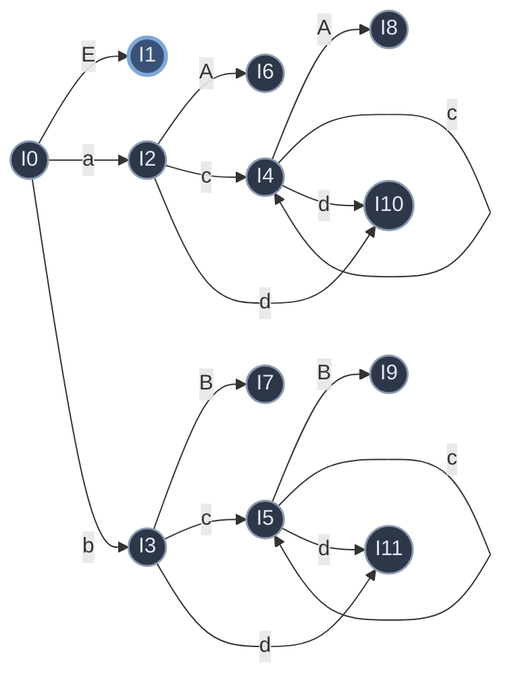

# 第五章 语法分析——自下而上分析

> 从输入串**归约**到开始符 S（最右推导的逆）。两大方法：**算符优先**、**LR**（LR(0)/SLR/LR(1)）。
> 上游：[[学习笔记/计算机基础/编译原理/04-语法分析-自上而下.md|第四章 语法分析——自上而下分析]]（对称的另一流派）· 关联：[[学习笔记/计算机基础/编译原理/02-高级语言及其语法描述.md|第二章 高级语言及其语法描述]]（短语/句柄）

> [!abstract] 本章主线
> 自下而上 = **移进-归约**：符号入栈，栈顶一旦形成某产生式右部就**归约**成左部，直到归约成 S。
> 核心难点：**怎么判断栈顶是"可归约串"？** 不同方法回答不同：
> - **规范归约/LR**：可归约串 = **句柄**（最左直接短语）；
> - **算符优先**：可归约串 = **最左素短语**。
> 必考概念：**短语、句柄、素短语、最左素短语**。

---

## 1. 移进-归约分析法

用一个**符号栈** + 输入缓冲区，四种动作：

| 动作 | 含义 |
|---|---|
| **移进** | 下一输入符压入栈顶，读头后移 |
| **归约** | 栈顶若干符号正好是某产生式右部 → 用左部替换它们，输出该产生式 |
| **接受** | 栈剩 `#S`、输入到 `#` → 分析成功 |
| **出错** | 调用错误处理 |

> [!info] 关键约束
> **可归约串必在栈顶**（不会在栈内部），所以只需检查栈顶若干符号。

**两个基本问题**（贯穿全章）：① 怎么找出可归约串？② 找到后归约成哪个非终结符？

---

## 2. 规范归约 & 短语/句柄（核心概念）

### 先搞懂：这些概念是干嘛的

自下而上分析 = 不断"归约"（把栈顶一串符号换成一个非终结符）。但**栈顶哪些符号能归约？** ——能归约的那串叫"**可归约串**"。不同方法对它的定义不同：

- **LR / 规范归约**：可归约串 = **句柄**
- **算符优先**：可归约串 = **最左素短语**

所以「短语、直接短语、句柄、素短语、最左素短语」这一串概念，**唯一目的就是定位栈顶的可归约串**。搞懂它们 = 搞懂"该归约哪儿"。

### 用语法树理解（最直观，不用背数学定义）

画一棵句型的语法树，这些概念全是"**子树**"的不同说法：

| 概念        | 语法树上的含义                        | 人话           |
| --------- | ------------------------------ | ------------ |
| **短语**    | 任一子树（某结点 + 它的全部子孙）的叶子，从左到右拼起来  | 树上任意"一坨"的叶子串 |
| **直接短语**  | 只有**父子两代**的子树（结点直接生出叶、无中间层）的叶子 | 一步就能归约的那一坨   |
| **句柄**    | **最左**的直接短语                    | 归约时最先剪的那片    |
| **素短语**   | 短语里「含 ≥1 个终结符、且内部无更小素短语」的      | 不含纯非终结符的最小短语 |
| **最左素短语** | 最左的那个素短语                       | 算符优先归约的那片    |
|           |                                |              |

> [!tip] 关键记忆
> **画语法树 → 找子树**。短语 = 所有子树叶子；直接短语 = 两代子树叶子；句柄 = 最左两代子树叶子。考试用这个，不用背 `S ⇒* αAδ` 那套数学定义。

> [!danger] 两个集合的关系（别混）
> - 短语 ⊇ 直接短语 ⊇ 句柄（句柄 = 最左直接短语）
> - 短语 ⊇ 素短语 ⊇ 最左素短语
> - **句柄 ≠ 最左素短语**（一般不同：句柄是 LR 的可归约串，最左素短语是算符优先的）

### 规范归约

**规范归约 = 最左归约 = 最右推导的逆过程**。每步把当前句型的**句柄**（最左直接短语）替换成产生式左部，反复直到 S。直观上 = **每次剪掉语法树最左的那棵两代子树**。

### 例子

> [!example]- 详例：求句型 F*F+F 的短语/直接短语/句柄/素短语/最左素短语
> 文法：`E→E+T | T`，`T→T*F | F`，`F→i | (E)`。句型 `F*F+F`（F 是**未展开的非终结符**，作为叶子保留）。
> 语法树（根 E→E+T；左 E→T→T*F（左 T→F）；右 T→F）：
> ```mermaid
> flowchart TD
>     E0((E)) --> E1((E))
>     E0 --> plus(("﹢"))
>     E0 --> T1((T))
>     E1 --> T2((T))
>     T2 --> T3((T))
>     T2 --> mul(("﹡"))
>     T2 --> F1((F))
>     T3 --> F2((F))
>     T1 --> F3((F))
>     class E0,E1,T1,T2,T3 state
>     class F1,F2,F3,plus,mul leaf
>     classDef state fill:#2d3748,stroke:#8a9bb0,stroke-width:1.5px,color:#e2e8f0
>     classDef leaf fill:#3b5278,stroke:#7fa8d6,stroke-width:2px,color:#e2e8f0
> ```
>
> **① 短语** = 每棵子树（5 个内部结点）的叶子，去重得 { `F*F+F`, `F*F`, `F` }
>
> **② 直接短语** = 两代子树（子全叶）：只有两个 `T→F`（T*F 的左 T、右 T）→ 直接短语 `F`
>
> **③ 句柄**（最左直接短语）= `F`
>
> **④ 素短语**（含终结符、内部无更小素短语）：
>
> | 短语 | 含终结符？ | 内部更小素短语？ | 素短语？ |
> |---|---|---|---|
> | `F*F+F` | ✓ | 有 `F*F` | ✗ |
> | `F*F` | ✓ | 无（`F` 非终结符） | ✓ |
> | `F` | ✗ | — | ✗ |
>
> → 素短语 = `F*F`
>
> **⑤ 最左素短语** = `F*F`
>
> > [!danger] 关键对比：句柄 ≠ 最左素短语
> > - **句柄 = `F`** → LR/规范归约归约它（用 `T→F`）
> > - **最左素短语 = `F*F`** → 算符优先归约它（用 `T→T*F`）
> > - 两者不同 → LR 和算符优先"归约哪儿"不一样，这正是两种方法的核心区别。

---

## 3. 算符优先分析

> [!abstract] 一句话：它要做什么
> 一种"偷懒"的自下而上分析法，**专门分析表达式**——模仿人算表达式的优先级直觉（先乘除后加减），用**算符优先级**决定该归约栈顶哪部分。不找精确句柄（那是 LR 的事），所以简单、快，但不精确。

### 先搞懂：它和 LR 的区别

自下而上分析都要归约，归约要找"可归约串"：

| 方法 | 找什么当可归约串 | 难度 |
|---|---|---|
| **LR** | 精确的**句柄**（要项目集规范族那一套）| 复杂、严谨 |
| **算符优先** | 用优先级找**最左素短语**（粗略的）| 简单，适合表达式 |

### 核心直觉：就是人算表达式

人算 `3+5*2`：看到 `+` 后是 `*`，知道 `*` 优先 → 先算 `5*2`，再算 `3+10`。
算符优先把这变成规则：**比较栈顶算符和当前输入算符的优先级**——栈顶 `<` 输入就移进（更优先的留着）、栈顶 `>` 输入就归约（栈顶先算掉）。

> [!example]- 走一遍：分析 i+i*i（非终结符统称 N）
> 假设已查优先表：`+ < *`、`* > +`、`#` 低于一切、一切高于 `#`。
>
> | 栈 | 输入 | 栈顶算符 vs 输入 | 动作 |
> |---|---|---|---|
> | `#` | `i+i*i#` | — | 移进 i → 归约成 N |
> | `#N` | `+i*i#` | `# < +` | 移进 + |
> | `#N+` | `i*i#` | — | 移进 i → N |
> | `#N+N` | `*i#` | `+ < *` | 移进 *（更优先，留着）|
> | `#N+N*` | `i#` | — | 移进 i → N |
> | `#N+N*N` | `#` | `* > #` | **归约** `N*N` → N |
> | `#N+N` | `#` | `+ > #` | 归约 `N+N` → N |
> | `#N` | `#` | — | **接受** |
>
> 第 6 步是关键：栈顶 `*`、输入到 `#`，`* > #` → 归约栈顶 `N*N`（最左素短语）。就像人算——`*` 优先，先把 `N*N` 算掉。

> [!tip] 下面这一堆概念是干嘛的
> FIRSTVT / LASTVT / 优先表 / 最左素短语——全是为了**造出上面查的那个"优先表"**并据此决定移进/归约。流程：造优先表 → 查表比优先级 → 决定移进/归约 → 归约最左素短语。

### 算符文法（OG）& 三种优先关系

- **算符文法（OG）**：任一产生式右部**不含两个相邻的非终结符**（没有 `…QR…`，Q、R 是非终结符）。
- **三种优先关系**（是算符优先的专用关系，**不是**数学的 <、=、>）：

| 关系 | 写法 | 含义 | 例子 |
|---|---|---|---|
| 低于 | `a < b` | a 优先级**低于** b | `+ < *`（乘号优先级更高） |
| 等于 | `a = b` | a、b **同级** | `( = )`（括号配对） |
| 高于 | `a > b` | a 优先级**高于** b | `* > +` |

> 教材常写成带圆点的 `⋖` `≐` `⋗` 以区别数学符号；这里用 `<` `=` `>` 便于显示，含义相同。

- **算符优先文法（OPG）**：任一终结符对 (a, b) **至多满足一种**优先关系（无冲突）。

### FIRSTVT(P) / LASTVT(P)

> [!info] 是什么
> - **FIRSTVT(P)** = P 能推出的**最左终结符**全体（`P ⇒ a…` 或 `P ⇒ Qa…`）。
> - **LASTVT(P)** = P 能推出的**最右终结符**全体（`P ⇒ …a` 或 `P ⇒ …aQ`）。

构造规则：
- **FIRSTVT(P)**：① 产生式 `P→a…` 或 `P→Qa…` → 加 a；② `P→Q…` 且 a ∈ FIRSTVT(Q) → 加 a。
- **LASTVT(P)**：① `P→…a` 或 `P→…aQ` → 加 a；② `P→…Q` 且 a ∈ LASTVT(Q) → 加 a。

> [!example]- 实例1：求文法 `S→a|^|(T)`，`T→T,S|S` 的 FIRSTVT / LASTVT
> **FIRSTVT**（最左终结符）：
> - `S→a`、`S→^`、`S→(T)`（开头 a/^/(）→ **FIRSTVT(S) = { a, ^, ( }**
> - `T→T,S`（T 后跟 `,`，规则① P→Qa…）→ 加 `,`；`T→S`（规则②）→ 继承 FIRSTVT(S) → **FIRSTVT(T) = { a, ^, (, , }**
>
> **LASTVT**（最右终结符）：
> - `S→a`、`S→^`、`S→(T)`（末尾 `)`）→ **LASTVT(S) = { a, ^, ) }**
> - `T→T,S`（末尾 `,S`，`,` 是末尾终结符，规则① P→…aQ）→ 加 `,`；`T→S`（规则②）→ 继承 LASTVT(S) → **LASTVT(T) = { a, ^, ), , }**

### 优先关系表怎么构造（扫描产生式）

对每条产生式 `P → X1 X2 … Xn` 的每个相邻位置 i：
- Xi、Xi+1 都是终结符 → `Xi = Xi+1`；Xi、Xi+2 终结符且 Xi+1 非终结符 → `Xi = Xi+2`；
- Xi 终结符、Xi+1 非终结符 → 对每个 b ∈ FIRSTVT(Xi+1) 置 `Xi < b`；
- Xi 非终结符、Xi+1 终结符 → 对每个 a ∈ LASTVT(Xi) 置 `a > Xi+1`。

> [!example]- 实例2：构造上面的优先关系表
> 扫描每条产生式的相邻符号：
> - `S→(T)`：`( < FIRSTVT(T)` → `( < a/^/(/,`；`LASTVT(T) > )` → `a/^/)/, > )`；`( T )` 中 `( = )`（两终结符隔一个非终结符）
> - `T→T,S`：`LASTVT(T) > ,` → `a/^/)/, > ,`；`, < FIRSTVT(S)` → `, < a/^/(`
>
> 优先关系表（行 = 栈顶算符，列 = 输入算符）：
>
> |   | a | ^ | ( | ) | , |
> |---|---|---|---|---|---|
> | **a** | | | | `>` | `>` |
> | **^** | | | | `>` | `>` |
> | **(** | `<` | `<` | `<` | `=` | `<` |
> | **)** | | | | `>` | `>` |
> | **,** | `<` | `<` | `<` | `>` | `>` |
>
> 每格 = "栈顶算符（行）vs 输入算符（列）"的关系；空白 = 无关系（出错）。

### 最左素短语 = 可归约串

> [!danger] 算符优先的归约条件（必考）
> 句型（用 `#` 包围）形式：`# N a N a ... N a N #`（a 是算符/终结符，N 是非终结符、可有可无）。
> 最左素短语 = **最左的**满足下面三条件的子串：
> - **头**：子串头算符的**左边**那个算符 `<` 头算符
> - **内部**：子串内一串算符彼此 `=`（同级）
> - **尾**：子串尾算符 `>` 它**右边**那个算符
>
> 口诀：**从左往右扫，遇到第一个 `>` 定尾；从尾往左回到 `<` 定头；中间一串 `=`**。

> [!example]- 详例：求句型 `#P*P+i#` 的最左素短语
> 文法：`E→E+T | T`，`T→T*F | F`，`F→P`，`P→(E) | i`。
>
> **第一步：算出要用的优先关系**
> - FIRSTVT(P) = { (, i }（`P→(E)`、`P→i`），层层继承 + `T→T*F` 给 `*`、`E→E+T` 给 `+` → **FIRSTVT(E) = { (, i, *, + }**
> - **`#` 的约定**：`#` 低于一切开头算符→ `# < *`、`# < +`；一切结尾算符 `> #`
> - **`*` 和 `+`**：`E→E+T` 中 `+` 后跟 T → `+ < FIRSTVT(T)`，而 `* ∈ FIRSTVT(T)` → `+ < *`，即 **`* > +`**
>
> **第二步：句型标出算符序列**
> `# P * P + i #` → 跳过非终结符 P → 算符序列：`#  *  +  #`
>
> **第三步：找最左素短语（头 `<`、内部 `=`、尾 `>`）**
> - 从左扫相邻算符对：
>   - `# < *`：头左边 `<` 头，**不触发**（继续）
>   - `* > +`：尾 `>` 尾右边，**触发**！`*` 是尾算符
> - 从尾 `*` 往左找头：遇到 `# < *` → 头算符是 `*`
> - 头 `*` 到尾 `*`（同一个）夹的子串 = `P * P`（头前 P + 头 `*` + 尾后 P）
>
> **最左素短语 = `P*P`** → 用 `T→T*F` 归约。

### 算符优先 vs 规范归约

- 算符优先**不是规范归约**（归约最左素短语，非句柄），归约速度快；
- 缺点：可能**误判**（把不该归约的归约），且**不顾非终结符的具体名字**。

---

## 4. LR 分析法概述

> [!abstract] LR 要做什么
> LR 是**严谨版**的自下而上分析：和算符优先一样是"移进-归约"，但**精确找句柄**（不是粗略的最左素短语），所以**适用面广**（绝大多数 CFG 都能分析）、**不会误判**。代价是分析表构造复杂（要项目集规范族那一套，后面 §5–§9 讲）。

### 和算符优先的区别

| | 算符优先 | LR |
|---|---|---|
| 可归约串 | 最左素短语（粗略） | **句柄**（精确） |
| 适用范围 | 算术表达式 | 绝大多数 CFG |
| 会误判吗 | 可能 | 不会（严谨） |
| 分析表 | 优先关系表（简单） | ACTION/GOTO 表（复杂） |

### LR 名字含义

- **L**：从**左**到右扫描输入；
- **R**：构造**最右推导的逆**（即规范归约——每步归约句柄）；
- **(k)**：每步向前看 k 个符号。多数程序语言是 LR(1)。

### 核心机制：用"状态"记录历史 + 展望

LR 怎么精确找句柄？关键：**用一个"状态栈"**。每个状态综合了两件事：
- **历史**：栈里已经移进/归约了什么；
- **展望**：根据当前状态，预测接下来可能遇到什么。

**栈顶状态 + 当前输入符号 → 查表 → 唯一确定动作**（移进哪个、归约成什么）。这就是 LR 精确的原因——状态把"该归约哪儿"编码进去了。

### LR 分析器结构

- **状态栈 + 符号栈**（一一对应：栈顶状态配栈顶符号）；
- **ACTION 表**（动作表）：状态 s 面临终结符 a 时该干什么（移进/归约/接受/报错）；
- **GOTO 表**（状态转换表）：状态 s 遇到文法符号 X 后转到哪个状态；
- **总控程序**：驱动整个分析（所有 LR 分析器通用）。

### ACTION 的四种动作

| 动作 | 干什么 |
|---|---|
| **移进（shift）** | 把当前输入符 a 和新状态压栈，读下一个输入 |
| **归约（reduce）** | 栈顶若干符号正好是某产生式右部 → 弹出它们，压入左部非终结符和新状态 |
| **接受（acc）** | 栈剩 `#S`、输入到 `#` → 分析成功 |
| **报错** | 表里空白 → 调用出错处理 |

> [!info] 归约的具体操作
> 若用产生式 `A→β` 归约（β 长度为 r）：弹出栈顶 **r 个符号 + r 个状态**，露出前面的状态，再把左部 `A` 和 `GOTO[露出状态, A]` 压栈。

> [!example]- 实例：用 LR 分析 i*i+i（用现成表跑，先不究表怎么造）
> 文法（产生式编号）：
> ```text
> (1) E→E+T   (2) E→T   (3) T→T*F   (4) T→F   (5) F→(E)   (6) F→i
> ```
>
> **LR 分析表**（左半 ACTION、右半 GOTO）：
>
> | 状态 | i | + | * | ( | ) | # | E | T | F |
> |---|---|---|---|---|---|---|---|---|---|
> | 0 | s5 | | | s4 | | | 1 | 2 | 3 |
> | 1 | | s6 | | | | acc | | | |
> | 2 | | r2 | s7 | | r2 | r2 | | | |
> | 3 | | r4 | r4 | | r4 | r4 | | | |
> | 4 | s5 | | | s4 | | | 8 | 2 | 3 |
> | 5 | | r6 | r6 | | r6 | r6 | | | |
> | 6 | s5 | | | s4 | | | | 9 | 3 |
> | 7 | s5 | | | s4 | | | | | 10 |
> | 8 | | s6 | | | s11 | | | | |
> | 9 | | r1 | s7 | | r1 | r1 | | | |
> | 10 | | r3 | r3 | | r3 | r3 | | | |
> | 11 | | r5 | r5 | | r5 | r5 | | | |
>
> **读表**：ACTION 部分（列 i `+` `*` `(` `)` `#`）—— `sN`=移进到状态 N、`rN`=用第 N 条产生式归约、`acc`=接受、空白=报错；GOTO 部分（列 E T F）——数字=归约后压入的状态。
>
> **用这张表跑 i*i+i**（状态栈、符号栈一一对应，每步查表）：
>
> | 步 | 状态栈 | 符号栈 | 输入 | 查表 | 操作 |
> |---|---|---|---|---|---|
> | 1 | `0` | `#` | `i*i+i#` | `ACTION[0,i]=s5` | 压入 i 和状态 5 |
> | 2 | `05` | `#i` | `*i+i#` | `ACTION[5,*]=r6`，`GOTO[0,F]=3` | 归约 `F→i`：弹 1 露 0，压 F + 状态 3 |
> | 3 | `03` | `#F` | `*i+i#` | `ACTION[3,*]=r4`，`GOTO[0,T]=2` | 归约 `T→F`：弹 1 露 0，压 T + 状态 2 |
> | 4 | `02` | `#T` | `*i+i#` | `ACTION[2,*]=s7` | 压入 `*` 和状态 7 |
> | 5 | `027` | `#T*` | `i+i#` | `ACTION[7,i]=s5` | 压入 i 和状态 5 |
> | 6 | `0275` | `#T*i` | `+i#` | `ACTION[5,+]=r6`，`GOTO[7,F]=10` | 归约 `F→i`：弹 1 露 7，压 F + 状态 10 |
> | 7 | `02710` | `#T*F` | `+i#` | `ACTION[10,+]=r3`，`GOTO[0,T]=2` | 归约 `T→T*F`：弹 3 露 0，压 T + 状态 2 |
> | 8 | `02` | `#T` | `+i#` | `ACTION[2,+]=r2`，`GOTO[0,E]=1` | 归约 `E→T`：弹 1 露 0，压 E + 状态 1 |
> | 9 | `01` | `#E` | `+i#` | `ACTION[1,+]=s6` | 压入 `+` 和状态 6 |
> | 10 | `016` | `#E+` | `i#` | `ACTION[6,i]=s5` | 压入 i 和状态 5 |
> | 11 | `0165` | `#E+i` | `#` | `ACTION[5,#]=r6`，`GOTO[6,F]=3` | 归约 `F→i`：弹 1 露 6，压 F + 状态 3 |
> | 12 | `0163` | `#E+F` | `#` | `ACTION[3,#]=r4`，`GOTO[6,T]=9` | 归约 `T→F`：弹 1 露 6，压 T + 状态 9 |
> | 13 | `0169` | `#E+T` | `#` | `ACTION[9,#]=r1`，`GOTO[0,E]=1` | 归约 `E→E+T`：弹 3 露 0，压 E + 状态 1 |
> | 14 | `01` | `#E` | `#` | `ACTION[1,#]=acc` | **接受** |
>
> **读法**：移进时压入"输入符 + GOTO 给的下一状态"；归约时按产生式右部长度弹出（连符号带状态），露出前面状态，再压入左部 + `GOTO[露出状态, 左部]`。
>
> **状态号怎么来的**：每步"状态几"都查表——移进查 `ACTION[栈顶, a]`（得 s 号）、归约后查 `GOTO[露出状态, 左部]`（得状态号）。表里的状态号（0,2,3,5,…）= LR(0) 项目集规范族编号（§6 造），这里先记"查表得状态"，造表见 §6。

### LR 文法的层次

- **LR(k)**：每步至多向前看 k 个符号。
- 四种分析表（**能力递增、构造变难**）：

| 类型 | 全称 | 特点 |
|---|---|---|
| **LR(0)** | 基础 LR | 不向前看（k=0），有局限，很多文法不行 |
| **SLR(1)** | 简单 LR | 向前看 1 个，用 FOLLOW 集解决部分冲突，实用 |
| **LALR(1)** | 向前 LR | 合并同心状态，状态数同 SLR、能力接近 LR(1)，**YACC 用** |
| **LR(1)** | 规范 LR | 能力最强、状态最多、代价最大 |

> 后面 §5–§9 从 LR(0) 项目集规范族开始，逐步构造 LR(0) 分析表，再用 SLR/LR(1) 解决冲突。

---

## 5. 活前缀 & LR(0) 项目

> [!abstract] 这一节是干嘛的
> §4 看了"用现成 LR 表跑分析"。现在要解决"**表怎么造**"。造表的关键 = 构造一个**识别活前缀的 DFA**（§6），而这个 DFA 的状态由 **LR(0) 项目**组成。所以先搞懂两个概念：**活前缀**（DFA 要识别的东西）和 **LR(0) 项目**（DFA 状态的组成单元）。

### 活前缀：栈里"到目前为止合法"的符号串

> [!info] 直觉
> LR 分析时，**栈里存放的符号串始终是一个"活前缀"**——它是某个规范句型的一个前缀，而且**不超过句柄的最右端**。
> 通俗说：栈里的东西"到目前为止是合法的"（还能继续往下分析）。一旦栈里不是活前缀，就说明出错了。

**例子**：分析 `i+i*i` 时，栈里的符号串变化（每一步都是活前缀）：
- `#` → `#i` → `#F` → `#T` → `#T*` → `#T*F` → `#T` → `#E` → ...

> [!tip] 为什么要识别活前缀
> LR 分析表（ACTION/GOTO）本质上就是一个**识别所有活前缀的 DFA**（每个状态对应一个项目集）。栈顶状态 = "当前活前缀对应 DFA 里的哪个状态"。所以**造 LR 分析表 = 构造识别活前缀的 DFA**（§6 讲怎么造）。

### LR(0) 项目：给产生式加圆点，标记"看到哪了"

在产生式右部加一个**圆点 `·`**，表示分析过程中**已经看到右部的多大部分**。

**例子**：`E→aA` 的三个项目：
- `E→·aA`：圆点在最左 → **还没看到**任何东西，准备看 `a`；
- `E→a·A`：圆点在 `a` 后 → **已看到 `a`**，准备看 `A`；
- `E→aA·`：圆点在最右 → **全部看完**，可以归约成 `E`。

> [!tip] 圆点的含义
> 圆点左边 = 已读入栈的部分；圆点右边 = 还期待读入的部分。圆点移到最右 = 可以归约。

### 项目分类（看圆点后面是什么）

| 类型 | 圆点后是 | 形式 | 含义 |
|---|---|---|---|
| **移进项目** | 终结符 | `A→α·aβ` | 下一步**移进** a |
| **待约项目** | 非终结符 | `A→α·Bβ` | 等非终结符 B **归约出来** |
| **归约项目** | 空（圆点最右） | `A→α·` | 可以用 `A→α` **归约** |
| **接受项目** | 空（且是 `S'→S·`） | `S'→S·` | **接受**（特殊的归约项目） |

> 记忆：**圆点后是终结符→移进；是非终结符→待约；圆点在最右→归约；`S'→S·`→接受**。

> [!tip] "待约"到底下一步干嘛
> 待约项目 `A→α·Bβ`（圆点后是非终结符 B）：B 不能直接从输入读（输入只有终结符），所以**等 B 被归约出来**——下一步去处理 B 的产生式，把栈顶归约成 B，圆点才能越过 B。构造 DFA 时（§6），待约项目会触发**闭包**：把 B 的所有产生式初始项目 `B→·γ` 加进当前项目集，表示"为了得到 B，开始匹配 B 的产生式"。
>
> 三类项目下一步对比：**移进**（圆点后终结符→读它）、**待约**（圆点后非终结符→先归约出它）、**归约**（圆点到头→归约当前产生式）。

### 拓广文法：加一个 S' 保证唯一接受态

给原文法**加一个新开始符 S' 和产生式 `S'→S`**：
- 这样必然有项目 `S'→S·`（圆点移到最右），它是**唯一的接受项目**；
- 保证 DFA 有唯一的接受状态（不然可能有多个归约到 S 的状态，分不清哪个是真正接受）。

**例子**：文法 `E→E+T|T` 拓广成：

```text
(0) S'→E     ← 新增
(1) E→E+T
(2) E→T
...
```

`S'→E·` 就是接受项目。

---

## 6. LR(0) 项目集规范族 & 识别活前缀的 DFA（⭐重点）

> [!abstract] 这一节干嘛
> §5 说了"造 LR 分析表 = 构造识别活前缀的 DFA"。这一节就是**用 LR(0) 项目组装出这个 DFA**：
> - DFA 的**状态** = 一个**项目集**（一组 LR(0) 项目）；
> - DFA 的**边** = 读一个文法符号，转到下一个项目集。
>
> 所有项目集的全体 = **项目集规范族**，连成图就是识别活前缀的 DFA。**LR 分析表的状态号（0,1,2,…）就是这些项目集的编号**——§4 那张表的 12 个状态就是这儿来的。

### 两个核心操作

**① CLOSURE（闭包）——遇到待约项目就展开**

> [!info] 规则
> 项目集 I 的闭包 CLOSURE(I)：
> 1. I 里的项目都属于 CLOSURE(I)；
> 2. 若有项目 `A→α·Bβ`（圆点后是非终结符 B），把 B 的**每条产生式**的初始项目 `B→·γ` 都加进来；
> 3. 反复 2，直到不再增大。

> [!tip] 直觉
> 闭包就是 §5 说的"待约触发"——圆点后是非终结符 B，意味着"要归约出 B"，所以把 B 的产生式都摆出来准备匹配。比如 `S'→·E` 圆点后是 E → 把 E 的产生式 `E→·aA`、`E→·bB` 都加进来。

**② GO（转换）——读一个符号，圆点右移**

> [!info] 规则
> GO(I, X)：把 I 里**圆点正好在 X 左边**的项目（`A→α·Xβ`），圆点右移过 X（变成 `A→αX·β`），得到 J，再取 CLOSURE(J)。

> [!tip] 直觉
> GO 就是"读入符号 X，圆点往前走一格"。比如 I 里有 `E→·aA`，GO(I, a) 把它变成 `E→a·A`（读了 a，圆点过 a），再求闭包。

### 构造算法（从 I0 出发，反复 GO）

```text
I0 = CLOSURE({S'→·S})     ← 初始项目集（拓广文法的开始项目）
C = {I0}                   ← 项目集规范族
重复：
  对 C 中每个项目集 I、每个文法符号 X：
    求 GO(I, X)，若非空且是新项目集，加入 C
直到 C 不再增大
```

### 详细构造实例

> [!example]- 构造文法 `S'→E`, `E→aA|bB`, `A→cA|d`, `B→cB|d` 的项目集规范族
> （说明：项目集编号是**任意的标签**，按发现顺序给、唯一即可——这里沿用 PPT slide 78 的约定，所以编号会跳跃，**不影响正确性**。做题时可按自己发现顺序连续编号。）
>
> **I0**（初始）= CLOSURE({S'→·E})：
> - `S'→·E` 圆点后是 E（非终结符）→ 加 E 的产生式：`E→·aA`, `E→·bB`
> - `E→·aA` 圆点后 a（终结符）、`E→·bB` 圆点后 b → 不再展开
> - **I0 = {`S'→·E`, `E→·aA`, `E→·bB`}**
>
> 从 I0 出发，对每个符号求 GO：
> - GO(I0, **E**)：`S'→·E` 圆点右移 → `S'→E·`。闭包（圆点后空）→ **I1 = {`S'→E·`}**（接受项目）
> - GO(I0, **a**)：`E→·aA` → `E→a·A`。闭包：圆点后 A → 加 `A→·cA`, `A→·d` → **I2 = {`E→a·A`, `A→·cA`, `A→·d`}**
> - GO(I0, **b**)：`E→·bB` → `E→b·B`。闭包：圆点后 B → 加 `B→·cB`, `B→·d` → **I3 = {`E→b·B`, `B→·cB`, `B→·d`}**
>
> 从 I2 出发：
> - GO(I2, **A**)：`E→a·A` → `E→aA·` → **I6 = {`E→aA·`}**
> - GO(I2, **c**)：`A→·cA` → `A→c·A`。闭包：圆点后 A → 加 `A→·cA`, `A→·d` → **I4 = {`A→c·A`, `A→·cA`, `A→·d`}**
> - GO(I2, **d**)：`A→·d` → `A→d·` → **I10 = {`A→d·`}**
>
> 从 I3 出发（与 I2 对称）：
> - GO(I3, **B**)：`E→b·B` → `E→bB·` → **I7 = {`E→bB·`}**
> - GO(I3, **c**)：`B→·cB` → `B→c·B`。闭包 → **I5 = {`B→c·B`, `B→·cB`, `B→·d`}**
> - GO(I3, **d**)：`B→·d` → `B→d·` → **I11 = {`B→d·`}**
>
> 从 I4 出发：
> - GO(I4, **A**)：`A→c·A` → `A→cA·` → **I8 = {`A→cA·`}**
> - GO(I4, **c**)：`A→·cA` → `A→c·A` → 闭包又得 I4（**自环**）
> - GO(I4, **d**)：`A→·d` → `A→d·` → I10（已存在）
>
> 从 I5 出发（对称）：
> - GO(I5, **B**)：`B→c·B` → `B→cB·` → **I9 = {`B→cB·`}**
> - GO(I5, **c**)：自环到 I5
> - GO(I5, **d**)：→ I11（已存在）
>
> 共得 **12 个项目集 I0–I11**。

**识别活前缀的 DFA**（项目集 = 状态，GO = 边；I1 是接受态）：



> [!tip] DFA 怎么读
> 从 I0 出发，**读入栈中活前缀的符号串**，到达的项目集告诉你"现在处在哪些产生式的哪一步"：
> - 读 `a` → 到 I2，有 `E→a·A`（已看到 E→a 的 `a`，正等 A 归约出来）；
> - 读 `a c` → I2 读 `c` 到 I4，有 `A→c·A`（看到 `c`，等 A）；
> - 读 `a c d` → I4 读 `d` 到 I10，有 `A→d·`（圆点最右，可归约 `A→d`）。
>
> 这就是"识别活前缀"——DFA 接受的串都是合法活前缀。

---

## 7. LR(0) 文法 & 分析表

> [!abstract] 这一节干嘛
> §6 造出了识别活前缀的 DFA（项目集 = 状态）。这一节就是**用这个 DFA 填出 §4 那张 ACTION/GOTO 表**——这是"造表"的最后一步。先判断文法是不是 LR(0)（能填出无冲突的表），再按 5 条规则填表。

### LR(0) 文法的判定（能不能填出无冲突的表）

> [!danger] LR(0) 文法条件
> 拓广文法的项目集规范族中，**每个项目集（状态）都不含冲突**：
> ① 不**既含移进项目又含归约项目**（移进-归约冲突）；
> ② 不**含多个归约项目**（归约-归约冲突）。
> 即每个状态要么"只有一个归约项目（其他都不是归约）"、要么"只有移进/待约项目（没归约）"。

> [!question] 为什么不能有冲突
> 填表时，一个状态遇到一个输入符**只能有一个动作**。如果某状态既有移进项目（要移进 a）又有归约项目（要归约），同一个格子要填两个动作 → 冲突，填不出 LR(0) 表。

> [!example]- §6 的文法是 LR(0) 吗？
> 检查每个项目集：
> - I0/I2/I3/I4/I5：只有移进/待约项目（圆点没到最右，无归约项目）→ 不冲突；
> - I1：只有 `S'→E·`（接受项目）；
> - I6/I7/I8/I9/I10/I11：各**只有一个归约项目**（圆点最右）→ 不冲突。
> → **无冲突，是 LR(0) 文法**。

### LR(0) 分析表构造（5 条规则）

项目集 Ik 的下标 k = 状态号（I0→状态 0、I6→状态 6…），含 `S'→·S` 的为初态。逐个项目集、逐个项目看：

| 规则 | 项目特征 | 填什么 |
|---|---|---|
| ① 移进 | `A→α·aβ` 且 GO(Ik,a)=Ij（a 终结符） | `ACTION[k,a] = sj`（移进到 j） |
| ② 归约 | `A→α·`（归约项目，A→α 是第 j 条产生式） | 对**所有**终结符 a 和 #，`ACTION[k,a] = rj` |
| ③ 接受 | `S'→S·` | `ACTION[k,#] = acc` |
| ④ GOTO | GO(Ik,A)=Ij（A 非终结符） | `GOTO[k,A] = j` |
| ⑤ 出错 | 其余 | 空白（报错） |

> [!tip] LR(0) 填表的关键特点
> 规则②：归约项目**对所有终结符都填 rj**（不看当前输入是什么）。这就是 LR(0) 简单但也容易冲突的原因——归约时太"激进"，不管输入是啥都归约。后面 **SLR(1)** 会改进（只对 FOLLOW 集填，§8）。

### 怎么填（直觉：把 DFA 翻译成表）

把 §6 的 DFA（项目集 = 状态、GO = 边）"翻译"成 ACTION/GOTO 表：
- DFA 里"读终结符 a 到状态 j"的边 → `ACTION[s,a] = sj`（移进）；
- DFA 里"读非终结符 A 到状态 j"的边 → `GOTO[s,A] = j`；
- 状态里有归约项目 `A→α·` → ACTION 那行（对该归约项目）**全填 rj**（j 是 A→α 的产生式号）；
- 状态里有接受项目 `S'→S·` → `ACTION[s,#] = acc`。

> [!example]- 详细模拟：用 §6 的 DFA 一步步填出 LR(0) 分析表
> 文法（产生式编号）：`S'→E`(0)、`E→aA`(1)、`E→bB`(2)、`A→cA`(3)、`A→d`(4)、`B→cB`(5)、`B→d`(6)
> 终结符：a b c d；非终结符：E A B。对照 §6 的 DFA（I0–I11），逐状态填：
>
> - **状态 0**（I0：`S'→·E` 待约、`E→·aA` 移进、`E→·bB` 移进）：
>   - GO(I0,a)=I2 → `ACTION[0,a]=s2`；GO(I0,b)=I3 → `ACTION[0,b]=s3`；GO(I0,E)=I1 → `GOTO[0,E]=1`
> - **状态 1**（I1：`S'→E·` 接受）→ `ACTION[1,#]=acc`
> - **状态 2**（I2：`E→a·A` 待约、`A→·cA`/`A→·d` 移进）→ `GOTO[2,A]=6`、`ACTION[2,c]=s4`、`ACTION[2,d]=s10`
> - **状态 3**（I3：对称）→ `GOTO[3,B]=7`、`ACTION[3,c]=s5`、`ACTION[3,d]=s11`
> - **状态 4**（I4：`A→c·A`、`A→·cA`、`A→·d`）→ `GOTO[4,A]=8`、`ACTION[4,c]=s4`、`ACTION[4,d]=s10`
> - **状态 5**（I5：对称）→ `GOTO[5,B]=9`、`ACTION[5,c]=s5`、`ACTION[5,d]=s11`
> - **状态 6**（I6：`E→aA·` 归约，第 1 条）→ 整行 `ACTION[6, a/b/c/d/#] = r1`
> - **状态 7**（`E→bB·`，第 2 条）→ 全填 `r2`
> - **状态 8**（`A→cA·`，第 3 条）→ 全填 `r3`
> - **状态 9**（`B→cB·`，第 5 条）→ 全填 `r5`
> - **状态 10**（`A→d·`，第 4 条）→ 全填 `r4`
> - **状态 11**（`B→d·`，第 6 条）→ 全填 `r6`
>
> 填出的 LR(0) 分析表：
>
> | 状态 | a | b | c | d | # | E | A | B |
> |---|---|---|---|---|---|---|---|---|
> | 0 | s2 | s3 | | | | 1 | | |
> | 1 | | | | | acc | | | |
> | 2 | | | s4 | s10 | | | 6 | |
> | 3 | | | s5 | s11 | | | | 7 |
> | 4 | | | s4 | s10 | | | 8 | |
> | 5 | | | s5 | s11 | | | | 9 |
> | 6 | r1 | r1 | r1 | r1 | r1 | | | |
> | 7 | r2 | r2 | r2 | r2 | r2 | | | |
> | 8 | r3 | r3 | r3 | r3 | r3 | | | |
> | 9 | r5 | r5 | r5 | r5 | r5 | | | |
> | 10 | r4 | r4 | r4 | r4 | r4 | | | |
> | 11 | r6 | r6 | r6 | r6 | r6 | | | |
>
> 填表口诀：**移进/待约项目照 GO 边填 ACTION(s)/GOTO；归约项目整行填 rN（N=产生式号）；接受项目填 acc**。这就是把 §6 的 DFA"翻译"成表的全过程。

> [!question] 为什么这张表"规律"（归约整行填），而 §4 的表不规律？
> 因为两表类型不同：**这张是 LR(0) 表**（本例文法是 LR(0)，归约状态没有移进项目，所以整行填 `rN`）；**§4 那张是 SLR(1) 表**（表达式文法**不是 LR(0)**——状态 2 既有归约 `E→T·` 又有移进 `T→T·*F`，冲突，所以归约只对 FOLLOW 集填、不能整行填，表才不规律）。FOLLOW 怎么解决冲突见 §8。

---

## 8. SLR(1) 解决冲突（LR(0) 的局限）

> [!abstract] 这一节干嘛
> §7 的 LR(0) 填表规则②是"归约项目**整行填** rN"。但很多文法（如表达式文法）的归约状态**还有移进项目**，整行填会冲突。SLR(1) 就是**改进规则②**：归约时不整行填，只对 **FOLLOW 集**填，从而解决冲突。

### LR(0) 的局限：移进-归约冲突

> [!example]- 经典反例：表达式文法的状态 2 冲突
> 文法 `S'→E`, `E→E+T|T`, `T→T*F|F`, `F→(E)|i`。
> 状态 2 的项目集：`{E→T·(归约), T→T·*F(移进)}`
> - `E→T·`（归约项目）→ 想归约（用 `E→T`）
> - `T→T·*F`（移进项目，圆点后是 `*`）→ 想移进 `*`
>
> 按 LR(0) 规则②（归约整行填 r2），状态 2 的 `ACTION[2,*]` 要同时填：
> - `r2`（归约，因 `E→T·`）
> - `s7`（移进，因 `T→T·*F`）
> → **冲突**！所以表达式文法**不是 LR(0) 文法**（I1、I2、I9 都有类似冲突）。

### SLR(1) 的解决办法：归约只对 FOLLOW 填

> [!danger] SLR(1) 思想
> 改进规则②：归约项目 `A→α·` **不再整行填**，只对 `a ∈ FOLLOW(A)` 的终结符填 `ACTION[k,a] = rj`。
>
> 这样冲突状态里：
> - 输入 a ∈ FOLLOW(A) → 归约；
> - a 是移进项目的圆点后符号 → 移进；
> - 若 **FOLLOW(A) 与移进符号集不相交** → 同一个 a 不会同时触发归约和移进 → **冲突解决**。

### 完整实例：表达式文法的 SLR(1) 全过程

> [!example]- 从项目集规范族到 SLR(1) 分析表（完整推导）
> 文法（拓广）：`S'→E`(0)、`E→E+T`(1)、`E→T`(2)、`T→T*F`(3)、`T→F`(4)、`F→(E)`(5)、`F→i`(6)
>
> **① 项目集规范族**（I0–I11，按 §6 的格式构造）：
>
> | 项目集 | 含的项目 | 冲突？ |
> |---|---|---|
> | I0 | `S'→·E`, `E→·E+T`, `E→·T`, `T→·T*F`, `T→·F`, `F→·(E)`, `F→·i` | 无 |
> | I1 | `S'→E·`(接受), `E→E·+T`(移进) | 无（接受填 #，移进填 +） |
> | **I2** | `E→T·`(归约), `T→T·*F`(移进 `*`) | **⚠️ 移进-归约冲突** |
> | I3 | `T→F·`(归约) | 无 |
> | I4 | `F→(·E)`, `E→·E+T`, `E→·T`, `T→·T*F`, `T→·F`, `F→·(E)`, `F→·i` | 无 |
> | I5 | `F→i·`(归约) | 无 |
> | I6 | `E→E+·T`, `T→·T*F`, `T→·F`, `F→·(E)`, `F→·i` | 无 |
> | I7 | `T→T*·F`, `F→·(E)`, `F→·i` | 无 |
> | I8 | `F→(E·)`, `E→E·+T` | 无 |
> | **I9** | `E→E+T·`(归约), `T→T·*F`(移进 `*`) | **⚠️ 移进-归约冲突** |
> | I10 | `T→T*F·`(归约) | 无 |
> | I11 | `F→(E)·`(归约) | 无 |
>
> **② FOLLOW 集**（解决冲突的关键）：
> - `FOLLOW(E) = {#, ), +}`、`FOLLOW(T) = {*, +, #, )}`、`FOLLOW(F) = {*, +, #, )}`
>
> **③ SLR 解决冲突**（I2 为例）：
> - I2 有 `E→T·`（归约，第 2 条）+ `T→T·*F`（移进 `*`）
> - SLR：`E→T·` 只对 `FOLLOW(E)={#, ), +}` 填 `r2`，**不对 `*` 填**（`* ∉ FOLLOW(E)`）
> - → `ACTION[2, +] = r2`、`ACTION[2, *] = s7` → **不冲突**！
> - I9 同理：`E→E+T·` 只对 FOLLOW(E) 填 `r1`，`*` 留给 `s7`。
>
> **④ 完整 SLR(1) 分析表**（就是 §4 那张表）：
>
> | 状态 | i | + | * | ( | ) | # | E | T | F |
> |---|---|---|---|---|---|---|---|---|---|
> | 0 | s5 | | | s4 | | | 1 | 2 | 3 |
> | 1 | | s6 | | | | acc | | | |
> | 2 | | r2 | s7 | | r2 | r2 | | | |
> | 3 | | r4 | r4 | | r4 | r4 | | | |
> | 4 | s5 | | | s4 | | | 8 | 2 | 3 |
> | 5 | | r6 | r6 | | r6 | r6 | | | |
> | 6 | s5 | | | s4 | | | | 9 | 3 |
> | 7 | s5 | | | s4 | | | | | 10 |
> | 8 | | s6 | | | s11 | | | | |
> | 9 | | r1 | s7 | | r1 | r1 | | | |
> | 10 | | r3 | r3 | | r3 | r3 | | | |
> | 11 | | r5 | r5 | | r5 | r5 | | | |
>
> 看状态 2 行：`+` 是 `r2`（归约）、`*` 是 `s7`（移进）——这就是 SLR 用 FOLLOW 集区分冲突的结果，也是 §4 那张表的来源。

> [!tip] LR(0) vs SLR(1) 一句话
> - **LR(0)**：归约**整行填** rN（不看输入）→ 简单，但归约状态有移进项目时冲突。
> - **SLR(1)**：归约**只对 FOLLOW 填** rN（看输入是否在 FOLLOW）→ 解决了 LR(0) 的移进-归约冲突，表更"不规律"但能处理更多文法。

---

## 9. LR(1) 规范 LR（SLR 的局限）

> [!abstract] 这一节干嘛
> §8 的 SLR(1) 用 FOLLOW 集解决冲突，但 FOLLOW 集**有时给宽了**（包含实际不可能出现的符号），导致 SLR 仍解决不了某些冲突。LR(1) 给每个项目加一个**"向前搜索符"**，精确记录"归约时下一个输入符应该是什么"，比 SLR 更精确。

### SLR 的局限：FOLLOW 集过宽

> [!example]- 非 SLR 文法：`S'→S`, `S→L=R|R`, `L→*R|i`, `R→L`（完整项目集 + FOLLOW 推导）
> **① 项目集规范族**（I0–I9）：
>
> | 项目集 | 含的项目 | 冲突？ |
> |---|---|---|
> | I0 | `S'→·S`, `S→·L=R`, `S→·R`, `L→·*R`, `L→·i`, `R→·L` | 无 |
> | I1 | `S'→S·`（接受） | 无 |
> | **I2** | `S→L·=R`（移进 `=`）, `R→L·`（归约 `R→L`） | **⚠️ 移进-归约冲突** |
> | I3 | `S→R·`（归约） | 无 |
> | I4 | `L→*·R`, `R→·L`, `L→·*R`, `L→·i` | 无 |
> | I5 | `L→i·`（归约） | 无 |
> | I6 | `S→L=·R`, `R→·L`, `L→·*R`, `L→·i` | 无 |
> | I7 | `L→*R·`（归约） | 无 |
> | I8 | `R→L·`（归约，无移进项目） | 无 |
> | I9 | `S→L=R·`（归约） | 无 |
>
> **② FOLLOW 集怎么算**（逐条规则贡献 + 迭代到不变）：
>
> 每个非终结符在哪些产生式右部出现、贡献什么：
>
> | 非终结符 | 出现在哪 | 规则②（A 后紧跟终结符 → 加它） | 规则③（A 在末尾 → 继承宿主 FOLLOW） |
> |---|---|---|---|
> | S | `S'→S` | — | + FOLLOW(S') = {#} |
> | L | `S→L=R`、`R→L` | `S→L=R` 中 L 后紧跟 `=` → + {=} | `R→L` 中 L 末尾 → + FOLLOW(R) |
> | R | `S→R`、`L→*R` | — | `S→R` → + FOLLOW(S)；`L→*R` → + FOLLOW(L) |
>
> 迭代求解（FOLLOW(L) 和 FOLLOW(R) 互相依赖，反复到不变）：
>
> | 轮次 | FOLLOW(S) | FOLLOW(L) | FOLLOW(R) |
> |---|---|---|---|
> | 第 1 轮 | {#} | {=} | {#} |
> | 第 2 轮 | {#} | {=, #} | {#, =} |
> | **最终** | **{#}** | **{=, #}** | **{#, =}** |
>
> 第 2 轮变化：FOLLOW(L) 继承 FOLLOW(R) 的 # → 加 #；FOLLOW(R) 继承 FOLLOW(L) 的 = → 加 =。
>
> **`=` 进入 FOLLOW(R) 的链条**：`S→L=R`（L 后 `=`）→ 第 1 轮 `=` 进 FOLLOW(L) → `R→L`（L 末尾继承）→ 第 2 轮 `=` 进 FOLLOW(R)。
>
> **③ 为什么 = 过宽**：L 在两个上下文出现——`S→L=R` 的 L（后**真的有** `=`）和 `R→L` 的 L（归约成 R 后，R 后**没有** `=`）。FOLLOW 把所有 L 的后续**合并**、不区分上下文 → `=` 被错误传给 R。
>
> **④ SLR 的冲突**：I2 有移进 `=`（`S→L·=R`）和归约 `R→L·`。SLR 对 FOLLOW(R)={#, =} 填归约 → `ACTION[I2, =]` 既要归约又要移进 → **冲突**。
>
> **⑤ LR(1) 怎么解决**：给 I2 的 `R→L·` 配**精确搜索符 #**（在 I2 的上下文里，R 归约后只可能跟 # ，不是 =）→ 只对 # 归约、**不对 = 归约** → = 留给移进 → **无冲突**。

### LR(1) 的解决办法：给项目加"向前搜索符"

LR(1) 项目 = `[A→α·β, a]`，比 LR(0) 多了一个 **`a`（向前搜索符）**：
- `a` 记录"**当圆点到头（归约）时，下一个输入符应该是什么**"；
- **只有归约项目** `[A→α·, a]` 用 `a`：下一个输入**正是 a** 时才归约；
- 移进/待约项目 `[A→α·β, a]`（β≠ε）：`a` 暂时没用（移进看圆点后的终结符）。

> [!tip] 和 SLR 的区别
> - **SLR**：归约时查 **FOLLOW(A)**（整个 FOLLOW 集，可能过宽）；
> - **LR(1)**：归约时只看项目自带的**向前搜索符 a**（精确，从推导过程算出，不会过宽）。

### 构造（简述）

- **CLOSURE 扩展**：`[A→α·Bβ, a]` → 对 B 的每条产生式加 `[B→·γ, b]`，其中 `b ∈ FIRST(βa)`（**不是 FOLLOW**，是 `FIRST(βa)`，精确得多）；
- **GO**：和 LR(0) 一样圆点右移，搜索符跟着走；
- **填表**：归约项目 `[A→α·, a]` → `ACTION[k, a] = rj`（**只对搜索符 a 填**，不是整行/FOLLOW）。

> [!info] 代价
> LR(1) 状态比 SLR **多很多**（每个项目因搜索符不同而分裂成多个状态）。**LALR(1)**（§10）就是合并"同心"项目集来折中——状态数同 SLR，能力接近 LR(1)。

---

## 10. LR(0) ⊂ SLR ⊂ LR(1) ⊂ 无二义文法

> [!danger] 四者能力包含关系（必考）
> ```
> LR(0)  ⊂  SLR(1)  ⊂  LR(1)  ⊂  无二义文法
> ```

### 为什么递增（展望能力不同）

| 类型 | 归约时看什么 | 展望精度 | 能力 |
|---|---|---|---|
| **LR(0)** | **什么都不看**（整行填 rN） | 无展望 | 最弱 |
| **SLR(1)** | 看 **FOLLOW(A)** | 粗（FOLLOW 可能过宽） | 中 |
| **LR(1)** | 看**向前搜索符 a**（精确） | 精确 | 最强 |
| **LALR(1)** | 同 LR(1)（合并同心集后） | 精确（可能引入少量冲突） | 介于 SLR 和 LR(1) |

> [!tip] 一句话记忆
> **展望越精确，能力越强，但状态越多**。LR(0) 闭着眼归约 → SLR 睁一只眼（FOLLOW）→ LR(1) 睁双眼（精确搜索符）。

### LALR(1)（实用，YACC 用）

LR(1) 状态太多（搜索符导致项目集分裂）。**LALR(1)**（Look-Ahead LR）：合并 LR(1) 中"**同心**"项目集（项目相同、仅搜索符不同的状态合并），状态数回到 SLR 水平，能力接近 LR(1)。**YACC/Bison 默认用 LALR(1)**。

### 重要结论

- **每个 LR 文法都无二义**（LR 表无冲突 ⟹ 每步唯一 ⟹ 语法树唯一）；
- 但**无二义文法不一定是 LR**（存在无二义但非 LR 的文法）——LR 是无二义的**充分条件**，不是必要条件。

> [!question] 哪些一定无二义？
> LL(1)、算符优先文法、SLR(1)、LR(1) **全都无二义**（都是确定性分析，每步唯一）。但无二义文法不一定是其中任何一个。

---

## ✅ 自测题（先自己想，再展开答案）

> [!question]- Q1. 移进-归约分析的四种动作？可归约串的位置有什么约束？
> 移进、归约、接受、出错。**可归约串必在栈顶**（不会在栈内部），只需检查栈顶若干符号。

> [!question]- Q2. 用语法树求短语/直接短语/句柄的口诀？
> - **短语** = 每棵子树（任一结点 + 全部子孙）的叶子从左到右；
> - **直接短语** = 只有父子两代子树的叶子；
> - **句柄** = 最左的两代子树叶子；
> - 素短语 = 含终结符且无更小素短语的短语。

> [!question]- Q3. 什么是算符文法？算符优先文法？三种优先关系？
> - **算符文法**：产生式右部不含两个相邻非终结符。
> - **算符优先文法**：任一终结符对至多满足一种优先关系。
> - 三关系：`≐`（相等）、`⋖`（低于）、`⋗`（高于）。

> [!question]- Q4. FIRSTVT(P) 和 LASTVT(P) 各是什么？
> - **FIRSTVT(P)** = P 能推出的**最左终结符**全体（`P⇒a…` 或 `P⇒Qa…`）。
> - **LASTVT(P)** = P 能推出的**最右终结符**全体（`P⇒…a` 或 `P⇒…aQ`）。

> [!question]- Q5. 算符优先分析的可归约串是什么？它的判定条件？
> **最左素短语**。条件：`aj-1 ⋖ aj`、`aj ≐ … ≐ ai`、`ai ⋗ ai+1`（找到第一个 ⋗ 定尾，往左回到 ⋖ 定头，中间一串 ≐）。

> [!question]- Q6. LR(0) 项目的四类？归约项目、接受项目各是什么？
> - **移进项目** `A→α·aβ`；**待约项目** `A→α·Bβ`；**归约项目** `A→α·`；**接受项目** `S'→S·`（特殊的归约项目）。

> [!question]- Q7. 怎么构造 LR(0) 项目集规范族？CLOSURE 和 GO 各做什么？
> 从 I0=CLOSURE({S'→·S}) 出发，反复对每个项目集 I 和符号 X 求 GO(I,X)，加入规范族，直到不变。
> - **CLOSURE(I)**：把圆点后非终结符 B 的所有 `B→·γ` 加进来；
> - **GO(I,X)**：I 中圆点在 X 左的项目右移圆点得 J，再取 CLOSURE(J)。

> [!question]- Q8. LR(0) 文法的判定条件？
> 每个项目集（状态）**无冲突**：① 不既含移进又含归约项目；② 不含多个归约项目。

> [!question]- Q9. SLR(1) 怎么解决 LR(0) 的冲突？
> 归约时**只对 FOLLOW(A) 里的终结符**填归约（而非所有终结符）。靠 FOLLOW 集与移进符号集**不相交**来区分移进/归约。

> [!question]- Q10. LR(0)、SLR(1)、LR(1)、无二义文法的包含关系？
> **LR(0) ⊂ SLR(1) ⊂ LR(1) ⊂ 无二义文法**。LR 文法必无二义，但无二义文法未必是 LR。

---

## 📌 速查表

| 问 | 答案要点 |
|---|---|
| 自下而上两方法 | 算符优先、LR |
| 四动作 | 移进/归约/接受/出错 |
| 规范归约 | 最左归约 = 最右推导的逆 |
| 短语（语法树） | 每棵子树的叶子 |
| 直接短语 | 父子两代子树的叶子 |
| 句柄 | 最左直接短语 |
| 素短语 | 含终结符且无更小素短语 |
| 最左素短语 | 算符优先的可归约串 |
| 算符文法 | 右部无两个相邻非终结符 |
| OPG | 终结符对至多一种优先关系 |
| LR 含义 | Left扫描/最右推导的逆（规范归约） |
| LR(0) 项目四类 | 移进/待约/归约/接受 |
| 活前缀 | 不超过句柄最右端的前缀 |
| LR(0) 文法 | 项目集无移进-归约/归约-归约冲突 |
| SLR(1) 解冲突 | 归约只填 FOLLOW(A) |
| LR(1) 项目 | `[A→α·β, a]` 带向前搜索符 |
| 四者关系 | LR(0) ⊂ SLR ⊂ LR(1) ⊂ 无二义 |
| LALR(1) | 合并同心集，YACC 用 |

---

## 下一步

- [[学习笔记/计算机基础/编译原理/06-语义分析和中间代码.md|第六、七章 属性文法、语法制导翻译与中间代码]]：语法制导翻译、**布尔表达式真假出口**、**控制语句回填**（🔴 重难点）
- 回到 [[学习笔记/计算机基础/编译原理/04-语法分析-自上而下.md|第四章 语法分析——自上而下分析]] · 00-总览
