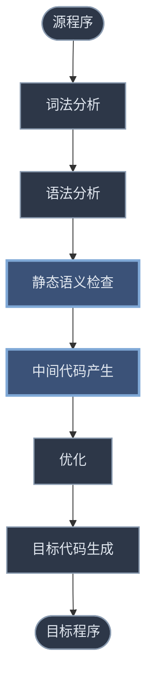

# 第六、七章 属性文法、语法制导翻译与中间代码

> 语法分析只回答"**合不合法**"，语义分析回答"**什么意思**"——把源程序翻译成**中间代码**（四元式等），供后续优化和代码生成。
> 上游：[[学习笔记/计算机基础/编译原理/05-语法分析-自下而上.md|第五章 语法分析——自下而上分析]]（提供语法树 / 归约时机）　·　关联：[[学习笔记/计算机基础/编译原理/04-语法分析-自上而下.md|第四章 语法分析——自上而下分析]]

> [!abstract] 本章主线（一句话）
> **语法制导翻译** = 给每个产生式配一组**语义动作**，在语法分析（推导 / 归约）的**同时**执行动作，**生成中间代码**。
>
> 两大必考硬骨头：**布尔表达式真假出口 + 回填**、**控制语句（if / while）回填**。

---

## 0. 这两章在干嘛（先看全景）

语法分析器吐出一棵语法树后，编译器还要做两件事才能得到"可优化、可移植"的中间表示：



> [!info] 静态语义检查（"静态"= 编译时，不运行程序）查四样
> - **类型检查**：`int + real` 要不要转换、`a[i]` 的 `a` 是不是数组
> - **控制流检查**：`break` 有没有套在循环里、`case` 常量不重复
> - **一致性检查**：同一标识符只声明一次、函数调用形实参匹配
> - **相关名字检查 / 作用域**：名字先声明后使用、同名屏蔽

> [!tip] 为什么要搞"中间代码"，不直接生成目标代码？
> 中间代码夹在源语言和目标语言之间，三大好处：
> 1. **便于优化**——与机器无关，一套优化算法通吃所有后端；
> 2. **便于移植**——换 CPU 只换后端（中间代码→目标），前端（源→中间代码）不动，即 *M 台机器  +  N 种语言，而非 *M × N*；
> 3. **结构清晰**——前端产中间代码、后端产目标代码，各管一段。

---

## 1. 属性文法

> [!abstract] 一句话
> 语法树只告诉你"结构长什么样"，**属性文法**给树上每个结点挂上一个"值"（叫**属性**），再配一套**语义规则**说清楚这个值怎么算——于是语法树从一副"骨架"变成"有血有肉"的东西，能算值、能查类型、能生成代码。

### 1.1 先看个例子：怎么让语法树"会算数"

想要一台"台式计算器"：输入 `3 * 5 + 4`，输出 19。光有文法（`E→E+T | T | …`）只能判断输入**合不合法**，**算不出值**。怎么办？

**给每个非终结符挂一个属性 `val`（"我的值是多少"），再给每条产生式配一条语义规则**，说清楚"我的 `val` 怎么由别人算出来"：

| 产生式 | 语义规则（左边符号的 val 怎么算） |
|---|---|
| `L → E n` | `print(E.val)` |
| `E → E₁ + T` | `E.val := E₁.val + T.val` |
| `E → T` | `E.val := T.val` |
| `T → T₁ * F` | `T.val := T₁.val * F.val` |
| `T → F` | `T.val := F.val` |
| `F → (E)` | `F.val := E.val` |
| `F → digit` | `F.val := digit.lexval` |

> [!tip] 读规则的窍门（贯穿全章）
> **等号右边是孩子，等号左边是自己。** 比如 `E.val := E₁.val + T.val` = "我这个 `E` 的值 = 左孩子 `E₁` 的值 + 右孩子 `T` 的值"。孩子的值先算好，我才能算 → **必须从叶子往根算**。

> [!example]- `3 * 5 + 4` 的带注释语法树（从下往上看）
> ```mermaid
> flowchart TD
>     L((L)) --> E0(("E val=19"))
>     L --> n((n))
>     E0 --> E1(("E val=15"))
>     E0 --> p(("﹢"))
>     E0 --> T1(("T val=4"))
>     E1 --> T2(("T val=15"))
>     T2 --> T3(("T val=3"))
>     T2 --> m(("﹡"))
>     T2 --> F1(("F val=5"))
>     T3 --> F2(("F val=3"))
>     T1 --> F3(("F val=4"))
>     F2 --> d2((digit 3))
>     F1 --> d1((digit 5))
>     F3 --> d3((digit 4))
>     class L,E0,E1,T1,T2,T3,F1,F2,F3 state
>     class n,p,m,d1,d2,d3 leaf
>     classDef state fill:#2d3748,stroke:#8a9bb0,stroke-width:1.5px,color:#e2e8f0
>     classDef leaf fill:#3b5278,stroke:#7fa8d6,stroke-width:2px,color:#e2e8f0
> ```
> 一步步算（这就是考试让你"求带注释语法树"的过程）：
> 1. **叶子**：`digit.lexval = 3 / 5 / 4`（终结符的属性由词法分析器给，**天生就有**）。
> 2. `F → digit`：`F.val` 抄 digit → `F.val = 3 / 5 / 4`。
> 3. `T → F`：`T.val = F.val` → 最左 `T.val = 3`。
> 4. `T → T₁ * F`：`T.val = T₁.val * F.val = 3 * 5 = 15`。
> 5. `E → T`：`E.val = 15`。
> 6. 右边再来 `T → F`：`T.val = 4`。
> 7. `E → E₁ + T`：`E.val = 15 + 4 = 19`。
> 8. 根 `L → E n`：`print(19)`。
>
> **关键观察：每个结点的值都只依赖它下面孩子的值**——值是"从下面顶上来"的。这种属性有个名字：**综合属性**。

### 1.2 两类属性：综合 vs 继承（⭐ 本节核心，必考）

上例所有属性都是"孩子算完传给爹"。但有些信息**没法从下面来，只能从上面或左边传下来**——比如 `real x, y, z`，`x` 是什么类型取决于它**左边**写的 `real`，跟它自己没关系。于是属性天然分两类：

| | 综合属性 synthesized | 继承属性 inherited |
|---|---|---|
| 值从哪来 | **子结点**算出来 | **父 / 左兄弟**传下来 |
| 树上方向 | 子 → 父（**自下而上**） | 父/兄 → 自己（**自上而下**） |
| 直觉 | "我自己算的" | "别人规定给我的" |
| 典型例子 | 表达式的值 `E.val` | 声明的类型 `L.in` |

判定一条规则属于哪类，**只看一件事**：

> [!danger] 判定口诀（做题直接用）
> 看语义规则 `b := f(...)` 里，**等号左边的 `b` 挂在产生式的哪个符号上**：
> - `b` 是**左部**非终结符的属性 → **综合属性**（左部在"接收"孩子的值往上送）。
> - `b` 是**右部**某个非终结符的属性 → **继承属性**（右部那个符号在"接收"父/兄传来的值）。
>
> **例 1**：`E → E₁ + T` 配 `E.val := E₁.val + T.val`。`E.val` 的 `E` 是**左部** → `E.val` 是**综合**。
> **例 2**：`D → T L` 配 `L.in := T.type`。`L.in` 的 `L` 是**右部** → `L.in` 是**继承**。

> [!info] 两条附带规则
> - **终结符只有综合属性**（值由词法分析器给，如 `digit.lexval`），没有继承属性。
> - **非终结符两者都可以有**；文法开始符号的继承属性是预先给定的**初始值**（比如树遍历前给 `S.a := 0`）。

### 1.3 再看个例子：类型怎么"传下去"（继承属性）

声明语句 `real id₁, id₂, id₃`，要把三个标识符都登记成 `real`。类型信息只在最左边的 `real` 那里（由 `T` 算出），右边的 `id` 们怎么知道自己的类型？靠继承属性 `L.in` **一路向右、向下传**：

| 产生式 | 语义规则 |
|---|---|
| `D → T L` | `L.in := T.type`（把类型从 T 传给右边的 L） |
| `T → int` | `T.type := integer` |
| `T → real` | `T.type := real` |
| `L → L₁ , id` | `L₁.in := L.in`（继续往右孩子传）；`addtype(id.entry, L.in)`（给 id 登记类型） |
| `L → id` | `addtype(id.entry, L.in)` |

（`addtype(id.entry, L.in)` = 把类型 `L.in` 填进 `id` 在符号表里那一项。）

> [!example]- `real id₁, id₂, id₃` 的带注释语法树（盯住 `L.in` 怎么流）
> ```mermaid
> flowchart TD
>     D((D)) --> T((T<br/>type=real))
>     D --> L0(("L<br/>in=real"))
>     T --> real((real))
>     L0 --> L1(("L<br/>in=real"))
>     L0 --> cm1((,))
>     L0 --> id3((id₃))
>     L1 --> L2(("L<br/>in=real"))
>     L1 --> cm2((,))
>     L1 --> id2((id₂))
>     L2 --> id1((id₁))
>     class D,T,L0,L1,L2 state
>     class real,cm1,cm2,id1,id2,id3 leaf
>     classDef state fill:#2d3748,stroke:#8a9bb0,stroke-width:1.5px,color:#e2e8f0
>     classDef leaf fill:#3b5278,stroke:#7fa8d6,stroke-width:2px,color:#e2e8f0
> ```
> 属性流动路径（考试常考）：
> 1. `T → real`：`T.type = real`（这是**综合**属性，T 自己算的）。
> 2. `D → T L`：规则 `L.in := T.type` → 最上层 `L.in = real`。**类型从左兄弟 `T` 横着传给右兄弟 `L`**。
> 3. `L → L₁ , id₃`：规则 `L₁.in := L.in` → 左孩子 `L.in = real`，**父传给子**；同时 `addtype(id₃, real)`。
> 4. 一路传到最左 `L → id₁`：`addtype(id₁, real)`。
>
> 结果：`id₁ / id₂ / id₃` 全部登记成 `real`。**继承属性的精髓：表达"我是什么，取决于我所在的上下文（左边声明的类型）"**——这种依赖，综合属性做不到。

> [!tip] 一句话类比，把两者彻底分开
> - **综合属性**像**考试成绩**——你自己考的，从你自己的答卷（子树）来，自下而上。
> - **继承属性**像**考场分配的 A/B 卷型**——不是你定的，是上面统一派发下来的，自上而下 / 从左到右。

### 1.4 S-属性 & L-属性文法（⭐ 决定能否一遍扫描）

这两个不是新属性，而是**对整个属性文法的分类**，直接决定它能不能"在语法分析的同时顺手把属性算完"（一遍扫描）：

| 文法 | 约束 | 适合的分析方式 | 一遍扫描？ |
|---|---|---|---|
| **S-属性文法** | **只用综合属性**（没有任何继承） | 自下而上（LR） | ✅ 归约时顺手算 |
| **L-属性文法** | 可有继承属性，但继承属性**只能依赖左边的兄弟 / 父**（不能依赖右兄弟） | 自上而下（LL） | ✅ 推导时顺手算 |

> [!tip] 为什么 L-属性"不能依赖右兄弟"
> 自上而下分析是从左往右展开的，算到某个结点时，**它右边的兄弟还没生成**，自然没法用右兄弟的属性。所以继承只能往"已经处理过的左边"看。
>
> 上面的变量声明文法是 **L-属性**：`L.in` 只从左兄弟 `T` / 父 `L` 来，从不看右边。台式计算器是 **S-属性**（纯综合）——而 S-属性必然也是 L-属性（**S ⊂ L**）。

### 1.5 依赖图 & 计算次序（了解即可，不展开算法）

属性之间有依赖（`b` 要等 `c` 算完才能算），所以**计算得按顺序来**：

- 把语法树上每个属性画成一个点，规则 `b := f(c)` 画成 `c → b` 的有向边 → 得到一张 **依赖图**。
- 对依赖图 **拓扑排序** 就得到正确计算顺序。
- 图里**有环**（如 `p=f(c), c=g(p)` 互相依赖）→ 文法"**非良定义**"，实际中不处理。
- 不显式排序也行：对语法树反复做"深度优先、从左到右"遍历（**树遍历法**），每趟把当前能算的都算了，多跑几趟直到全部算完。

> [!info] 这节记住一句
> 属性有依赖、要按拓扑序算；**S-属性走 LR 归约、L-属性走 LL 推导**时，分析顺序天然满足依赖顺序，所以能一遍扫描、不用显式建依赖图。

---

## 2. 语法制导翻译

> [!abstract] 一句话
> **一边做语法分析，一边就把翻译做了**——像"同声传译"：分析器每用一条产生式（匹配或归约），就立刻执行挂在这条产生式上的**语义动作**，边听边翻。

### 2.1 语义动作是什么

给每条产生式挂一段**语义动作**（花括号里，本质是个翻译子程序），它规定了"这个产生式产生的串**什么意思**、该干什么活"：

```
E → E₁ + E₂    { E.val := E₁.val + E₂.val }
E → 0          { E.val := 0 }
E → 1          { E.val := 1 }
```

动作能干的活很广：**算属性、查类型、操作符号表、生成中间代码**。后面几节（赋值、布尔、控制语句）全是"动作 = 生成中间代码"。

### 2.2 动作什么时候执行（⭐ 高频考点，本节唯一要记牢的）

| 分析方法 | 执行时机 | 一句话 |
|---|---|---|
| **自上而下**（LL / 递归下降） | 产生式**匹配输入成功**时 | 推导出来就执行 |
| **自下而上**（LR / 移进归约） | 产生式**被用于归约**时 | 归约掉才执行 |

> [!tip] 怎么记
> - LL 是自上而下展开，产生式**展开并匹配掉输入**那一刻执行；
> - LR 是自下而上归约，栈顶凑齐右部、**归约成左部**那一刻执行。
>
> 上节台式计算器的 `E.val := E₁.val + T.val` 就是 LR：只有栈顶凑齐 `E + T`、归约成 `E` 时，才把值加起来——**归约即计算**。

### 2.3 LR 栈怎么"带"语义值（实例）

光说"归约时计算"不够具体——栈上得有地方放属性值。做法：LR 栈每一项从"状态+符号"扩成**三元组 `(状态, 符号, 语义值)`**。归约时弹出若干项，用它们的语义值算出新符号的语义值，连同新符号压回栈。

> [!example]- 类型检查实例（看语义检查怎么搭归约的便车）
> 文法（带类型）：
> ```
> E → T₁ + T₂   { if T₁.type=int and T₂.type=int then E.type:=int else error }
> T → n         { T.type := int }      ← 数字是整型
> T → b         { T.type := bool }     ← b 是布尔
> ```
> **输入 `n + n`（合法）**：归约第 1 个 `n → T(type=int)` 压回；移进 `+`；归约第 2 个 `n → T(int)`；最后 `T + T → E`，动作查 `T₁.type=int` 且 `T₂.type=int` ✓ → `E.type = int`。
>
> **输入 `n + b`（非法）**：归约时 `T₁.type=int`、`T₂.type=bool`，动作判定不匹配 → `E.type := error`，**报类型错**。
>
> 这就是"静态语义检查"的实装——**完全搭在归约的顺风车上**，不用单独再跑一遍。

> [!info] 本节小结
> 语法制导翻译 = **语法分析搭台、语义动作唱戏**。记住"LL 匹配时 / LR 归约时执行动作"，剩下都是具体动作怎么写——那是第 4~6 节的事。

---

## 3. 中间语言

> [!abstract] 一句话
> 前端把源程序翻成**中间代码**，后端再把中间代码翻成目标机代码。中间代码有几种表示，**四元式**最常考。本节用一个表达式把它们串起来对比。
> （为什么需要中间代码——便于优化 / 便于移植 / 结构清晰——见 [[学习笔记/计算机基础/编译原理/06-语义分析和中间代码.md#0 这两章在干嘛（先看全景）|§0]]。）

### 3.1 逆波兰（后缀式）

> [!abstract] 一句话
> 后缀式把算符挪到两个操作数**后面**，不用括号。**算符出现的顺序，就是计算的顺序**——先算的算符先出现。

**转换规则（递归定义）**：

| 中缀 | 后缀 |
|---|---|
| `id` / 常量 | 它自己 |
| `E₁ op E₂` | `E₁' E₂' op`（左操作数、右操作数、最后算符） |
| `(E)` | `E'`（括号去掉） |

> [!tip] 手算窍门（考试最实用）
> 别死套规则，**按"计算顺序"走**：想清楚谁先算（先括号内 → 再乘除 → 后加减，同级从左到右），**算符谁先算就先写谁**；操作数按原顺序摆好，每个算符插到"它作用的那两个操作数"之后。

> [!example]- 逐步翻译 `a + b * c`
> 计算顺序：先算 `b*c`，再算 `a + (b*c)`。
> 1. 操作数按原顺序写出：`a b c`
> 2. 最先算的 `*`（作用于 b、c）插到它们后面：`a b c *`
> 3. 最后算的 `+`（作用于 a 和 `b*c`）放最后：`a b c * +`
>
> 结果：`a b c * +`

> [!example]- 同级左结合：`a + b + c`
> 计算顺序：先 `(a+b)`，再 `+ c`。
> 1. 操作数：`a b c`
> 2. 左边的 `+` 先算 → 插到 a、b 后：`a b +`
> 3. 右边的 `+` 后算 → 放最后：`a b + c +`
>
> 结果：`a b + c +`。（若是**右结合**算符如乘幂 `a^b^c`，则翻成 `a b c ^ ^`——右边的先算）

> [!example]- 带括号：`(a + b) * (c - d) + e`
> 计算顺序：先两个括号 `a+b`、`c-d`，再 `*`，最后 `+ e`。
> 1. `a+b` → `a b +`
> 2. `c-d` → `c d -`
> 3. 两部分相乘 `*` → `a b + c d - *`
> 4. 最后 `+ e` → `a b + c d - * e +`
>
> 结果：`a b + c d - * e +`

**反过来：用栈算后缀式**（验证你翻得对不对）
从左到右扫：遇操作数压栈；遇算符弹两个（**先弹的是右操作数**）、算、压回。

> [!example]- 用栈算 `a b c * +`（设 a=2, b=3, c=4）
> 扫描 `a b c * +`：
> 1. 压 `a` → 栈 `[2]`
> 2. 压 `b` → 栈 `[2, 3]`
> 3. 压 `c` → 栈 `[2, 3, 4]`
> 4. 遇 `*`：弹 4、3，算 `3*4=12`，压回 → 栈 `[2, 12]`
> 5. 遇 `+`：弹 12、2，算 `2+12=14`，压回 → 栈 `[14]`
>
> 结果 `14`，正是 `2 + 3*4` ✓

### 3.2 图表示：抽象语法树 vs DAG

都是"内部结点 = 算符，叶子 = 操作数"。**唯一区别**：

- **抽象语法树 (AST)**：每个子表达式**各建一个结点**（重复也照建）；去掉对翻译无用的信息（括号、单层 `E→T` 等）。
- **DAG**：**公共子表达式只建一个结点**，被多个父共享 → 天然实现"公共子表达式消除"。

> [!example]- `a + a*(b-c) + (b-c)*d`：AST 画两份，DAG 只画一份（共享）
> 后缀式：`a a b c - * + b c - d * +`。
>
> **抽象语法树（AST）**——`b-c`、`a` 出现两次就建**两份**结点（两个 `-`、两个 `a`、两个 `b`、两个 `c`）：
> ```mermaid
> flowchart TD
>     p2(("﹢"))
>     p2 --> p1(("﹢"))
>     p2 --> mul2(("﹡"))
>     p1 --> a1((a))
>     p1 --> mul1(("﹡"))
>     mul1 --> a2((a))
>     mul1 --> min1(("﹣"))
>     min1 --> b1((b))
>     min1 --> c1((c))
>     mul2 --> min2(("﹣"))
>     mul2 --> d((d))
>     min2 --> b2((b))
>     min2 --> c2((c))
>     class p2,p1,mul2,mul1,min1,min2 state
>     class a1,a2,b1,c1,b2,c2,d leaf
>     classDef state fill:#2d3748,stroke:#8a9bb0,stroke-width:1.5px,color:#e2e8f0
>     classDef leaf fill:#3b5278,stroke:#7fa8d6,stroke-width:2px,color:#e2e8f0
> ```
>
> **DAG**——公共部分只建**一个**结点被共享：`-`(`b-c`) 被两个 `*` 共享，`a` 被 `+` 和 `*` 共享，`b`/`c` 也只一个：
> ```mermaid
> flowchart TD
>     p2(("﹢"))
>     p2 --> p1(("﹢"))
>     p2 --> mul2(("﹡"))
>     p1 --> a((a))
>     p1 --> mul1(("﹡"))
>     mul1 --> a
>     mul1 --> min(("﹣"))
>     mul2 --> min
>     mul2 --> d((d))
>     min --> b((b))
>     min --> c((c))
>     class p2,p1,mul2,mul1,min state
>     class a,b,c,d leaf
>     classDef state fill:#2d3748,stroke:#8a9bb0,stroke-width:1.5px,color:#e2e8f0
>     classDef leaf fill:#3b5278,stroke:#7fa8d6,stroke-width:2px,color:#e2e8f0
> ```
>
> 对比要点：AST 有 **13 个结点**（重复的 `-`/`a`/`b`/`c` 各建），DAG 只有 **8 个**（公共子表达式 `b-c` 共享一个 `-`，`a` 也共享）→ DAG 天然实现了**公共子表达式消除**。
>
> 构造函数：`mknode(op,左,右)` 建算符结点，`mkleaf(id,entry)` / `mkleaf(num,val)` 建叶。

### 3.3 三地址代码

形式 `x := y op z`，**每条最多 3 个地址**。它就是 AST/DAG 的"线性化"——AST 每个内部结点对应一条三地址指令。

> [!info] 三地址语句的种类（混个眼熟，可能考填空）
> `x:=y op z` ｜ `x:=op y`（单目）｜ `x:=y` ｜ `goto L` ｜ `if x relop y goto L` ｜ `param x` & `call p,n` & `return y` ｜ `x:=y[i]` & `x[i]:=y`（索引）｜ `x:=&y` & `x:=*y` & `*x:=y`（指针）

### 3.4 ⭐ 四元式（最常用，必考会写）

一个**四域记录** `(op, arg1, arg2, result)`：
- 单目运算只用 `arg1`，`arg2` 空（写 `-`）；
- 转移语句把目标标号放 `result`；
- `arg1/arg2/result` 常是指向符号表入口的指针，临时变量 `T1,T2…` 也填进符号表。

> [!example]- ⭐ 例：写 `a := b*(-c) + b*(-c)` 的四元式
> ```text
> (0) (uminus, c,  -,  T1)     ← -c → T1
> (1) (*,        b,  T1, T2)   ← b*T1 → T2
> (2) (uminus, c,  -,  T3)     ← 第二个 -c → T3（四元式不共享，重算一遍）
> (3) (*,        b,  T3, T4)
> (4) (+,        T2, T4, T5)
> (5) (:=,       T5, -,  a)
> ```
> 临时变量之间的联系**通过 `T1,T2…` 名字**串起来。注意 `b*(-c)` 这里算了两遍——若用 DAG 则只算一次。

### 3.5 三元式

只有**三域** `(op, arg1, arg2)`，**没有 result**——临时值靠**引用产生它的那条三元式的编号**表示。

> [!example]- 同一个表达式的三元式
> ```text
> (0) (uminus, c,  - )
> (1) (*,      b,  (0))   ← 引用第 (0) 条的结果
> (2) (uminus, c,  - )
> (3) (*,      b,  (2))
> (4) (+,      (1), (3))
> (5) (assign, a,  (4))
> ```
> 对比四元式：写 `T1` 的地方，三元式写 `(0)`（指向第 0 条）。
>
> 多目运算（数组赋值）：`x[i]:=y` → `(0) ([]=, x, i)`，`(1) (assign, (0), y)`。

### 3.6 间接三元式

> [!abstract] 是什么
> 把"运算"和"执行顺序"**拆成两张表**：
> - **三元式表**：只存**所有不同的三元式**（相同的只存一份，比如重复出现的 `A+B`）。
> - **间接码表**：一张指针表，**按执行顺序**列出要用到的三元式的编号。
>
> 间接码表里可以**多次出现同一个编号**（同一条三元式被执行多次）。

> [!danger] 为什么拆成两张表？优化方便！
> 回忆普通三元式的痛点：临时值靠**位置编号**引用，优化时移动 / 删除一条三元式，所有引用它的编号全得改。
> 间接三元式把"**定义**（三元式表）"和"**执行**（间接码表）"分开：**优化时只改间接码表的指针顺序 / 增删指针，三元式表本身和里面的编号引用完全不动**。顺带还省空间（相同运算只存一份）。

> [!example]- 实例：`X:=(A+B)*C;  Y:=D↑(A+B)`（`↑` 是乘幂）
> 注意 `(A+B)` 在两条语句里都用到了——这正是间接三元式的用武之地。
>
> **① 三元式表**（只存**不同**的运算，`A+B` 只存一份）：
> ```text
> (0) (+,   A, B)        ← A+B
> (1) (*,   (0), C)      ← (A+B)*C
> (2) (↑,   D, (0))      ← D↑(A+B)，复用 (0)
> (3) (:=,  X, (1))      ← X := (A+B)*C
> (4) (:=,  Y, (2))      ← Y := D↑(A+B)
> ```
>
> **② 间接码表**（按语句执行顺序，列出指针；`[k]` 是码表项，`(n)` 是它指向的三元式）：
> ```text
> [1] → (0)   A+B                 ┐ 第一条语句 X:=(A+B)*C
> [2] → (1)   (0)*C               │
> [3] → (3)   X := (1)            ┘
> [4] → (0)   A+B（复用同一条）   ┐ 第二条语句 Y:=D↑(A+B)
> [5] → (2)   D↑(0)               │
> [6] → (4)   Y := (2)            ┘
> ```
>
> **关键观察**：三元式表只有 **5 条**（`A+B` 只存一份即 (0)），间接码表却有 **6 项**——`[1]` 和 `[4]` 都指向 `(0)`，因为两条语句各执行一次 `A+B`，但它们共用**同一条**三元式。
>
> **优化举例**：若优化删掉了第二条语句 `Y:=...`，只需从间接码表抹掉 `[4][5][6]` 三项，**三元式表完全不动**；若用普通三元式，删一条可能牵连所有位置编号。

### 3.7 ⭐ 四元式 / 三元式 / 间接三元式 对比（选择、简答高频）

| | 临时变量怎么写 | 优化时改动 | 空间 |
|---|---|---|---|
| **四元式** | 显式 `T1,T2…`（填符号表） | 改表容易 | 临时变量占符号表 |
| **三元式** | 无，用 `(编号)` 引用 | **难**（移动一条，引用它的编号全得改） | 省 |
| **间接三元式** | 无 | **只改间接码表**，方便 | 最省（相同三元式存一份） |

> [!tip] 一句话
> 想优化方便 → 四元式 or 间接三元式；想省空间 → 三元式 or 间接三元式。**间接三元式两头都占**，是兼顾方案。

---

## 4. 赋值语句的翻译

> [!abstract] 一句话
> 把 `id := E` 翻成一串三地址代码：**先算右部表达式 E 的值放进临时变量，再赋给左部 id**。这是典型的 **S-属性文法**（纯综合属性），LR 归约时顺手生成。

### 4.1 翻译模式（背这张表）

文法：`S → id := E`，`E → E₁+E₂ | E₁*E₂ | -E₁ | (E₁) | id`。

| 产生式 | 语义动作 |
|---|---|
| `S → id := E` | 查表 `p := lookup(id.name)`；找到则 `emit(p ':=' E.place)`，否则报错 |
| `E → E₁ + E₂` | `E.place := newtemp`；`emit(E.place ':=' E₁.place '+' E₂.place)` |
| `E → E₁ * E₂` | `E.place := newtemp`；`emit(E.place ':=' E₁.place '*' E₂.place)` |
| `E → -E₁` | `E.place := newtemp`；`emit(E.place ':=' 'uminus' E₁.place)` |
| `E → (E₁)` | `E.place := E₁.place`（括号不产生代码） |
| `E → id` | 查表，`E.place := id` 的入口 |

- `newtemp`：分配新临时变量 `T1, T2…`；
- `emit`：吐一条三地址语句到输出文件；
- `lookup`：查符号表（找不到 = 未声明，报错）。

> [!example]- 例：手把手翻 `x := -y * z + w`
> 从左到右、自下而上归约，每归约一条就 `emit`：
> ```text
> T1 := uminus y      ← 归约 -y
> T2 := T1 * z        ← 归约 T1*z
> T3 := T2 + w        ← 归约 T2+w
> x := T3             ← 归约 x := E
> ```
> 规律：**每个非终结符 `E` 归约时，值都放进一个新临时变量**（除非它是单个 `id` 或括号）。

### 4.2 ⭐ 类型转换 `inttoreal`（高频考点）

两个操作数类型不同时，先把整型**提升**成实型再算，算符也分 `int+ / real+` 等。

> [!danger] 规则（对 `E → E₁ op E₂`）
> - 两边都 int → `int op`，结果 int；
> - 两边都 real → `real op`，结果 real；
> - 一 int 一 real → **先把 int 那个 `inttoreal`**，再 `real op`，结果 real。

> [!example]- ⭐ 例：`x := y + i*j`（x, y 是 real；i, j 是 int）
> ```text
> T1 := i int* j        ← i, j 都 int → 整数乘
> T2 := inttoreal T1    ← 把整数结果转成实数（要和 real 相加）
> T3 := y real+ T2      ← y 是 real, T2 已转 real → 实数加
> x := T3
> ```
> **关键**：`i*j` 先按整数算（省事），结果再 `inttoreal` 提升去跟实数 `y` 相加——**别一上来就把 `i, j` 都转成 real**。

### 4.3 数组元素赋值（了解）

`x := y[i]`（取内容）、`x[i] := y`（存内容），涉及基地址 + 偏移的地址计算，四元式 / 三元式里有对应表示（如三元式 `([],=, x, i)`）。

---

## 5. ⭐ 布尔表达式的翻译

> [!abstract] 先想清楚：布尔表达式在程序里干嘛？
> 布尔表达式（`a<b`、`x and y`、`not flag`）有两种用途：
> 1. **算逻辑值**——像算术一样要个 0/1 结果，比如 `T := a or b`；
> 2. **当条件**——在 `if E then…` / `while E do…` 里决定"走哪条路"。这才是大头。
>
> 两种用途对应**两种翻译法**，第 2 种（控制流法）是期末绝对重点。

文法（优先级 `not > and > or`，关系算符高于布尔算符）：
`E → E or E | E and E | not E | (E) | id₁ relop id₂ | id`

### 5.1 数值法（把布尔当算术算）

像算术表达式一样一步步算出 0 / 1：

> [!example]- `a or b and not c` → 三条赋值
> ```text
> T1 := not c
> T2 := b and T1
> T3 := a or T2
> ```
> 关系式 `a < b` 等价于 `if a<b then 1 else 0`，翻译成 5 条（`nextstat` = 下一条地址）：
> ```text
> 100:  if a<b goto 103
> 101:  T := 0
> 102:  goto 104
> 103:  T := 1
> 104:
> ```

数值法简单，但**当条件用时就太绕**——条件式根本不在乎 0/1 是多少，只在乎"为真跳哪、为假跳哪"。于是有控制流法。

### 5.2 ⭐ 控制流法：真假出口（必考核心）

> [!danger] 核心思想
> 给布尔表达式 `E` 两个**出口标号**（像路标）：
> - **`E.true`**：`E` 为真时跳到哪；
> - **`E.false`**：`E` 为假时跳到哪。
>
> **不算 0/1，直接生成跳转指令**。

**翻译规则**：

| 表达式 | 翻译 |
|---|---|
| `id₁ relop id₂` | `if id₁ relop id₂ goto E.true` ；`goto E.false` |
| `E₁ or E₂` | `E₁` 假 → 跳去算 `E₂`（新建 `E₁.false`）；`E₁` 真 → 跳 `E.true` |
| `E₁ and E₂` | `E₁` 真 → 跳去算 `E₂`（新建 `E₁.true`）；`E₁` 假 → 跳 `E.false` |
| `not E₁` | 交换 `E₁` 的真假出口 |

> [!tip] 短路 = "能省就省"（记 or / and 的出口怎么定）
> - `A or B` ≡ `if A then true else B`：**`A` 真 → 直接跳真出口**（`B` 不用看了，结果已经真）。
> - `A and B` ≡ `if A then B else false`：**`A` 假 → 直接跳假出口**（`B` 不用看，结果已经假）。
>
> 一句话：**`or` 假才看右边，`and` 真才看右边**。

**or / and 的语义规则**（出口如何传递）：

```
E → E₁ or E₂:
    E₁.true  := E.true        ← E₁ 真 = 整个 E 真，跳 E 的真出口
    E₁.false := newlabel      ← E₁ 假，转去算 E₂
    E₂.true  := E.true
    E₂.false := E.false
    E.code := E₁.code ‖ gen(E₁.false':') ‖ E₂.code

E → E₁ and E₂:
    E₁.true  := newlabel      ← E₁ 真，转去算 E₂
    E₁.false := E.false       ← E₁ 假 = 整个 E 假，跳 E 的假出口
    E₂.true  := E.true
    E₂.false := E.false
    E.code := E₁.code ‖ gen(E₁.true':') ‖ E₂.code
```

> [!example]- ⭐ 例题（控制流法）：`a<b or c<d and e<f`，真假出口 `Ltrue` / `Lfalse`
> ```text
>        if a<b goto Ltrue     ← a<b 真 → or 短路，直跳真出口
>        goto L1               ← a<b 假 → 转去算右半 c<d and e<f
> L1:    if c<d goto L2        ← c<d 真 → and 要看右边，转 L2
>        goto Lfalse           ← c<d 假 → and 短路，整个为假
> L2:    if e<f goto Ltrue     ← e<f 真 → 整个表达式真
>        goto Lfalse
> ```
> **怎么读**：`or` 把左操作数的**假出口**（`L1`）指给右操作数；`and` 把左操作数的**真出口**（`L2`）指给右操作数。

### 5.3 ⭐ 一遍扫描 + 回填 backpatch（必考核心）

> [!danger] 为什么要"回填"？（先欠债，后还钱）
> 一遍扫描时，生成 `if a<b goto ?` 的瞬间，**目标标号还不知道**——后面的代码还没生成，标号还没定。怎么办？
> 1. 目标栏**先填 0**（打张欠条）；
> 2. 把这条"欠债"指令**记进链表**（`truelist` / `falselist`）；
> 3. 等目标标号**确定了**，**一次性回填**整条链（还钱）。

**关键数据结构**：

| 名字 | 作用 |
|---|---|
| `E.truelist` | 需要回填**真出口**的四元式编号链 |
| `E.falselist` | 需要回填**假出口**的四元式编号链 |
| `nextquad` | 下一条将生成的四元式编号（初值 1，每 `emit` 一次 +1） |
| `makelist(i)` | 建一个只含 `i` 的新链 |
| `merge(p₁, p₂)` | 合并两条链 |
| `backpatch(p, t)` | 把链 `p` 里每条四元式的**第四栏（result）**都填成 `t` |

**四元式转移约定**：`(jnz, a, -, p)` = `if a goto p`；`(jrop, x, y, p)` = `if x rop y goto p`；`(j, -, -, p)` = `goto p`。

**带回填的翻译模式**（注意插入的标记非终结符 `M`）：

| 产生式 | 语义动作 |
|---|---|
| `E → E₁ or M E₂` | `backpatch(E₁.falselist, M.quad)`（E₁ 假→跳到 E₂）；`E.truelist := merge(E₁.truelist, E₂.truelist)`；`E.falselist := E₂.falselist` |
| `E → E₁ and M E₂` | `backpatch(E₁.truelist, M.quad)`（E₁ 真→跳到 E₂）；`E.truelist := E₂.truelist`；`E.falselist := merge(E₁.falselist, E₂.falselist)` |
| `E → not E₁` | `E.truelist := E₁.falselist`；`E.falselist := E₁.truelist` |
| `E → (E₁)` | `E.truelist := E₁.truelist`；`E.falselist := E₁.falselist` |
| `E → id₁ relop id₂` | `E.truelist := makelist(nextquad)`；`E.falselist := makelist(nextquad+1)`；`emit('j' relop, id₁, id₂, 0)`；`emit('j', -, -, 0)` |
| `E → id` | `E.truelist := makelist(nextquad)`；`E.falselist := makelist(nextquad+1)`；`emit('jnz', id, -, 0)`；`emit('j', -, -, 0)` |
| `M → ε` | `M.quad := nextquad`（记下 E₂ 代码的起点，供回填） |

> [!tip] `M` 是干嘛的？
> `M → ε` 是个"哨兵"，在扫到 `E₂` 之前**记下当时的 `nextquad`**（即 `E₂` 代码从哪开始）。归约 `E₁ or M E₂` 时，就用 `M.quad` 回填 `E₁.falselist`——告诉那些"假出口待定"的指令：**去 `E₂` 那儿**。

> [!example]- ⭐⭐ 例题：`a<b or c<d and e<f` 回填全过程（nextquad 从 100 起）
> 
> **先理清归约顺序**：LR 自下而上分析按**后序**归约（叶子先、根最后），同级 `and` 优先于 `or`。**每归约到一条产生式就立刻触发它的语义动作**（emit 或回填）。语法树（圈号 = 归约次序）：
> ```text
>            or ⑤
>           /    \
>       a<b ①    and ④
>                /    \
>             c<d ②   e<f ③
> ```
> 
> **记号回顾**：`(j<,a,b,0)` = `if a<b goto 0`；`(j,-,-,0)` = `goto 0`；`nextquad` = 下一条将生成的四元式号（每 emit 一条 +1）；`backpatch(p,t)` = 把链 `p` 里每条四元式的**第四栏**都改成 `t`。
> 
> **① 归约 `a<b`**（用 `E→id₁ relop id₂`，此刻 `nextquad=100`）
> - `truelist := makelist(100)=[100]`，`falselist := makelist(101)=[101]`
> - `emit 100:(j<,a,b,0)`、`emit 101:(j,-,-,0)`；`nextquad → 102`
> - 含义：a<b 真→跳 100 的目标（未知，先填 0）；假→跳 101 的目标（也填 0）。
> 
> **② 归约 `M`**（`or` 后的 `M→ε`）：`M.quad := nextquad = 102`　←记下"右操作数 E₂ 的代码从 102 开始"
> 
> **③ 归约 `c<d`**（`nextquad=102`）：`truelist=[102]`、`falselist=[103]`；`emit 102:(j<,c,d,0)`、`103:(j,-,-,0)`；`nextquad → 104`
> 
> **④ 归约 `M`**（`and` 后）：`M.quad := 104`
> 
> **⑤ 归约 `e<f`**（`nextquad=104`）：`truelist=[104]`、`falselist=[105]`；`emit 104:(j<,e,f,0)`、`105:(j,-,-,0)`；`nextquad → 106`
> 
> **⑥ 归约 `c<d and e<f`**（`E→E₁ and M E₂`，E₁=`c<d`，E₂=`e<f`，`M.quad=104`）
> - `backpatch(E₁.truelist, 104)`：链 `[102]` 的第四栏填 104 → **102 变成 `goto 104`**（`c<d` 真 → 跳去算 `e<f`，对应 and"E₁ 真才看右边"）✅
> - `E.truelist := E₂.truelist = [104]`（and 真 ⇔ E₂ 真）
> - `E.falselist := merge([103],[105]) = [103,105]`（E₁ 或 E₂ 任一假则整个假）
> 
> **⑦ 归约 `a<b or (c<d and e<f)`**（`E→E₁ or M E₂`，E₁=`a<b`，E₂=第⑥步的 and，`M.quad=102`）
> - `backpatch(E₁.falselist, 102)`：链 `[101]` 的第四栏填 102 → **101 变成 `goto 102`**（`a<b` 假 → 跳去算右半，对应 or"E₁ 假才看右边"）✅
> - `E.truelist := merge([100],[104]) = [100,104]`（E₁ 或 E₂ 任一真则整个真）
> - `E.falselist := E₂.falselist = [103,105]`
> 
> **最终四元式**（✅ = 已被第 ⑥/⑦ 步回填；0 = 仍待外层回填）：
> ```text
> 100  (j<, a, b, 0)     ← if a<b goto 0（真出口，待外层回填） ┐ truelist
> 101  (j,   -, -, 102)  ← goto 102 ✅ 第⑦步回填               │ =[100,104]
> 102  (j<, c, d, 104)   ← if c<d goto 104 ✅ 第⑥步回填         │
> 103  (j,   -, -, 0)    ← goto 0（假出口，待外层回填）         ┤ falselist
> 104  (j<, e, f, 0)     ← if e<f goto 0（真出口，待外层回填）  │ =[103,105]
> 105  (j,   -, -, 0)    ← goto 0（假出口，待外层回填）         ┘
> ```
> **此刻状态**：`E.truelist=[100,104]`、`E.falselist=[103,105]`，这 4 条的目标还是 0，要等控制语句 `if E then…` / `while E do…` 把它们回填成 `S₁`/`S₂` 的入口（见第 6 节）。
> 
> **回填本质一句话**：两次 `backpatch`（⑥填 102→104、⑦填 101→102）就是把"E₁ 的短路出口"接到了"E₂ 代码起点"，和 §5.2 属性文法版里 `or` 给 `E₁.false` 新建标号、`and` 给 `E₁.true` 新建标号是**同一件事**——只是这里标号先用 0 占位、后回填。

---

## 6. ⭐ 控制语句的翻译

> [!abstract] 先想清楚：控制语句翻译 = 摆出"判断 + 跳转"的代码骨架
> `if` / `while` 翻译的核心，是先把**代码骨架**摆出来——条件在哪判断、真去哪、假去哪、循环怎么跳回——然后再说一遍扫描怎么把这些"去哪"填上。
>
> 文法：`S → if E then S₁` ｜ `if E then S₁ else S₂` ｜ `while E do S₁` ｜ `begin L end` ｜ `A`（赋值）；`L → L; S | S`。

### 6.1 ⭐ 先看代码骨架（if / while 的标准布局，答题模板）

考试让你"写中间代码"时，**先把骨架默出来，再填跳转**。把它印在脑子里：

**if-then-else**（条件真去 then、假去 else；then 做完**必须跳过 else**）：
```text
           E.code          ← 条件：真跳 E.true，假跳 E.false
E.true:    S₁.code         ← then 分支
           goto S.next     ← S₁ 做完，跳过 S₂
E.false:   S₂.code         ← else 分支
S.next:
```

**while-do**（多一个循环头，每轮回它重新判断条件）：
```text
S.begin:   E.code          ← 每轮跳回这里重新判断条件
E.true:    S₁.code         ← 循环体
           goto S.begin    ← 循环体做完，跳回循环头
E.false:                    ← 条件假 → 跳出循环
```

> [!tip] 模板记忆要点
> - **if-else**：then 之后**一定有 goto 跳过 else**（否则会顺延执行 S₂，逻辑错）。
> - **while**：两个关键跳——条件假**跳出**，循环体做完**跳回循环头**。

### 6.2 一遍扫描回填版（⭐ `nextlist`，重点）

骨架里那些"去哪"（`S.next`、`E.true`…）一遍扫描时还不知道，照样用**回填**。引入 `S.nextlist`：

> [!info] `S.nextlist` 是什么
> **`S` 执行完后，那些"该跳到 `S.next`、但目标还没定"的待回填四元式链。** 一个语句做完该去哪，就靠它带上。

再插两个标记非终结符：`M`（记位置）、`N`（产生跳过 else 的 `goto`）。

| 产生式 | 语义动作 |
|---|---|
| `S → if E then M S₁` | `backpatch(E.truelist, M.quad)`（真→S₁）；`S.nextlist := merge(E.falselist, S₁.nextlist)` |
| `S → if E then M₁ S₁ N else M₂ S₂` | `backpatch(E.truelist, M₁.quad)`（真→S₁）；`backpatch(E.falselist, M₂.quad)`（假→S₂）；`S.nextlist := merge(S₁.nextlist, N.nextlist, S₂.nextlist)` |
| `S → while M₁ E do M₂ S₁` | `backpatch(S₁.nextlist, M₁.quad)`（循环体做完→回循环头）；`backpatch(E.truelist, M₂.quad)`（真→进循环体）；`S.nextlist := E.falselist`（假→跳出）；`emit('j', -, -, M₁.quad)`（补一条跳回循环头） |
| `S → begin L end` | `S.nextlist := L.nextlist` |
| `S → A`（赋值） | `S.nextlist := makelist()`（空链） |
| `L → L₁ ; M S` | `backpatch(L₁.nextlist, M.quad)`（分号前做完→下条语句）；`L.nextlist := S.nextlist` |
| `L → S` | `L.nextlist := S.nextlist` |
| `M → ε` | `M.quad := nextquad` |
| `N → ε` | `N.nextlist := makelist(nextquad)`；`emit('j', -, -, 0)`（产生跳过 else 的那条 goto，目标待回填） |

> [!tip] `N` 是干嘛的？
> `if E then S₁ else S₂` 里，**S₁ 执行完必须跳过 S₂**。所以插一个 `N → ε`，在 S₁ 之后立刻 `emit` 一条 `goto`（先填 0），记进 `N.nextlist`，最后和 `S₁.nextlist`、`S₂.nextlist` 一起并进 `S.nextlist`，等外层回填到 `S.next`。

### 6.3 ⭐⭐ 综合例题：`while a<b do if c<d then x:=y+z else x:=y-z`

按"**先摆骨架，再填跳转**"写，最终代码：

```text
L1:    if a<b goto L2     ← while 条件：真 → L2 进循环体
       goto Lnext         ← 假 → 跳出（S.next）
L2:    if c<d goto L3     ← if 条件：真 → L3（then）
       goto L4            ← 假 → L4（else）
L3:    T1 := y+z          ← then: x:=y+z
       x := T1
       goto L1            ← 循环体做完，跳回循环头
L4:    T2 := y-z          ← else: x:=y-z
       x := T2
       goto L1            ← 同样跳回循环头
Lnext:
```

> [!tip] 怎么对上回填规则
> `while M₁ E do M₂ S₁`：`M₁.quad = L1`（循环头）、`M₂.quad = L2`（循环体起点）。
> - `backpatch(E.truelist, M₂.quad)` → `a<b` 真 → 跳 `L2`；
> - `E.falselist` 成为 `S.nextlist` → `a<b` 假 → 跳 `Lnext`；
> - `backpatch(S₁.nextlist, M₁.quad)` + `emit goto L1` → 循环体两路（then/else）都跳回 `L1`。

> [!example]- 简化变体（PPT slide 89）：`while (a<b) do if (c<d) then x:=y+z`（无 else）
> 下面是**回填后**的最终四元式（✅ = 已回填；emit 时就知道目标的直接填、不必回填）：
> ```text
> 100  (j<, a, b, 102)   ← while 真 → 进循环体 102       ✅backpatch(E.truelist, M₂.quad)
> 101  (j,   -, -, 0)    ← while 假 → 跳出（S.nextlist，待外层回填）
> 102  (j<, c, d, 104)   ← if 真 → then 104              ✅backpatch(E.truelist, M.quad)
> 103  (j,   -, -, 100)  ← if 假 → 回循环头 100          ✅backpatch(S₁.nextlist, M₁.quad)
> 104  (+, y, z, T1)     ← x:=y+z
> 105  (:=, T1, -, x)
> 106  (j,   -, -, 100)  ← 循环体结束 → 回循环头          emit 时直接填 M₁.quad
> ```
> **回填动作**（`while M₁ E do M₂ S₁`，`M₁.quad=100` 循环头、`M₂.quad=102` 循环体起点）：
> - `backpatch(E.truelist, M₂.quad=102)` → **100 填 102**（条件真进循环体）
> - `backpatch(S₁.nextlist, M₁.quad=100)` → **103 填 100**（循环体/if 假都跳回循环头）
> - `emit(j,-,-,100)` → **106 直接填 100**（补跳回循环头，emit 时 M₁.quad 已知，不必回填）
> - `S.nextlist := E.falselist = [101]` → **101 保持 0**，目标待**外层**回填（while 跳出后去哪，由 while 之外的语句决定）

### 6.4 标号与 goto 语句（简述）

- 标号定义 `L: S` 处理后，符号表里 `L` 的"地址"栏 = `S` 第一条四元式地址，置"**已定义**"。
- `goto L`：`L` 已定义 → 直接 `goto 地址`；`L` 不在表 → 填入、置"未定义"、生成 `goto 0`；`L` 在表但未定义 → **拉链**（把这条 goto 接到 L 的未定义链尾），等 L 定义时一次性 `backpatch` 整条链。
- 这是**向前转移**（goto 在前、定义在后）必须用拉链 + 回填的原因。

### 6.5 CASE 语句（简述）

`case E of C₁:S₁; …; otherwise:Sₙ end`。两种翻法：法一**逐次比较**（`if T≠Cᵢ goto Lᵢ₊₁`）；法二**测试表**（各 Sᵢ 在前，`test` 处集中判 `if T=Cᵢ goto Lᵢ`，可用 `(case, Cᵢ, Pᵢ, -)` 四元式记录分支表）。

---

## 7. 过程调用的处理

> [!abstract] 一句话
> 过程调用 = **传参数** + **转子**。翻译时把每个实参的地址逐一排在转子指令前面：`param` ×n + `call`。

常见**传地址**方式：调用段把实参地址放到被调用段能拿到的地方，被调用段把它们抄进自己的形参单元，过程体对形参的访问 = 对这些单元的**间接访问**。

文法：`S → call id (Elist)` ；`Elist → Elist, E | E`。实参地址放进一个**队列**。

> [!example]- 例：`call S(A, X+Y)` 的翻译
> ```text
>     (先把表达式实参算出来：X+Y → T)
>     param A        ← 第一个实参地址
>     param T        ← 第二个实参地址
>     call S         ← 转子
> ```
> 翻译模式：`Elist→E` 初始化队列只含 `E.place`；`Elist→Elist,E` 把 `E.place` 追加到队尾；`S→call id(Elist)` 对队列里**每一项** `p` 都 `emit('param' p)`，最后 `emit('call' id.place)`。

---

## ✅ 自测题（先自己想，再展开答案）

> [!question]- Q1. 综合属性和继承属性怎么区分？S-属性 / L-属性文法各是什么？
> 看语义规则等号左边的属性挂在**左部符号**还是**右部符号**：前者综合（子→父，自下而上），后者继承（父/兄→自己，自上而下）。
> - **S-属性**：只用综合属性 → 自下而上一遍扫描。
> - **L-属性**：继承属性只依赖左边的兄弟 / 父 → 自上而下一遍扫描。

> [!question]- Q2. 语法制导翻译中，语义动作什么时候执行？
> 自上而下（LL）：产生式**匹配成功**时；自下而上（LR）：产生式**用于归约**时。

> [!question]- Q3. 四元式、三元式、间接三元式有什么区别？优化时谁方便？
> - **四元式** `(op,arg1,arg2,result)`：有显式临时变量 `T1…`，改表容易，但临时变量占符号表。
> - **三元式** `(op,arg1,arg2)`：无 result，用**位置编号**引用临时值，省空间但优化时**移动一条会影响所有引用**，难改。
> - **间接三元式**：三元式表 + 间接码表，优化只改间接码表，**方便且省空间**。

> [!question]- Q4. 写出 `a := b*(-c) + b*(-c)` 的四元式序列。
> ```
> (0) (uminus, c,  -,  T1)
> (1) (*,        b,  T1, T2)
> (2) (uminus, c,  -,  T3)
> (3) (*,        b,  T3, T4)
> (4) (+,        T2, T4, T5)
> (5) (:=,       T5, -,  a)
> ```

> [!question]- Q5. 写出 `x := y + i*j`（x,y 为 real；i,j 为 int）的三地址代码（含类型转换）。
> ```
> T1 := i int* j
> T2 := inttoreal T1
> T3 := y real+ T2
> x := T3
> ```

> [!question]- Q6. 布尔表达式的"真假出口"是什么？`or` / `and` 怎么短路？
> `E` 带两个标号：`E.true`（真跳哪）、`E.false`（假跳哪），直接生成跳转不算 0/1。
> - `or` 短路：`E₁` 真 → 直跳 `E.true`（不评估 `E₂`）。
> - `and` 短路：`E₁` 假 → 直跳 `E.false`（不评估 `E₂`）。

> [!question]- Q7. 为什么需要"回填"？`truelist` / `falselist` / `backpatch` 各干什么？
> 一遍扫描生成跳转指令时**目标标号未知**（后面代码没生成），先填 0 占位。
> - `truelist` / `falselist`：记录待回填真 / 假出口的四元式编号链。
> - `backpatch(p, t)`：把链 `p` 里每条四元式的**第四栏**全填成 `t`。
> - `M.quad`：标记非终结符记下 `E₂` 代码起点，供 `backpatch`。

> [!question]- Q8. ⭐ 手推 `a<b or c<d and e<f` 的回填过程（nextquad 从 100 起），写出最终四元式与 truelist/falselist。
> 见 §5.3。最终：
> ```
> 100 (j<, a, b, 0)     ┐
> 101 (j,   -, -, 102)  │
> 102 (j<, c, d, 104)   │
> 103 (j,   -, -, 0)    │
> 104 (j<, e, f, 0)     │
> 105 (j,   -, -, 0)    ┘
> ```
> `truelist = [100, 104]`，`falselist = [103, 105]`，真假出口目标待控制语句回填。

> [!question]- Q9. ⭐ 写出 `while a<b do if c<d then x:=y+z else x:=y-z` 的中间代码。
> 见 §6.3。关键：循环头 `L1`、循环体起点 `L2`、then 分支 `L3`、else 分支 `L4`、出口 `Lnext`；循环体两路都 `goto L1`。

> [!question]- Q10. `M → ε` 和 `N → ε` 这两个标记非终结符分别在回填里起什么作用？
> - `M`：记下当时的 `nextquad`（即紧跟其后的代码起点），供 `backpatch` 指向（`E₂` 起点、`S₁` 起点、下条语句起点）。
> - `N`（仅 if-else 用）：在 `S₁` 之后立刻 `emit` 一条跳过 `else` 的 `goto`，记进 `N.nextlist`，最后并入 `S.nextlist`。

---

## 📌 速查表

| 问 | 答案要点 |
|---|---|
| 综合属性 | 子→父，自下而上 |
| 继承属性 | 父/兄→自己，自上而下 |
| 终结符属性 | 只有综合（词法给） |
| S-属性文法 | 只用综合，一遍自下而上 |
| L-属性文法 | 继承只看左边，一遍自上而下 |
| 语法制导翻译 | 产生式配语义动作；LL 匹配时 / LR 归约时执行 |
| 逆波兰 | 算符在后，`a+b*c` → `a b c * +` |
| DAG vs AST | DAG 公共子表达式共享一个结点 |
| 四元式 | `(op, arg1, arg2, result)`，显式 T |
| 三元式 | 无 result，用位置引用 |
| 间接三元式 | 三元式表+间接码表，优化只改码表 |
| 三地址代码 | `x := y op z`，最多 3 地址 |
| 类型转换 | `inttoreal`，算符分 `int+`/`real+` |
| 真假出口 | `E.true`/`E.false`，直接跳转 |
| or 短路 | E₁ 真→跳 E.true |
| and 短路 | E₁ 假→跳 E.false |
| 回填 | 先填 0，记链，后 `backpatch` |
| truelist/falselist | 待回填真/假出口的四元式链 |
| backpatch(p,t) | 链 p 的第四栏全填 t |
| makelist/merge | 建单元素链 / 合并两链 |
| M.quad | 记 E₂（或 S₁）代码起点 |
| N.nextlist | if-else 中跳过 else 的 goto |
| while 回填 | E 真→S₁；S₁→回 E；E 假→跳出 |
| if-else 回填 | E 真→S₁；E 假→S₂；S₁ 后跳过 S₂ |
| 标号 goto | 未定义标号拉链，定义时回填 |
| 过程调用 | `param` ×n + `call` |

---

## 下一步

- [[学习笔记/计算机基础/编译原理/07-符号表与运行时存储.md|第七、八、九章 符号表与运行时存储组织]]（第八、九章）· 回到 [[学习笔记/计算机基础/编译原理/05-语法分析-自下而上.md|第五章 语法分析——自下而上分析]] · 00-总览
