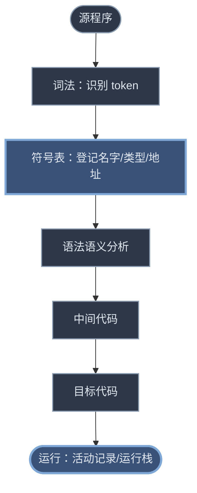

# 第七、八、九章 符号表与运行时存储组织

> 前面几章把源程序翻成了中间代码。**符号表**负责"记住名字"（每个标识符是什么类型、在哪、占多大），**运行时存储组织**负责"安排空间"（程序跑起来时，变量、形参、临时值都放哪、怎么找到）。
> 上游：[[学习笔记/计算机基础/编译原理/06-语义分析和中间代码.md|第六、七章 属性文法、语法制导翻译与中间代码]]（说明语句翻译填符号表、过程调用 param/call）· 关联：[[学习笔记/计算机基础/编译原理/05-语法分析-自下而上.md|第五章 语法分析——自下而上分析]]

> [!abstract] 本章主线
> 两件事：**符号表**（编译期管理名字）+ **运行时存储**（运行期安排空间）。
> 四大必考硬骨头：**参数传递 4 法**、**活动记录内容**、**静态链 / 动态链**、**DISPLAY 表构建**。

> [!info] 原材料说明
> 同济 PPT **无独立第八章**（从第七章直接跳第九章）。符号表的素材源自**第七章 slide 33–43**（说明语句翻译）和 **slide 92–94**（标号 goto），运行时用**第九章**。复习课把这两块合在"第八、九章"标题下。

---

## 0. 这块在干嘛（全景）



> [!tip] 一句话分工
> **符号表**是编译器在**编译时**用的"花名册"（查名字属性）；**活动记录 / 运行栈**是程序在**运行时**用的"工作台"（存本次调用的局部数据）。两者通过"相对地址 offset"对接——编译时算出 offset，运行时用它去活动记录里取。

---

## 1. 符号表

### 1.1 符号表是什么、贯穿编译全程（⭐ 复习课考点）

**符号表**：编译器用来记录每个名字（变量、过程、常量、标号…）属性的数据结构——每个名字一项，登记它的**种类、类型、相对地址、作用域**等。

> [!info] 符号表贯穿编译每个阶段（复习课明确考点）
> | 阶段 | 符号表干什么 |
> |---|---|
> | **词法** | 识别标识符，建/查符号表项 |
> | **语法** | 一般不动符号表 |
> | **语义** | 查类型做检查、把说明语句的属性（类型/偏移）填进去 |
> | **中间代码 / 优化** | 生成代码时查名字的地址；临时变量也登记 |
> | **目标代码** | 用符号表里的相对地址生成访问指令 |

### 1.2 说明语句的翻译：把名字填进符号表

说明语句（`var x: integer;`）不产生可执行代码，它的"翻译"就是**把名字的属性填进符号表**，并安排好相对地址。

变量说明文法 `D → id : T`，翻译方案：
```
D → id : T   { enter(id.name, T.type, offset);   ← 把名字/类型/当前偏移填入符号表
               offset := offset + T.width }       ← 偏移前移一个宽度
T → integer  { T.type:=integer; T.width:=4 }
T → real     { T.type:=real;    T.width:=8 }
T → array(num) of T₁ { T.type:=array(num,T₁.type); T.width:=num*T₁.width }
T → ↑T₁      { T.type:=pointer(T₁.type); T.width:=4 }
```

> [!example]- 例：`var a: array[10] of integer; x: real;` 的符号表登记
> 设 `offset` 从 0 开始：
> - `a`：`enter(a, array(10,int), 0)`，offset += 10×4 = 40 → offset=40
> - `x`：`enter(x, real, 40)`，offset += 8 → offset=48
>
> 符号表里 `a@0, x@40`，后续代码引用 `x` 就翻译成"活动记录起点 + 40"处的访问。

常量定义（`const pi=3.14`）类似：常量值存常量表、回送序号，再给标识符建符号表项（`add(id.entry, kind=CONSTANT, type, ord)`）。

### 1.3 ⭐ 嵌套过程的符号表（mktable / enter / addwidth / enterproc + 双栈）

Pascal 这类语言**过程可以嵌套定义**，于是每个过程要有**自己一张符号表**（不然同名的内层 `i` 和外层 `i` 分不清）。管理这些表的四个操作（必背）：

| 操作 | 作用 |
|---|---|
| `mktable(previous)` | **建一张新符号表**，表头记外层表指针 `previous`，返回新表指针 |
| `enter(table, name, type, offset)` | 在 `table` 里给 `name` **建一项**，填类型和相对地址 |
| `addwidth(table, width)` | 在 `table` 表头**记下本表所有名字的总宽度** |
| `enterproc(table, name, newtable)` | 在外层 `table` 里给**过程名** `name` 建一项，指向过程的 `newtable` |

**两个栈**配合（关键）：
- **`tblptr` 栈**：保存"当前正在处理的各层过程"的符号表指针，栈顶=当前过程表。
- **`offset` 栈**：保存各层过程的当前相对地址，栈顶=当前过程下一个名字的 offset。

> [!example]- 嵌套符号表结构（sort 例）：每过程一张表，表头指外层、外层登记过程名指内层
> ```mermaid
> flowchart TD
>     sortT(("sort 表<br/>a@0, x@44<br/>+过程名项"))
>     raT(("readarray 表<br/>i@0"))
>     exT(("exchange 表<br/>形参 i,j"))
>     qsT(("quicksort 表<br/>k@0,v@4<br/>+过程名项"))
>     partT(("partition 表<br/>i,j"))
>     sortT -- 表头previous --> nil((nil))
>     raT -- 表头 --> sortT
>     exT -- 表头 --> sortT
>     qsT -- 表头 --> sortT
>     partT -- 表头 --> qsT
>     sortT -. "enterproc 登记过程名→指向内层表" .-> raT
>     sortT -. enterproc .-> exT
>     sortT -. enterproc .-> qsT
>     qsT -. enterproc .-> partT
>     class sortT,raT,exT,qsT,partT state
>     class nil leaf
>     classDef state fill:#2d3748,stroke:#8a9bb0,stroke-width:1.5px,color:#e2e8f0
>     classDef leaf fill:#3b5278,stroke:#7fa8d6,stroke-width:2px,color:#e2e8f0
> ```
> **怎么走翻译方案**（`D → proc id; N D₁; S`）：进 `proc` 时 `mktable(top(tblptr))` 建新表、压 `tblptr`/`offset`；处理内层说明 `enter(...)`；退出过程时 `addwidth` 记总宽、`pop` 双栈、`enterproc` 在外层表登记该过程名。

### 1.4 标号与 goto 的符号表（拉链 + 回填）

标号 `L` 在符号表里有"**定义否**"栏和"**地址**"栏：
- 遇到 `L: S`（定义点）：把 `L` 置"已定义"，地址栏 = `S` 第一条四元式；若之前有"未定义"的 goto 指向它，一次性 `backpatch` 整条链。
- 遇到 `goto L`（使用点）：`L` 已定义 → 直接填地址；`L` 未定义 → **拉链**（把这条 goto 接到 `L` 的未定义链尾，目标先填 0），等定义点出现再回填。
- 这就是[[学习笔记/计算机基础/编译原理/06-语义分析和中间代码.md#6.4 标号与 goto 语句（简述）|向前转移]]必须用拉链 + 回填的原因。

---

## 2. 运行时存储划分与活动记录

### 2.1 运行时内存划分

目标程序运行时，内存分成四块：

| 区域 | 存什么 |
|---|---|
| **代码区 (Code)** | 目标代码（编译生成，只读） |
| **静态数据 (Static)** | 全局/静态变量（编译时就能定大小的） |
| **栈 (Stack)** | 过程活动的数据（活动记录，动态伸缩） |
| **堆 (Heap)** | 程序员动态申请/释放的数据（`new`/`malloc`） |

### 2.2 活动记录是什么

> [!abstract] 活动记录 (Activation Record)
> 为了管理**一次过程调用**所需信息，在栈顶分配的一块**连续存储区**。每进入一个过程就在栈顶"累筑"一个活动记录，退出时释放。
>
> 一次过程调用 = 一个活动 = 一个活动记录。

### 2.3 ⭐ 活动记录的内容（必考，记这个布局）

一个活动记录从**底（SP 指向）到顶（TOP 指向）**大致装这些（嵌套过程版）：

```text
TOP → ┌─────────────┐  ← 栈顶（下一个可用单元）
      │  临时单元    │  表达式求值的临时变量
      │  内情向量    │  数组的维数/上下界等信息
      │  局部变量    │  本过程说明的变量
      │  形式单元    │  存实参的地址或值
      │  静态链      │  指向【直接外层】的最新活动记录（存取链）
      │  动态链(老SP)│  指向【调用者】的活动记录（控制链）
      │  返回地址    │  调用完回到哪
SP →  └─────────────┘  ← 本活动记录起点
```

> [!danger] 静态链 vs 动态链（必考辨析）
> | | **静态链**（存取链 access link） | **动态链**（控制链 control link / 老 SP） |
> |---|---|---|
> | 指向谁 | 本过程的**直接外层**（按程序文本的嵌套关系）的最新活动记录 | **调用本过程**的那个过程的活动记录 |
> | 用来干嘛 | 找**非局部变量**（外层定义的名字） | 过程**返回时恢复现场**（找回调用者的 SP/TOP） |
> | 由谁决定 | 程序的**静态结构**（源代码里谁套在谁里面） | **调用关系**（运行时谁调了谁） |

> [!tip] 什么时候静态链 ≠ 动态链？
> 当**调用者 ≠ 直接外层**时两者不同。最典型是**递归**：过程 R 的直接外层是 Q，但 R 递归调用自己时，新 R 的**动态链指向旧 R**（调用者），**静态链却指向 Q**（直接外层）。详见 §4。

对局部变量 `X` 的引用 = **变址访问** `dx[SP]`：`dx` 是 `X` 相对活动记录起点的偏移（编译时可定），`SP` 是当前活动记录起点。

### 2.4 静态分配 vs 动态分配

| | 静态分配（FORTRAN） | 动态分配（Pascal/C） |
|---|---|---|
| 何时定空间 | **编译时**全确定 | 运行时动态 |
| 能否递归 | ❌ 不允许 | ✅ 允许 |
| 可变数组 | ❌ | ✅ |
| 方式 | 每数据对象固定单元 | **栈式**（活动记录）/ **堆式**（malloc） |

> [!info] FORTRAN 静态分配的临时变量重用（slide 34–35）
> FORTRAN 的临时变量"定值一次、引用一次"，可以用**栈式重用**省空间：`X:=A*B-C*D+E*F` 需要 T1~T5，但 T3 可复用 T1 的单元、T4 复用 T2、T5 复用 T1，于是 5 个临时变量只要 **2 个单元**（地址 a 和 a+1）。

---

## 3. ⭐ 参数传递 4 法（必考大题）

调用和被调用过程之间通过**参数**传信息：形参（过程定义里的 `x,y,z`）vs 实参（调用时传的 `A+B,A,A`）。四种传递方式结果**完全不同**，是期末大题常客。

> [!danger] 先记住这张总表
> | 方式 | 传的是 | 形参单元存 | 过程体内形参= |
> |---|---|---|---|
> | **传值** call by value | 实参的**值** | 实参的值 | 一个局部副本（改了不影响实参） |
> | **传地址** call by reference | 实参的**地址** | 实参的地址 | 对地址单元的**间接访问** |
> | **得结果** call by result | 地址+值（双单元） | 第一单元存地址、第二单元存值 | 直接访问第二单元；返回前把第二单元写回实参 |
> | **传名** call by name | 实参的**文字** | —（不预计算） | 把过程体抄到调用处、形参文字替换成实参 |

### 3.1 传值（call by value）

- 调用段先把实参的**值**算出来；
- 被调用段把值**抄进**形参单元；
- 形参当**局部变量**用，过程体里改它**不影响实参**。

### 3.2 传地址（call by reference）

- 调用段把实参的**地址**传到被调用段能拿到的地方（简单变量直接传地址；表达式 `A+B` 先算出值存临时单元 `T`，传 `T` 的地址）；
- 被调用段把地址抄进形参的形式单元；
- 过程体对形参的**引用 / 赋值 = 对该地址单元的间接访问**（改形参就是改实参）。

### 3.3 得结果（call by result）

传地址的**变形**（但不等价）：
- 每个**形参两个单元**：第一单元存实参**地址**，第二单元存实参**值**；
- 过程体对形参的访问 = 对**第二单元**的直接访问；
- **返回前**把第二单元的内容**写回**第一单元所指的实参单元。

### 3.4 传名（call by name）

- **不预先计算**实参，而是把过程体**抄到调用处**，凡出现形参的地方**文字替换**成实参；
- 等价于把实参当成一个"参数子程序"，每次用到形参就去算一次实参。

### 3.5 ⭐⭐ 综合例题：`P(A+B, A, A)` 四种方式各输出多少

```text
procedure P(x, y, z)
begin
    y := y + 1;
    z := z + x;
end

begin A := 2; B := 3; P(A+B, A, A); print A; end
```
三个实参：`A+B`(=5)、`A`、`A`。注意 **y 和 z 都绑定 A**——这是题目的"坑"。

> [!example]- ① 传地址 → A = **8**
> `A+B` 是表达式 → 算出 5 存临时单元 `T`，传 `T` 的地址；两个 `A` 传 `A` 的地址。
> - `x → T 地址(值 5)`，`y → A 地址(值 2)`，`z → A 地址(值 2)`（**y、z 都指向 A**）
> - `y:=y+1` → `A := A+1` → **A=3**
> - `z:=z+x` → `A := A + T↑` = `3 + 5` → **A=8**
> - 输出 **8**。

> [!example]- ② 得结果 → A = **7**
> 每形参两单元（地址 / 值）：`x:(T,5)`、`y:(A,2)`、`z:(A,2)`，过程体访问**值单元**。
> - `y:=y+1` → y 的值单元 `2+1=3`
> - `z:=z+x` → z 的值单元 `2+5=7`（注意 z、y 的值单元**各自独立**，没被 y 那步影响）
> - **返回前**写回实参：y 的值单元 3 → 写回 A → A=3；z 的值单元 7 → 写回 A → **A=7**
> - 输出 **7**。

> [!example]- ③ 传值 → A = **2**
> 实参值抄入形参：`x=5, y=2, z=2`，形参是**局部副本**。
> - `y:=y+1` → 局部 y=3
> - `z:=z+x` → 局部 z=2+5=7
> - 改的都是副本，**A 不动** → 输出 **2**。

> [!example]- ④ 传名 → A = **9**
> 过程体抄到调用处，形参文字替换：`x↔A+B, y↔A, z↔A`：
> ```text
> A := 2;  B := 3;
> A := A + 1;        ← y:=y+1，y 换成 A → A=3
> A := A + (A+B);    ← z:=z+x，z 换成 A、x 换成 A+B → A = 3 + (3+3) = 9
> print A;
> ```
> 输出 **9**。

> [!success] 四种方式结果对照
> | 方式 | 输出 A |
> |---|---|
> | 传地址 | **8** |
> | 得结果 | **7** |
> | 传值 | **2** |
> | 传名 | **9** |

> [!question]- ⭐ 练习（PPT slide 19）：`P(a+b, a-b, a, a)`，a=5, b=3，求四种方式输出
> 程序：
> ```text
> procedure P(w, x, y, z)
> begin
>     y := y * w;
>     z := z + x;
> end
> begin a := 5; b := 3; P(a+b, a-b, a, a); write(a); end
> ```
> 实参对应：`w↔a+b(=8)`、`x↔a-b(=2)`、`y↔a`、`z↔a`（**y 和 z 都绑定 a**）。
>
> **① 传值 → a = 5**
> 值抄入副本：w=8, x=2, y=5, z=5。`y:=y*w` 局部 y=40；`z:=z+x` 局部 z=7。改的是副本，**a 不变 = 5**。
>
> **② 传地址 → a = 42**
> `a+b`、`a-b` 先算出存临时 T1=8、T2=2，传地址；两个 `a` 传 a 的地址。
> - w→T1(8), x→T2(2), y→a(5), z→a(5)，**y、z 都指向 a**
> - `y:=y*w` → `a := a * T1↑` = `5*8 = 40` → a=40
> - `z:=z+x` → `a := a + T2↑` = `40+2 = 42` → a=42
>
> **③ 得结果 → a = 7**
> 每形参两单元（地址 / 值），过程体访问**值单元**：w:(T1,8)、x:(T2,2)、y:(a,5)、z:(a,5)。
> - `y:=y*w` → y 的值单元 = `5*8 = 40`
> - `z:=z+x` → z 的值单元 = `5+2 = 7`（z 的值单元仍是 5，**不受 y 那步影响**，两者各自独立）
> - 返回前写回实参：y 的 40 → a=40；z 的 7 → a=**7**（最后写回的覆盖）
>
> **④ 传名 → a = 77**
> 过程体抄到调用处、形参文字替换：`y↔a, w↔a+b, z↔a, x↔a-b`
> ```text
> a := 5;  b := 3;
> a := a * (a+b);     ← y:=y*w → a = 5*(5+3) = 40
> a := a + (a-b);     ← z:=z+x → a = 40+(40-3) = 77
> write(a);
> ```
>
> **答案**：传值 **5** / 传地址 **42** / 得结果 **7** / 传名 **77**。
> **易错点**：传名每次用到形参都**重新代入当时的实参值**——第二句 `a-b` 里的 `a` 已是 40（不是 5），所以是 `40-3=37`；若错代入初值 5 会得到 `40+(5-3)=42`（错）。

---

## 4. ⭐ 栈式分配与非局部名字的访问

### 4.1 简单栈式（C 语言：无嵌套过程）

C **不允许过程嵌套定义**（过程里不能再定义过程），但允许递归。所以**没有静态链**——非局部数据（全局变量）静态分配在栈底，局部数据进活动记录。

活动记录内容（C 版）：`老SP | 返回地址 | 参数个数 | 形式单元 | 局部变量 | …`

> [!info] 过程调用 / 进入 / 返回（用 SP、TOP 指针）
> - **调用** `call P,n`：`1[TOP]:=SP`（保护老 SP）、`3[TOP]:=n`（参数个数）、`JSR P`（转子）。每个 `par Ti`：`(i+3)[TOP]:=Ti`（传值）或 `addr(Ti)`（传地址）。
> - **进入 P**：`SP:=TOP+1`（新 SP）、`1[SP]:=返回地址`、`TOP:=TOP+L`（新 TOP，L=P 活动记录大小，编译时可定）。
> - **返回**：`TOP:=SP-1`（恢复 TOP）、`SP:=0[SP]`（恢复老 SP）、`X:=2[TOP]`（取返回地址）、`UJ 0[X]`（跳回）。

### 4.2 嵌套过程栈式（Pascal：有嵌套 + 递归）

Pascal 过程**嵌套定义**，内层过程能访问外层变量 → 需要**静态链**或 **DISPLAY 表**来找非局部数据。

> [!info] Pascal 过程调用规则（了解，能解释嵌套可见性）
> 主程序可直接调第 1 层；过程能调自己的直接内层、自己（递归）、以及外层；并列过程中"后说明的可调先说明的"。这些规则决定了谁能调谁，进而影响静态链的指向。

### 4.3 ⭐ 静态链怎么定（确定规则）

设调用前过程在 `SP`，被调用过程的静态链 `SL` 指向其**直接外层**的活动记录：

| 调用关系 | 被调用过程的静态链 = |
|---|---|
| 第 N 层调第 **N+1** 层（调直接内层） | 调用者的 `SP`（`SL(N+1)=SP(N)`） |
| 第 N 层调第 **N** 层（同层，如递归自己） | 调用者的**静态链**（`SL(N+1)=SL(N)`） |
| 第 N 层调第 **N−x** 层（调外层） | 沿调用者的静态链**向前走 x 步** |

> [!tip] 直觉
> 被调用过程的"直接外层"是固定的（由源代码嵌套结构定）。所以只需找到"调用者活动记录里、代表那个直接外层的位置"——三种调用关系对应三种找法。

### 4.4 ⭐⭐ DISPLAY 表（嵌套层次显示表）

> [!danger] DISPLAY 表是什么
> 一个**指针数组**，第 `i` 项存"第 `i` 层过程的**最新活动记录**的起始地址"。当前运行过程通过它**一步到位**找到任意外层的数据，**不用沿静态链一步步爬**。
>
> DISPLAY 表作为活动记录的一部分，进入过程时建立。

**⭐ 构建方法（必考）**：

> [!danger] 当 P1 调用 P2、进入 P2 时，P2 的 DISPLAY 表怎么建？
> **从 P1 的 DISPLAY 表自底向上取 `l₂` 个单元**（`l₂` = P2 的层数），**再添上 P2 自己的新 SP**，就构成 P2 的 DISPLAY 表。
> - 实现上：把 **P1 的 DISPLAY 地址**作为连接数据（"全局 DISPLAY"）传给 P2，P2 进来后照此拷贝 + 加一项。

> [!example]- 例：P2 是第 2 层，P1 是第 1 层
> - P1 的 DISPLAY（2 项）：`[P0 的 SP, P1 的 SP]`
> - 进入 P2：取 `l₂=2` 个 → `[P0 的 SP, P1 的 SP]`，再加 P2 的 SP → P2 的 DISPLAY = `[P0 的 SP, P1 的 SP, P2 的 SP]`
>
> 引用第 `k` 层过程的变量 `X`：先 `LD R1, (d+k)[SP]` 取出第 k 层活动记录起点（d 是 DISPLAY 表在活动记录里的相对位置），再 `LD R2, dx[R1]` 取变量。

### 4.5 ⭐⭐ 嵌套过程运行栈构造例（主程序 P → S → Q → R）

源程序嵌套结构（静态嵌套，决定静态链）：P(0层) 里定义 S(1层)，S 里定义 Q(2层)？——以 PPT 例为准：P→S→Q→R→R 的**调用链**，注意静态嵌套关系是 P 套 S 套 Q 套 R。

> [!example]- 运行栈快照（P→S→Q→R，展示静态链 vs 动态链）
> ```mermaid
> flowchart TD
>     top(["TOP →"])
>     RRec(["R 的活动记录<br/>动态链→R?, 静态链→Q<br/>形参 u,v; 局部 c,d"])
>     QRec(["Q 的活动记录<br/>动态链→S, 静态链→S<br/>形参 b; 局部 i"])
>     SRec(["S 的活动记录<br/>动态链→P, 静态链→P<br/>局部 c,i"])
>     PRec(["P 的活动记录<br/>动态链→0, 静态链→0<br/>局部 a,x"])
>     top --- RRec
>     RRec --> QRec
>     QRec --> SRec
>     SRec --> PRec
>     RRec -. "静态链（找外层Q）" .-> QRec
>     QRec -. "静态链（外层S）" .-> SRec
>     SRec -. "静态链（外层P）" .-> PRec
>     class RRec,QRec,SRec,PRec state
>     classDef state fill:#2d3748,stroke:#8a9bb0,stroke-width:1.5px,color:#e2e8f0
> ```
> - **动态链**：每一层都指向**调用者**（R←Q←S←P，因为正是这个调用链把栈筑起来）。
> - **静态链**：每一层指向**直接外层**。在本例调用链恰好 = 嵌套链，所以静态链和动态链**同向**。
> - **关键区别**看递归 `R→R`（PPT slide 55）：新 R 的**动态链指旧 R**（调用者），但**静态链指 Q**（直接外层，因为 R 的外层是 Q 不是 R 自己）——这就是两条链必须分开的原因。
>
> 每个活动记录里还存：返回地址、形参单元、局部变量等（见 §2.3 布局）。完整栈中每个字段的 SP 相对地址都在 PPT slide 51–55 逐格画出。

> [!info] 用 DISPLAY 表的运行栈（slide 65–68）
> 带 DISPLAY 时，活动记录里多两项：**全局 DISPLAY**（调用者传来的 DISPLAY 地址）和**本过程 DISPLAY 表**。进入过程时按 §4.4 的方法从全局 DISPLAY 拷贝、加本层 SP，建好自己的 DISPLAY。之后访问任意外层变量都从 DISPLAY 直接取地址，不再爬静态链。

---

## ✅ 自测题（先自己想，再展开答案）

> [!question]- Q1. 符号表在编译各阶段分别起什么作用？
> 词法：识别标识符建/查项；语义：查类型做检查、填说明语句的属性（类型/偏移）；中间代码/优化：查名字地址、登记临时变量；目标代码：用相对地址生成访问指令。语法阶段一般不动。

> [!question]- Q2. 嵌套过程符号表的四个操作 mktable/enter/addwidth/enterproc 各干什么？tblptr/offset 栈呢？
> `mktable(prev)` 建新表（表头记外层）；`enter(t,name,type,offset)` 建名字项；`addwidth(t,w)` 记表总宽；`enterproc(t,name,newt)` 在外层登记过程名指向内层表。`tblptr` 栈存各层符号表指针（栈顶=当前），`offset` 栈存各层当前相对地址。

> [!question]- Q3. ⭐ 活动记录里静态链和动态链的区别？
> 静态链指向本过程**直接外层**（按源码嵌套）的活动记录，用来找**非局部变量**；动态链（老 SP）指向**调用者**的活动记录，用来**返回时恢复 SP/TOP**。当调用者≠直接外层（如递归）时两者不同。

> [!question]- Q4. ⭐ 简述参数传递 4 法，各举一个"会改变实参 / 不改变"的判断。
> - 传值：传值，形参是副本，**不改实参**；
> - 传地址：传地址，间接访问，**改实参**；
> - 得结果：地址+值双单元，返回前写回实参，**改实参**（但与传地址不等价）；
> - 传名：文字替换抄过程体，**改实参**（且每次用到形参都重新代入）。

> [!question]- Q5. ⭐ `P(A+B,A,A)`（A=2,B=3），传地址 / 得结果 / 传值 / 传名 各输出多少？
> 传地址 **8**、得结果 **7**、传值 **2**、传名 **9**。详见 §3.5。

> [!question]- Q6. ⭐ 第 N 层调第 N+1 层、调同层、调第 N−x 层，被调过程的静态链分别怎么定？
> N→N+1：`SL = 调用者 SP`；N→N（同层/递归）：`SL = 调用者的静态链`；N→N−x：沿调用者静态链走 x 步。

> [!question]- Q7. ⭐ DISPLAY 表是什么？进入 P2 时它的 DISPLAY 表怎么建？
> DISPLAY 是指针数组，第 i 项存第 i 层过程最新活动记录的起点，用来直接访问任意外层数据（不用爬静态链）。进入 P2 时：**从 P1 的 DISPLAY 自底向上取 `l₂` 个**（l₂=P2 层数），**再加 P2 的新 SP**，即为 P2 的 DISPLAY。P1 的 DISPLAY 地址作为"全局 DISPLAY"传给 P2。

> [!question]- Q8. 递归调用 R→R 时，新 R 的静态链和动态链分别指向哪？为什么不同？
> 新 R 的**动态链指向旧 R**（调用者），**静态链指向 Q**（R 的直接外层）。因为静态关系由源码定（R 嵌在 Q 里），不因递归而变；而调用关系是旧 R 调用了新 R。

---

## 📌 速查表

| 问 | 答案要点 |
|---|---|
| 符号表 | 编译期记名字属性（种类/类型/地址/作用域），贯穿各阶段 |
| enter | 建名字项，填类型+offset |
| mktable(prev) | 建新表，表头指外层 |
| addwidth | 记本表总宽度 |
| enterproc | 外层登记过程名→内层表 |
| tblptr/offset 栈 | 各层符号表指针 / 各层当前偏移 |
| 标号 goto | 未定义标号拉链，定义时 backpatch |
| 内存划分 | 代码 / 静态数据 / 栈 / 堆 |
| 活动记录 | 一次过程调用的一块连续存储区 |
| 静态链 | 指向直接外层活动记录，找非局部 |
| 动态链(老SP) | 指向调用者活动记录，返回恢复现场 |
| 局部变量访问 | 变址 `dx[SP]` |
| 静态分配 | FORTRAN，编译时定，不可递归 |
| 动态分配 | Pascal/C，栈式/堆式，可递归 |
| 传值 | 传值，副本，不改实参 |
| 传地址 | 传地址，间接访问，改实参 |
| 得结果 | 双单元，返回前写回实参 |
| 传名 | 文字替换抄过程体 |
| `P(A+B,A,A)` 结果 | 地址8 / 得结果7 / 传值2 / 传名9 |
| 静态链 N→N+1 | SL=调用者 SP |
| 静态链 N→N | SL=调用者静态链 |
| 静态链 N→N−x | 沿调用者静态链走 x 步 |
| DISPLAY | 指针数组，第 i 项=第 i 层最新活动记录起点 |
| DISPLAY 构建 | 从调用者 DISPLAY 取 l₂ 个 + 本层 SP |
| 全局 DISPLAY | 把调用者 DISPLAY 地址作连接数据传出 |

---

## 下一步

- 回到 00-总览 · 上游 [[学习笔记/计算机基础/编译原理/06-语义分析和中间代码.md|第六、七章 属性文法、语法制导翻译与中间代码]]
- 后续：1.8 第十章 优化（DAG 优化四元式、循环优化三件套）
